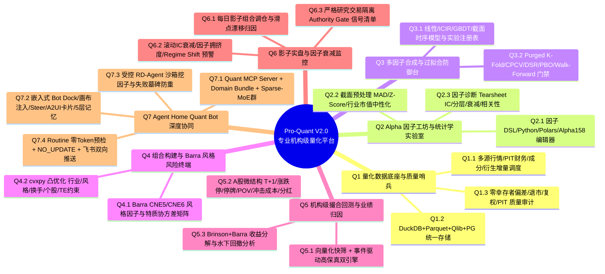
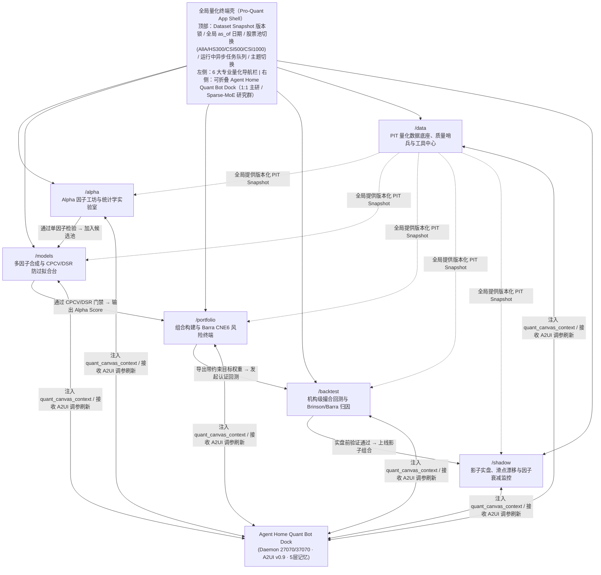

# 专业机构级量化分析平台（Pro-Quant Research Platform）详细 PRD-Map V2.0

> **文档状态**：Pro-Quant V2.0 架构与产品全景基线（彻底重构自 V0.1 研报工作台，待评审拍板）  
> **统一对齐契约**：[V2-QUANT-CONTRACT.md](V2-QUANT-CONTRACT.md)（严格遵循 `Q1–Q7` 产品域编号与 `quant_*` MCP 工具契约）  
> **配套交付**：[02-dev-plan.md](02-dev-plan.md)（分阶段开发与定量验收计划） · [03-agent-home-integration.md](03-agent-home-integration.md)（Agent Home 深度双向集成架构） · [03-quant-gap-and-data-tooling.md](../research/03-quant-gap-and-data-tooling.md)（机构级 8 大 Gap 与量化数据/工具实战方案） · [prototype-v1-quant.html](../design/prototype-v1-quant.html)（专业量化终端高保真原型）

---

## 1. 专业量化产品战略定位与目标用户画像

### 1.1 为什么彻底转向 Pro-Quant V2.0？
绝大多数个人与中小团队自建的“量化原型”（包括本机旧原型 `quant-akshare-qlib-rdagent`），在真实资金与严谨投研视角下存在 **8 道致命鸿沟**：
1. **数据失真与未来函数**：用前复权价格直接回测、缺乏退市股与历史指数成分（幸存者偏差）、无财报发布日 PIT（Point-in-Time）时间戳，甚至上游失败时静默退化为随机游走合成行情；
2. **因子研究停留在拍脑袋**：缺截面去极值/行业市值中性化、缺 RankIC/ICIR/t-stat/10 分层单调性/半衰期/相关性正交诊断；
3. **零过拟合防线**：反复调参后只看样本内年化收益，缺乏 Purged K-Fold / CPCV（组合清除交叉验证）、DSR（Deflated Sharpe Ratio）与 PBO（过拟合概率）硬门禁；
4. **裸奔的风格风险**：把“押注小微盘/低流动性 Beta”错当成“纯 Alpha”，无 Barra CNE5/CNE6 风格与特质风险协方差模型；
5. **玩具级等权拼盘**：无 `cvxpy` 凸优化器，无法同时约束行业中性、风格暴露上下界、单股权重上限、换手率惩罚与成分股偏离；
6. **失真的理想撮合回测**：忽略 A 股 T+1、一字涨跌停买不进/卖不出、停牌冻结、成交量参与率上限（POV）与冲击成本，纸面年化 40% 实盘直接腰斩；
7. **回测完就失明**：没有影子盘（Shadow Portfolio）每日对照实盘滑点漂移，也没有滚动 IC 衰减与状态切换（Regime Shift）监控；
8. **AI 停留在硬编码模板或失忆聊天框**：缺乏跨实验长期记忆、防重复试错墓碑库、长任务零 Token 挂起与交互式调参卡片。

### 1.2 核心定位与四条不可违背的量化铁律
- **产品定位**：面向专业量化研究员与量化/复合中小私募研究台的 **机构级 AI-Native 多因子量化研发与风控终端（Pro-Quant Research Platform）**——以 **A 股（全 A / 沪深 300 / 中证 500 / 中证 1000 / 国证 2000）日频多因子与指数增强为主战场**，架构原生预留 **ETF / 股指期货（贴水对冲）/ 期权 / 分钟级量价及美港股** 扩展。
- **四条量化铁律**：
  1. **确定性数理内核与 LLM 认知彻底解耦**：所有 PIT 面板拼接、因子截面计算、CPCV/DSR 检验、Barra 协方差、`cvxpy` 求解、A 股微结构撮合与归因 100% 由确定性 Python（DuckDB/Polars/NumPy/cvxpy）引擎完成；LLM 严禁口算统计量或直接改写净值。
  2. **零未来函数 & 零幸存者偏差硬红线**：行情永存未复权原始价 + 复权因子 + 公司行动现金流；财报按 `ann_date`（发布日）PIT 生效；股票池强制包含已退市股票与历史时点指数成分及历史申万行业归属。
  3. **统计门禁先于入库（No Gate, No Alpha）**：任何手工或 RD-Agent 挖掘的候选因子/模型，未经 CPCV / DSR / PBO / 增量相关性硬门禁检验，严禁晋升正式因子池或进入影子组合。
  4. **不重复造 Agent 轮子 + 物理交易隔离**：所有对话、5 层长期记忆、Sparse-MoE 专家群、A2UI 调参审批、定时例行巡检与飞书双向触达 **100% 复用本机 Agent Home（`ppeng-agent-core`）**；系统严守研究/交易边界，**绝不接入实盘自动下单接口**。

### 1.3 目标用户画像与核心任务（JTBD）

| 用户层级 | 典型画像 | 当前真实痛点 | 核心诉求（Jobs-To-Be-Done） | 对应阶段 |
| :--- | :--- | :--- | :--- | :---: |
| **U0 核心主研** | **独立专业量化研究员 / 个人量化工作室**（管理自有资金或专户，聚焦 A 股多因子选股与指增策略） | 免费爬虫口径混乱不敢上真金白银；手写 Jupyter 脚本文档散落、实验不可复现；缺少工业级 Barra 风险约束与真实微结构回测 | ① 一套本地可跑、零幸存者偏差的 DuckDB/Parquet PIT 数据湖；② 几分钟跑完新因子截面诊断 + 真实 A 股撮合回测；③ 右侧 Quant Bot 记住所有淘汰教训并帮调约束参数 | **Phase 0 – MVP** |
| **U1 复合投研台** | **中小量化私募 / 量化+基本面复合（Quantamental）研究团队**（2–8 名研究员，需统一因子库、风控标准与归因复盘） | 商业机构平台（优矿/米筐机构版/Barra Direct）动辄数十万/年且难以深度集成自研 AI；团队内因子共线性严重、回撤归因不清 | ① 统一 Experiment Registry + CPCV/DSR 防过拟合门禁；② CNE6 风格暴露 + `cvxpy` 全约束优化；③ Brinson+Barra 收益拆解；④ Sparse-MoE 专家 Bot 群协同审计 | **V1 核心深化** |
| **U2 自动化因子工厂** | **AI-Assisted Alpha 研发流**（希望夜间持续受控挖因子、盘后自动监控因子衰减与滑点漂移） | 无监督 LLM 挖因子极易过拟合、重复产出垃圾公式、空烧算力与 Token；实盘偏离回测后知后觉 | ① 夜间受控 RD-Agent 沙箱循环 + CPCV 硬门禁淘汰 + 失败入 `project.memory` 墓碑库；② 盘后影子组合自动对账滑点并经飞书 `[NO_UPDATE]` 智能推送 | **V2 闭环放大** |

---

## 2. 全景 PRD-Map（7 大产品域 `Q1–Q7` × 27 核心模块）

### 2.1 七大域 × 27 模块详细规格矩阵

| 模块 ID | 所属域 | 功能模块名称 | 核心数学 / 统计指标与工程协议 | 输入 / 输出契约 | 阶段 | Agent Home Bot 联动点 |
| :--- | :---: | :--- | :--- | :--- | :---: | :--- |
| **Q1.1.1** | **Q1** | 多源行情与复权公司行动适配器 | 原始未复权 OHLCV + `adj_factor` + 分红/送转/配股现金流表；支持 Tushare Pro / RQData / 掘金 / BaoStock 降级（**严禁合成假行情回退**） | In: 数据源 Token + 增量日期区间 Out: 分区 Parquet（`bars_raw`, `corp_actions`） | Phase 0 | `quant_data_health` 巡检异常源状态 |
| **Q1.1.2** | **Q1** | PIT 财务、历史成分与历史申万行业入湖 | 双时态键 `(report_period, ann_date, first_seen_at)`；保留已退市标的；按日生效的沪深 300/中证 500/1000 历史成分与申万 2014/2021 变更链 | In: 季报/预告/快报/指数权重/申万映射 Out: `pit_financials`, `universe_hist`, `sw_industry_hist` | Phase 0 | `quant_query_pit_panel`, `quant_universe_constituents` |
| **Q1.1.3** | **Q1** | 特色量价与跨资产扩展数据流 | 两融余额与融券余量、龙虎榜席位、卖方一致预期（EPS 边际修正）、股指期货（IF/IC/IM）基差贴水、ETF 申赎、分钟线 | In: 扩展数据源增量批次 Out: `margin_lhb`, `consensus_pit`, `futures_basis`, `bars_1m` | V1 / V2 | `data-ops` 监控贴水成本与数据完整性 |
| **Q1.2.1** | **Q1** | DuckDB + Parquet 湖仓与不可变快照 | 按 `market/freq/year` 分区 Parquet + DuckDB 列式 OLAP 视图 + 不可变 `dataset_snapshot_id`（SHA-256 manifest） | In: ETL 增量表 Out: 只读版本化快照指针（实验 100% 可复现） | Phase 0 | 所有 `quant_*` 工具返回强制附带 `snapshot_id` |
| **Q1.2.2** | **Q1** | Qlib Bin 自动构建与 PG 元数据注册表 | 增量同步至 Qlib binary provider（带文件签名校验防脏写）；PostgreSQL 承载证券生命周期、任务状态与 Experiment Registry | In: Parquet 增量清单 Out: Qlib `freq_1d` provider + PG 元数据行 | Phase 0 | `quant_list_experiments` 检索元数据 |
| **Q1.3.1** | **Q1** | PIT / 零幸存者偏差 / 复权自动化哨兵 | 7 项日终硬审计：停复牌断档、退市覆盖、拆股复权跳空误差 `< 1e-6`、财报 `ann_date < report_end` 非法倒挂检测、空值率漂移 | In: 最新入湖快照 Out: 红黄绿质量审计报告 + `fact_fingerprint` | Phase 0 | 08:30 Routine 调 `quant_data_health`；全绿 `[NO_UPDATE]` |
| **Q2.1.1** | **Q2** | 因子表达式 DSL / Polars / Qlib Alpha158 编辑器 | Monaco 代码编辑器；支持内置 Alpha158 算子、声明式时间序列/截面 DSL（`Rank`, `TsMean`, `DecayLinear`, `Corr`）与受限 Python/Polars 脚本 | In: 表达式 / 脚本 + 目标股票池 + 日期区间 Out: AST 安全校验结果 + 因子面板句柄 | MVP | `quant-lead` 解释公式并直接把修改建议推入编辑器 |
| **Q2.1.2** | **Q2** | 因子版本库与元数据谱系（Factor Catalog） | 记录因子大类（量价/反转/动量/质量/估值/预期/另类）、经济逻辑、计算复杂度、数据依赖与当前状态（`draft/candidate/prod/retired`） | In: 因子定义 + 评审记录 Out: 版本化 `factor_id@vN` | MVP | `project.memory` 自动同步淘汰原因墓碑 |
| **Q2.2.1** | **Q2** | 标准化截面预处理管线 | 逐截面执行：剔除 ST/次新/停牌/涨跌停样本 → MAD（$3\times 1.4826\cdot\text{MAD}$）或分位数去极值 → 行业中位数缺失值处理 → Z-Score / Rank 标准化 → WLS 申万一级行业 + 对数流通市值正交中性化 | In: 原始因子矩阵 + 预处理配置 JSON Out: 标准化中性因子面板 + 预处理前后分布直方图 | MVP | `quant_eval_factor` 参数化控制预处理流水线 |
| **Q2.3.1** | **Q2** | 单因子统计学诊断 Tearsheet | RankIC（Spearman）、Pearson IC、ICIR、Newey-West 调整 $t$-stat、IC 胜率、10 分层等权/市值加权净值与单调性 Spearman $\rho$、多空净值、IC 衰减（Lag 1/5/10/20 半衰期）、双边换手率、分年度/分市值/分行业稳定性 | In: 中性化因子 + 远期收益周期（T+1 Open 到 T+N Open） Out: 诊断摘要 JSON（≤4KB）+ 完整图表 Parquet | MVP | `quant_eval_factor` 供 Bot 诊断因子有效性与衰减 |
| **Q2.3.2** | **Q2** | 因子相关性矩阵、VIF 共线性与增量检验 | 计算候选因子与现有在产因子库的截面平均相关系数、最大相关对手、方差膨胀因子（VIF）、正交剥离后的边际 $\Delta\text{ICIR}$ | In: 候选因子 + 基准因子池 Out: 相关性热力图 + Top-15 高相关对 + 增量检验结论 | MVP | `quant_factor_correlation` 阻断同质重复因子 |
| **Q3.1.1** | **Q3** | 多因子合成与截面/时序模型训练引擎 | 等权 / ICIR 加权 / 滚动 Ridge / Lasso / LightGBM / CatBoost / RankNet（LambdaRank）；严格按交易日滚动训练窗口（Expanding / Rolling Window） | In: 因子集合 + 目标标签（行业中性超额收益）+ 超参网格 Out: 样本外逐日预测打分 `alpha_score` + 特征重要性 | V1 | Bot 对比多模型 OOS ICIR 与换手权衡 |
| **Q3.1.2** | **Q3** | 统一实验注册表（Experiment Registry） | 每次训练/验证强制绑定 `git_sha`、`dataset_snapshot_id`、随机种子、特征列表、超参、验证指标与产物路径，支持多实验并行 Diff | In: 实验配置与指标 Out: 不可篡改 `experiment_id` 谱系图 | MVP (基础) / V1 (完整) | `quant_list_experiments` 跨轮检索对照 |
| **Q3.2.1** | **Q3** | Purged K-Fold & CPCV 组合清除交叉验证 | 遵循 Lopez de Prado《AFML》标准：按标签持有期执行 **Purge（清除重叠区间）+ Embargo（隔离缓冲期）**，生成 $\binom{N}{k}$ 条样本外净值路径分布 | In: 策略/模型 + $N$ 折数 + $k$ 测试折数 + Embargo 天数 Out: CPCV OOS Sharpe 分布、路径稳定性与 **PBO（过拟合概率）** | V1 | `quant_run_cpcv_gate` 异步 `wait_for` 零 Token 等待 |
| **Q3.2.2** | **Q3** | 多重检验校正门禁（DSR & Walk-Forward） | 计算 **Deflated Sharpe Ratio（DSR）**（计入历史累计试错次数 $M$、收益偏度与峰度）、White's Reality Check / SPA 检验、滚动样本外衰减比（OOS/IS Sharpe Ratio） | In: 候选收益序列 + 试验计数 $M$ Out: 硬门禁裁决（`PASS`/`REJECT`）+ 失败诊断码 | V1 | A2UI 审批卡展示 `DSR/PBO` 决定是否晋升生产库 |
| **Q4.1.1** | **Q4** | Barra CNE5/CNE6 风格风险模型引擎 | 逐日截面 WLS 估计 **10 大风格因子**（Size, Beta, Momentum, ResidualVolatility, NonlinearSize, Book-to-Price, Liquidity, EarningsYield, Growth, Leverage）+ 31 个申万一级行业因子收益与暴露矩阵 $X_t$ | In: PIT 行情/财务/历史行业面板 Out: 逐日风格暴露 $X_t$、因子收益 $f_t$、特质残差 $u_t$ | MVP (基础暴露) / V1 (完整协方差) | `quant_barra_exposure` 诊断组合隐性 Beta |
| **Q4.1.2** | **Q4** | 因子协方差与特质风险矩阵估计 | 指数加权半衰期协方差 + **Newey-West 自相关调整** + **Eigenfactor 特征值风险调整** + Ledoit-Wolf / 贝叶斯收缩特质方差 $\Delta_t$ | In: $f_t, u_t$ 历史序列 Out: 半正定风险矩阵 $\Sigma_t = X_t F_t X_t^\top + \Delta_t$ | V1 | 驱动组合预测跟踪误差（TE）计算 |
| **Q4.2.1** | **Q4** | `cvxpy` 机构级带约束凸优化器 | 目标函数 $\max_w \alpha^\top w - \frac{\gamma}{2}(w-w_b)^\top \Sigma (w-w_b) - \lambda \|w - w_{t-1}\|_1$；约束含：资金/做多约束、行业主动偏离上下限、Barra 风格暴露上下界、单股权重上限、成分股权重下限（如指增 ≥80%）、流动性参与率上限与换手硬上限；支持 `infeasible` 软松弛诊断 | In: Alpha 打分、$\Sigma_t$、基准权重 $w_b$、约束配置 Out: 最优目标权重 $w_t^*$、求解器状态、约束触界灵敏度（影子价格） | MVP (轻量) / V1 (完整) | `quant_optimize_portfolio` + A2UI 滑块实时重跑优化 |
| **Q5.1.1** | **Q5** | 双模回测架构（向量化快筛 + 事件驱动高保真） | **快筛模式**（VectorBT/Polars 秒级扫参）与 **认证模式**（事件驱动逐日/逐 Bar 撮合状态机，支持现金账户、在途订单、分红现金入账） | In: 目标权重/信号流 + 撮合参数 Out: 净值曲线、超额曲线、逐笔成交/拒单流水 | MVP | `quant_run_backtest`（快筛同步 / 认证走 `wait_for`） |
| **Q5.2.1** | **Q5** | A 股微结构真实撮合与成本模型 | 严格实现：**T+1 卖出冻结**、按历史生效规则匹配涨跌幅（主板 ±10% / 创科 ±20% / 北交 ±30% / 主板 ST 于 2026-07-06 前 ±5%、2026-07-06 起 ±10%）下的**涨跌停一字板不可买/不可卖**、停牌仓位冻结、单日成交量参与率上限（POV ≤ 5%–10%）自动跨日拆单、**平方根/Almgren-Chriss 冲击成本**、佣金 + 单边印花税（0.05%）+ 过户费、**非前复权真实成交价 + 除权除息现金流守恒** | In: 原始 OHLCV、涨跌停价、停牌标记、公司行动表 Out: 真实成交价、未成交/延迟成交统计、成本拆解（佣金/税/冲击） | MVP | Bot 归因时直接指出“因跌停未成交导致的超额流失 bps” |
| **Q5.3.1** | **Q5** | Brinson + Barra 业绩归因与水下回撤分析 | **Brinson-Fachler**（行业配置 / 个股选择 / 交互收益）+ **Barra 因子收益分解**（纯 Alpha vs 10 风格 Beta vs 行业暴露 vs 交易成本拖累）+ Top-5 水下回撤区间剖析 + 滚动夏普/IR | In: 回测/影子盘持仓与成交流水 + Barra 快照 Out: 归因瀑布图数据 + 风险收益指标卡 | V1 | `quant_attribution_tearsheet` 供 `risk-pm` 深度复盘 |
| **Q6.1.1** | **Q6** | 每日影子组合（Shadow Portfolio）与滑点漂移追踪 | 每日收盘后用最新 PIT 数据生成 T+1 目标调仓单，次日按实际 TWAP/VWAP/Open 成交价模拟影子净值，逐日量化 **“理论回测 vs 影子实盘”滑点差（Implementation Shortfall, bps）** 与成交缺口 | In: 在产策略配置 + T 日实际行情 Out: 影子净值、滑点漂移报告、涨跌停阻塞清单 | V2 | 15:45 Routine 调 `quant_shadow_drift_check` |
| **Q6.2.1** | **Q6** | 因子衰减、拥挤度与市场状态切换监控 | 监控在产因子的 20/60/120 日滚动 RankIC、IC 衰减斜率、估值/换手拥挤度指标及市场波动/风格 Regime 切换信号，触发红黄灯降权建议 | In: 实时因子面板与影子盘收益 Out: 衰减雷达图与状态告警事件 | V2 | 异常突破阈值打破 `[NO_UPDATE]` 推送飞书告警 |
| **Q6.3.1** | **Q6** | 研究/交易隔离闸门（Authority Gate） | 仅产出经风控校验（单股/行业/偏离/黑名单/ST 检查）后的**只读调仓建议清单（CSV/JSON）与审批签核单**；物理隔离任何券商交易柜台 SDK | In: 优化目标权重与当前影子持仓 Out: 经校验的只读调仓单 + 风控合规签章 | MVP (红线) / V2 (清单流) | `approvalMode: 'always'` + `SourceLedger` 严防越权 |
| **Q7.1.1** | **Q7** | Quant MCP Server + 专属 Bot / Sparse-MoE 群 | Python FastMCP 暴露全部 13 个 `quant_*` 工具（Streamable HTTP `:8101`）；Agent Home 内建 `quant-lead` 主研 Bot 与 `alpha-miner`/`risk-pm`/`data-ops` 稀疏专家群（V1 封装 `@ppeng/agent-quant`） | In: MCP 请求 / 群聊消息 Out: ≤4KB 结构化摘要 + `artifact_uri` | MVP (MCP+Lead) / V1 (MoE+Bundle) | 核心基础设施（详尽规范见 `03-agent-home-integration.md`） |
| **Q7.2.1** | **Q7** | 嵌入式 Bot Dock + A2UI 卡片 + 5 层记忆 | Quant Workbench 右侧常驻侧栏直连 Agent Home Daemon（`27070`/`37070`），最新 `user` 消息头注入 `<quant_canvas_context>` 保 KV Cache；气泡内嵌 A2UI v0.9 参数调优与 CPCV 审批卡；5 层记忆沉淀研究偏好与淘汰因子墓碑 | In: 画布状态 + 用户指令 + A2UI 按钮回调 Out: SSE 响应 + 主画布联动刷新 + 记忆落库 | MVP (Dock) / V1 (A2UI 深度卡片) | 直连 `/api/sessions/:id/stream`, `/steer`, `/a2ui/action` |
| **Q7.3.1** | **Q7** | 受控 RD-Agent 沙箱挖因子与 Routine 飞书闭环 | 夜间受控假设生成（先查 `project.memory` 墓碑防重复）→ 无网只读沙箱执行 → CPCV/DSR 硬门禁淘汰 → 通过者生成 A2UI/飞书审批简报；搭配 08:30 / 15:45 / 23:00 三大 Routine（`precheck` + `[NO_UPDATE]`） | In: 研究目标与算力/轮次硬预算 Out: 晋升候选因子卡 + 失败墓碑记录 + 飞书双向消息 | V2 | `quant_submit_factor_hypothesis`（`approvalMode: 'always'`）+ `bg_run`/`wait_for` 零 Token 挂起 + 飞书双向网关 |

---

## 3. 专业量化信息架构（IA）与 6 大核心页面拆解

彻底摒弃 V0.1“个股研报阅读器”布局，采用 **机构级高密度专业量化研究终端架构**（支持深色精密终端默认主题 + 浅色投研报告模式切换、等宽 tabular-nums 数字对齐、键盘快捷键导航）：

### 3.1 六大核心页面功能拆解 + 全局右侧 Bot 侧栏

1. **`/alpha` — Alpha 因子工坊与统计学实验室（Q2）**
   - **左区（因子库 & 表达式编辑器）**：左侧因子目录树（按量价/基本面 PIT/一致预期/资金流分类，带 `prod`/`candidate`/`retired` 标签）；中部 Monaco 编辑器支持 DSL / Polars 脚本编写、内置 Alpha158 模板一键载入及实时 AST 语法与未来函数静态扫描；下方截面预处理管线配置条（去极值/行业市值中性化/样本过滤开关）。
   - **主区（统计学 Tearsheet 诊断面板）**：核心 KPI 顶栏（RankIC / ICIR / NW $t$-stat / 10 分层单调性 $\rho$ / 半衰期 / 双边换手率）；ECharts 四联图（累计 RankIC 时序 + 10 分层净值曲线 + IC 衰减柱状图 + 与现有因子库 Top-15 相关性热力图）；底部“一键提交 CPCV 门禁”或“淘汰并写入 Bot 记忆墓碑”。
2. **`/models` — 多因子合成与 CPCV/DSR 过拟合防御台（Q3）**
   - **实验注册表与对比区（Experiment Registry）**：AG Grid / TanStack 高密度实验对比表（`exp_id`, `model_type`, `dataset_snapshot`, `IS Sharpe`, `OOS Sharpe`, `DSR`, `PBO`, `Gate Status`），支持多选实验一键 Diff 超参、特征权重与净值曲线。
   - **过拟合防御可视化区**：Purged K-Fold / CPCV 时间轴清除与隔离区（Purge/Embargo）示意图、CPCV 多路径 OOS Sharpe 分布直方图与 PBO 概率仪表盘、DSR 多重检验衰减曲线（显式标出历史试错次数 $M$ 的惩罚代价）、Walk-Forward 样本外滚动表现。
3. **`/portfolio` — 组合构建与 Barra CNE6 风险终端（Q4）**
   - **左侧约束配置台**：选择 Alpha 模型与基准（HS300/CSI500/CSI1000），配置风险厌恶 $\gamma$、换手率惩罚系数 $\lambda$、申万一级行业主动偏离上下界、Barra 10 风格暴露区间、单股上限、成分股占比下限与流动性上限，点击“运行 `cvxpy` 优化”（实时显示求解器状态与约束影子价格；不可行时给出松弛诊断）。
   - **主区风险与持仓透视**：Barra CNE6 10 大风格主动暴露横向正负柱状图（含红线警戒带）、申万一级行业偏离柱图、预测跟踪误差（TE）风险拆解饼图（风格 vs 行业 vs 特质）、目标权重 vs 当前持仓调仓明细表。
4. **`/backtest` — 机构级撮合回测与 Brinson/Barra 业绩归因（Q5）**
   - **撮合参数与运行控制**：切换“向量化快筛”与“事件驱动 A 股微结构认证”双模式，透明展示 T+1、涨跌停一字板拒绝、停牌冻结、POV 参与率上限、平方根冲击成本系数、佣金/印花税与非前复权分红入账配置。
   - **净值与双维归因面板**：策略净值 / 基准净值 / 相对超额净值与水下回撤图（Lightweight Charts / ECharts）；**Brinson 归因表**（行业配置 + 选股 + 交互）与 **Barra 因子收益瀑布图**（拆清赚的是纯 Alpha 还是小盘/动量风格 Beta，以及交易冲击成本吃掉了多少 bps）；底部微结构成交审计表（列出因一字涨跌停/停牌未能成交的明细及机会成本）。
5. **`/data` — 量化数据底座、PIT 质量哨兵与工具接入中心（Q1）**
   - **PIT 质量审计大盘**：各资产表覆盖区间、已退市标的收录数、最新交易日同步进度、7 项日终审计红绿灯（复权一致性、PIT `ann_date` 倒挂检查、成分股权重和=100% 校验）、历史不可变 `dataset_snapshot_id` 列表。
   - **数据源与 MCP/工具接入面板**：管理多源数据适配器配额/熔断状态、Prefect 增量 ETL 调度日志、FastMCP Server（`:8101`）实时健康检查与 13 个 `quant_*` 工具调用统计、以及本机 Agent Home Daemon 连接状态探测。
6. **`/shadow` — 影子实盘、滑点漂移与因子衰减监控（Q6）**
   - **影子净值与漂移对账**：每日影子组合净值 vs 理论回测净值双线叠加、Implementation Shortfall（滑点差 bps）柱状趋势、当日调仓成交阻塞诊断；
   - **因子衰减雷达与信号签核**：在产核心因子 20/60/120 日滚动 RankIC 衰减曲线与拥挤度热力表；底部 **Authority Gate 只读信号清单导出区**（经风控规则全绿校验后，支持导出带签核哈希的调仓建议 CSV/JSON，永久不含实盘下单按钮）。
7. **全局右侧 — 嵌入式 Agent Home Quant Bot 协作侧栏（Q7）**
   - 顶部一键切换「1:1 `quant-lead`（永久记忆主研）」与「`Pro-Quant Desk`（4-Bot Sparse-MoE 研究群）」，显示当前已自动绑定的画布快照徽章（如 `/portfolio · CSI1000_PIT · exp_m07`）；
   - 支持流式 SSE 输出、运行中途实时 **Steer 纠偏**、**A2UI v0.9 交互卡片渲染**（原地调 $\lambda$ / 审批提交 CPCV 门禁）、大工具结果按需展开原文、以及待批工具的 `Approve / Reject` 审批条。

---

## 4. 四条专业量化核心闭环旅程（End-to-End Quant Workflows）

1. **闭环一：新因子假设 → 截面统计诊断 → CPCV 硬门禁入库（Q2 → Q3 → Q7）**
   `研究员在 /alpha 写新量价/PIT财务因子（或让 quant-lead 结合历史记忆草拟表达式）` → `系统自动执行 AST 无未来函数静态扫描 + MAD/行业市值正交中性化` → `秒级产出 RankIC / ICIR / 10 分层单调性 / 衰减半衰期与现有因子库相关性检验` → `若 max_corr < 0.5 且 ICIR 达标，点击 Bot 气泡内的 A2UI 确认卡提交 quant_run_cpcv_gate` → `Agent Home 零 Token 挂起等待 CPCV+DSR 跑完` → `通过 PBO < 0.25 & DSR > 0.95 晋升正式因子库；未通过则自动将公式与失败归因写入 project.memory 墓碑库`。
2. **闭环二：多因子合成 → Barra 约束优化 → A 股微结构回测 → 归因调优（Q3 → Q4 → Q5 → Q7）**
   `在 /models 选中通过门禁的 15 个低相关因子跑滚动 LightGBM/ICIR 合成` → `一键送入 /portfolio 配置中证 1000 指增约束（行业 ±2%、Barra Size ±0.3σ、单股 ≤2%）求解 cvxpy 权重` → `点击 Bot Dock 询问“当前组合为何换手偏高”` → `risk-pm 调 quant_barra_exposure 后在气泡内渲染 A2UI 调参卡片` → `研究员在卡片内把换手惩罚 λ 从 0.003 调至 0.005 并点击重跑` → `在 /backtest 启动事件驱动微结构回测，审阅 Brinson+Barra 收益拆解与跌停未成交审计，确认纯 Alpha 占比健康后锁定版本`。
3. **闭环三：夜间数据自检 → 盘后影子调仓 → 滑点漂移归因 → 飞书智能推送（Q1 → Q6 → Q7）**
   `每日 08:30 Agent Home Routine 先跑 precheck 脚本确认交易日与夜间 ETL 完成` → `data-ops 调 quant_data_health 全绿后返回 [NO_UPDATE] 静默不打扰` → `15:45 收盘后影子组合自动完成 T 日真实行情对账，Routine 触发 quant_shadow_drift_check` → `若发现某策略滑点较回测放大 +22 bps 且小盘反转因子 20 日滚动 IC 跌破 0.01，立即经飞书网关推送带 Deep-Link 的归因告警卡` → `研究员在飞书直接回复指令或在 Web 端 `/shadow` 审阅并下调该因子权重`。
4. **闭环四：RD-Agent + Agent Home 受控自动化夜间挖因子（Q7.3 → Q2 → Q3）**
   `每日 23:00 触发夜间挖掘 Routine（仅当开启开关文件时通过 precheck）` → `alpha-miner 先从 AgentMemoryStore.project.memory 召回全部已证伪因子墓碑与在产库相关基线，避免重复试错` → `提出 3–5 个具备经济学逻辑的新假设，经 AST 校验后在无网只读沙箱执行 Polars 计算与单因子筛选` → `仅将高潜候选推入 CPCV/DSR 硬门禁（全程采用 bg_run + wait_for 零 Token 等待）` → `无合格因子时记录墓碑并 [NO_UPDATE] 静默结束；有合格因子时次晨在飞书与 Web 端呈现 A2UI 审批卡等待人工最终签核入库`。

---

## 5. 专业级量化领域数据模型（Quant Entity Map）与统计/合规红线

### 5.1 十大核心量化实体（Data-to-Alpha 全链路可复现血缘）

| 实体 | 核心字段与存储引擎 | 解决的专业量化工程问题 |
| :--- | :--- | :--- |
| `InstrumentLifecycle` | `ts_code`, `exchange`, `list_date`, `delist_date`, `st_intervals[]`, `board_type`（主板/创/科/北交）[PostgreSQL] | 彻底消除幸存者偏差；按板块自动匹配涨跌停幅度（10%/20%/30%/5%） |
| `MarketBarRaw` & `CorpAction` | 未复权 `open/high/low/close/vwap/vol/amount`, `up_limit`, `down_limit`, `is_suspended`, `adj_factor`, `cash_div`, `bonus_share` [Parquet/DuckDB] | 真实成交价撮合 + 除权除息现金流守恒 + 动态派生后复权收益，绝不存写死前复权价 |
| `PitFinancialFact` | `ts_code`, `metric_code`, `report_period`, `ann_date`, `first_seen_at`, `revision_seq`, `value_decimal` [PostgreSQL + Parquet 镜像] | 严格按 `ann_date <= as_of` 构造横截面财务因子，杜绝财报滞后与追溯重述未来函数 |
| `UniverseAndIndustryHist` | `index_code`, `as_of_date`, `ts_code`, `weight`, `sw_l1_code`, `sw_l2_code`, `valid_from/to` [Parquet/DuckDB] | 历史时点指增基准与申万行业中性化，杜绝“用今天的行业和今天的成分股回测五年前” |
| `DatasetSnapshot` | `snapshot_id (sha256)`, `as_of_cutoff`, `table_manifests`, `qa_audit_status` [PostgreSQL] | 任何因子/模型/回测实验锁定不可变数据快照，保证三个月后重跑结果按位一致 |
| `FactorDefinition` & `FactorPanel` | `factor_id`, `version`, `dsl_or_code`, `ast_hash`, `preprocess_cfg`, `status`, Parquet 截面值矩阵 [PG + Parquet] | 因子血缘追踪、版本对比与多因子合成快速读取 |
| `ExperimentRun` & `CpcvAudit` | `exp_id`, `snapshot_id`, `model_cfg`, `trial_count_M`, `rank_ic`, `icir`, `cpcv_pbo`, `dsr`, `gate_verdict`, `artifact_uri` [PostgreSQL] | 记录全部历史试错次数 $M$ 以诚实计算 DSR，杜绝挑樱桃（Cherry-Picking） |
| `BarraRiskSnapshot` | `trade_date`, `style_exposures (N×10)`, `industry_exposures (N×31)`, `factor_cov (41×41)`, `specific_var (N×1)` [Parquet] | 驱动组合优化、实时风格风险透视与事后 Barra 因子归因 |
| `PortfolioOptRun` | `opt_id`, `exp_id`, `trade_date`, `constraints_json`, `solver_status`, `dual_shadow_prices`, `target_weights`, `est_te`, `est_turnover` [PG + Parquet] | 记录每期优化求解状态、约束触界诊断与可审计调仓目标 |
| `BacktestRun` & `ShadowDriftLog` | `run_id`, `engine_mode`, `microstructure_cfg`, `nav_uri`, `fills_uri`, `rejected_orders_uri`, `brinson_barra_json`, `shadow_slippage_bps` [PG + Parquet] | 完整留存撮合拒单审计、归因分解与影子盘实盘漂移历史 |

### 5.2 统计严谨性与合规红线（Non-Negotiables）
1. **数据零泄漏与零合成铁律**：任何上游数据源故障只能告警并阻断写入或保留标注 `stale` 的最后有效快照，**严禁生成模拟/随机合成价格混入研究库**；所有截面回测必须通过“截断 $t+1$ 后数据重算 $t$ 日信号一致性”单测。
2. **诚实的多重检验记账**：实验注册表自动累计同一研究专题下的试错总数 $M$，DSR 计算默认计入全部失败尝试，严禁删库洗白试错历史。
3. **物理交易隔离与合规边界**：平台定位为**内部量化研究、统计验证与风险归因系统**；不包含任何券商实盘下单接口或自动报单守护进程；面向外部/飞书输出的所有摘要均为客观统计指标与风控诊断，严禁发布面向公众的荐股建议或收益承诺。

---

## 6. 待拍板的 6 项核心决策清单（面向量化研发总监 / 老板评审）

> 说明：为避免与产品域编号 `Q1–Q7` 混淆，待拍板项统一编号为 **`D1–D6`**。

| 编号 | 核心拍板议题 | 候选方案 | 专业推荐与理由 |
| :---: | :--- | :--- | :--- |
| **D1** | **首期量化策略方向与频率重心** | A. **A 股日频全市场 / 沪深 300 / 中证 500 / 中证 1000 多因子选股与指增主力（V2 扩分钟级量价 + ETF/股指期货贴水对冲）** B. 第一天同步做日频多因子 + 分钟级高频 CTA/T0 C. 美股/加密货币量化优先 | **推荐 A**：日频 PIT 多因子 + Barra + 高保真微结构是机构级量化研发最扎实的地基，数据成本与工程复杂度可控，且 V2 可平滑下探分钟频与跨资产。 |
| **D2** | **数据源采购档位（淘汰免费裸爬）** | A. 纯免费源（BaoStock + AKShare，无完整退市/历史成分/PIT 财报） B. **专业研究主力档（¥3,000–¥8,000/年：Tushare 5k/1w 积分 + 米筐 RQData 个人科研版或聚宽 JQData 补齐 PIT 财务/历史成分/历史申万/退市/期货贴水）** C. 机构专线直签（Wind/万得/通联/天软，数万至十数万元/年） | **推荐 B**（Phase 0 可先用 Tushare 5k ¥500/年 + 开源补全跑通骨架与校验框架，MVP 验收前升级补齐完整 PIT 与历史成分，彻底消除幸存者偏差）。 |
| **D3** | **Barra CNE6 风险模型与回测引擎路线** | A. 采购商业现成 Barra 因子库（极贵，年费数十万） B. **自建标准 CNE6 10 风格 + 申万一级行业 WLS 风险模型与 Newey-West/Eigenfactor 协方差 + 双引擎回测（VectorBT 快筛 + 自研事件驱动 A 股微结构撮合）** C. 仅用 Qlib 默认回测（不建 Barra 与微结构细颗粒审计） | **推荐 B**：在自建 PIT 数据湖上用 Polars/NumPy 复现标准 CNE6 与 A 股微结构撮合的工程投入仅 2–3 周，但带来 100% 透明可控与机构级可信度。 |
| **D4** | **Agent Home 深度集成演进方式** | A. 另起炉灶在量化后端自建简易 Chat + Cron B. **MVP 零侵入集成（FastMCP Streamable HTTP + Agent Home 原生创建 `quant-lead` Bot + Quant Workbench 同源代理内嵌 Bot Dock）→ V1 升级 `@ppeng/agent-quant` Domain Bundle + Sparse-MoE 4-Bot 群 + 定制 A2UI 卡片** C. 第一天直接深度魔改 `ppeng-agent-core` 内核 | **推荐 B**：MVP 零改动 `ppeng-agent-core` 即可直接复用永久 Bot、5 层记忆、KV Cache、A2UI、Routine 与飞书网关；V1 再按标准 5 步封装领域包，迭代风险最低。 |
| **D5** | **旧项目 `quant-akshare-qlib-rdagent` 资产处置** | A. 在旧项目 SQLite + AkShare 代码上直接修补扩容 B. **彻底以 Pro-Quant V2.0 新架构重建核心数据湖、因子/Barra/回测与真实 RD-Agent 沙箱，仅选择性借鉴旧项目 `qlib_service.py` 增量签名校验思路与目录编排经验** | **推荐 B**：实地源码审计表明旧项目存在写死前复权 `qfq`、失败静默生成随机假行情、SQLite 逐行存 K 线、硬编码字符串模板伪装 RD-Agent 等底层结构缺陷，硬改成本远高于高标准重建（详见 `02-dev-plan.md` 第 2 节）。 |
| **D6** | **算力部署与影子实盘合规边界** | A. **本机工作站（Mac Studio / 单台高配 Linux 16C64G+ NVMe）承载 DuckDB/Parquet/FastAPI + 同机直连 Agent Home；严格物理隔离实盘下单，仅产出风控校验后的调仓清单** B. 上云搭建 K8s + ClickHouse 集群并直连券商 QMT/XtQuant 自动下单 | **推荐 A**：单机 NVMe 上 DuckDB + Polars 跑全 A 10 年日频截面与回测仅秒级至分钟级，零分布式运维税且数据与 Alpha 因子 100% 本地私密可控；严守零自动下单红线。 |
