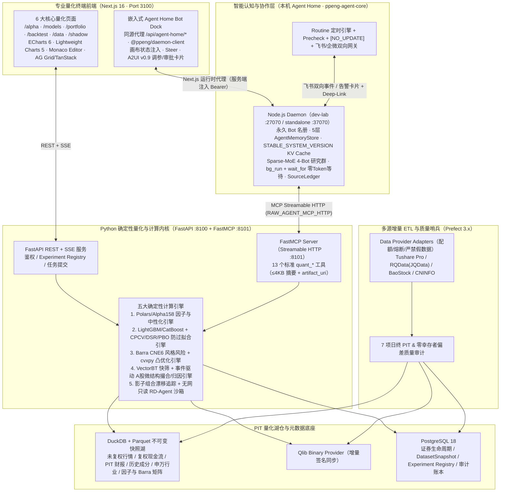

# 专业机构级量化分析平台（Pro-Quant Research Platform）分阶段开发计划 V2.0

> **文档状态**：Pro-Quant V2.0 研发实施蓝图（彻底升级自 V0.1，待拍板后启动 Phase 0）  
> **统一对齐契约**：[V2-QUANT-CONTRACT.md](V2-QUANT-CONTRACT.md)（`Q1–Q7` 域 & 13 个 `quant_*` MCP 工具）  
> **配套交付**：[01-prd-map.md](01-prd-map.md)（Pro-Quant V2.0 PRD-Map） · [03-agent-home-integration.md](03-agent-home-integration.md)（Agent Home 深度双向集成方案） · [03-quant-gap-and-data-tooling.md](../research/03-quant-gap-and-data-tooling.md)（机构 Gap 与数据/工具实战）

---

## 1. 总体架构总览与全栈技术栈定案

Pro-Quant V2.0 采用 **“Python 确定性量化计算内核 + Next.js 专业量化终端 + 直连本机 Agent Home 认知协作层”** 的三层紧耦合数据、松耦合进程的极简高可靠架构，单台高配工作站（Mac Studio / 16C64G NVMe Linux）即可发挥机构级日频研发算力，无多余分布式运维税。

### 1.1 系统全景架构图

### 1.2 全栈技术栈定案表

| 架构层次 | 最终定案技术栈 | 关键选型理由与约束边界 |
| :--- | :--- | :--- |
| **前端专业量化终端** | **Next.js 16 (App Router) + React 19 + TypeScript + Tailwind CSS** | 运行时 Middleware 代理本机 Agent Home Daemon（镜像 `ppeng-agent-core/apps/web-console/middleware.ts`），OpenAPI 自动生成 Python→TS 强类型契约 |
| **量化图表 / 表格 / 编辑器** | **Apache ECharts 6.x**（IC/分层/Barra 暴露/归因瀑布/水下回撤）+ **TradingView Lightweight Charts 5.x**（K 线与买卖点标注）+ **Monaco Editor**（因子 DSL/Python 语法高亮与诊断）+ **AG Grid Community / TanStack Table**（高密度 5,000+ 行截面/持仓虚拟滚动） | 彻底覆盖专业量化终端高频交互，全部宽松许可，等宽数字与高密度精密暗色终端体验一流 |
| **后端 API 与异步任务** | **Python 3.12 + FastAPI + Pydantic v2 + Arq/Celery + Prefect 3.x** | 确定性计算、回测与 ETL 全栈统一 Python 生态，零跨语言胶水成本；长任务统一返回 `job_id` 与状态事件供前端和 Agent Home `wait_for` 消费 |
| **分析湖仓与元数据** | **DuckDB 1.x/2.x + 分区 Parquet + Polars**（列式面板计算主力）+ **PostgreSQL 18**（元数据、PIT 财报主表、不可变 Snapshot 与 Experiment Registry）+ **Qlib Binary Provider**（Alpha158 与 Qlib 工作流兼容层） | 全 A 5,300+ 标的 × 10 年日频面板在 DuckDB + Polars 下毫秒至秒级计算；彻底告别旧项目 SQLite 逐行存 K 线的性能与并发瓶颈 |
| **建模、风控与凸优化** | **LightGBM / CatBoost / scikit-learn / SciPy / statsmodels** + **`cvxpy`（CLARABEL / OSQP / ECOS / SCS）** + 自研 **Barra CNE6** 与 **CPCV/DSR** 模块 | `cvxpy` + CLARABEL 对全 A 3,000–5,000 股二次规划求解可达秒级，完整支持换手率 $L_1$ 惩罚、行业/风格线性约束与影子价格诊断 |
| **双模回测引擎** | **VectorBT**（向量化参数快筛）+ **自研事件驱动 A 股微结构撮合引擎**（核心认证回测）+ Qlib 兼容导出器 | 商业/通用开源回测器常忽略 A 股一字板涨跌停、停牌冻结、POV 拆单与非前复权分红现金流，自研精简事件驱动状态机（~1,500 行核心代码 + 100% 边界单测）最透明可靠 |
| **MCP 与智能协作层** | **Python `FastMCP`（Streamable HTTP `:8101` + Stdio 兼容）** → 直连本机 **Agent Home（`ppeng-agent-core` Daemon `27070`/`37070`）** + 复用 **`@ppeng/daemon-client`** 与 **A2UI v0.9** | 零重复造 Chat/Memory/Routine/飞书轮子；所有高算力或写操作工具受 Agent Home `SourceLedger`、`approvalMode` 与 `wait_for` 护栏约束 |

---

## 2. 旧项目 `quant-akshare-qlib-rdagent` 资产深度评估（实地代码审计）

在决定“硬改旧项目还是新架构重建”前，我们实地只读审计了本机旧项目 `<legacy-quant-repo>` 的全部核心后端源码，结论清晰且证据确凿：**仅选择性借鉴局部工具思路，核心数据湖、回测与 RD-Agent 闭环必须在 Pro-Quant V2.0 新架构下彻底重建。**

### 2.1 逐模块源码审计与处置清单

| 旧项目文件 / 模块 | 实地核验现状与致命缺陷 | 处置决策 |
| :--- | :--- | :--- |
| `backend/app/services/data_service.py` | ① 第 92 行写死 **`adjust="qfq"`（前复权）** 且第 114 行把 `adj_factor` 固定填为 `1.0`，直接毁掉真实成交价并引入未来分红泄漏； ② 第 118 行在 AkShare 报错时**静默回退到 `_make_synthetic_bars()` 生成随机游走假行情**，在真量化研究里是灾难级红线； ③ 第 20 行仅内置 3 只种子股，无退市股、无 PIT 财务、无历史成分、无历史申万行业 | **彻底废弃重写**（改由 DuckDB/Parquet PIT 湖 + 商业研究数据源适配器 + 7 项日终审计替代，物理删除任何假行情生成逻辑） |
| `backend/app/models/entities.py` & `quant.db` | 使用 SQLite（`quant.db`）逐行存储 `bar_data`；`SectorMembership` 只有单字段 `effective_date` 无失效区间；无 `ann_date` PIT 财报、无 `DatasetSnapshot`、无 Barra 风险与实验注册表 | **彻底废弃重写**（升级为 PostgreSQL 18 元数据/Registry + DuckDB/Parquet 列式湖仓） |
| `backend/app/services/backtest_service.py` | ① 第 71–76 行只写死一个 20 日均收益简单动量因子，无预处理与统计学检验； ② 第 80–140 行 `_apply_a_share_trading_constraints` 仅为收盘价权重模拟，**无涨跌停一字板撮合失败、无停牌冻结、无 POV 参与率拆单、无冲击成本、无分红送转现金流**，印花税粗暴用 `0.5 * turnover` 近似 | **彻底废弃重写**（替换为 VectorBT 快筛 + 完整 A 股微结构事件驱动撮合引擎 + Brinson/Barra 归因） |
| `backend/app/services/strategy_service.py` | 第 9–45 行 `_build_strategy_template` 实为**硬编码字符串模板**——无论用户输入什么需求都返回同一段 20 日均收益动量代码，并非真正的 RD-Agent 假设-沙箱-验证循环 | **彻底废弃重写**（改由 Agent Home `alpha-miner` + 无网只读沙箱 + CPCV/DSR 硬门禁 + 失败墓碑记忆实现真实受控研发闭环） |
| `backend/app/services/qlib_service.py` | 实现了 Parquet 路径解析、`_file_sig` 文件尺寸+mtime 签名校验、`_provider_structure_ok` 与增量 `dump_bin.py` 封装（502 行，含单测 `test_qlib_provider_validation.py`） | **可借鉴复用思路**（抽取其增量签名校验与 Qlib bin 原子切换 `_staging` 机制，重构进新仓库 `services/quant_lake/qlib_sync.py`） |
| `frontend/` (React + Vite + Ant Design) | 面向玩具原型的简单 AntD 页面，缺少高频量化终端信息密度、Monaco 因子编辑器、CPCV/Barra/归因专业视图与 Agent Home Bot Dock | **不继承**（按 Next.js 16 + `prototype-v1-quant.html` 机构终端视觉体系全新构建） |

> **工程判断结论**：旧原型有价值的资产仅在于“验证过 FastAPI + Qlib `dump_bin` + Parquet 落盘在本机环境可行”，但数据模型、复权口径、撮合逻辑与策略生成全部存在不可修补的底层硬伤。在 `stock-research` 新仓库从 Phase 0 一次性把 PIT Schema 与微结构引擎建对，比强行改造旧代码节省至少 40% 返工时间，且零历史技术债。

---

## 3. 分阶段开发路线图（总计 24 周 · 4 个里程碑）

> 周期按 **1–2 名全栈/量化工程师 + 多 Agent 协同（如 Herdr Flow 并行推进）** 评估。每个阶段末均设置 **一票否决制机构级定量验收门禁（Hard Quantitative Gates）**，未通过门禁禁止进入下一阶段。

### Phase 0：PIT 量化数据底座、复权/退市校验与工程脚手架（W1 – W2）

**阶段目标**：一次建对最不能返工的底座——无幸存者偏差的 PIT 数据湖、不可变数据集快照、以及自动化数据质量哨兵。

| 工作包 | 核心交付物（对齐域 ID） | 完成定义（DoD）与定量验收门禁 |
| :--- | :--- | :--- |
| **P0.1 仓库与基础基建** | Monorepo（`apps/web` Next.js 16、`services/quant-api` FastAPI、`services/quant-mcp` FastMCP、`packages/quant-core` Polars/NumPy 核心库）；Docker Compose（PG 18 + Prefect Server） | 一键 `make dev` 启动前端/API/MCP/PG；OpenAPI 自动同步 TS 类型；CI 跑通 pytest + ruff + tsc |
| **P0.2 PIT Schema 与 DuckDB 湖仓** (`Q1.2`) | `InstrumentLifecycle`、`MarketBarRaw`、`CorpAction`、`PitFinancialFact`、`UniverseAndIndustryHist`、`DatasetSnapshot` 存储层与版本化 manifest 机制；借鉴旧项目 `qlib_service.py` 实现 Qlib bin 原子同步 | 支持全 A（含历史退市股）10 年日频行情读取 < 500ms；任意 `snapshot_id` 重跑查询结果哈希 100% 一致 |
| **P0.3 多源适配与 7 项 PIT 质量哨兵** (`Q1.1`, `Q1.3`) | Tushare Pro + RQData/JQData（或 BaoStock 开发兜底，**零合成假数据**）适配器（配额/限流退避/断流告警）+ 7 项日终审计引擎 | **Phase 0 硬门禁**： 1. 拆股/分红复权一致性单测误差 `< 1e-6`； 2. 财报 `ann_date` 倒挂与重述 PIT 截断测试 **0 未来函数泄漏**； 3. 历史退市股收录完整性与中证 500/1000 历史成分权重和=100% 校验通过 |

---

### Phase 1（MVP）：Alpha 因子实验室 + Barra 基础 + 高保真微结构回测 + Agent Home Bot 实机接入（W3 – W8）

**阶段目标**：跑通专业量化研究员日常核心闭环——**写因子 → 截面统计诊断 → 高保真 A 股微结构回测 → 右侧 Agent Home Quant Bot 记忆协同与基础优化**。

| Sprint | 核心交付功能（对应 PRD-Map 模块） | 定量验收门禁（Hard Gates） |
| :--- | :--- | :--- |
| **Sprint 1（W3–W4） Alpha 因子工坊与统计引擎** | - **Q2.1–Q2.3**：因子 DSL / Polars 算子库 + 内置 Alpha158 + AST 无未来函数静态扫描 + 标准化截面预处理管线（MAD/Z-Score/申万行业+市值中性化） - 单因子 Tearsheet（RankIC/ICIR/NW $t$-stat/10 分层单调性/IC 衰减/换手率）+ 与已有因子库相关性/VIF 矩阵 - 前端 `/alpha`（Monaco 编辑器 + ECharts 诊断四联图）与 `/data` 数据质量大盘 | 1. **未来函数扰动单测 100% 通过**：截断 $t+1$ 后数据重算 $t$ 日因子值最大绝对误差 `< 1e-12`； 2. 全 A 5,300 股 × 5 年单因子计算+诊断耗时 p95 `< 8s` |
| **Sprint 2（W5–W6） Barra 基础与高保真 A 股微结构回测** | - **Q4.1（基础）& Q4.2（轻量）**：Barra CNE6 10 大风格因子每日截面暴露计算 + 基础 `cvxpy` 均值方差/行业中性优化器 - **Q5.1–Q5.2**：VectorBT 向量化快筛 + **事件驱动 A 股微结构撮合引擎**（T+1、各板块及历史规则版本涨跌停一字板不可成交、停牌冻结、POV 上限拆单、平方根冲击成本、双边佣金+印花税+过户费、非前复权成交价+分红送转现金流） - **Q6.3（红线）**：Authority Gate 物理隔离声明与静态扫描门禁 - 前端 `/backtest` 与 `/portfolio`（基础版） | 1. **A 股微结构撮合边界单测 100% 通过**（覆盖 T+1 冻结、主板 10%/创科 20%/ST 2026-07-06 跨规则日 5%→10% 一字板拒单、停牌仓位冻结、POV 拆单、除权分红现金流精确守恒）； 2. 全 A 300 只持仓 5 年日频事件驱动回测耗时 `< 15s` |
| **Sprint 3（W7–W8） FastMCP + Agent Home Quant Bot 实机联调** | - **Q7.1（MVP）**：Python FastMCP Streamable HTTP Server（`:8101`）首批上线 9 个核心 `quant_*` 工具（覆盖 Q1/Q2/Q4/Q5），强制 ≤4KB 摘要 + `artifact_uri` 契约 - 在本机 Agent Home 创建永久 **`quant-lead` Bot**（`POST /api/bots`）+ 配置 `RAW_AGENT_MCP_HTTP` / `RAW_AGENT_MCP_EXPAND_HTTP=true` + 挂载首批 Quant `SKILL.md` + 写入 `SecretVault` - **Q7.2（MVP）**：Quant Workbench 右侧内嵌 **Agent Home Bot Dock**（Next.js 同源运行时代理、`.agent-state/dev-lab.ports.json` 端口发现、`@ppeng/daemon-client` SSE 消费、Steer 纠偏、`<quant_canvas_context>` 最新 `user` 消息头注入） | **MVP 强验收总门禁**： 1. 连续切换 `/alpha` → `/portfolio` → `/backtest` 对话 5 轮，Agent Home `GET /api/traces` 中 **`turn_start.payload.stablePrefixHash` 100% 保持不变**（KV Cache 零击穿）； 2. `quant_eval_factor` 与 `quant_run_backtest` 异步任务可通过 Agent Home `wait_for` 零 Token 挂起并正常唤醒； 3. 淘汰因子成功写入 `project.memory` 且下轮新对话可准确召回预警 |

---

### Phase 2（V1）：多因子合成 + CPCV/DSR 防过拟合 + 完整 Barra/`cvxpy` + 归因 + A2UI 与 Sparse-MoE 群（W9 – W16）

**阶段目标**：补齐专业机构级研发与风控的全部核心纵深，完成从“能跑因子回测”到“防过拟合、控风格风险、清收益归因、人机交互调参”的质变跃升。

| Sprint | 核心交付功能（对应 PRD-Map 模块） | 定量验收门禁（Hard Gates） |
| :--- | :--- | :--- |
| **Sprint 4（W9–W10） 多因子合成与 CPCV/DSR 过拟合防线** | - **Q3.1–Q3.2**：ICIR / Ridge / LightGBM / CatBoost 滚动训练引擎 + 完整 PostgreSQL Experiment Registry（自动累计专题试错次数 $M$） - **Purged K-Fold / CPCV（Purge + Embargo）** + **Deflated Sharpe Ratio（DSR）** + **PBO 过拟合概率** + Walk-Forward 滚动衰减检验 - 补齐 MCP 工具：`quant_run_cpcv_gate`、`quant_list_experiments` - 前端 `/models` 页面（实验对比 Diff + CPCV 路径分布 + PBO/DSR 仪表盘） | **防过拟合硬门禁压测**：构造 100 组纯高斯白噪声随机因子做网格调参模拟，验证 CPCV（PBO `< 0.25`）+ DSR（`> 0.95`）双门禁对假 Alpha 的**拦截率 ≥ 98%** |
| **Sprint 5（W11–W12） 完整 Barra CNE6 风险矩阵与 `cvxpy` 全约束优化** | - **Q4.1（完整）**：Barra CNE6 因子协方差矩阵（指数加权 + Newey-West 自相关调整 + Eigenfactor 调整）+ 贝叶斯收缩特质方差 $\Delta_t$ - **Q4.2（完整）**：`cvxpy`（CLARABEL/OSQP）全约束优化（行业偏离、10 风格上下界、单股上限、指增成分股占比、流动性参与率、$L_1$ 换手惩罚）+ `infeasible` 软松弛与影子价格诊断 - 前端 `/portfolio` 完整版（CNE6 10 风格暴露、TE 拆解、有效前沿、调仓明细） | 1. 协方差矩阵 $\Sigma_t$ 在全历史滚动截面 100% 满足半正定（最小特征值 `> 0`）； 2. 连续 60 个月度/周度中证 1000 指增滚动优化求解成功率 ≥ 99%，不可行截面 100% 给出可操作松弛建议 |
| **Sprint 6（W13–W14） Brinson + Barra 业绩归因与特色数据** | - **Q5.3**：**Brinson-Fachler**（配置/选股/交互）+ **Barra 因子收益拆解**（纯 Alpha vs 风格 Beta vs 行业 vs 交易成本拖累）+ Top-5 水下回撤剖析 - **Q1.1.3**：接入两融、龙虎榜席位与卖方一致预期（EPS 边际修正 PIT）数据流 - 补齐 MCP 工具：`quant_attribution_tearsheet`；升级 `/backtest` 归因瀑布与拒单审计视图 | 归因恒等式残差检验：`总超额收益 - (Brinson配置 + 选股 + 交互) < 1e-6`，`组合收益 - (Barra风格 + 行业 + 特质Alpha - 交易成本) < 1e-6` |
| **Sprint 7（W15–W16） `@ppeng/agent-quant` Bundle + Sparse-MoE 群 + A2UI 深度卡片** | - **Q7.1（V1）**：按 `ppeng-agent-core/doc/DOMAIN_AGENTS.md` 5 步标准封装可选领域包 **`@ppeng/agent-quant`**（逐工具精确配置 `approvalMode`），并在 Agent Home 组建 4-Bot **Sparse-MoE 研究群**（`quant-lead` + `alpha-miner` + `risk-pm` + `data-ops`，`routing = sparse-all`） - **Q7.2（V1）**：Quant Dock 完整落地 **A2UI v0.9 渲染器**，支持气泡内交互式“调整换手惩罚 $\lambda$ / 行业上限并重跑优化”与“批准/驳回提交 CPCV 门禁”卡片，回调 `/api/sessions/:id/a2ui/action` 自动刷新主画布 | **V1 联调强门禁**： 1. 群内单领域提问仅唤醒目标专家（Top-$K \le 2$），未唤醒专家 0 Token； 2. A2UI 卡片修改 $\lambda$ 点击提交 → `cvxpy` 重算 → 主画布 `/portfolio` 自动刷新全链路端到端实机通过； 3. `SourceLedger` 污点测试：通过 `contextSources` 投喂含 Prompt Injection 的外部研报，验证系统 100% 阻断未授权写工具调用 |

---

### Phase 3（V2）：影子实盘漂移监控 + 受控 RD-Agent 闭环 + 跨资产与分钟频扩展（W17 – W24+）

**阶段目标**：将研究闭环延伸至“准实盘每日对账与衰减预警”，并上线受控夜间自动化挖因子工厂，同时按需打开分钟级与衍生品/跨市场维度。

- **Q6.1–Q6.3 每日影子实盘与滑点漂移监控（W17–W19）**：
  - 上线每日收盘自动影子调仓模拟引擎、Implementation Shortfall（bps）归因、20/60/120 日滚动 IC 衰减与因子拥挤度雷达、前端 `/shadow` 页面与 Authority Gate 只读调仓清单签核流；
  - 补齐 MCP 工具 `quant_shadow_drift_check` 并上线 **08:30 盘前数据预检** 与 **15:45 盘后影子漂移归因** 两大 Agent Home Routine（`precheck` 零 Token 预检 + `[NO_UPDATE]` 静默 + 飞书双向告警推送）。
- **Q7.3 受控 RD-Agent 夜间自动化因子研发闭环（W20–W22）**：
  - 构建无网络、只读 Parquet 卷、限 CPU/内存的独立因子计算沙箱容器，补齐 `quant_submit_factor_hypothesis`（`approvalMode: 'always'`）；
  - 上线 **23:00 夜间受控挖掘 Routine**：`alpha-miner` 先查 `project.memory` 淘汰墓碑 → 生成新假设 → 沙箱执行 → CPCV/DSR 硬门禁淘汰 → 失败自动写墓碑并 `[NO_UPDATE]` 静默，仅合格因子晨间推飞书审批卡。
- **跨资产与分钟级量价扩展（W23–W24+）**：
  - 接入股指期货（IF/IC/IM）日频贴水成本模拟（精准核算市场中性策略对冲损耗）、ETF 轮动/套利分析、5 分钟/1 分钟量价高频聚合因子（日内成交分布、早尾盘动量、高频波动偏度），以及按需扩展港/美股多币种资产面板。

---

## 4. 数据、算力与基础设施分档预算表（月度运行成本参考）

> 不含研发人力，仅列外部数据订阅、LLM 推理与本地/云算力资源（默认本机 Agent Home 复用，零额外 Chat 平台费用）：

| 成本项 | 档位 1：Phase 0 骨架验证档（冷启动） | 档位 2：MVP–V1 专业个人/小工作室主力档（推荐） | 档位 3：V2 私募投研台准生产档 |
| :--- | :--- | :--- | :--- |
| **量化数据源（PIT/成分/行情）** | **¥50 – ¥150/月** （Tushare 5k 积分 ¥500/年 + BaoStock 校验，仅作骨架与小样本联调） | **¥400 – ¥1,000/月（约 ¥5k–¥12k/年）** （Tushare 1w 积分 + 米筐 RQData 科研版 / 聚宽 JQData，补齐完整 PIT 财务、退市股、历史成分、历史申万与期货贴水） | **¥3,000 – ¥15,000+/月** （通联数据 / 优矿 / Wind / 天软商业 API + 分钟级与一致预期商业许可） |
| **Agent Home LLM 推理成本** | **¥50 – ¥150/月** （得益于 `STABLE_SYSTEM_VERSION` KV Cache 命中 + `wait_for` 零 Token 挂起 + `[NO_UPDATE]` 静默） | **¥200 – ¥600/月** （日常 `quant-lead` + 4-Bot Sparse-MoE 群 + 08:30/15:45 Routine 巡检） | **¥800 – ¥2,500/月** （叠加夜间受控 RD-Agent 因子搜索预算，由 Agent Home `maxCostUsd` 硬帽锁死） |
| **计算与存储硬件** | **¥0/月（利用现有本机 Mac/PC）** DuckDB + Parquet 10 年全 A 日频约占 15–30 GB SSD | **¥0 – ¥300/月** （现有 32G/64G 工作站本机跑全部引擎 + 定时加密备份至 OSS/NAS；无需上云集群） | **¥1,000 – ¥3,000/月** （专用 32C128G NVMe Linux 机箱一次性投入或云主机，支持分钟级与大规模 CPCV 并行） |
| **月度运行成本合计** | **约 ¥100 – ¥300/月** | **约 ¥600 – ¥1,900/月** | **约 ¥4,800 – ¥20,000+/月** |

---

## 5. 专业量化核心工程风险与应急预案

| 风险类别 | 严重度 | 典型失效表现 | 工程预防与硬兜底机制 |
| :--- | :---: | :--- | :--- |
| **1. 隐蔽未来函数与幸存者偏差泄漏** | 极高 | 财报按报告期末而非 `ann_date` 对齐、用当日申万行业回测 5 年前、或误用前复权价格导致回测虚高实盘亏损 | Phase 0 建立 PIT 物理表结构约束；Sprint 1 引入 **CI 时间截断扰动回归测试**（删除 $t+1$ 后所有数据重算 $t$ 日信号，偏差 `> 1e-12` 直接阻断合并）；严禁合成假行情逻辑入库 |
| **2. 多重检验与夜间 RD-Agent 过拟合假 Alpha** | 极高 | 夜间挖因子跑出 50 个样本内 Sharpe > 3 的噪声公式，实盘首月集体失效 | Experiment Registry 强制累计专题试错次数 $M$；未通过 **CPCV（PBO `< 0.25`）+ DSR（`> 0.95`）+ 现有库相关度 `< 0.5`** 三重硬门禁禁止晋升；所有失败案例强制沉淀进 Agent Home `project.memory` 墓碑防重复挖掘 |
| **3. Barra 协方差病态与 `cvxpy` 优化不可行（Infeasible）** | 高 | 极端行情下同时卡死“行业 ±1%、Style ±0.2σ、换手 ≤15%”导致求解器报错无解，中断滚动回测或影子盘调仓 | 协方差矩阵强制实施 Newey-West + Eigenfactor 调整 + 特征值下界裁剪保证严格正定；`cvxpy` 封装**分级软约束回退机制**（先松弛换手率惩罚，次松弛风格边界，绝不松弛合规与单股集中度红线）并输出明确诊断报告 |
| **4. 数据源限流断流或字段口径突变** | 高 | 上游接口临时故障导致盘前 ETL 失败、产生缺失交易日或行业代码错位 | Prefect 任务内置指数退避 + 多源交叉对账；日终 7 项 PIT 质量哨兵不通过时**拒绝推进 `DatasetSnapshot` 指针**，保留上一健康快照并触发 08:30 Routine 飞书红灯告警 |
| **5. RD-Agent 沙箱代码越权或算力失控** | 高 | LLM 生成死循环、超内存代码或试图访问宿主文件/网络 | 候选因子代码必经 **AST 白名单检查**（仅允许 Polars/NumPy/Math 算子）并在 **无网、只读挂载、硬限 CPU/RAM/超时（60s）** 的隔离容器中执行；外层叠加 Agent Home `maxTurns` / `maxCostUsd` 与 `approvalMode: 'always'` |
| **6. Agent Home 集成侧上下文污染、KV 击穿或长任务超时** | 中高 | 直接在 MCP 返回 5 万行明细撑爆上下文；在 20 秒 `McpHttpSession` 超时内同步跑全量回测；或把外部研报与可信画布混传导致误污点 | ① MCP 工具硬限返回体 `≤ 4KB` 摘要 + `artifact_uri`；② 耗时 >10s 任务一律异步返回 `job_id` + `wait_for` 零 Token 等待；③ 可信画布状态仅前置注入最新 `user` 消息保 `STABLE_SYSTEM_VERSION` KV 命中，不可信外部文本强制走 `contextSources` 受 `SourceLedger` 污点保护 |
