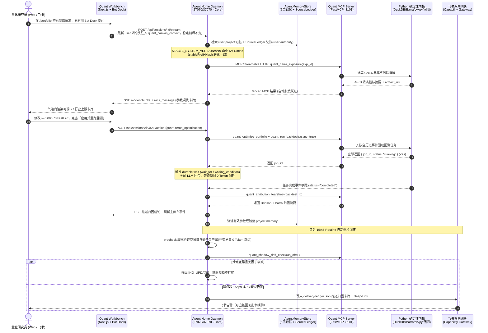

# Pro-Quant V2.0 × Agent Home（`ppeng-agent-core`）深度双向集成架构方案

> **文档状态**：Pro-Quant V2.0 架构设计基线（待拍板实施）  
> **对齐契约**：[V2-QUANT-CONTRACT.md](V2-QUANT-CONTRACT.md)（`Q7` 域 & `quant_*` MCP 契约）  
> **核验基线**：本方案全部路径、端口、接口、数据模型与安全机制均基于实地只读核验本机 Agent Home 仓库 `<ppeng-agent-core>` 真实源码编写，无虚构接口。  
> **配套文档**：[01-prd-map.md](01-prd-map.md) · [02-dev-plan.md](02-dev-plan.md) · [03-quant-gap-and-data-tooling.md](../research/03-quant-gap-and-data-tooling.md)

---

## 1. 架构分工原则：为什么绝不自造 Chat 轮子，而与 Agent Home 双向融合

专业量化研发平台与通用 AI Agent 运行时是**两套复杂度截然不同的工程体系**。若在 Python 量化后端里顺手自建一套“简陋 Chat + 聊天历史表 + Cron 定时器 + 飞书推送 + 简单记忆”，短期内看似省事，3 个月后必然陷入三大工程泥潭：
1. **重复造出半成品 Agent 运行时**：缺少 Prompt KV Cache 前缀保护、大结果驱逐（Tool-Result Stub）、实时中途转向（Steer）、零 Token 持久等待（Durable Wait）、多层记忆检索与防幻觉污点追踪；
2. **记忆与研究资产割裂**：用户在 Quant Workbench 里做的因子实验、淘汰教训、风险偏好，与用户在 Agent Home / 飞书里日常交互的永久助手彻底失联；
3. **长任务与无人值守巡检成本失控**：没有 `precheck` 零 Token 预检、`[NO_UPDATE]` 静默和 `waiting_condition` 挂起机制，盘前/盘后/夜间挖因子定时任务每天空烧大量 LLM Token 并轰炸飞书群。

因此，Pro-Quant V2.0 确立 **“确定性量化内核（Python）× 认知与协作运行时（Agent Home Node.js Daemon）”双核解耦、双向融合** 原则：

| 维度 | Pro-Quant Backend（Python 确定性内核） | Agent Home（`ppeng-agent-core` Node.js Daemon） | 真实代码依据（`ppeng-agent-core`） |
| :--- | :--- | :--- | :--- |
| **核心职责定位** | **算得准、零泄漏、可复现**：PIT 数据湖、因子截面计算、CPCV/DSR 检验、Barra CNE6 风险模型、`cvxpy` 凸优化、A 股微结构回测、影子盘漂移归因 | **记得住、会调度、能协作、控风险**：永久 Bot 身份、多会话/群聊编排、多层记忆、长任务零 Token 挂起、A2UI 交互卡片、安全污点、例行巡检、飞书/企微双向触达 | `apps/daemon/src/server.ts`, `packages/core/src/` |
| **运行形态与端口** | FastAPI + DuckDB/Parquet + Polars + FastMCP（推荐端口 `8100` REST / `8101` Streamable HTTP MCP） | 单进程 Node.js Daemon：**`dev-lab` 本地开发首选端口 `27070`**（冲突顺延并写入 `.agent-state/dev-lab.ports.json`）；**独立守护/Docker 默认端口 `37070`**（`RAW_AGENT_DAEMON_PORT`） | `scripts/dev-lab.mjs:46` (`27070`), `apps/daemon/src/server.ts:125` (`37070`), `packages/daemon-client/src/client.ts:15` |
| **状态与记忆管理** | **不可变实验账本（Experiment Registry）**：Dataset Snapshot、因子表达式哈希、IC/回测/优化产物 Parquet 持久化 | **5+1 层 `AgentMemoryStore` + `UserProfile` + Dreamer**：`session.scratch`(200) / `session.long`(500) / `user.memory`(5000) / `team.memory`(2000) / `project.memory`(5000) + `library`(20000)，支持 FTS5 + Embedding 渐进召回与删除抑制 | `packages/core/src/memory/store.ts:20-27`, `packages/core/src/memory/types.ts:1-7`, `apps/daemon/src/routes/memory.ts` |
| **上下文与成本治理** | 计算结果一律只输出精炼指标摘要 + `artifact_uri`，原始大表落盘 Parquet 供按需切片查询 | **海马体压缩编译 + KV Cache 保护**：`STABLE_SYSTEM_VERSION = 'v19'` 稳定前缀缓存、动态上下文后置、`auto-compact` / `micro-compact` + `context-compiler`、`tool-result-stub` 大结果自动置换（原体可通过 API 按需取回） | `packages/core/src/model/prompt-builder.ts:90,512`, `doc/PROMPT_CACHE.md`, `packages/core/src/session/context-compiler.ts`, `apps/daemon/src/routes/sessions.ts:845` |
| **多专家协作** | 无多 Agent 聊天路由，仅提供无状态并发计算 Worker（Celery/Arq/多进程池） | **Protocol-Level Sparse-MoE Bot Rooms**：`routing = sparse-all`（含 2–3 人小群稀疏唤醒），群主 `hostBotId` 软门控选人、未唤醒专家 0 Token、六道防风暴闸门、Push Blackboard + Pull Retrieval + 触达记忆 | `apps/daemon/src/routes/bot-rooms.ts`, `doc/BOT_ROOM_MOE_PLAN.md`, `packages/core/src/rooms/touched-memory.ts` |
| **长任务等待** | 异步执行回测/CPCV/RD-Agent 任务，暴露 `job_id` 与状态查询接口 | **零 Token 持久等待（Durable Wait）**：Goal/Routine 中 `bg_run` 自动 host-park 为 `waiting_condition`；`wait_for` 支持 `session` / `bot_task` / `routine_run` 及自定义宿主适配器，条件满足单次唤醒 | `packages/core/src/tools/builtin-tools.ts:1561`, `packages/core/src/waits/tool.ts:23`, `packages/core/src/waits/background-source.ts:30`, `apps/daemon/src/routes/durable.ts` |
| **定时巡检与 IM 触达** | 仅负责 ETL 数据同步与影子组合日终计算（Prefect），不负责面向人的对话和推送编排 | **Routine + Precheck + `[NO_UPDATE]` + 飞书/企微双向网关**：`precheck` 零 Token 预检、无变化 `[NO_UPDATE]` 静默、`changesOnly`/免打扰/日预算、`delivery-ledger.json` 至少一次投递、飞书双向事件订阅直达 `feishu.botId` | `apps/daemon/src/routes/cron.ts`, `packages/core/src/bots/silence.ts`, `packages/core/src/cron/notification-decision.ts`, `doc/IM_AGENT_INTEGRATION.md` |
| **交互与安全边界** | 确定性风控校验 + 物理隔离（**无任何券商下单 SDK / 路由**） | **A2UI v0.9 渲染 + `SourceLedger` 安全污点 + 审批流**：外部数据/MCP 返回自动 `fenceExternalContent` 隔离、污点沿子会话链单向传递（子策略只能收窄不能放宽）、`approvalMode: 'always'` 强制人工放行 | `doc/A2UI.md`, `packages/core/src/learning/sources.ts`, `apps/daemon/src/routes/misc.ts:189` |

> **核心结论**：Quant Backend 专心做 **“100% 确定性机构级金融计算引擎 + MCP Server”**；Agent Home 承担 **“100% 智能体认知、记忆、多 Bot 协作、交互卡片、定时例行与 IM 门户”**。两者通过三条标准化链路双向打通。

---

## 2. 接入方案一：Quant MCP Server → Agent Home（推荐主链路）

将量化后端能力通过 **FastMCP（Python）** 暴露为标准 **MCP Streamable HTTP Server**（本地开发同时兼容 Stdio），由 Agent Home 原生 MCP Client 消费。这是零侵入、跨仓库解耦、且天然受 Agent Home 安全围栏与凭据治理保护的首选主链路。

### 2.1 Agent Home 原生 MCP 接入机制与真实配置核验

实地核验 `ppeng-agent-core/packages/core/src/mcp/mcp-http.ts`、`ppeng-agent-core/packages/core/src/mcp/mcp-http-config.ts`、`ppeng-agent-core/packages/core/src/mcp/mcp-stdio.ts` 与 `ppeng-agent-core/packages/core/src/mcp/mcp-manager.ts`，Agent Home 已完整内置如下接入能力：

1. **Streamable HTTP 主通道（生产 / 本地多进程推荐）**：
   - 使用官方 `@modelcontextprotocol/sdk` 的 `StreamableHTTPClientTransport`（若未锁定 `transport` 且服务端返回 HTTP `404/405`，自动降级至 `SSEClientTransport`；锁定 `transport: "streamable-http"` 则禁止降级）。
   - 配置写入 Agent Home 环境变量 `RAW_AGENT_MCP_HTTP`（JSON 数组），并显式开启 **`RAW_AGENT_MCP_EXPAND_HTTP=true`**（源码 `mcp-manager.ts:145` 默认为 `false`；开启后除通用 `mcp_invoke` 外，会自动将全部 `quant_*` 工具展开为 `mcp_h{i}_quant_*` 独立工具，模型可直接按名调用并按字母序稳定排入 Prompt Cache）。
   - 支持 **`bearerEnv`**（从环境变量读取 Bearer Token，永不写入配置明文与日志）、**`oauth: true`**（OAuth 2.1 + PKCE，回调 `/api/mcp/oauth/callback`），且 `McpHttpSession` 自动对 ≥8 字符凭据做全量响应/错误文本脱敏（`redactSecrets`）。
   - **超时注意点（源码实测）**：`McpHttpSession` 对非 `GET` 的单次 HTTP POST 请求默认超时为 **`DEFAULT_TIMEOUT_MS = 20_000`（20 秒）**（`mcp-http.ts:12,119-127`）。因此**凡耗时可能超过 15 秒的量化计算（CPCV、全市场回测、RD-Agent 挖因子）绝不能在单次 MCP `callTool` 中同步阻塞**，必须采用 **“快速提交返回 `job_id`（< 2s）+ 轮询/Wait 回调”** 异步契约！

```json
// Agent Home 环境变量配置示例（.env 或 SecretVault 注入）
// RAW_AGENT_MCP_EXPAND_HTTP=true
// RAW_AGENT_MCP_HTTP=
[
  {
    "url": "http://127.0.0.1:8101/mcp",
    "transport": "streamable-http",
    "bearerEnv": "QUANT_MCP_BEARER_TOKEN"
  }
]
```

2. **Stdio 本地单机通道（无 HTTP 进程轻量化场景）**：
   - 通过 `RAW_AGENT_MCP_STDIO` JSON 数组挂载（`RAW_AGENT_MCP_EXPAND_STDIO` 默认 `true`，展开为 `mcp_s{i}_quant_*`），适合单人离线脚本调试：
```json
[
  {
    "command": "/path/to/stock-research/.venv/bin/python",
    "args": ["-m", "quant_mcp.server", "--transport", "stdio"],
    "cwd": "/path/to/stock-research",
    "env": { "QUANT_DATA_ROOT": "/data/quant-lake" }
  }
]
```

3. **连接器授权与密钥分层治理（`connector_grants` + `SecretVault` + `UserVault`）**：
   - 核验 `ppeng-agent-core/packages/core/src/connectors/registry.ts`、`ppeng-agent-core/apps/daemon/src/routes/connectors.ts`、`ppeng-agent-core/apps/daemon/src/routes/secrets.ts` 与 `ppeng-agent-core/apps/daemon/src/routes/user-vault.ts`：
     - **`SecretVault`（`PUT /api/secrets/:name`）**：存放连接器与数据服务密钥（如 `QUANT_MCP_BEARER_TOKEN`、`TUSHARE_TOKEN`、`RQDATA_TOKEN`）。Wire 层只返回密钥名，不回显明文。
     - **`connector_grants`（`POST /api/connectors/:id/grant`）**：按插件/领域/发现卡片维护三态授权（`needsAuth` → `needsGrant` → `granted`），持久化于 `daemon_control` KV 的 `connector_grants` 键，只保存 `secretEnv` 或 `credRef` 引用，未授权连接器不进入工具列表和系统提示词。
     - **`UserVault`（`/api/user-vault`）**：**严格区分于 `SecretVault`**，仅用于存放用户个人产品登录凭据（`login` / `card` / `contact`）并通过 `uvref` 在安全表单/浏览器中无明文代填（例如若需授权抓取付费投研数据网站会话时使用），**禁止**把 API Token 混存进 `UserVault`。
   - **补充零代码绑定路径（Bot 级 OpenAPI 导入）**：对只需只读查询的辅助量化 REST 端点，还可直接调用 `POST /api/bots/:id/connections/import`（传入 `readOnlyOnly: true` 与 `secretEnv`），以 Bot 级连接器形式绑定并自带探活（`/probe`）与调用审计（`/invocations`）。

### 2.2 13 个核心 Quant MCP Tool 完整契约表（100% 对齐 `V2-QUANT-CONTRACT.md`）

> 说明：`V2-QUANT-CONTRACT.md` 第 2 节共定义了 **5 层 × 13 个 `quant_*` 核心工具**，下表逐一补齐权限级别、审批策略、长任务异步机制与上下文防爆规范。
> 注意：`McpManager` 对通过外部 MCP 展开的工具默认统一设置 `approvalMode: 'auto'`, `sideEffectLevel: 'system'`, `needsApproval: () => true`（`mcp-manager.ts:282-284`）。对只读查询工具，在生产使用中可通过两种标准机制免去重复点击：① 在 Quant Bot 会话中通过 `PATCH /api/sessions/:id` 写入 `sessionToolGrants` 授权只读 `quant_*` 工具；② 通过第 3 节的 `@ppeng/agent-quant` Domain Bundle 封装为原生 `ToolContract` 并精确声明 `approvalMode: 'never' | 'auto' | 'always'`。

| # | 工具名（`quant_` 前缀） | 所属域 | 读写与副作用分级 | `approvalMode` 契约 | 执行形态与长任务等待（`bg_run` / `wait_for`） | 返回体防爆上下文摘要策略（Context Hygiene） |
| :-: | :--- | :---: | :--- | :--- | :--- | :--- |
| 1 | `quant_data_health` | **Q1** | 只读（`none`） | `never`（或只读会话授信） | 同步返回（< 1.5s） | 仅返回按表/市场聚合的健康灯、最新交易日、缺口股票数 Top-10 样例与 `audit_report_uri`；不吐全市场 5,300 只明细 |
| 2 | `quant_query_pit_panel` | **Q1** | 只读（`none`） | `never` | 同步返回（< 3s）；超限转异步导出 | 强制分页/聚合：`max_rows ≤ 50` 预览 + 统计分位数（count/null_pct/p05/p50/p95）+ Parquet `panel_handle_id`，禁止把百万行面板灌入对话 |
| 3 | `quant_universe_constituents` | **Q1** | 只读（`none`） | `never` | 同步返回（< 1s） | 返回指定 `as_of` 历史截面成分股数量、申万一级行业权重分布、近一期调入/调出变更摘要，全量代码列表按 `include_symbols=false` 默认折叠 |
| 4 | `quant_eval_factor` | **Q2** | 只读计算（`none`，仅写临时缓存） | `never`（受沙箱/AST 白名单保护） | 中等耗时（3–12s）；全量 10 年评估走异步 `job_id` + `wait_for` | 返回核心统计字典（RankIC/ICIR/t-stat/10 分层年化收益与单调性 Spearman $\rho$/半衰期/换手率/空值率）+ `tearsheet_id`；原始每日 IC 序列落盘供前端画图 |
| 5 | `quant_factor_correlation` | **Q2** | 只读计算（`none`） | `never` | 同步返回（< 3s） | 仅返回与候选因子相关系数 $\|\rho\| > 0.3$ 的 Top-15 已有因子对、最大共线性 VIF 及增量信息比 $\Delta\text{ICIR}$，不返回 $N\times N$ 完整大矩阵 |
| 6 | `quant_submit_factor_hypothesis` | **Q2 / Q7** | **受控写入**（`workspace`：生成沙箱实验代码、写入候选因子池） | **`always`（需人工审批或 A2UI 确认卡片放行）** | **异步长任务**：先入队返回 `experiment_id` + `job_id`，通过 `bg_run`（受控沙箱执行）或宿主注册 `wait_for(source='quant_job')` 零 Token 挂起 | 仅返回假设 ID、AST 安全校验结论、关联的 `experiment_id` 与初始状态；完整表达式代码通过 `DiffView` A2UI 卡片展示 |
| 7 | `quant_run_cpcv_gate` | **Q3** | 受控重计算（`none`/写实验审计记录） | `auto`（计算资源配额内自动，超大规模需确认） | **异步长任务**（15s–5min）：提交返回 `job_id`，在 Goal/Routine 下由宿主 park 为 `waiting_condition`（`wait_for` 零 Token 等待） | 仅返回 Gate 判定（`PASS / REJECT`）、PBO、DSR、Purged K-Fold OOS Sharpe、样本外衰减比与失败原因码；各折叠净值明细存 Parquet |
| 8 | `quant_list_experiments` | **Q3** | 只读（`none`） | `never` | 同步返回（< 1s） | 默认 `limit=20` 紧凑表（`exp_id`, `factor/model`, `dataset_hash`, `oos_icir`, `dsr`, `pbo`, `status`），按时间或指标排序 |
| 9 | `quant_barra_exposure` | **Q4** | 只读计算（`none`） | `never` | 同步返回（< 2s） | 返回 CNE6 10 大风格因子主动暴露 $z$-score、前 10 大偏离申万行业权重、组合预测年化跟踪误差（TE）及风险拆解（风格/行业/特质占比） |
| 10 | `quant_optimize_portfolio` | **Q4** | 受控计算（生成目标权重方案快照，**非下单**） | `auto`（只产出目标权重方案 JSON，写实验表不触实盘） | 同步（< 5s，单截面 `cvxpy`）或异步（全历史滚动优化走 `job_id` + `wait_for`） | 返回求解状态（`optimal` / `infeasible` 及松弛诊断）、预期收益/风险/换手率、Top-15 持仓与 Top-10 调仓变动、约束触界清单 + `opt_run_id` |
| 11 | `quant_run_backtest` | **Q5** | **受控重计算**（`workspace`/写回测产物） | **`auto`（快筛） / `always`（全历史事件驱动长回测，防算力滥用）** | **异步长任务**（10s–10min）：立即返回 `backtest_id` + `job_id`，配合 `bg_run` / `wait_for` 零 Token 挂起直到 `status in ['completed','failed']` | 返回核心绩效卡（年化/超额/IR/Sharpe/Sortino/Calmar/MaxDD/换手/冲击成本拖累/涨跌停未成交笔数）+ `backtest_id`；逐日 NAV 与交易流水不进上下文 |
| 12 | `quant_attribution_tearsheet` | **Q5** | 只读（`none`） | `never` | 同步返回（< 2s） | 返回 Brinson（配置/选股/交互）+ Barra（纯 Alpha / 风格 Beta / 行业 / 交易成本）汇总分解表、前 5 大水下回撤区间与正负贡献 Top-5 标的 |
| 13 | `quant_shadow_drift_check` | **Q6** | 只读（`none`，绝不触发实盘下单） | `never` | 同步返回（< 2s） | 返回 T 日影子盘 vs 理论回测滑点差（bps）、成交率缺口（涨跌停/停牌阻塞列表）、近 20 日滚动 IC 衰减告警及风格漂移指纹 `fact_fingerprint`（供 `[NO_UPDATE]` 比对） |

> **上下文防爆双保险**：
> 1. **服务端硬预算**：每个 `quant_*` MCP Tool 响应体强制控制在 **≤ 4 KB JSON**（约 1,000–1,500 Tokens），大表格/净值序列一律以 `artifact_uri`（Parquet 路径或 REST 下载句柄）返回；
> 2. **Agent Home 侧 Stub 驱逐**：即便单次工具输出较长，Agent Home 的 `tool-result-stub` 会将其自动替换为轻量占位摘要，原始完整内容安全保留在 SQLite 中，前端或后续审阅可通过 `GET /api/sessions/:id/tool-results/:messageId` 精确取回。

---

## 3. 接入方案二：专属 Quant Bot + 可选 `@ppeng/agent-quant` Domain Bundle & Sparse-MoE 量化研究群

### 3.1 为什么现有 `@ppeng/agent-stock` 远远不够？

实地核验 `ppeng-agent-core/packages/agent-stock/src/index.ts` 与 `ppeng-agent-core/packages/agent-stock/src/agents.ts`：
- 现有 `@ppeng/agent-stock` 仅包含 2 个基本面/行情人设（`stock-analyst`, `stock-screener`）与 **3 个只读散户级工具**（`quote_get`, `fundamentals_get`, `news_search`，数据源为 Yahoo Finance / AlphaVantage / mock）；
- 它 **没有** A 股 PIT 财报、无退市股与历史成分、无因子 IC/分层/CPCV 统计学检验、无 Barra 风格风险、无 `cvxpy` 优化、无 A 股微结构回测，且其提示词面向卖方个股主观研报（含 `long/hold/avoid` 倾向，不符合我们的量化研究定位）。

因此，**保留 `@ppeng/agent-stock` 作为轻行情参考包不动**，而在 Agent Home 中构建面向 Pro-Quant V2.0 的**专属 Quant Bot 矩阵**，并在 V1 阶段可选封装为独立领域包 **`@ppeng/agent-quant`**。

### 3.2 专属 Quant Bot 矩阵与 Sparse-MoE 量化研究群设计

依托 Agent Home 已落地的 **永久 Bot 名册（`POST /api/bots`）**、**5 层记忆（`AgentMemoryStore`）** 与 **Protocol-Level Sparse-MoE Bot Rooms（`POST /api/bot-rooms`, `routing = sparse-all`）**，设计 **1 个常驻主研入口 + 3 个稀疏唤醒专家 Bot**：

| Bot ID / 角色 | 形态与路由角色 | 允许工具范围（最小权限 `allowedTools`） | 专属记忆利用策略（`AgentMemoryStore` 5 层映射） | 绑定技能（`allowedSkills`） |
| :--- | :--- | :--- | :--- | :--- |
| **`quant-lead`**<br/>（量化主研助手 / 群主） | **主入口永久 Bot** + 群聊 **Shared Expert（`hostBotId`）** | 全部只读 `quant_*` + `quant_submit_factor_hypothesis`(需批) + `quant_run_backtest` + `a2ui_render` + `room_route_turn` / `room_assign_task` + `wait_for` + `memory_*`；**严禁 `bash`/`write_file`** | - `user.memory`：永久记住研究员偏好的股票池（如中证 500/1000）、换手率上限、行业/风格偏离容忍度<br/>- `project.memory`：**已证伪因子墓碑库（Falsified Factor Graveyard）**，记录失败因子公式、失败原因（高换手/样本外衰减/与 Barra Size 共线）及 CPCV 分数，防止重复试错<br/>- `session.long`：当前研究专题主线与多轮实验演进<br/>- `session.scratch`：向专家 Bot 交接的子任务草稿 | `quant-factor-hypothesis`, `quant-cpcv-audit`, `a2ui` |
| **`alpha-miner`**<br/>（因子挖掘与统计检验专家） | **Routed Expert**（仅当被 `@alpha-miner` 或 `quant-lead` 软门控选中时唤醒，平时 **0 Token**） | `quant_query_pit_panel`, `quant_eval_factor`, `quant_factor_correlation`, `quant_submit_factor_hypothesis`, `quant_run_cpcv_gate`, `quant_list_experiments`, `a2ui_render` | 读取 `project.memory` 中已淘汰因子墓碑 + `team.memory` 中的当前因子库相关性基线；通过触达记忆将有效假设写回共享经验 | `quant-factor-hypothesis`, `quant-rdagent-sandbox` |
| **`risk-pm`**<br/>（Barra 风险与组合优化专家） | **Routed Expert**（平时 **0 Token**，涉风格暴露、换手惩罚、组合优化或归因诊断时唤醒） | `quant_barra_exposure`, `quant_optimize_portfolio`, `quant_run_backtest`, `quant_attribution_tearsheet`, `a2ui_render` | 记住组合风控红线（单股上限、跟踪误差预算、Barra Size/Beta 暴露区间）及历史优化不可行（infeasible）松弛经验 | `quant-barra-optimizer`, `quant-attribution-review` |
| **`data-ops`**<br/>（PIT 数据质量与实盘漂移哨兵） | **Routed Expert** + **Routine 主力值守 Bot**（平时 **0 Token**） | `quant_data_health`, `quant_universe_constituents`, `quant_shadow_drift_check`, `quant_list_experiments`（全只读，无任何写工具） | 记录各数据源历史故障模式（如节假日交易日历漂移、停牌补数延迟）与影子盘滑点基线 | `quant-pit-auditor`, `quant-shadow-monitor` |

> **Sparse-MoE 群聊实机优势（对照 `doc/BOT_ROOM_MOE_PLAN.md`）**：
> - 创建名为 `Pro-Quant Research Desk` 的 Bot Room（`POST /api/bot-rooms`，成员 4 人，`hostBotId: "quant-lead"`），因 `routing = sparse-all`，用户在群里问“看看今天中证 1000 影子盘滑点为什么放大了？”时，`quant-lead` 仅路由唤醒 `data-ops` 与 `risk-pm`（Wave 1 Top-2），`alpha-miner` **0 唤醒、0 Token**；
> - **六道防风暴硬闸门**自动生效：禁平级互 `@` 乒乓死循环、同轮一人一票、波次席位衰减（$4 \to 2 \to 1$）、Epoch 世代栅栏（用户在群里中途插话改约束或喊停时 `room.epoch++`，旧波次过期输出直接丢弃不污染群黑板）；
> - **触达记忆打通**：在群聊里由 `risk-pm` 诊断出的“当前策略小市值暴露超标 +0.85σ”结论，经推送触达 `quant-lead` 后，研究员回到 Quant Workbench 右侧 1:1 私聊 `quant-lead` 时，主研助手天然记得该风控事实。

### 3.3 可选 `@ppeng/agent-quant` Domain Bundle 封装蓝图（V1 进阶）

MVP 阶段直接通过 **方案一（Quant MCP Server + `POST /api/bots` 创建 4 个 Bot + 挂载 `SKILL.md`）** 即可零改动 `ppeng-agent-core` 代码跑通全部闭环。进入 V1 稳定期后，如需更精细的 **`approvalMode` 按工具逐一分级**、**离线 mock 单测** 与 **Lab 一键开关挂载**，按 `ppeng-agent-core/doc/DOMAIN_AGENTS.md` 的 5 步标准新增领域包 `packages/agent-quant/`：
1. `packages/agent-quant/src/index.ts`：导出 `quantBundle: DomainBundle`（`id: 'quant'`, `label: 'Pro-Quant Research'`）；
2. `src/agents.ts`：声明 `quant-lead` / `alpha-miner` / `risk-pm` / `data-ops` 四个 `AgentSpec`（严格配置 `domainId: 'quant'` 与最小 `allowedTools`）；
3. `src/tools/*.ts`：薄代理层（HTTP 调用 Quant Backend REST/MCP，缺 `QUANT_API_BASE_URL` 时按规范返回 `{ ok: false, content: 'QUANT_API_BASE_URL is not configured' }` 而非抛异常，逐工具精确设置 `approvalMode: 'never' | 'auto' | 'always'`）；
4. `src/skills.ts`：内嵌量化方法论 Runbook 与 `triggerWords`（`["因子", "RankIC", "CPCV", "DSR", "Barra", "回测", "滑点漂移", "换手惩罚"]`），由技能路由器按需加载，保持常驻系统提示词精简；
5. 注册进 `domains.manifest.json` 与 `apps/daemon/src/domain-loader.ts` 的 `REGISTRY`（满足启动期 drift 强校验），在 Lab Settings 实时热开关生效。

### 3.4 配套 Quant Skills 与三大 Routine 例行任务（零 Token 预检 + `[NO_UPDATE]` + 飞书双向推送）

借助 Agent Home 原生 `POST /api/cron/jobs`、**`precheck` 零 Token 预检**（`doc/IM_AGENT_INTEGRATION.md`）、**`[NO_UPDATE]` 静默协议**（`packages/core/src/bots/silence.ts`）、**`notificationDecision` 防打扰策略**（`changesOnly` / `quietStart-quietEnd` / `dailyBudget`）以及 **飞书双向事件网关**（`feishu.botId` + `delivery-ledger.json`），编排三大量化例行任务：

| Routine 任务 | Cron（`Asia/Shanghai`） | 归属 Bot / Room | `precheck` 零 Token 预检（不满足直接跳过，0 模型调用） | 执行内容与 `[NO_UPDATE]` 静默规则 | 飞书双向闭环动作 |
| :--- | :--- | :--- | :--- | :--- | :--- |
| **1. 盘前数据与因子拥挤度预检** | `30 8 * * 1-5` | `data-ops`（结果投递至主会话 / Quant Room） | `script` 检查交易日历 + 确认昨日 EOD Parquet ETL 已落盘（非交易日返回 `{"wakeAgent":false}`） | 调 `quant_data_health` + `quant_barra_exposure`；若数据 0 缺口、PIT 审计全绿且无因子拥挤度破阈，严格输出 **`[NO_UPDATE]`** 静默不发飞书；发现缺数/异常退市/风格突变则推红黄灯简报 | 用户在飞书直接回复“补拉昨天的申万行业分类并重跑校验”，经 `feishu/events` 直达 `quant-lead` 触发修复流程 |
| **2. 盘后影子盘调仓与滑点漂移归因** | `45 15 * * 1-5` | `risk-pm` + `data-ops`（Quant Room） | `script` 检查当日收盘行情与影子组合 T 日调仓任务状态文件已就绪（非交易日静默） | 调 `quant_shadow_drift_check` + `quant_attribution_tearsheet`；对比理论回测 vs 影子实盘成交滑点、涨跌停未成交清单、近 20 日滚动 IC 衰减；滑点差 `< 15 bps` 且无因子衰减告警且指纹未变时按 `changesOnly` 静默，否则生成归因卡片 | 飞书推送含 Deep-Link（直达 Quant Workbench `/shadow`）的归因卡片；用户可在飞书追问或点进 Web 端用 A2UI 卡片调低换手惩罚系数 |
| **3. 夜间受控因子挖掘简报** | `0 23 * * 1-5` | `alpha-miner`（受 `maxTurns` & 算力预算约束） | `predicate`（`file:/data/quant-lake/flags/nightly_mining_enabled` 存在且非空才唤醒） | 启动 1 轮受控假设生成 → 沙箱评估 → `quant_run_cpcv_gate` 硬门禁（利用 `bg_run` + `wait_for` 零 Token 等待计算完成）；失败因子自动写入 `project.memory` 墓碑并输出 `[NO_UPDATE]`（零垃圾通知）；**仅当出现通过 `DSR > 0.95 & PBO < 0.25 & max_corr < 0.5` 的候选因子时**，向飞书推送审批摘要卡 | 次日用户在飞书或 Web 端查看新因子 Tearsheet，点击 A2UI 审批卡决定“入正式因子库”或“打回并写原因进记忆” |

---

## 4. 接入方案三：Quant Workbench 前端内嵌 Agent Home Bot Dock（反向集成）

用户绝不需要在 Quant Workbench 与 Agent Lab 两个浏览器窗口之间反复切换复制粘贴。Quant Workbench（Next.js 16）右侧常驻可折叠的 **Agent Home Quant Bot Dock**，以反向集成方式直连本机 Agent Home Daemon。

### 4.1 通信架构：同源运行时代理 + `@ppeng/daemon-client`

严格参照 Agent Home 自身 Web Console 的真实生产代理模式（`ppeng-agent-core/apps/web-console/middleware.ts`）与 `ppeng-agent-core/packages/daemon-client/src/client.ts`：

1. **服务端运行时代理（Next.js Route Handler / Middleware）**：
   - Quant Workbench 前端只请求同源相对路径 `/api/agent-home/*`，由 Next.js 服务端在运行时转发至 `AGENT_HOME_DAEMON_URL`（等价于 `DAEMON_PROXY_TARGET`）：
     - 端口自动解析优先级：① 显式环境变量 `AGENT_HOME_DAEMON_URL`（如 `http://127.0.0.1:27070`）；② 自动读取 Agent Home 的 `.agent-state/dev-lab.ports.json` 获取当前动态分配的 `dev-lab` Daemon 端口（首选 `27070`）；③ 回退独立守护默认端口 `http://127.0.0.1:37070`。
   - **安全铁律**：`Authorization: Bearer ${RAW_AGENT_AUTH_TOKEN}` 仅在 Next.js 服务端代理层注入（镜像 `middleware.ts:17-23`），浏览器端永不接触 Daemon Token，同时规避 CORS 预检与 `X-Frame-Options: DENY` 限制。
   - **Body 缓冲细节**：非 GET 请求在代理转发前先 `arrayBuffer()` 再透传，规避 Node `undici` 对流式请求体收到 401 响应抛网络异常导致前端误报 502（真实源自 `middleware.ts:64-70` 实战踩坑经验）。
2. **共享 SSE 帧解析**：
   - 前端（浏览器侧）和 BFF（Node 侧）复用 `@ppeng/daemon-client` 的 `feedSseBuffer()`（`packages/daemon-client/src/sse.ts`）逐帧解析 `event:` / `data:` 块，处理 Agent Home 真实发出的 5 类 SSE 事件：`ready`、`session`、`model`（含文本 delta、tool call、以及 `type: 'a2ui_message'`）、`result`、`error`。

### 4.2 Quant Bot Dock 对接 Agent Home Daemon 真实 HTTP/SSE 端点清单

以下所有路由均已逐行核验 `ppeng-agent-core/apps/daemon/src/routes/bots.ts`、`ppeng-agent-core/apps/daemon/src/routes/sessions.ts`、`ppeng-agent-core/apps/daemon/src/routes/bot-rooms.ts` 与 `ppeng-agent-core/apps/daemon/src/routes/misc.ts`：

| 前端 Dock 交互动作 | 真实 Daemon 路由 | 请求体 / 查询参数要点 | 预期行为与 UI 联动 |
| :--- | :--- | :--- | :--- |
| **打开/复用 Quant 主研会话** | `POST /api/bots/:id/open` | `id = quant-lead` | 返回 Bot 永久 `canonicalSessionId`；重开浏览器无缝续聊 |
| **拉取历史与分页消息** | `GET /api/sessions/:id` | `?messageLimit=50&beforeSeq=<seq>` | 加载历史气泡、持久化 A2UI `SurfaceUpdatePart` 及未消费 `inbox` |
| **发送提问并流式接收** | `POST /api/sessions/:id/stream` | `{ message, replyTo?, attachmentIds?, contextSources? }` | 触发 SSE 流；刷新页面重连可用 `{ follow: true }`（`sessions.ts:1031`）无缝续听在途运行而不重跑 |
| **运行中途实时纠偏（Steer）** | `POST /api/sessions/:id/steer` | `{ text, replyTo?, contextSources? }` | 写入下一拍 `session_inbox`，不打断当前在途 LLM 请求；支持 `PATCH /api/sessions/:id/steer/:itemId` 编辑或升格为 `subagent` |
| **急停当前运行 / 分叉实验** | `POST /api/sessions/:id/cancel`<br/>`POST /api/sessions/:id/fork` | `{ boundarySeq?, title? }` | 显式中止运行（断开 SSE 不会误停）；或在关键实验节点分叉对照讨论 |
| **A2UI 交互卡片动作回调** | `POST /api/sessions/:id/a2ui/action` | `{ surfaceId, name, context, dataModel?, autoRun? }` | Daemon 自动合成 `[a2ui:action <name>] {...}` 用户消息并触发下一轮执行 |
| **审批受控工具调用** | `GET /api/approvals?status=pending`<br/>`POST /api/approvals/:id/:decision` | `decision = approve \| reject`（可附会话级授信选项） | 在 Dock 内原位展示审批卡，放行后自动续跑挂起的 Session / Routine |
| **展开大结果完整原文** | `GET /api/sessions/:id/tool-results/:messageId` | `?part=0&seq=<seq>` | 当 `tool-result-stub` 压缩了大 JSON 时，支持研究员点击“查看原始计算输出” |
| **切换至 Sparse-MoE 研究群** | `GET /api/bot-rooms/:id/messages`<br/>`POST /api/bot-rooms/:id/messages` | `{ text, mentions?, idempotencyKey }` | 同一 Dock 顶部可在「1:1 `quant-lead`」与「4 人 `Pro-Quant Desk` 群聊」之间一键切换 |

### 4.3 关键工程不变量：画布上下文注入与 Prompt KV Cache 零击穿保护

核验 `ppeng-agent-core/packages/core/src/model/prompt-builder.ts`（`STABLE_SYSTEM_VERSION = 'v19'`）、`ppeng-agent-core/doc/PROMPT_CACHE.md` 与 `ppeng-agent-core/packages/core/src/ingestion/context-sources.ts`，我们必须严格遵守两条底层工程不变量：

#### 不变量 1：严禁把易变画布状态写进 System Prompt，必须注入“最新一条 `user` 消息前部”
Agent Home 的 `buildStablePrefix()` 仅包含静态身份、工具目录与固定操作规则（由 `STABLE_SYSTEM_VERSION` 与 `turn_start` Trace 中的 `stablePrefixHash` 监控）。如果在每次用户切换页面、切换股票池或重跑回测时去改 Bot `instructions` 或拼接 system message，就会**100% 击穿 Anthropic `cache_control: ephemeral` 与 OpenAI 自动前缀 KV Cache**，导致每次提问重算全部历史与工具 schema 的输入成本和首字延迟。

**正确实现**：Quant Workbench Dock 在用户点击发送（或触发快捷指令）时，仅将**当前画布紧凑快照（≤ 800 字符）前置拼接到最新一条 `user` 消息的文本头部**，历史消息与稳定系统前缀逐字节保持不变：

```text
<quant_canvas_context>
{
  "active_view": "/portfolio",
  "as_of": "2026-11-24",
  "universe": "CSI1000_PIT",
  "experiment_id": "exp_20261124_m07",
  "factor_id": "fac_rev_mom_20d_orth",
  "tearsheet_metrics": {
    "rank_ic": 0.048, "icir": 3.12, "cpcv_pbo": 0.14, "dsr": 0.97,
    "active_size_z": 0.62, "ann_turnover": 6.4, "te_pct": 4.8
  }
}
</quant_canvas_context>

帮我看一下当前组合的小市值暴露为什么偏高到 +0.62σ，并给出把 Size 暴露压到 ±0.25σ、同时控制年化双边换手 ≤ 5x 的优化对比。
```

- **缓存验证门禁**：联调验收时通过 `GET /api/traces?sessionId=:id` 检查连续多轮切换页面/因子后的 `turn_start.payload.stablePrefixHash`——**必须完全一致**，证明 KV Cache 前缀零击穿。

#### 不变量 2：严格区分“可信画布遥测”与“外部不可信附件”（防 `SourceLedger` 误污点）
实地核验发现一个极易踩坑的源码级细节：
- Agent Home 的 `applyContextSources()`（`packages/core/src/ingestion/context-sources.ts:68`）会把通过 `body.contextSources` 传入的内容用 `fenceExternalContent({ source: 'attachment' })` 包裹并打上 `«external ...»` 围栏；
- 而 `SourceLedger.observe()`（`packages/core/src/learning/sources.ts:98`）一旦检测到最新 `user` 消息里出现 `«external` 标记，就会立即记账 `source-exposure`（外部污点暴露），收紧后续受控工具自动执行权限！

因此，Quant Workbench 实施**双通道分流注入**：
1. **可信画布状态（数值指标 / 当前 `experiment_id` / `factor_id` / 路由）**：由 Workbench 前端序列化白名单字段（剥离任何外部自由文本），以 `<quant_canvas_context>` 写入 `message` 正文头部 → **保持用户直接权威（`kind: 'user'`），不触发误污点**；
2. **不可信外部文本（用户贴入的卖方研报 PDF、网络财经新闻、第三方因子帖文）**：**强制走 `body.contextSources` 通道** → 自动套上 `«external»` 围栏并触发 `SourceLedger` 污点保护，从根源阻断隐藏在外部文章里的 Prompt Injection 诱导 Bot 擅自篡改实验或提交恶意代码！

### 4.4 A2UI v0.9 量化交互卡片设计与双向闭环

基于 `ppeng-agent-core/doc/A2UI.md` 与 `ppeng-agent-core/packages/core/src/a2ui/catalog/agent-native.ts`，Quant Bot Dock 完整消费 Agent Home 的 `a2ui_message` SSE 块与历史 `SurfaceUpdatePart`，优先复用官方 Basic v0.9 Catalog 与 `https://ppeng.dev/agent-core/a2ui/v1`（已有 `ApprovalRequest`, `TaskCard`, `DiffView`, `TraceMini`, `ChartCard`），并可按需注册扩展目录 `https://quant.local/a2ui/v1`（未注册组件自动优雅降级）。

#### 典型场景 A：调整换手率惩罚系数 $\lambda$ / 行业偏离上限并一键重跑 `cvxpy` 组合优化
Bot 诊断出换手过高或风格偏离后，调用 `a2ui_render` 在气泡内直接渲染参数调优卡片：

```json
{
  "surfaceId": "opt_tune_exp_20261124_m07",
  "catalogId": "https://a2ui.org/specification/v0_9/basic_catalog.json",
  "messages": [
    { "createSurface": { "surfaceId": "opt_tune_exp_20261124_m07", "catalogId": "https://a2ui.org/specification/v0_9/basic_catalog.json" } },
    { "updateDataModel": {
        "surfaceId": "opt_tune_exp_20261124_m07",
        "value": { "turnoverLambda": 0.0035, "maxIndustryDev": 0.02, "maxSizeZ": 0.25, "experimentId": "exp_20261124_m07" }
    }},
    { "updateComponents": {
        "surfaceId": "opt_tune_exp_20261124_m07",
        "components": [
          { "id": "root", "component": "Card", "child": "col" },
          { "id": "col", "component": "Column", "children": ["title", "f_lambda", "f_ind", "f_size", "btn_run"] },
          { "id": "title", "component": "Text", "text": "组合优化约束调参（cvxpy Barra CNE6）" },
          { "id": "f_lambda", "component": "TextField", "label": "换手率惩罚系数 λ", "value": { "path": "/turnoverLambda" } },
          { "id": "f_ind", "component": "TextField", "label": "行业主动偏离上限", "value": { "path": "/maxIndustryDev" } },
          { "id": "f_size", "component": "TextField", "label": "Barra Size 暴露上限 (σ)", "value": { "path": "/maxSizeZ" } },
          { "id": "btn_run", "component": "Button", "label": "应用约束并重跑优化", "action": { "name": "quant.rerun_optimization", "sendDataModel": true } }
        ]
    }}
  ]
}
```

用户修改数值并点击按钮后，Quant Dock 发起真实回调：
```http
POST /api/agent-home/api/sessions/:sessionId/a2ui/action
Content-Type: application/json

{
  "surfaceId": "opt_tune_exp_20261124_m07",
  "name": "quant.rerun_optimization",
  "context": { "experimentId": "exp_20261124_m07" },
  "dataModel": { "turnoverLambda": 0.005, "maxIndustryDev": 0.015, "maxSizeZ": 0.20 }
}
```
Daemon 自动将其转化为 `[a2ui:action quant.rerun_optimization] {...}` 并驱动 `quant-lead` / `risk-pm` 调用 `quant_optimize_portfolio`，计算完毕后不仅在气泡输出对比表，还通过 Workbench 事件总线刷新主画布 `/portfolio` 的 Barra 暴露柱状图与有效前沿！

#### 典型场景 B：批准提交候选因子进入 CPCV/DSR 过拟合门禁
当 `alpha-miner`（或受控 RD-Agent）提出新因子假设并完成快速 RankIC 初筛后，渲染含公式 `DiffView` + 审批按钮的 A2UI 卡片：
- 按钮 1：`quant.approve_cpcv_gate`（批准提交 `quant_submit_factor_hypothesis` + 异步运行 `quant_run_cpcv_gate`）；
- 按钮 2：`quant.reject_and_memorize`（淘汰并把淘汰理由写入 `project.memory` 墓碑库，永久防止后续再提出同质无效因子）。

---

## 5. 端到端时序图与安全/合规护栏

### 5.1 端到端交互与长任务零 Token 等待时序图



### 5.2 五道安全与合规硬护栏（结合 `SourceLedger` 与 `approvalMode`）

| 护栏层次 | 机制与源码锚点 | 在 Pro-Quant V2.0 中的强制约束 |
| :--- | :--- | :--- |
| **1. 物理交易隔离（Zero Auto-Trading）** | Quant MCP Server 与 `@ppeng/agent-quant` 工具目录物理裁撤 | **绝对禁止**任何券商交易接口、模拟盘真实报单、CTP/QMT/XtQuant 下单函数进入 MCP Server 或 Agent 工具池；系统最高权限仅止步于产出**待人工审阅的调仓建议清单（CSV/JSON）与风控校验报告**。 |
| **2. `SourceLedger` 污点隔离与单向收窄** | `ppeng-agent-core/packages/core/src/learning/sources.ts` (`source-authority`, `source-exposure`, `source-inherited`) | 凡经 MCP、外部网页、定时 Routine 或 `contextSources` 附件进入上下文的内容，一律标记为 **证据而非授权（evidence, never authorization）**。一旦触发外部污点暴露或处于 Routine/子 Agent 委托链下，未列入 `allowedEffects` 白名单的高副作用工具自动拦截，且子会话策略只能收窄、不可反向放宽父级约束。 |
| **3. 写操作与重算力强制审批（`approvalMode: 'always'`）** | `ToolContract.approvalMode` + `POST /api/approvals/:id/:decision` + `session.metadata.permissionMode` | `quant_submit_factor_hypothesis`、高成本全量回测/RD-Agent 批量搜索默认 `approvalMode: 'always'`；Quant 生产会话严禁开启 `permissionMode: 'bypass'`（Agent Home 源码 `sessions.ts:188` 已要求显式 `confirmBypass: true`，在 Quant Workbench 代理层直接硬拦截任何把 `permissionMode` 改为 `bypass` 的请求）。 |
| **4. 凭据零泄漏与沙箱执行** | `SecretVault`（`/api/secrets`）+ `connector_grants` + `McpHttpSession.redactSecrets` | 数据供应商 Token（Tushare/RQData）仅存量化后端环境变量或 Agent Home `SecretVault`；RD-Agent 生成的候选因子代码一律运行在**无网络、只读数据卷、限 CPU/内存的独立受控沙箱**中，经 AST 白名单检查（禁 `os`/`subprocess`/`socket`/`eval`/`open` 写）后方可评估。 |
| **5. 研究产出合规红线** | Bot 稳定系统前缀 + Quant 后端报告门禁 | Bot 全部回答与飞书简报限定为“统计学指标、因子暴露、历史样本外验证与滑点漂移分析”，严禁输出针对外部公众的荐股指令或保证收益承诺；所有结论强制附带 `dataset_snapshot_id`、`as_of` 日期与样本外检验指标（DSR/PBO）。 |
