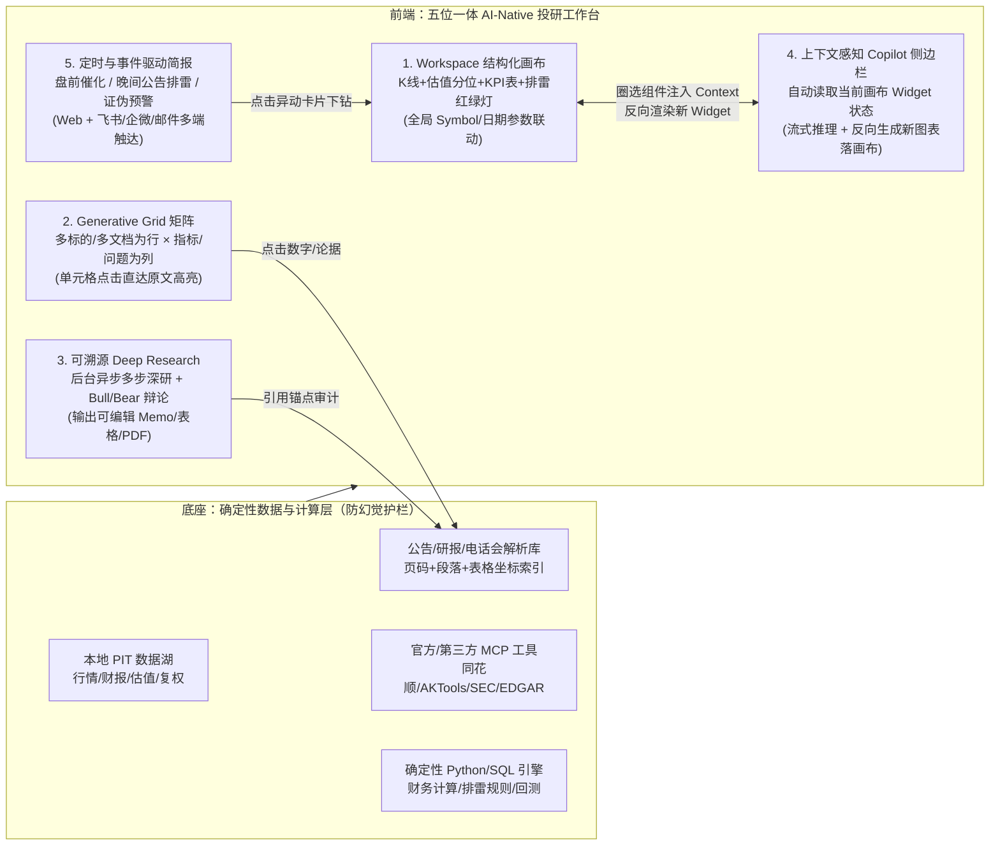

# 股票投研系统：2025–2026 全球与中国产品格局、开源生态与核心工作流深度调研

> **调研基准时间**：2026 年 11 月（GitHub 活跃度、星标、协议与发版信息于 `2026-11-25` 通过 GitHub REST API 实时核验；商业产品定价、功能与监管规则通过 2024–2026 官方公告与权威渠道核实）  
> **目标市场**：以 **A 股为核心**，深度对标 **美股（成熟范式与 AI 工具链最前沿）** 并兼顾 **港股（联动/跨境）**  
> **核查约定**：严格遵循 Evidence-First 原则；凡机构定制报价、未披露终审交易或动态阶梯费率，均显式标注 `[待核实]` 并附第三方采购基准区间。

---

## 执行摘要（Executive Summary）：2025–2026 股票投研行业的四大结构性拐点

在正式立项与拍板开发路线之前，过去 24 个月（2024 Q4 – 2026 Q4）全球与中国金融投研领域已经完成了第一轮大浪淘沙，四个不可逆的行业共识已经成型：

1. **“MCP 大解绑”重构数据分发格局**：传统数据巨头已经承认封闭聊天框打不过前沿推理模型，全面转向通过 **Model Context Protocol (MCP)** 与 **Skills** 将带权限控制（Entitlement-Gated）的权威数据喂给外部 Agent。海外方面，S&P Global / Kensho（2025.7）、FactSet（2025.12 推出业内首个生产级 MCP Server）、Daloopa、Quartr、Bigdata.com、Fiscal.ai 均已接入 **Claude for Financial Services** 与 **ChatGPT for Financial Services**；国内方面，**Wind Alice Market / AIFin Market**（2026.3 起打破 30 年纯 B 端定价墙向个人开放）、**东方财富“妙想 Skills”**（2026.3.13）、**通联数据 Datayes MCP / AI-Ready 3.0**（2026）以及**同花顺官方开源 `Hithink-Tech-Org/Financial-API`（MCP + CLI）** 全部走向同一条路。**纯套壳通用大模型的“AI 选股聊天机器人”已经失去商业护城河。**
2. **专用单体金融大模型退场 → “前沿推理模型编排 + 确定性计算（Deterministic Compute）”成事实标准**：Bloomberg 高管已公开确认 2023 年发布的 50B 参数 **BloombergGPT 并未在生产环境使用**，其于 2026 年 10 月全面公测上线的 **ASKB** 转而采用商业前沿模型 + 开源权重 + 小型专用模型的混合编排；开源社区亦高度收敛——`AI4Finance/FinGPT`（LoRA 微调 Notebook）在 2026 年已被边缘化，而 `FinRobot V2`、`TauricResearch/TradingAgents v1.0.0`（2026-11-24 全面重写为 TypeScript CLI）、`virattt/dexter`、`HKUDS/Vibe-Trading` 全部统一至 **“模型负责规划与叙事，确定性 Python/SQL/金融引擎负责一切数学与估值计算”** 的工程铁律。
3. **纯 ChatBox 消亡 → “结构化画布（Workspace）+ 矩阵批处理（Grid）+ 可溯源 Deep Research + 定时事件简报”成为付费主流**：Hebbia 行业尽调调研显示，约 71% 的金融团队已使用 AI 提效，但高达 **59% 仍须手工重算或二次核验 AI 输出**，根源在于传统聊天框存在表格坐标丢失、多步推理下的 **Citation Drift（引用漂移）** 与缺乏单元格级审计溯源。2026 年高留存、高客单产品（AlphaSense $7.5B 估值 / $600M+ ARR、Rogo $2B–$3.75B 估值、Hebbia Matrix 2.0、Fiscal.ai、OpenBB/FINOS Workspace）全部围绕“所见即所查、点击数字直达财报/公告原文高亮”构建。
4. **国内 A 股存在明显的“产品能力断层”与本土制度红利窗口**：国内市场呈现极端割裂——**理杏仁 / 芝士财富**财务干净但刻意“零 AI、零舆情、零盘口”；**财联社 / 开盘啦 / 韭研公社**题材与短线反应极快但缺乏严谨财务回溯与排雷；**同花顺 / 东财 C 端**覆盖广但广告推销与股吧噪音极重；**Wind / iFinD** 机构能力强但重且贵。叠加 2024–2026 年 **北向资金披露改革、新“国九条”史上最严退市/分红/减持红线、2025.7.7 高频程序化交易监管落地**，面向高阶个人与中小买方的 **AI-Native A 股合规深度投研工作台** 正处于极佳的切入窗口。

---

## 一、海外商业标杆产品矩阵（传统巨头 vs 新一代 AI-Native）

2025–2026 年海外股票投研市场呈现剧烈的 **两极分化（Bifurcation）**：顶端是年费 $3,300–$32,000+/席位的机构内容垄断者与投行/买方交付型 Agent；中底端则是 $20–$200/月 的 AI-Native 个人与独立分析师工作台——如今仅需 Bloomberg 不到 2% 的成本，即可完成 ~80% 的美股公开市场基本面与电话会研究。

### 1.1 传统/经典标杆深度剖析

#### 1. Bloomberg Terminal（彭博终端）
- **最新定价（2025–2026）**：无公开零售价目表（附加数据与交易所实时行情费另计 `[待核实]`）。自 **2025 年 1 月 1 日** 实施 6.5% 调价后，现行客户通告口径为：**单席位 $31,980/年（~$2,665/月）**，**2 席位及以上 $28,320/席位/年（~$2,360/月）**，强制 **2 年期合约锁定**（60 天提前解约窗口）；市场消息显示后续续约档期正逼近 ~$33,840/年。
- **AI 能力演进**：
  - **ASKB（Agentic Terminal AI）**：2026 年 1–2 月内测、2026 年 2 月 23 日发布预览、**2026 年 10 月向全量终端订阅用户正式开放（GA）**。可横跨数亿份公告、电话会转录、卖方研报、30,000+ 新闻源、Instant Bloomberg (IB) 聊天记录及用户上传的私有 PDF/Word 文档执行段落级溯源合成；配套 **ASKB Workflows** 支持将财报前后多步研究固化为可复用工作流库。
  - **BQL & BQuant Assistant**：ASKB 可直接生成 **Bloomberg Query Language (BQL)** 查询并一键导入 Excel/BQuant；**BQuant Assistant** 面向 22,000+ 字段自动生成 Python/PyBQL 代码。
  - **BloombergGPT 退出生产**：高管明确表示 2023 年发布的 BloombergGPT 不在 ASKB 生产链路中运行，已全面转向模型无关（Model-Agnostic）的前沿+开源+专用小模型组合。
- **护城河与短板**：IB Chat 交易员社交网络锁定、固收/宏观/信用定价标准与 Bloomberg News 构成极厚壁垒；但 **$32k/席位 + 2 年锁定期 + 封闭围墙花园（拒绝像 FactSet/S&P 那样开放外部 MCP 管道）** 使其在轻量级 AI Agent 生态中显得笨重。

#### 2. FactSet（慧甚）
- **最新定价**：机构定制报价 `[待核实]`；第三方采购基准显示 Workstation 约 **$12,000–$22,000+/席位/年**，企业级 API/AI-Ready Data/MCP 协议通常在 **$30,000–$100,000+/年**。
- **AI 能力演进**：2023 年底推出 **FactSet Mercury** 并在 2024 年 11 月扩展为全平台智能助手、2025 年 1 月上线投行专属 **Pitch Creator**；最具战略意义的是 **2025 年 12 月 16 日推出金融数据行业首个生产级 MCP Server**，将基本面、一致预期、股权结构与行情直接接入 Claude、ChatGPT、Snowflake 与 Databricks；2026 年 6 月 26 日上线 **Portfolio Analytics MCP**，2026 年 2 月发布私募平台 **Cobalt AI Doc Ingest** 及 MCP 接口，2026 年 11 月集成 Carbon Arc 另类数据 MCP。
- **护城河与短板**：多源数据口径统一能力（Data Concordance）与买方组合归因（Portfolio Analytics）实力极强，是传统巨头中最拥抱开放 MCP 的玩家；但模块化计价复杂、原生终端界面老旧，面临退化为 Claude/Rogo 背后“纯数据管道”的风险。

#### 3. S&P Capital IQ Pro（标普 Capital IQ）
- **最新定价**：机构定制合同 `[待核实]`；英国 G-Cloud 与采购基准显示单席位约 **$12,000–$25,000+/年**，叠加 Visible Alpha 与私募模块可达 **$33,000+/席位/年**，年续约涨幅约 5%，直连 API 常需在桌面端基础上加价 ~75%。
- **AI 能力演进**：2024 年 5 月完成收购 **Visible Alpha** 并于 **2025 年整合进 Capital IQ Pro**（覆盖 170+ 行业、100 万+ 细粒度卖方模型一致预期 KPI）；旗下 **Kensho** 于 2024 年 11 月推出 LLM-Ready API 并于 **2025 年 7 月 15 日率先落地 Anthropic Claude MCP 集成**；2026 年 10 月重磅发布 **ChatIQ Spreadsheets（AI 驱动且可刷新 CIQ 公式的 Excel 建模）与 ChatIQ Presentations（自动生成 PPT）**，叠加 Document Intelligence 2.0，正面反击 Rogo 等新锐。
- **护城河与短板**：Compustat/CIQ 标准化财务口径、私募公司库、信用评级与 Visible Alpha 卖方细粒度一致预期形成顶级数据护城河；但桌面端学习成本高、封闭库限制私有 Data Room 接入、中小企业难以承受。

#### 4. Koyfin
- **最新定价（精确核实）**：Free $0；**Plus $39/月（年付 $468/年，月付 $49）**；**Premium $79/月（年付 $948/年，月付 ~$99–$110）**；面向 RIA 投顾的 **Advisor Core $209/月**、**Advisor Pro $299/月**（均年付）；Teams 3 人起定制 `[待核实]`。
- **核心特征与 AI 现状**：底层采用机构级 **S&P Capital IQ** 基本面/预期数据与 Morningstar 投顾数据，提供 Web 端极佳的“轻量彭博”图表、跨资产宏观仪表盘与客户提案报告。**值得注意的是，截至 2026 年末，Koyfin 仍未在终端内上线原生对话式 AI Copilot 或财报 Agent**，坚持做纯可视化数据终端。
- **护城河与短板**：极佳的视觉交互与 S&P CIQ 数据零售套利；但**个人版无原生 Excel 插件与开发者 API（仅支持 CSV 导出）**，缺乏 AI 文档问答与公司专属经营 KPI（如 SaaS ARR/同店增速），正遭受 Fiscal.ai 与 Perplexity Finance 的上下夹击。

#### 5. Seeking Alpha
- **最新定价（精确核实）**：**Premium $299/年**（首年常有 $215–$269 促销）；**Alpha Picks $499/年**（独立订阅，每月 2 只量化强买推荐）；**PRO $2,400/年**（精选深度创意、微盘股与做空专区）。
- **核心特征与 AI 现状**：核心壁垒在于双边众包多空辩论社区 + 覆盖 100+ 指标的 **5 因子 Quant Ratings**（Value / Growth / Profitability / Momentum / EPS Revisions）。**2024 年 12 月 10 日推出 Virtual Analyst Reports**，利用 LLM 聚合站内众包研报、电话会纪要与量化评分生成 3,000+ 美股的标准执行摘要。
- **护城河与短板**：庞大的个人投资者 SEO 分发与多空观点库；但 AI 仅停留在浅层“站内摘要”阶段，不支持交互式多文档穿透与自定义建模，众包作者水平参差不齐，且强年付付费墙门槛高。

#### 6. TradingView
- **最新定价（精确核实）**：Basic $0；**Essential $12.95/月（月付 $14.95）**；**Plus $29.95/月（月付 $34.95）**；**Premium $59.95/月（月付 $69.95）**；**Ultimate $199.95/月（月付 $239.95）**（实时交易所行情另计）。
- **核心特征与 AI 现状**：2025–2026 迭代至 **Pine Script v6**（动态循环请求、严格类型、单脚本最多 40 路请求）与 **Screener 2.0 / Pine Screener**。上线了 **AI Screener**（自然语言映射预设筛选器）与 **AI Chart Copilot**，但配额严格、复杂指标映射易出错，且无法在 Pine Screener 内自动生成 Pine 代码。
- **护城河与短板**：全球无可争议的 HTML5 技术图表标准 + 10 万+社区脚本 + 全球券商/交易所 B2B 嵌入生态；但**基本面研究只是附庸**——无 SEC 财报深读 RAG、无分部 KPI 表、无机构一致预期与电话会智能分析。

---

### 1.2 新一代 AI-Native 投研代表深度剖析（2025–2026）

#### 7. Perplexity Finance（`perplexity.ai/finance`）
- **核心能力与演进**：自 2024 年 11 月携手 **Quartr** 接入财报电话会后，2025–2026 快速演进为面向大众与轻专业用户的全能 AI 金融中枢——整合 **FactSet** 一致预期、S&P Global、Morningstar、LSEG、Financial Modeling Prep、SEC EDGAR 原文（10-K/10-Q/8-K/20-F）、Quartr 实时音视频与幻灯片、Polymarket 预测市场、Coinbase 行情与 Plaid 组合同步。2026 年推出 **Perplexity Computer**（暴露 40+ 金融工具调用与 Quartr MCP 集成）及面向开发者的 **`finance_search` Agent API**，已支持多步骤生成 DCF 与可比公司表格/PPT。
- **最新定价（精确核实）**：Free $0；Education Pro $10/月；**Pro $20/月（年付 ~$17/月）**；**Enterprise Pro $40/席位/月**；**Max $200/月（年付 ~$167/月）**；Agent API 按调用/Token 计费。
- **护城河与短板**：以 $20/月 极致性价比和消费级分发，打包了多家机构级数据源，成为散户与独立研究者的“第一入口”；但并非面向机构 MNPI / 合规审计设计，缺乏专家访谈与卖方研究闭环，复杂财务口径计算偶有边界偏差。

#### 8. Fiscal.ai（原 FinChat.io）
- **关键节点与定位**：**2025 年 6 月 17 日**正式由 FinChat.io 更名为 **Fiscal.ai**，同步完成 Portage 领投、VanEck 参投的 **$1,000 万 A 轮融资**（累计融资 $1,300 万），标志着产品从“零售财报聊天工具”全面升级为“AI-Native 机构级基本面终端 + API/MCP 数据商”。
- **最新定价（精确核实）**：永久免费 Web 终端已退场，改为 **7 天试用**（开发者 API 保留 ~35 只核心标的/日限 250 次的免费沙箱）；**Pro $39/月（年付 $468，月付 $49）**；**Max $79/月（年付 $948，月付 $99）**；Enterprise 参考约 **$199–$250/月** 或定制 `[待核实]`；生产级 API/MCP 单独计费 `[待核实]`。
- **核心杀手锏与短板**：覆盖全球 100,000+ 上市公司，核心护城河在于人工校对、直链 SEC 公告段落的 **公司专属经营 KPI 与分部拆解库**（如 SaaS 的 ARR/NRR、零售同店增速 SSS、云厂商分部利润），堪称 **“大众版 Visible Alpha / Daloopa”**；Copilot 直接基于结构化库生成图表而非瞎搜网页。短板是无卖方研报与专家纪要、宏观与固收图表弱于 Koyfin。

#### 9. AlphaSense（含 Tegus & Canalyst）
- **资本规模与壁垒**：2024 年中以 **9.3 亿美元**收购专家网络巨头 **Tegus**（含 30 万+ 专家访谈库、BamSEC、Canalyst 标准化财务模型库）；**2026 年 Q1 突破 $6 亿 ARR**（年中迈向 $7 亿+，年增速 ~40%），并于 **2026 年 6 月以 $75 亿估值完成 $3.5 亿融资**（Vitruvian、Accenture Ventures、J.P. Morgan AM 领投，已筹备 IPO）。
- **AI 产品矩阵**：**Generative Grid**（2025.3.5 上线，跨数百份文档并行矩阵提取）、**Deep Research**（2025.6.10 上线，自主执行数十次至上百次迭代检索生成投资级研报，耗时 5–30 分钟后台运行）、**SuperAnalyst**（2026 年中上线，常驻型自主多步研究 Agent）。
- **定价与短板**：企业定制 `[待核实]`（采购基准：基础版中位 **$18.4k–$25k/年**、Tegus 专家库中位 **$30k/年**，合并全家桶 **$25k–$100k+/年**）。拥有所有 AI-Native 平台中最硬的 **独家定性内容壁垒（华尔街卖方研报 + 30 万专家纪要 + Canalyst）**；短板是企业打包价格高且不透明，原生 Office 投行交付物（PPT/Excel 编排）弱于 Rogo。

#### 10. Hebbia（Matrix）
- **核心范式与演进**：彻底抛弃聊天框，首创 **Matrix 多智能体电子表格网格**（每一行是一份财报/尽调文档/公司，每一列是一个 Agent 问题或提取任务，每个单元格均可点击跳转原文高亮）。2025–2026 升级至 **Matrix 2.0 Workflow Engine**：支持 **Follow-Up Columns**（按公司串联多步 Agent）、Company Grid 混合公私有数据、**Matrix-as-a-Source**（将上层矩阵作为下层矩阵输入）以及一键输出投委会备忘录（IC Memo）与 PPT。
- **商业进展与定价**：累计融资 ~$1.61 亿（2024.7 由 a16z 领投 $1.3 亿 B 轮，估值 $7 亿）；2025–2026 ARR 增至 **~$4,800 万–$5,000 万**，拿下 **Morgan Stanley 约 5,000 席位**标杆大单。企业定制 `[待核实]`（行业基准约 **$3,000–$15,000/席位/年**，机构总包达数十万美元）。
- **致命短板**：Matrix 交互范式极具前瞻性，但本身**已被 AlphaSense（Generative Grid）、Rogo 与 Harvey 全面效仿**；由于缺乏独家金融/专家数据护城河，正遭受 AlphaSense（数据更厚）与 Rogo（投行 Office 交付更快）的双重夹击。

#### 11. Rogo（“Felix” 数字投行分析师）
- **爆发式轨迹**：由前投行分析师打造，专注投行（IB）、PE 与对冲基金。2025.4 B 轮 $3.5 亿估值 → 2026.1 C 轮（红杉领投）$7.5 亿 → 2026.4 D 轮（KPCB 领投 $1.6 亿）**$20 亿估值** → 2026.9 获巴克莱/法巴/花旗/法兴战略轮 ~$3,000 万 → 2026.11 彭博报道正以 **$37.5 亿估值**冲刺 ~$3.5 亿融资 `[终审交割待核实]`；2026 年中后期 ARR 达 **$5,000 万–$7,700 万**，覆盖高盛、摩根大通、花旗、富国等约 450 家机构。
- **核心能力与定价**：旗下自主智能体 **“Felix”** 原生寄生在 **Excel、PowerPoint、Word** 及机构内部 SharePoint/Data Room 中，直接交付带机构模板与页脚溯源的 Pitchbook、Comps 与动态财务模型，原生内置华尔街防火墙（Chinese Walls）与 MNPI 合规隔离。定价为定制 `[待核实]`（行业基准底座约 **$3,300/席位/年** + 驻场实施费，采用 **BYOD 模式**，客户需自带 FactSet/CIQ/LSEG 数据牌照）。
- **致命短板**：无自有数据护城河，属于纯工作流编排层；正面临上游 **Claude for Excel/PPT** 与 **ChatGPT for Financial Services** 以及下游 **S&P ChatIQ Spreadsheets/Presentations** 的三面围剿。

#### 12. Quartr
- **核心能力与进展**：专注全球第一手投资者关系（IR）内容基础设施，覆盖 **65+ 市场、17,000+ 上市公司**的实时财报电话会音频、带发言人标注的转录稿、同步幻灯片（支持 Slide History 跨季对比）与公告。提供 **Quartr Pro**（含源链接 AI 问答、叙事变化周报与原生 **Quartr MCP**）及面向 RAG 优化的 **Quartr API**（为 Perplexity Finance 等平台供数）。2026 年 8 月获 Altos Ventures 与瑞典北欧斯安银行（SEB）领投 **$1,800 万融资**。
- **定价与短板**：个人移动端与学生版免费；Quartr Pro 与 API 为企业定制 `[待核实]`（市场反馈机构接入通常数百至数千美元/月起）。长板是全球 IR 源头最干净，短板是赛道偏窄（无财务数据库、无一致预期、无专家访谈），存在沦为低毛利幕后管道的风险。

#### 13. 2025–2026 四大不可忽视的新锐与底座势力
- **Anthropic Claude for Financial Services（及 OpenAI ChatGPT for Financial Services）**：2025.7 发布金融分析方案，2025.10 推出 **Claude for Excel**（结构化读/建/查多表模型并附单元格引用），2026.2–5 打通 Excel ↔ PPT ↔ Word 并预置 **FactSet、S&P Capital IQ、LSEG、Morningstar、PitchBook、MSCI、Daloopa、Moody's、Bigdata.com** 等全套官方 MCP 连接器；OpenAI 亦携手摩根士丹利/Evercore 推出对标方案。无单独 SKU（从 Claude Pro $20/月 到企业定制 `[待核实]`，数据费另付给各数据商）——**对所有“薄壳金融 AI 工具”构成降维打击**。
- **Bigdata.com（RavenPack 出品）**：依托 20 年金融 NLP 与实体消歧知识图谱积累，将 10 亿+ 机构文档（25 年新闻、SEC 公告、转录、研报、ESG）切片 Token 化，提供 7×24 监控 Agent 与零代码远程 MCP Server。定价极其透明：**Starter $0**（送 $10 额度）、**Pro $40–$50/月**（解锁 PIT 财务/研报/情绪信号与 API/MCP）、**Max $160–$200/月**、Enterprise 定制 `[待核实]`。
- **Daloopa**：2026 年 5 月完成 **$4,700 万 C 轮**（累计 ~$1.01 亿），覆盖 5,500+ 上市公司长达 14 年历史，主打 **100% 带原文页码超链接的自动化财务 KPI 抽取与模型更新**，通过官方 MCP 成为 Claude、OpenAI、Perplexity 背后的“确定性数字校验底座”。企业定制 `[待核实]`（基准 **$10,000–$25,000+/席位/年**）。
- **Brightwave**：累计融资 $2,100 万，主打基于知识图谱的 **全文档尽调推理（Whole-Document Reasoning）**——并非切碎 Top-K 片段 RAG，而是整库吃进数百页 Data Room/CIM/公告以自动发现跨文档矛盾点。定制报价 `[待核实]`（市场基准 **$30,000–$80,000+/年**），但资本体量远逊于 AlphaSense/Rogo。

---

### 1.3 海外商业投研产品全景横向对比表

| 产品 | 类别与目标客群 | 覆盖市场 | 核心杀手锏功能 | AI 落地深度 | 2025–2026 核实定价 | 核心护城河 | 致命短板 | 适用借鉴方向 |
| :--- | :--- | :--- | :--- | :--- | :--- | :--- | :--- | :--- |
| **Bloomberg Terminal** | 传统机构巨头 （全市场机构/交易台） | 全球多资产（股/债/汇/大宗/宏观） | 实时全资产终端 + IB Chat + ASKB Workflows + BQL/BQuant | **极深** （ASKB 2026.10 GA，多模型编排 + 代码生成） | 单席 **$31,980/年** 2+席 **$28,320/年** （2 年锁；附加费 `[待核实]`） | IB Chat 社交网络 + 固收/宏观定价权 + 彭博新闻 | 极贵 + 封闭围墙花园（抗拒开放外部 MCP） | 借鉴 ASKB Workflows“固化可复现研究流水线”思路 |
| **FactSet** | 传统机构巨头 （买方资管/投行） | 全球股/债/宏观/私募 | 多源数据统一 + 组合归因 + **首个生产级金融 MCP** | **深（数据/MCP 层）** （Mercury、Pitch Creator、MCP 生态） | 定制 `[待核实]` 基准：终端 **$12k–$22k/年**；API/MCP **$30k–$100k+/年** | 买方组合分析嵌入 + 数据口径映射 + 开放 MCP 先发优势 | 模块计价复杂；终端交互偏老；面临沦为纯管道风险 | 借鉴“开放 MCP + 组合风险归因”分层架构 |
| **S&P Capital IQ Pro** | 传统机构巨头 （投行/买方/研究） | 全球公募+私募+信用 | 标准化财务 + **Visible Alpha 细粒度预期** + ChatIQ Office | **深** （Kensho MCP、Doc Intel 2.0、2026.10 ChatIQ Excel/PPT） | 定制 `[待核实]` 基准：**$12k–$33k+/席位/年**（API 另加 ~75%） | Compustat/CIQ 财务标准 + Visible Alpha + 标普评级 | 贵、学习陡峭、封闭数据保险箱不便融私有文档 | 借鉴“可刷新公式的表格交付 + 细粒度分部预期” |
| **Koyfin** | 现代 Web 终端 （进阶个人/RIA 投顾） | 全球股/ETF/宏观/基金 | Web 端最强多资产图表、宏观仪表盘与投顾报告 | **极低/无** （无原生 AI Copilot/文档 Agent） | Free $0；Plus **$39/月**；Premium **$79/月**；Advisor **$209–$299/月**（年付） | 视觉交互标杆 + S&P CIQ 零售套利 + RIA 工具粘性 | 个人版**无 Excel 插件与 API**；零 AI 文档与 KPI 能力 | 借鉴高密度可视化画布与估值/宏观仪表盘交互 |
| **Seeking Alpha** | 个人众包社区 （美股个人投资者） | 美股为主 | 众包多空辩论库 + 5 因子 Quant Ratings + Virtual Analyst | **浅（摘要层）** （仅限站内语料摘要，无交互深挖） | Premium **$299/年**；Alpha Picks **$499/年**；PRO **$2,400/年** | 双边作者网络 + SEO 分发 + 量化评分历史口碑 | 众包质量参差、强年付墙、无深度建模与图表 | 借鉴“5 因子量化评分 + 多空观点并列呈现” |
| **TradingView** | 技术图表平台 （全球技术交易者） | 全球股/期货/外汇/加密 | 行业标准 HTML5 图表 + Pine Script v6 + Screener 2.0 | **浅（外壳封装）** （限额筛选器映射 + 图表摘要） | Basic $0；Essential **$12.95**；Plus **$29.95**；Premium **$59.95**；Ultimate **$199.95/月**（年付） | 10 万+社区脚本 + 全球券商/交易所嵌入式组件 | **基本面与公告研究极弱**；AI 无法写 Pine 选股脚本 | 借鉴 K 线交互体验（可直接集成开源 Lightweight Charts） |
| **Perplexity Finance** | AI-Native 入口 （大众/独立研究者） | 美股/全球股/加密 | $20/月 聚合 FactSet + Quartr + SEC EDGAR + 40+ 工具 | **中高** （多步检索 + Perplexity Computer 表格/PPT 生成） | Free $0；Pro **$20/月**；Ent Pro **$40/月**；Max **$200/月** | 消费级海量流量 + 低价聚合多家机构数据源 | 非合规/MNPI 级别；无专家纪要；复杂口径精度有限 | 借鉴低门槛自然语言直达行情+公告+转录体验 |
| **Fiscal.ai** *(原 FinChat)* | AI-Native 基本面终端 （进阶个人/中小买方） | 全球 10 万+上市公司 | **人工校对公司专属 KPI 与分部拆解** + 溯源 Copilot/MCP | **高（数据锚定）** （查询结构化 KPI 库而非泛网页） | 7 天试用；Pro **$39/月**；Max **$79/月**（年付）；Ent ~**$199–$250/月** `[待核实]` | 高性价比独家经营 KPI 数据库 + 快速迭代 + MCP 分发 | 无卖方研报与专家访谈；宏观与图表弱于 Koyfin | **最值得 A 股对标的个人/专业工作台标杆之一** |
| **AlphaSense** *(+Tegus)* | AI-Native 机构情报 （买方/投行/企业战略） | 全球公私募（美欧核心） | **卖方研报 + 30 万 Tegus 专家访谈 + Canalyst** + Deep Research | **极高** （Gen Grid、Deep Research、SuperAnalyst） | 定制 `[待核实]` 基准：合并版 **$25k–$100k+/年**（$7.5B 估值） | **最强独家定性内容壁垒** + 句级原文溯源 + $600M+ ARR | 极贵且打包不透明；原生 Office 制表/制片弱于 Rogo | 借鉴 **Generative Grid 批处理 + Deep Research 后台异步深研** |
| **Hebbia** *(Matrix)* | AI-Native 网格工作台 （PE/私募信贷/投行） | 全球公私有文档/Data Room | **Matrix 2.0 多智能体电子表格网格**（跨文档并行尽调） | **极高** （多步级联列、Matrix-as-a-Source、单元格溯源） | 定制 `[待核实]` 基准：**$3k–$15k/席位/年**（大行总包数十万美元） | 分析师原生表格 UX + 顶级企业合规（Morgan Stanley 5k 席位） | 无独家金融数据壁垒；网格交互已被全面抄袭 | 借鉴 **“文档为行、问题为列、单元格带引用”的多股横向对比矩阵** |
| **Rogo** *(Felix)* | AI-Native 投行分析师 （IB/PE/对冲基金） | 客户自带数据（BYOD） | 原生驻留 **Excel/PPT/Word** 交付带脚注 Pitchbook 与模型 | **极高** （端到端办公文档执行 + 华尔街防火墙合规） | 定制 `[待核实]` 基准：底座 ~**$3,300/席位/年** + 实施费（BYOD） | 顶级投行股东+客户同盟 + 驻场工程交付 + MNPI 合规 | **无自有数据**；被 Claude/ChatGPT Office 与 S&P 夹击 | 借鉴“研究终点是结构化交付物（研报/模型表），而非聊天记录” |
| **Quartr** | AI-Ready IR 底座 （对冲基金/券商/AI 平台） | 全球 65+ 市场、1.7 万公司 | 最干净的一手财报音频、同步 PPT 与 RAG/MCP 转录 API | **中（数据基建优先）** （IR 问答、Slide 跨季对比、原生 MCP） | 移动端免费；Pro/API 定制 `[待核实]`（数百至数千美元/月起） | 全球 65 国一手 IR 源头 + 嵌入 Perplexity 等生态 | 赛道过窄（无财务/一致预期/专家），易管道化 | 借鉴“电话会音频/PPT/原文同步锚定”交互细节 |
| **Claude / ChatGPT for FinServ** | 前沿模型 + MCP 中枢 （全市场金融机构） | 取决于接入的第三方 MCP | **原生 Excel/PPT 读写** + 一键联邦接入 FactSet/CIQ/Daloopa 等 MCP | **前沿原生 Agentic** （最强长上下文推理 + 工具调用） | Pro **$20/月** → 企业定制 `[待核实]`（不含数据商牌照费） | 底层推理代差 + 开放 MCP 标准 + 零训练企业隐私承诺 | 需另购昂贵数据牌照；缺开箱即用投行权限/中国墙治理 | 警示：**切勿重复造通用聊天轮子，必须提供专属数据/画布/垂直工作流价值** |
| **Bigdata.com** *(RavenPack)* | AI 金融语料与监控 （量化/买方/开发者） | 全球 10 亿+ 金融文档 | 实体消歧知识图谱 + 7×24 监控 Agent + 零代码远程 MCP | **高（精准 RAG）** （Token 级计费精准召回） | Starter **$0**；Pro **$40–$50/月**；Max **$160–$200/月**；Ent `[待核实]` | 20 年金融 NLP/知识图谱积累 + 透明按量计费 | 非图表/财务建模终端；高频 Agent 易烧光额度 | 借鉴“实体消歧 + Token/额度精细计量 + 7×24 监控 Agent” |
| **Daloopa** | 确定性基本面提取层 （买方/AI 大模型底座） | 全球 5,500+ 上市公司 | **100% 审计级溯源历史 KPI 抽取** + 自动更新 Excel 模型 | **深（抽取与 MCP 层）** （各大前沿模型数字防幻觉核心底座） | 限量免费；Core/API 定制 `[待核实]`（基准 **$10k–$25k+/席位/年**） | 确定性数字零幻觉护城河 + 主流 AI 巨头默认后端 | 纯数据抽取管道，无定性检索、图表或新闻 | 借鉴“数字抽取与 LLM 叙事彻底分离 + 单元格锚点回跳” |
| **Brightwave** | 全文档尽调推理 （PE/对冲基金） | 公募公告 + 私有 Data Room | 知识图谱整库读入数百页文档，自动排查**跨文档矛盾点** | **高（图推理）** （超越 Top-K 切片 RAG 的全局一致性核查） | 定制 `[待核实]` 基准：**$30k–$80k+/年** | 全文档矛盾检测算法 + 合规就绪 | 融资体量小（$21M），渠道难敌 $7.5B AlphaSense | 借鉴“交叉核验财报正文 vs 附注 vs 电话会口径矛盾”的排雷能力 |

---

## 二、国内主流投研产品矩阵（A 股 / 港股生态）与 A 股独特痛点

与海外高度一致的是，2025–2026 年中国主流金融终端也全线进入 **“DeepSeek 深度思考普及 + 数据 MCP/Skills 生态开放 + 交付型 Agent”** 阶段；但与海外截然不同的是，国内存在强烈的 **A 股本土制度特征、数据源割裂、C 端噪音严重与特许投顾牌照红线**。

### 2.1 机构级终端矩阵

#### 1. Wind 万得（`wind.com.cn` | `alice.wind.com.cn`）
- **定价与 2026 破冰**：传统机构金融终端单账号公开标准报价约 **39,800 元/年**（大机构集采有折扣，全模块企业级采购可达数十万元/年），独立宏观库 **EDB** 参考约 **34,600 元/年**。**重大变局出现在 2026 年 3 月下旬**：万得成立近 30 年来首次打破纯机构定价墙，发布面向个人专业用户的 **Wind Alice 个人版**，随后成立全资子公司“万得艾思（深圳）”并在 2026 年下半年推出 **Alice Market / AIFin Market**——采用“注册赠积分 + 订阅/灵点制”（市场公开报道起步月费低至数十元至数百元档位，企业轻量团队包参考约 5 万元/年 `[各档位实时价格与扣点细则待核实]`），向个人分析师与外部 Agent 开放机构级数据与工具。
- **核心 AI 与数据壁垒**：官方 AI 品牌统一为 **Wind Alice（万得艾思/灵犀）**，定位“交付型金融工作平台”，底层挂载上百个专业 **MCP 工具与 Skills 技能广场**，面对复杂课题自动拉起多专家 Agent 输出带溯源、可编辑的 **Word / Excel / PPT 底稿**。其 **EDB 宏观经济数据库**（覆盖全球 200+ 国家/地区数千万指标、国内可下钻至区县级）、全市场固收/债券估值体系、机构一致预期基准及历史 `WindPy` / Excel `w.edb()` 模板锁定依然是绝对壁垒。
- **痛点**：机构降本增效下高昂年费正逼迫买方/卖方将账号费转嫁给分析师或转向 iFinD/Choice 双终端并行；老终端学习曲线陡峭。

#### 2. 同花顺 iFinD / 问财（`51ifind.com` | `iwencai.com`）
- **定价分层**：iFinD 机构终端标准参考价约 **8,800–20,000 元/台/年**（多模块/高并发机构标价可达 3 万–5 万元/年），主打 Wind“高性价比平替”；C 端问财基础选股免费，进阶/策略包数百至数千元/年 `[App 内实时分档待核实]`，Level-2 零售常见 200–400 元/年；HithinkGPT 企业版/API 定制报价 `[待核实]`。
- **2025–2026 AI 演进**：自研 **HithinkGPT** 为首批备案金融大模型；**2025 年 2 月**迅速融合 **DeepSeek-R1** 推理范式将问财升级为具备“边想边查、多步规划”能力的 **Agent 2.0**；iFinD 全面集成 AIGC 研报创作、产业链图谱与财务排雷。更值得关注的是，2026 年 6 月同花顺官方在 GitHub 开源了 **`Hithink-Tech-Org/Financial-API`（4,608★，MIT）**，直接提供面向 AI Agent 的 REST API、**MCP Server**、CLI 与 Agent Skills。
- **优缺点**：问财自然语言条件选股国民心智无敌，iFinD 性价比高；但 iFinD Python API 文档与调试口碑偏弱、长历史冷门数据完整度仍逊于 Wind；同花顺 C 端 App 广告弹窗与投教课程推销干扰极重。

#### 3. 东方财富 Choice / 妙想金融大模型（`choiceweb.eastmoney.com` | `ai.eastmoney.com`）
- **定价分层**：Choice 标准单账号约 **5,000–6,000 元/年**（常见 5,800 元/年），仅为 Wind 零头，且支持个人账户资产达标（如月均 30 万）免费体验；东财 App 妙想基础 AI 对个人免费开放，**妙想 Skills / MCP** 在推广期提供限时免费或绑定 Choice 权益 `[长期商业化阶梯价待核实]`。
- **2024–2026 妙想演进**：2024.11.30 发布面向专业投研的 **妙想投研助理** 并嵌入 Choice 8.0+；2025.2 完成 DeepSeek 本地化部署并升级深度思考模式；2025.3.21 妙想全面登陆东财 App；**2026 年 3 月 13 日正式发布“妙想 Skills”**（配套 MCP 体系），以 Choice 数据库为底座封装资讯搜索、财务查数、智能选股、自选股与模拟组合管理四大核心技能，全面兼容 OpenClaw、DeepSeek、Kimi、千问等外部 Agent。
- **优缺点**：性价比无出其右，坐拥“东财网 + 天天基金 + 东财证券 + 股吧”流量闭环，MCP/Skills 卡位极快；但超长周期细分宏观/固收深度不及 Wind，股吧社区情绪噪音与水军极重。

### 2.2 进阶个人与垂类生态矩阵

- **萝卜投研 / 通联数据 Datayes（`robo.datayes.com`）**：2026 年升级至 **AI-Ready 3.0 + Datayes MCP**，并推出搭载 DeepSeek 推理模型的 AI 原生工作台 **萝卜Work**，聚焦全市场研报 PDF 秒级解读、**产业链知识图谱**（穿透供应链事件传导）及行业/另类数据（供应链物流、专利、ESG 等）。会员分基础免费、银卡（促销年卡常见 258 元–数百元）与金卡/Pro（数千元/年 `[最新官网挂牌价待核实]`）。偏基本面与中长期买方，缺乏 A 股盘中短线打板与游资工具。
- **理杏仁 Lixinger（`lixinger.com`）**：A/港/美严谨基本面与**估值百分位（PE/PB/股息率 3/5/10 年及全历史分位）**标杆。**2026 年 3 月 4 日起正式执行新定价**：年付非种子用户 **518 元**（种子用户 **418 元**），二年付 928/828 元，三年付 1,248/1,148 元，月付 70 元。2026 年初上线 A 股三大财报“业绩回溯值”与保险偿付能力等专项字段，并提供开放 Token API。官方明确坚持 **“不做推荐、不做技术分析、不做预测”**——刻意零 AI、零舆情、零盘口，界面硬核。
- **雪球（`xueqiu.com`）**：中文互联网沉淀最深的长文基本面社区与实盘组合平台，2025–2026 接入 DeepSeek 推出 A/美股财报 AI 摘要并主推指数配置（雪球三分法）。痛点极其鲜明：AI 财报摘要普及带来大量同质化“伪深度”长文；**算法回音室效应**在极端行情下放大羊群情绪；大 V 暗语荐股与强监管封号频发。
- **富途牛牛（`futuhk.com` / `futunn.com`）**：港美股个人交易与研究交互标杆（美股 LV2 60 档盘口、5×24h 交易、期权链可视化），**2025 年 3 月全面接入 DeepSeek-R1** 升级 **牛牛 AI（Futubull AI）** 并上线低门槛 AI 程式交易。但用于 **深度 A 股研究存在硬伤**：自 **2023 年 5 月中旬**起响应证监会跨境业务整改从中国大陆应用商店下架（“遏制增量、化解存量”），境内新用户无法合规开户使用；且其 A 股覆盖限于沪深股通，缺乏本土概念板块、游资席位与政策传导深度。
- **腾讯自选股**：依托混元大模型 + DeepSeek-R1 双底座，**2026 年 6 月中旬开启金融 AI 智能体 StockBuddy 内测**，直接原生打通 **微信 / 企业微信聊天对话** 与桌面端及腾讯 ima 知识库，主打免部署、持仓一键诊断与智能盯盘，且合规底线极严（绝不直接荐股）。局限在于定位大众轻陪伴，缺乏深度财务建模、长周期宏观库与 A 股盘口短线生态。
- **垂直生态四强（A 股实战高频刚需补全）**：
  - **财联社 / 星矿数据 / 财跃星辰（`cls.cn` / `finstep.cn`）**：7×24h 盘中电报与政策风口事实标准，推出国有双备案千亿多模态 **财跃大模型**；但核心 VIP 栏目（《盘中宝》《风口研报》等）单栏目原价约 **1 万–1.38 万元/年**，钻石卡原价 **3 万–6 万元/年**，价格昂贵且偏短线催化。
  - **芝士财富（`zscf.cc`）**：聚焦基本面量化排雷、申万一二三级行业估值分位与双股 PK 台，年度会员参考约 **298–518 元/年起** `[实时全档位待核实]`，对价值新手友好但无舆情/短线盘口。
  - **韭研公社（`jiuyangongshe.com`）**：A 股“基本面+题材”复盘高信噪比社区（免费 + 工分激励制），上线盘中 AI 实时异动解析，新题材首波产业链逻辑沉淀全网最快，但存在吹票博弈。
  - **开盘啦（`kaipanla.com`）& 通达信**：前者是短线打板/集合竞价/涨停梯队/资金属性分类神器（VIP 参考约 300–600 元/年 `[实时促销价待核实]`）；后者是普及度最高的极速看盘与自定义公式承载基座，但 UI 老旧且无原生非结构化 AI 投研能力。

### 2.3 国内主流投研产品全景横向对比表

| 产品 | 定位与客群 | 覆盖市场 | 核心杀手锏 | AI 落地深度（2025–2026） | 参考成本/模式 | 核心优势 | 主要短板 |
| :--- | :--- | :--- | :--- | :--- | :--- | :--- | :--- |
| **Wind 万得 / Wind Alice** | 机构垄断终端 + 2026 个人 AI 破冰 | 全球（A 股/固收/宏观统治级） | EDB 宏观库 + 固收估值 + F9 + **Wind Alice 多专家交付底稿 & Alice Market MCP** | **极高** （2026.3 个人版破冰，挂载 150+ 金融 MCP 工具） | 终端 ~**39,800 元/年**；EDB ~34,600 元/年；Alice 个人积分/订阅制 `[实时档位待核实]` | 数据最权威、机构事实标准、模板/代码强锁定 | 机构单价高、终端笨重、个人版精细扣点成本待观察 |
| **同花顺 iFinD / 问财** | 机构平替 + 国民 C 端选股 | A/港/美/基金/债 | **问财自然语言选股** + 国民流量 + 官方开源 `Financial-API` MCP | **高** （HithinkGPT + 2025.2 DeepSeek-R1 Agent 2.0） | iFinD **8,800–20,000 元/年**；问财免费+进阶订阅 `[待核实]`；L2 200–400 元/年 | 性价比高、自然语言选股心智最强、官方开放 MCP | API 调试口碑偏弱；C 端广告弹窗推销极重 |
| **东方财富 Choice / 妙想** | 高性价比机构终端 + 开放 Skills 生态 | 沪深港美/基金/宏观 | 极致性价比终端 + **2026.3 妙想 Skills/MCP 开放技能包** | **高** （妙想投研助理 + DeepSeek 本地部署 + Skills/MCP） | Choice **5,000–6,000 元/年**；C 端免费；Skills 推广期免费/绑定 `[待核实]` | 全网最低门槛机构终端 + 流量与交易闭环 | 超长周期宏观/固收深度不及 Wind；股吧噪音极重 |
| **萝卜投研（通联数据）** | AI 研报与产业链买方工作台 | A/港/美/宏观/另类 | 全市场研报搜索解读 + **产业链知识图谱** + 另类数据 + 萝卜Work | **高** （AI-Ready 3.0 + Datayes MCP + DeepSeek） | 免费 + 银卡 ~258+ 元/年 + 金卡/Pro 数千元/年 `[待核实]` | 研报穿透、产业链传导与另类因子独具特色 | 缺 A 股盘中短线/竞价/游资生态；高阶版较贵 |
| **理杏仁** | 严谨基本面与估值工具（价值派） | A/港/美股与宽基指数 | **多窗口估值百分位** + 2026 业绩回溯值 + 开放 API | **零** （官方刻意坚持纯数据、无 AI/无预测） | **2026.3.4 新价：年付 518 元**（种子 418 元），月付 70 元 | 数据极度干净克制、无广告噪音、开放 API | 无大模型助手、无公告语义/舆情、无盘口技术面 |
| **雪球** | 长文基本面社区 + 基金组合 | A/港/美/公募 | 中文最深基本面讨论沉淀 + 实盘组合 + 指数社区 | **中低** （接入 DeepSeek 财报摘要与问答） | 免费 + 会员/基金申购/打赏 | 高净值用户与行业草根专家多 | 噪音/回音室严重、AI 同质化水文多、暗语荐股合规风险 |
| **富途牛牛** | 港美股交易与综合研究标杆 | 港/美（统治级）+ 沪深股通 | 美股 60 档 LV2/5×24h + 期权链 + **牛牛 AI（DeepSeek-R1）+ AI 程式交易** | **中高** （专家模式图表报告、自然语言选股） | 免费行情 + 交易佣金 + 高级行情订阅 | 交互体验行业顶级，港美股生态闭环 | **2023.5 大陆下架遏制增量**；A 股本土题材/龙虎榜/政策深度弱 |
| **腾讯自选股 / StockBuddy** | 国民轻量行情 + 微信原生 Agent | 沪深港美 | **2026.6 StockBuddy 原生接入微信/企微** + ima 知识库 | **中高** （混元 + DeepSeek 双底座，严格合规提示） | C 端免费 + 增值行情/资讯服务 | 微信触达零门槛、交互轻便、合规极稳 | 偏大众轻陪伴，无深度财务建模与专业盘口工具 |
| **财联社 / 芝士 / 韭研 / 开盘啦 / 通达信** | A 股细分场景刚需专精工具 | A 股深度本土化 | 电报秒推（财联社）/ 排雷（芝士）/ 题材复盘（韭研）/ 竞价打板（开盘啦）/ 公式（通达信） | **分化** （财跃大模型、韭研 AI 异动解析；通达信/开盘啦偏传统） | 免费至极高（开盘啦 ~300–600 元；财联社 VIP **1 万–6 万元/年**） | 精准命中 A 股独有博弈与催化场景 | 工具极度碎片化，投资者不得不同时开 4–5 个软件拼装 |

---

### 2.4 A 股 vs 美股 / 港股投研核心差异对比

设计 AI-Native 投研系统若直接照搬美股开源框架（如 `virattt/dexter` 或纯 SEC 架构）到 A 股，必然“水土不服”。三个市场的结构性差异如下：

| 维度 | A 股（核心关注） | 美股（成熟范式标杆） | 港股（联动/跨境） |
| :--- | :--- | :--- | :--- |
| **权威公告与数据形态** | 巨潮资讯网（CNINFO）PDF 为主、非标格式多；互动易/上证e互动、交易所问询函/监管函、业绩预告/快报极其关键；概念板块三家口径打架 | SEC EDGAR 强制标准化 **XBRL**（10-K/10-Q/8-K/13F/Form 4）；Quartr/FactSet 电话会转录高度标准化；KPI 披露透明度高 | 港交所披露易（HKEXnews）中英文 PDF 公告；财报仅强制半年报+年报（无季报强制）；CCASS 券商席位托管变动数据独特 |
| **交易微观结构** | **T+1 交收**；分板块涨跌幅（主板 **10%**、ST **5%**、双创 **20%**、北交所 **30%**）；集合竞价、涨停板封单与连板梯队决定短线生态 | **T+0**、无涨跌幅限制（仅熔断）；盘前盘后与 5×24h 交易发达；期权（0DTE/Gamma）与做空机制（Short Interest）主导定价 | **T+0**、无涨跌幅限制；衍生品（涡轮/牛熊证）活跃；流动性高度向头部蓝筹集中，中小市值易现“仙股”流动性枯竭 |
| **核心定价驱动力** | **“政策与产业主题 + 业绩边际超预期 + 资金筹码博弈”三轮驱动**；高占比散户与游资放大情绪波动；2024 起分红与退市红线重塑微盘定价 | **基本面自由现金流 + 华尔街一致预期 Beat/Raise + 机构配置与回购**主导；财报季单日跳空决定趋势 | 离岸美元流动性（美债利率）+ 中国内地基本面 + **南向港股通资金**三因素共振 |
| **合规红线（AI 产品）** | **极其严格**：《证券法》特许持牌，非持牌软件**严禁输出具体买卖信号、目标价、仓位指令或暗语荐股**，必须严格定位于“客观信息整理与研究辅助” | SEC 投资顾问（RIA）监管，但通用出版物豁免（Publisher's Exclusion）边界相对清晰，Quant Rating / 研报摘要商业化成熟 | 香港证监会（SFC）第 4 类（就证券提供意见）持牌监管；面向大陆境内提供跨境开户/展业受严厉限制 |

---

### 2.5 A 股投研六大独特需求与 2024–2026 制度剧变深析

1. **北向资金披露两阶段改革（2024）与替代追踪体系**
   - **制度剧变**：2024 年 4 月 12 日沪深港三所联合宣布改革，分两步落地：① **2024 年 5 月 13 日起**，停止盘中实时公布北向买入/卖出及成交总额（盘中额度余额 ≥30% 仅显示“额度充足”）；② **2024 年 8 月 19 日起**，盘后不再公布北向每日整体净买入额及前十大活跃股买卖明细，仅公布成交总额、总笔数、ETF 成交总额及前十大活跃股总成交额，单股北向持股明细改为**每季度第 5 个沪深股通交易日**按季披露（南向港股通维持日频明细）。
   - **实战替代方案（系统必须内置）**：① 盘后紧盯前十大成交活跃股总量 + **龙虎榜“沪/深股通专用”席位**（须提醒混杂短线通道资金）；② 季频北向持仓与季报 **QFII/RQFII 进出 + 海外机构调研记录**交叉印证；③ 高频外资风险偏好改用 **USD/CNH 离岸汇率 + 海外中概/中国 ETF（KWEB/MCHI）申赎溢价 + 富时 A50 夜盘**映射；④ 监控境内宽基 ETF 放量申赎与两融余额时，必须在 UI 上**明确区分“内资杠杆情绪”与“外资流向”**，防止误导。

2. **政策与题材轮动 + 概念板块“口径打架”**
   - A 股盘面高度受国务院文件、部委会议、地方产业政策与互动易回复驱动，形成“电报触发 → 产业链拆解 → 竞价与封单验证”的独特链路。
   - **致命数据痛点**：面对同一热门概念（如“人形机器人”“固态电池”“低空经济”），**同花顺、东方财富、财联社**三家给出的成分股常相差 30%–50%，充斥大量“蹭热点/营收占比不足 1%”的伪概念股。专业 AI 投研系统必须具备 **“多源概念取交集 + 财报分部营收/互动易原文实质含金量打分”** 能力。

3. **公告与财报排雷（含 2024 新“国九条”史上最严硬约束）**
   - **2024 年 4 月 12 日**新“国九条”、**4 月 30 日**修订版《股票上市规则》与 **5 月 24 日**减持新规彻底改写了 A 股小微盘与绩差股的风险定价，系统必须将这些**确定性规则硬编码为“一票否决/红黄灯排雷引擎”**：
     - **财务类组合退市**：主板“利润总额/净利润/扣非净利润孰低为负 + 扣除后营收 **< 3 亿元**”（原 1 亿；双创维持 1 亿）即 `*ST`，连续两年退市（**2025.1.1 施行，2024 年报首年适用**）。
     - **交易类市值退市**：沪深主板连续 20 个交易日收盘总市值 **< 5 亿元**（原 3 亿；双创维持 3 亿）强制退市（**2024.10.30 生效**）。
     - **财务造假立体退市**：1 年造假 ≥2 亿且占比 ≥30%；2 年累计 ≥3 亿且占比 ≥20%；**连续 3 年及以上造假不论金额占比坚决退市**。
     - **分红不达标 ST**：近一年盈利且未分配利润为正，但近三年累计现金分红 < 年均净利润 **30%** 且累计 < **5,000 万元**（主板）/ **3,000 万元**（双创）即实施 ST（双创近三年研发投入占比 ≥15% 或累计 ≥3 亿元可豁免）。
     - **减持硬锁（2024.5.24）**：破发、破净、分红不达标严禁控股股东/实控人二级市场减持，封堵离婚/大宗/融券绕道减持。
   - **日常高频排雷**：交易所问询函/关注函、证监会立案调查、高商誉减值（业绩承诺期满集中爆雷）、**存贷双高**（高货币资金与高有息负债并存）、大股东高比例股权质押平仓风险、以及业绩预告/快报向下修正“变脸”（年报有条件强制预告截止 **1 月 31 日**，中报主板有条件强制截止 **7 月 15 日**、双创/北交所自愿）。

4. **多终端一致预期口径冲突 & 卖方“只唱多不唱空”偏误**
   - 同一只 A 股在**朝阳永续（Go-Goal）**、**Wind**、**东财 Choice**、**同花顺**的 EPS 一致预期常偏差数个百分点（源于覆盖券商样本范围、极值剔除与入库时间戳差异）。同时卖方因维护调研与投行关系极少发“卖出”评级，静态研报同质化极高。
   - **有效投研范式**：AI 系统不应简单复述券商研报结论，而应自动提取 **盈利预测边际上调/下调率（Analyst Revision）**、过滤“复读机式”点评、标出真正具备增量数据/产业链调研的异见研报，并监控 **业绩超预期断层（Positive Surprise）**。

5. **龙虎榜、筹码结构与 2024–2025 量化/融券监管重塑**
   - 盘后龙虎榜需智能区分游资知名席位、机构专用、沪深股通专用与“拉萨天团”（散户席位），结合涨停梯队（空间板/晋级率）刻画情绪周期。
   - **两大监管分水岭**：① **2024 年 7 月 11 日**正式**暂停转融券业务**（存量须于 2024.9.30 前了结），融券保证金比例提至 100%（私募 120%），重塑微盘与做空生态；② 沪深北交易所《程序化交易管理实施细则》于 **2025 年 7 月 7 日**正式施行，明确**高频交易量化红线：单账户每秒申报/撤单 ≥300 笔或单日 ≥20,000 笔**，纳入北向程序化交易报告与差异化收费，显著改变盘中微结构。

6. **T+1 催生的盘前盘后刚需与合规不可逾越红线**
   - 由于 T+1 当日买入无法纠错，A 股研究者对 **盘前（隔夜外盘/大宗/部委消息/集合竞价映射）** 与 **盘后（涨停复盘/龙虎榜/晚间公告自动排雷/自选股异动归因）** 存在极强的高频定时刚需。
   - **合规硬边界**：国内无投顾牌照的 AI 系统，**绝对禁止生成“买入/卖出/加仓/目标价 XX 元”等直接交易指令**；必须以“多空论据并陈 + 风险红灯清单 + 数据原文溯源 + 强制风险揭示”的投研辅助形态交付。

---

## 三、开源与 AI Agent 投研生态深度拆解（2024–2026 实测与祛魅）

本章节所有 GitHub 仓库均于 **`2026-11-25` 通过 GitHub REST API 实时核验**（含规范仓库 URL、实时星标、最后推送时间、最新 Release、源码 `LICENSE` 文件实测核查），旨在彻底剥离“GitHub 高星 Demo 滤镜”，甄别真正可进入生产环境的工程架构。

### 3.1 2024–2026 核心开源与高星新锐项目实测全景表

> **说明**：表中分为“核心标杆项目（12 个）”与“2025–2026 爆款新锐与 A 股 MCP 生态（9 个代表）”。

| 项目名称 | 核实官方 GitHub 仓库 | 实时 Stars *(2026-11-25)* | 最后推送 | 最新版本 | 实测开源协议 | 核心架构思想 | 生产级价值 vs Demo 陷阱 |
| :--- | :--- |---:|---|---|---|---|---|
| **OpenBB (ODP / Workspace)** | `openbq-org/OpenBB` *(原 `OpenBB-finance/OpenBB`)* | **75,708** | 2026-11-18 | `openbb-v5.0.0` / `ODP v2.0.0` (2026-09-30) | **Apache-2.0** *(2026 下半年由 AGPL-3.0 回调)* | ODP 数据总线 + FastAPI REST/MCP + 声明式 `widgets.json` BFF + BYO Agent `/agents.json` & `/query` SSE + FINOS Workspace (`finos-labs/finos-workspace`) | **极高生产参考价值**：开源界最强 UI/Widget/BYO-Agent 底座且重回宽松 Apache-2.0。**注意**：2026.8 商业公司关停移交基金会后的社区演进节奏；仍需自备付费数据源；原生 A 股偏弱。 |
| **TradingAgents** | `TauricResearch/TradingAgents` | **123,709** | 2026-11-24 | **`v1.0.0`** (2026-11-24) | **Apache-2.0** | **v0.x**：Python/LangGraph 4 分析师→多空辩论→交易员→风控→PM。**v1.0.0 (2026.11)**：99.6% **TypeScript 重写**为 Claude-Code 风格 CLI（主规划器 + 4 并行专家 + 16 Markdown Skills + 确定性计算 + 强制引用） | **v1.0.0 具备中高研究工具价值**（v0.5–0.7 已修补 PIT）。**陷阱**：经典多轮辩论单股耗 15–20+ 次 LLM 调用且延迟达分钟级；开放网页搜索与大模型记忆仍有未来函数泄漏；v1.0 数据层导流至商业 Tauric API。 |
| **TradingAgents-CN** | `hsliuping/TradingAgents-CN` | **33,066** | 2026-11-14 | `v3.0.0` 社区版 (2026-09-22) | **混合协议（Hybrid）** 核心 Apache-2.0 + 应用层**私有源可用** | Python 3.11 + FastAPI + Vue 3 + MongoDB 7/8 + Redis 6/7；A 股 5 级单股深研、6,000+ 股自然语言筛选、AkShare/Tushare/股吧、AI 记忆与 Skill 中心 | **A 股 Web 交互有参考价值**。**陷阱**：MongoDB+Redis 运维偏重；定时/批量分析、Word/PDF 导出、Agent 工坊与交易系统均被锁在商业 **Pro 版**；混合协议存在二开商用风险（纯 Apache-2.0 替代可看 `simonlin1212/TradingAgents-astock`，4,004★）。 |
| **AI Hedge Fund** | `virattt/ai-hedge-fund` | **64,844** | 2026-11-09 | `v2.7.2` (2026-11-09) | **MIT** | 由 v1 18 位大师角色（巴菲特/芒格/木头姐等）LangGraph 投委会，演进至 v2 YAML 基金策略（`pipx install aihf`）+ PIT 筛选器 + 模拟券商 `SimBroker` | **纯教育级 Demo（官方自明）**。**陷阱**：仅模拟盘无真实 OMS；强绑定作者自家付费 `financialdatasets.ai`（仅美股）；大师角色投票本质高度同质且均值回归、极耗 Token；严重受 LLM 历史记忆未来函数污染。 |
| **Dexter** | `virattt/dexter` | **28,028** | 2026-09-23 | `v1.1.0` (2026-09-23) | **根目录缺失 `LICENSE` 文件** *(README 声明 MIT)* | **TypeScript 98.6% / Bun / Ink TUI**（“金融版 Claude Code”）：自主 Plan → Tool Call → 自校验 → Scratchpad/Context Compaction 上下文压缩 + 15+ 细分财报工具 + Skills（`dcf`/`write-memo`）+ Cron + WhatsApp | **极高架构参考价值**：工程形态远胜 `ai-hedge-fund`，完美示范深度投研 Agent Harness 的上下文压缩与技能编排。**陷阱**：仍限美股且绑定 Financial Datasets API；缺少根目录 LICENSE 文件需法务留意。 |
| **FinRobot** | `AI4Finance-Foundation/FinRobot` | **8,474** | 2026-10-24 | `desktop-v0.1.0` (2026-07-07) / `v1.0.0` (2026-03-20) | **Apache-2.0** | 三代演进：V0 AutoGen（已降级教学）→ V1 OpenAI Agents SDK → **V2 PydanticAI + FastAPI + TS Desktop**，确立核心铁律：**“Deterministic compute, LLM narration”** | **V2 架构极具生产借鉴价值**（将估值模型确定性 Python 计算与 LLM 叙事彻底解耦）。**陷阱**：依赖付费 FMP API；缺乏多租户代码执行沙箱加固与实盘交易桥接。 |
| **FinGPT** | `AI4Finance-Foundation/FinGPT` | **21,710** | 2026-11-18 | `v1.0.0` (2026-04-08) | **MIT** | **77.8% 为 Jupyter Notebook**；基于旧基座（Llama-2/3-8B、ChatGLM2-6B）的 LoRA/QLoRA 微调与 FinGPT-Forecaster | **2026 年生产价值极低**：已被“前沿推理模型 + RAG/MCP 工具调用”范式全面替代。**陷阱**：脚本式代码质量、概念漂移严重、近期仅靠零星社区 PR 修补 Bug。 |
| **FinRL** | `AI4Finance-Foundation/FinRL` | **17,177** | 2026-11-18 | `v0.3.8` (2026-03-20) | **MIT** | **80.8% 为 Jupyter Notebook**；深度强化学习（PPO/SAC/DDPG）量化交易环境 | **仅限学术与教学**。**陷阱**：DRL 在非平稳金融市场极易过拟合、327+ 未闭环 Issue、实盘泛化极差。 |
| **Microsoft Qlib** | `microsoft/qlib` | **50,548** | 2026-11-04 | `v0.9.8` (2026-10-08) | **MIT** | Python/Cython AI 量化基础设施：二进制表达式引擎、**PIT Data Handler**、Alpha158/360 因子库、LightGBM/PyTorch 模型动物园、嵌套回测引擎 | **开源量化研究绝对黄金标准**（实证 IC/RankIC/换手率）。**陷阱**：进入低速维护模式（~1 年 1 次小版，近期偏安全补丁）；上手陡峭；内置免费 A 股数据源陈旧断裂，必须自建日更 PIT 数据湖；无实盘 OMS。 |
| **Microsoft RD-Agent** | `microsoft/RD-Agent` | **15,482** | 2026-10-21 | **`v1.0.0`** (2026-09-23) | **MIT** | Python + Vue Web UI；构建在 Qlib 之上的自动化研发闭环：**假设提出 → Co-STEER 生成代码 → 沙箱回测 → Bandit/知识图谱反馈演化**（因子+模型联合优化） | **量化团队自动化挖因子利器**。**陷阱**：**仅支持 Linux**；依赖 Docker/GPU 与高额 LLM Token 消耗；极易挖掘出统计过拟合、缺乏经济学逻辑的黑箱因子，必须人工施加样本外（OOS）门控。 |
| **ValueCell** | `ValueCell-ai/valuecell` | **11,069** | 2026-03-09 | `v0.1.20-beta` (2026-01-10) | **Apache-2.0** | Python + TS 本地优先多智能体工作站；通过 **Google A2A 协议**桥接异构框架（LangChain/Agno）+ MCP 数据层 + 加密交易所实盘直连 | **开源仓已事实停滞（警示样本）**：自 2026.2.11 后无提交，README 已导流至商业托管版 `valuecell.ai`。**陷阱**：早期 Beta 稳定性差、A2A 多层幻觉放大、将实盘交易密钥放入失修本地 Agent 存在严重资产安全风险。 |
| **AKShare 生态** | `akfamily/akshare` *(+ `aktools` 1,581★ / `akquant` 2,634★)* | **23,465** | 2026-11-24 | `v1.20.65` (2026-11-15) | **MIT** | ~1,000 个 A 股/全球金融接口（2026.11 统一返回 DataFrame），配套官方 **`aktools`（HTTP + MCP Server，支持大表落盘防爆上下文）** 与 Rust+Python 回测引擎 **`akquant`** | **A 股开源数据基石**（日更级高频维护）。**陷阱**：底层爬取东财/新浪等公开网页，**反爬限流、封 IP 与字段漂移频发**；生产环境绝不能在 Agent 循环内直调，必须加本地缓存湖与多源兜底。 |
| **Daily Stock Analysis** | `ZhuLinsen/daily_stock_analysis` | **74,342** *(58.5k forks)* | 2026-11-24 | `v3.35.0` | **MIT** | 2026 年现象级爆款：GitHub Actions 零成本 Serverless 定时跑 A/港/美股多源拉数 + LLM 决策仪表盘 + 飞书/企微/Telegram 推送 | **极佳“轻量化盘前盘后简报”冷启动范本**。**陷阱**：无状态无本地 PIT 库、依赖免费爬虫稳定性脆弱、无法支撑多轮交互深研与严谨回测。 |
| **Vibe-Trading** | `HKUDS/Vibe-Trading` | **38,788** | 2026-11-24 | 活跃演进 | **MIT** | 港大 HKUDS 2026.4 开源“个人交易 Agent”：证据锚定量化研究工作台 + Qlib158/Alpha101/GTJA191 因子库 + 持久记忆 + 影子账户 + **Authority Gate（研交权限隔离阀）** | **生产级安全边界最佳实践**：明确用代码级 Authority Gate 隔断“AI 研究”与“实盘执行”，比 `AI-Trader`（23.4k★，2026 年中已降温）更成熟。 |
| **QuantDinger** | `OpenByteInc/QuantDinger` | **13,971** | 2026-11-22 | `v5.9.6` | **Apache-2.0** | 自托管 Agentic Trading OS：PostgreSQL 状态机（Fencing Tokens/租约/幂等）+ Kafka 事件总线 + Celery/Redis + MCP & Agent Gateway | **少数真正按分布式系统工程标准写的开源交易内核**，为未来对接实盘风控提供可靠蓝本。 |
| **a-stock-data** | `simonlin1212/a-stock-data` | **12,003** | 2026-11-03 | 活跃演进 | **Apache-2.0** | 全栈 A 股 AI Agent Skill 工具包：15 层数据、87 个端点、34 个多免密数据源（K 线/逐笔/研报/龙虎榜/打板/资金流/公告/可转债/ETF 期权） | **A 股垂类 Skill 封装高能参考**；底层仍含较多公开抓取源，商用前须做数据源合规与稳定性替换。 |
| **同花顺 Financial-API** | `Hithink-Tech-Org/Financial-API` | **4,608** | 2026-11-12 | 活跃演进 | **MIT** | **同花顺官方**面向 AI Agent 原生打造：REST API + **MCP Server** + CLI (`hithink-finance-cli`) + Python SDK + Agent Skills（行情/财报/概念板块/涨停） | **2026 A 股官方 Agent 化标杆**：免去脆弱爬虫，提供高可用官方概念板块与行情 MCP 入口。 |
| **CNEquity** | `rootSunc/CNEquity` | **1,086** | 2026-11-24 | 活跃演进 | **Apache-2.0** | 自托管开源 A 股本地 Parquet 数据湖：86 个日频数据集、内置复权与历史指数成分、**无幸存者偏差、PIT 语义、行级血缘、原生 MCP**、零 Token 注册 | **直击 AKShare/Qlib 最大痛点的隐藏瑰宝**：直接提供开源本地 PIT A 股数据湖 + MCP，极具工程落地价值。 |
| **其他细分高星参考** | `muxuuu/serenity-skill` (4,175★) `hello245m/free-stockdb` (3,199★) `TNT-Likely/PanWatch` (2,567★) `ginlix-ai/LangAlpha` (2,343★) `financial-datasets/mcp-server` (2,331★) | 2k–4k+ | 2026-10/11 | 活跃 | MIT / Apache-2.0 | 分别代表 2026 生态的五大微趋势：可组合 `SKILL.md` 供应链投研包、本地增量 K 线缓存库、实时盯盘监控、Python 版金融 Claude Code、美股官方 MCP | 可作为模块级组件参考，避免全栈从零造轮子。 |

---

### 3.2 四大核心架构深度拆解

#### 1. OpenBB 的 2026 变局与 `Widget + BYO Agent + 双向 MCP` 范式
- **2026 年 8–9 月重大治理与协议逆转**：OpenBB Inc. 于 2026 年 8 月关停商业创业公司运营，将全栈资产移交两大非营利组织——核心数据平台 **Open Data Platform (ODP)** 与 `openbb-ai` 移交由 BrightQuery 支持的 **OpenBQ Foundation**（`openbq-org/OpenBB` 推出 `v5.0.0` / `ODP v2.0.0`）；前端工作台 **OpenBB Workspace** 捐赠给 Linux 基金会旗下 **FINOS**（`finos-labs/finos-workspace`）。更关键的是，**仓库 `LICENSE` 已由 2024 年 5 月的强传染性 AGPL-3.0 全面回调为商业友好的 Apache-2.0**，消除了自研商业系统借鉴或二次开发的法务顾虑。
- **最值得吸收的三层解耦设计**：
  1. **声明式 BFF（`widgets.json`）**：后端 FastAPI 服务只需暴露 `/widgets.json` 元数据契约（定义标题、数据来源、图表/表格/Markdown 类型、交互联动参数如 `symbol`/`date_range`），前端工作台自动渲染多组件联动画布，实现 **“一份后端接口，同时服务人类看板与 AI 上下文”**。
  2. **BYO Agent 协议（`/agents.json` + `/query` SSE）**：任何外部 Agent 通过 `openbb-ai` SDK 注册能力并接收包含 **`request.widgets.primary`（用户主动圈选的看板组件）与 `request.widgets.secondary`（当前画布其余组件）** 的结构化上下文，以 SSE 流式返回推理过程、指向具体 Widget 的引用锚点，甚至反向生成新图表/表格落回画布。
  3. **双向 MCP**：Workspace 既是 **MCP Client**（挂载 SQL/估值/行情等外部 MCP 工具），也是 **MCP Server**（向 Claude Code 等长时 Agent 暴露画布数据）。

#### 2. Multi-Agent 辩论祛魅：`TradingAgents` v1.0.0 的自我革命与 `ai-hedge-fund` vs `dexter`
- **为什么 `TradingAgents`（123.7k★）在 `2026-11-24` 的 `v1.0.0` 彻底推翻了自己？**
  - 2024–2025 爆火的经典 **“多角色固定流水线 + 多轮多空辩论（Bull vs Bear）”** 模式在真实投研中暴露四大硬伤：① **Token 成本爆炸**（单股单日 15–20+ 次串行 LLM 调用，跑 500 股 × 250 日回测 API 账单天文数字）；② **延迟失控**（依赖串行跳数 + 慢速免费爬虫，单股耗时 30 秒至数分钟，盘中不可用）；③ **难以根治的未来函数泄漏**（即便 v0.5–v0.7 给 SEC/FRED 加了 PIT 过滤，开放网页/股吧搜索和 LLM 预训练参数记忆依然会在历史回测中“提前剧透”业绩雷与股灾）；④ **角色扮演不等于 Alpha**（上游分析师若幻觉一个数字，下游多空辩论只会在错误前提下煞有介事地互相论证）。
  - 因此，TauricResearch 在 `v1.0.0` 中将仓库 **99.6% 重写为 TypeScript**，主动转向 **“主规划器（Plan Mode）+ 4 个并行领域专家（权益/宏观/量化/风控）+ 确定性数学计算工具 + 16 个 Markdown Skills + 强制引用溯源”** 的金融版 Claude Code 范式。
- **`virattt/ai-hedge-fund`（64.8k★）vs `virattt/dexter`（28.0k★）的鲜明对照**：同一作者的两个超高星项目完美诠释了“玩具 Demo”与“工程范式”的区别——`ai-hedge-fund` 让 18 位传奇投资人角色对着同一份财务 JSON 轮流投票（高度相关误差、均值回归、仅支持 `SimBroker` 模拟盘），本质是教学演示；而 `dexter` 采用单主循环 + 持久化 `scratchpad` + `compact`/`microcompact` 长会话上下文压缩 + 15+ 细粒度 SEC 工具 + 可插拔 `dcf`/`write-memo` Skills，才是现代投研 Agent 真正该学习的内核架构。

#### 3. “确定性计算 vs 概率推理”的分界线：`FinRobot V2`、`Qlib/RD-Agent` 与 `Vibe-Trading/QuantDinger`
- **基本面建模界限（`FinRobot V2`）**：核心原则 **“Deterministic compute, LLM narration”**——绝不让 LLM 在上下文里用心算 DCF、同比增速、ROE 或估值百分位；估值与财务计算全部交给审计过的确定性 Python/SQL 工具，LLM 仅负责挑选假设区间（并显式标出敏感性分析）与撰写带引用溯源的中文逻辑。
- **量化选股界限（`Qlib` + `RD-Agent`）**：AI 可以做假设生成与因子代码编写（`RD-Agent`），但因子是否有效只能由严谨的 **PIT 数据湖（如 `CNEquity`）+ 无幸存者偏差回测引擎（`Qlib` / `akquant`）** 用 IC/RankIC/换手率/样本外夏普说话，且必须警惕自动化挖因子带来的过拟合黑箱。
- **研究与交易界限（`Vibe-Trading` + `QuantDinger`）**：`Vibe-Trading` 的 **Authority Gate** 与 `QuantDinger` 的 PostgreSQL 租约状态机给出行业共识——**LLM 永远只停留在研究、筛选、预警与草稿层；任何触及资金或下单的逻辑必须隔离在确定性、幂等、硬风控门控的软件系统中**（在 A 股更受严格合规约束）。

---

### 3.3 “生产级有效设计” vs “Demo 噱头/伪需求”犀利甄别表

| 设计模式 | 归类判定 | 真实投研中的表现与深层原因 | 我们的工程决策 |
| :--- | :--- | :--- | :--- |
| **确定性计算 + LLM 叙事解耦** *(FinRobot V2 / Daloopa / Fiscal.ai)* | **生产级核心** | 彻底消除大模型算数幻觉（增速/估值/分位零误差），财务口径可审计、可复现 | **必须作为系统第一铁律** |
| **本地 PIT 数据湖 + 官方/结构化 MCP** *(CNEquity / 同花顺 Financial-API / OpenBB ODP)* | **生产级核心** | 避免实时爬虫被封 IP、解决财务重述（Restatement）未来函数、支撑高并发低延迟 | **必须自建/托管本地同步缓存层，禁止 Agent 直调裸爬虫** |
| **Workspace 画布上下文注入 + 单元格/原文级溯源** *(OpenBB BYO Agent / AlphaSense / Hebbia)* | **生产级核心** | 让分析师一眼核对原始图表与公告高亮句，直接将信任复核成本降低 80%+ | **MVP 核心交互骨架** |
| **Planner + 并行专家 Subagents + Markdown Skills + 上下文压缩** *(Dexter / TradingAgents v1.0)* | **生产级核心** | 成本可控、并行耗时压至数十秒内、领域方法论（如 A 股排雷/季报拆解）可沉淀复用 | **核心 Agent 编排选型** |
| **两轮受控多空辩论（仅用于定性尽调防盲区）** | **有限生产价值** | 强制列出核心反方证伪条件（Bear Case），打破人类确认偏误；但只应用于“看研报/写备忘录”而非高频打分下单 | **保留为“1 轮结构化多空论据+证伪指标清单”，严禁无上限辩论烧钱** |
| **10–18 位投资大师角色扮演投票** *(ai-hedge-fund v1)* | **Demo 噱头** | 同一份数据喂给 18 个 Prompt 只是消耗 18 倍 Token 换来高度同质的均值回归废话 | **坚决摒弃** |
| **用通用 LLM 直接回测历史股票超额收益** | **致命 Demo 陷阱** | 预训练语料已包含历史业绩爆雷与牛熊走势（Parametric Look-Ahead Bias），回测曲线虚高极具欺骗性 | **禁止用 LLM 自由推理做历史回测背书** |
| **自微调 7B/8B 垂直金融 LoRA 模型** *(FinGPT 早期路线)* | **2026 已过时** | 维护成本高、知识迅速过期、长上下文推理与工具调用能力远逊于商用前沿/DeepSeek/Qwen 旗舰 API | **不自训大模型，把研发力全投在数据清洗、工具链与工作流** |
| **让本地多智能体直接持有实盘交易密钥自动买卖** *(ValueCell 早期模式)* | **高危反模式** | 提示词注入、幻觉放大、网络重试重复下单叠加国内非法荐股/合规风险，后果不可控 | **彻底隔离：只做研究辅助与模拟组合跟踪，绝不做 AI 自动实盘** |

---

## 四、核心投研工作流拆解 & 2025–2026 主流交互范式

### 4.1 端到端六阶段投研工作流与 AI 10x 提效地图

一套完整的专业/进阶个人股票投研闭环包含六个阶段。并非每个环节都需要重度 AI——**真正能产生 10x 提效的，是那些“高非结构化信息密度 + 高重复机械整理 + 高跨源交叉验证”的瓶颈节点**：

| 投研阶段 | 传统人工最耗时痛点（时间黑洞） | AI 最能产生 10x 提效的核心抓手 | 美股 vs A 股关键落地差异 | 防幻觉与质量护栏 |
| :--- | :--- | :--- | :--- | :--- |
| **1. 机会发现 / 选股筛选** | 跨 4–5 个软件拼条件；热点题材真伪难辨；筛选结果仍需逐只点开看基本面 | ① **自然语言 → 确定性 SQL/结构化筛选器**（可查看与微调生成条件）；② **A 股概念含金量去伪**（多源交集 + 财报营收穿透）；③ **新国九条硬指标一键预排雷** | 美股重因子/估值/EPS 上调；**A 股必须叠加政策题材映射、业绩预告超预期断层与退市/分红/质押前置过滤** | 筛选条件必须透明回显为确定性 SQL/指标公式，拒绝黑箱打分直接给名单 |
| **2. 个股深度财报与基本面研究** | 动辄 200 页年报/10-K、跨 5 年附注核对、同行 5 家横向拉表耗时 1–3 天 | ① **结构化财务体检与估值百分位**（自动画图算指标）；② **跨文档矛盾检测**（正文 vs 附注 vs 电话会，Brightwave 范式）；③ **Generative Grid 横向对比矩阵**（同行 5–10 家一键抽 KPI 与管理层表态） | 美股依托标准化 XBRL + 分部 KPI（Fiscal.ai 模式）；**A 股重 CNINFO PDF 表格精准解析、问询函/商誉/存贷双高/应收/关联交易深度排雷** | **数字 100% 由数据库/代码计算**；每条定性提取必须附精确页码/段落锚点点击高亮 |
| **3. 技术面 / 资金面 / 舆情融合** | 盘面形态、龙虎榜、资金流、晚间公告、雪球/股吧/研报割裂在 5 个页面，情绪噪音极大 | ① **多维共振看板**（价格结构 + 筹码/估值分位 + 业绩修正 + 舆情情感去噪）；② **研报去同质化**（过滤复读机研报，只提炼“预期变化与增量论据”）；③ **资金面口径自动校准** | 美股重期权异动/13F/内部人 Form 4；**A 股重龙虎榜席位识别、涨停梯队、融资余额 vs 离岸外资代理指标（替代停披的日频北向）** | 严格隔离“事实数据”与“社区观点”；对雪球/股吧情绪仅作逆向热度参考，禁止当基本面事实 |
| **4. AI 深度研报与多空辩论（Bull vs Bear）** | 撰写投资备忘录耗时久；投资者天然陷入确认偏误（只看多头理由） | ① **后台异步 Deep Research**（5–15 分钟跑完多步检索与计算，输出结构化 IC Memo 初稿）；② **受控 Bull vs Bear 对抗面板**（强制生成 3–5 条可量化跟踪的“证伪触发条件”） | 美股重盈利模型/护城河/资本配置；**A 股必含“政策退坡风险、解禁/减持日历、大股东质押与一致预期拥挤度”专项章节** | 严禁编造目标价与买卖指令；所有关键假设提供敏感性区间；每段结论挂靠原文证据编号 |
| **5. 监控预警与盘前盘后简报** | A 股每日晚间数千条公告易漏重大雷；盘前隔夜外盘/政策/竞价信息过载 | ① **事件驱动晚间公告秒级排雷推送**（仅推自选/持仓的实质性变化：预告变脸/问询函/减持/大订单）；② **个性化盘前映射简报 + 盘后复盘卡片**（飞书/企微/Web/邮件触达） | 美股重盘前盘后财报突发与宏观 CPI/FOMC；**A 股因 T+1 交易制，晚间公告排雷 + 早盘 8:30 盘前催化 + 15:30 盘后涨停/龙虎榜复盘是最高频刚需** | 采用“确定性规则触发（如跌破质押线/业绩下修>20%）+ LLM 摘要解读”混合架构，防漏报误报 |
| **6. 组合跟踪与投研笔记复盘** | 买入逻辑随时间遗忘，亏损后缺乏客观归因与反事实复盘 | ① **投研笔记绑定初始 Thesis 与证伪指标**，当财报/公告触发当初设定的证伪条件时自动高亮提醒；② **持仓集中度/行业暴露/风险归因自动月报** | 美股偏长期组合夏普/回撤归因；**A 股需跟踪风格暴露（大盘红利 vs 小微主题）与持仓日历（解禁/业绩窗口）** | 定位为“个人/团队私有投研知识库 + 纪律校验器”，零自动下单 |

---

### 4.2 深度剖析：为什么纯 ChatGPT 式聊天框在投研场景留存极低？

2023–2024 年大批创业公司推出“金融 ChatGPT 套壳”，但 2025–2026 年的真实市场结局表明，**纯聊天框形态的次月留存与付费转化极差**。综合 Hebbia 行业调研（**59% 金融用户仍需手工复核/重做 AI 输出**）、**Vals AI Finance Agent Benchmark**（衡量准确率、延迟与单次会话成本的帕累托前沿）以及 **CFA Institute AI Transition Framework**，纯 ChatBox 存在五大结构性死穴：

1. **Token-Soup 破坏财报二维坐标结构**：财务报表、附注、可比估值表天然是强层级二维网格。聊天框将 200 页 PDF 切片成文本流后，极易丢失跨页表头、单位（百万元 vs 亿元）与合并/母公司口径，导致提取数字张冠李戴。
2. **多步合成中的“引用漂移（Citation Drift）”**：深度投研极少是单跳检索，通常需要 3–5 步交叉比对。纯聊天框在链式推理过程中极易丢失第一步的原始出处，最后只给一个敷衍的“来源：2025 年报”，在真实投研审查中毫无价值。
3. **审计粒度错配（段落级 vs 单元格/句子级）**：金融研究者绝不会因为 AI 指向“第 45 页”就相信一个数字——他们需要**单元格与原文句子级 Deep-Link 高亮**，一键目视核对原文口径与附注免责声明。
4. **“空白输入框恐惧”与视觉带宽极度低下**：人类分析师扫一眼 K 线 + 5 年 PE 百分位 + 营收/利润柱状图只需 **3 秒**，而在聊天框里需要输入 3 轮 Prompt、阅读 1,500 字线性瀑布文本，信息密度与扫描效率倒退了一个时代。
5. **非结构化文本无法沉淀为活的“投研状态”**：聊天记录是一次性消耗品——下个季度新财报发布时，昨天的对话不会自动刷新数据，也无法像画布、估值表或监控规则那样持续追踪并复用。

---

### 4.3 2025–2026 用户真正买单的主流交互范式蓝图

综合 OpenBB/FINOS Workspace、AlphaSense、Hebbia Matrix 2.0、Fiscal.ai 与 Wind Alice 的成功实践，当代最主流且用户愿意持续付费的投研产品形态，是 **“结构化画布 + 矩阵批处理 + 异步可溯源深研 + 上下文感知 Copilot + 事件驱动简报”五位一体工作台**：

**五个核心交互层的具体产品设计要点**：
1. **左/主区 —— Workspace 结构化多组件画布（借鉴 Koyfin + Fiscal.ai + OpenBB）**：采用类似 OpenBB `widgets.json` 的声明式组件布局，单只股票默认呈现高密度核心视图：**行情与筹码图 + 历史估值百分位 + 公司专属分部 KPI 趋势 + 新国九条/财务排雷红绿灯 + 公告/业绩日历**；切换顶部标的或时间区间时，全画布同步联动刷新。
2. **多股横向对比视图 —— Generative Grid 矩阵（借鉴 Hebbia Matrix + AlphaSense）**：支持将自选股组或同行业 5–10 家公司作为行，将“最新季度毛利率变化原因”“管理层对下半年指引”“资本开支与产能规划”“最大风险点”设为列，并行调用专家 Agent 批量抽取，**每个单元格附带数字角标，点击右侧直接滑出公告 PDF/转录原文并黄色高亮对应句子**。
3. **深度交付模式 —— 异步可溯源 Deep Research（借鉴 AlphaSense + TradingAgents v1.0 + Dexter）**：对于耗时 3–10 分钟的个股深度尽调或行业图谱，绝不卡死前台对话，而是提供后台任务进度条（实时流式展示 Plan 步骤与已调工具），交付包含 **核心结论、财务健康体检、盈利预期变化、多空辩论（含可量化证伪指标）与完整参考索引** 的结构化文档，支持一键保存至个人投研笔记或导出 Markdown/Word/Excel。
4. **右侧可折叠 —— 上下文感知 Copilot 侧边栏（借鉴 OpenBB BYO Agent）**：Copilot 自动感知用户当前正在查看的股票、财务表与圈选的公告片段（无需重复贴数据）；回答不仅输出文字，还可调用 **Generative UI** 直接在对话中或主画布中生成新的对比折线图/估值表；内部内置可复用 **Markdown Skills**（如 `/排雷`、`/季报拆解`、`/同行对比`、`/龙虎榜解读`）。
5. **高频回流引擎 —— 定时事件驱动盘前盘后简报（借鉴 `daily_stock_analysis` + 腾讯 StockBuddy）**：每天 **08:30 盘前简报**（隔夜外盘/政策电报对自选股映射）、**盘中/晚间重大公告秒级排雷**（问询函/预告变脸/减持触发推送）、**16:00 盘后复盘**（自选股异动归因 + 市场情绪/涨停梯队），每条推送卡片带 Deep-Link 一键直达主工作台深挖，彻底解决投研软件打开频次低的问题。

---

## 五、对我们自研系统的产品战略启示与立项建议

### 5.1 三条最可行的差异化切入路线深度对比

结合前述海内外竞争格局与 A 股断层痛点，我们提炼出三条最具可行性的差异化路线，对其投入产出比（ROI）与竞争态势进行横向评估：

| 评估维度 | 路线 A：AI-Native 个股深度投研工作台 *（“A 股版 Fiscal.ai + 轻量 AlphaSense”）* | 路线 B：量化筛选 / PIT 因子 + 基本面 Agent 闭环 *（“Qlib/CNEquity + 基本面深研双轮”）* | 路线 C：轻量级自动化盘前盘后与事件驱动助手 *（“增强版 Daily Stock Analysis + 合规排雷哨兵”）* |
| :--- | :--- | :--- | :--- |
| **核心定位与卖点** | 面向高阶个人/中小买方，用**结构化画布 + 财务排雷 + 公告溯源矩阵 + Deep Research** 10 倍提速个股研究 | 打通“本地 PIT 多因子初筛 → 基本面 Agent 排雷深研 → 组合回测与跟踪”的半自动投研闭环 | 极低使用门槛的定时早晚报、自选股晚间公告自动排雷、持仓异动归因与多端（飞书/企微/Web）推送 |
| **核心目标客群** | 价值/成长基本面研究者、高净值个人、家族办公室、中小私募分析师（付费意愿强、对数据准度极敏感） | 具备一定量化基础的进阶个人、个人工作室、小型量化/主观融合私募（ARPU 最高，但人群规模相对较窄） | 广大上班族进阶股民、自选股数量多没时间盯公告的投资者（人群最广，冷启动传播极快） |
| **核心数据源与工程难度** | **中–高**：需稳定结构化财务/估值/一致预期库 + CNINFO/SEC PDF 精准解析与锚点高亮引擎 + 画布前端 | **极高**：除路线 A 全部要求外，还需**严格无幸存者偏差的本地 PIT 数据湖**、复权引擎、因子回测引擎与 OOS 防过拟合体系 | **低–中**：自选股行情 + 晚间公告/快讯流 + 规则排雷引擎 + 定时调度 + 多端消息推送 |
| **LLM 算力与边际成本** | 中等（画布与财务计算 0 Token；仅在触发 Deep Research / Matrix 批处理时消耗，可用分级模型路由控本） | 中高（若涉及类似 RD-Agent 的自动化因子挖掘，算力与 Token 消耗大；纯基本面复筛则可控） | **低**（批处理异步调度，可使用 DeepSeek/Qwen 高性价比推理模型，单用户月成本可压至数元） |
| **直接竞争格局与差异化壁垒** | **直击国内最大空白**：比理杏仁多 AI 公告深读与排雷；比同花顺/东财干净无广告；比 Wind 便宜 90%+；比海外工具懂 A 股新国九条与 CNINFO | 面临聚宽/掘金/Qlib 等成熟量化平台竞争，但**“量化粗筛 + 基本面语义排雷”的融合体验**目前市面上极少做好 | 面临 `daily_stock_analysis`（74k★ 开源免费）、腾讯 StockBuddy、东财妙想的免费挤压——**纯做简报护城河薄、易被替代** |
| **合规风险等级** | **低–中**（清晰定位研究辅助、多空并陈、无买卖信号，极易合规） | **中–高**（因子排名/回测易被误解为荐股或策略代客理财，需极其谨慎的免责与去信号化设计） | **低–中**（只要严禁输出“操作建议/买卖点”，聚焦“公告排雷+事实归因”，合规稳健） |
| **首期 MVP 周期与 ROI** | 8–12 周出可用 MVP；**留存与付费转化天花板最高，综合 ROI 最佳** | 16–24 周+；前期数据与回测基建过重，易陷入“还没验证用户需求先写半年引擎”的泥潭 | 3–5 周即可上线跑通；获客与日活拉动最快，但单独难以支撑高客单长期变现 |

#### 核心战略推荐：**“C 为高频钩子冷启动 → A 为核心画布与留存壁垒 → B 为 V2 专业付费升级”**
- **不要孤立押注单一极端路线**：纯做 C（定时日报）容易沦为免费开源脚本的替代品；一开始就重做 B（全套量化 PIT 回测平台）研发周期过长、风险过高。
- **最优演进路径**：
  - **Phase 1（MVP，前 6–8 周）**：以 **路线 A 的极简核心（单股结构化投研画布 + 新国九条/财报自动排雷 + 公告原文溯源问答）** 为主阵地，搭配 **路线 C 的轻量级自选股晚间公告排雷与盘前盘后简报** 作为每日回流钩子；先打穿 **A 股核心 + 美股基础财务/SEC**。
  - **Phase 2（V1，第 3–5 个月）**：上线 **Generative Grid 多股横向对比矩阵**、**后台异步 Deep Research（含受控 Bull/Bear 证伪清单）**、**上下文感知 Copilot 侧边栏（BYO MCP/Skills 架构）** 以及 **投研笔记与证伪提醒闭环**。
  - **Phase 3（V2，第 6 个月+）**：沉淀本地 **PIT Parquet 数据湖**（借鉴 `CNEquity`），向上开放 **路线 B 的“量化多因子初筛 + 基本面 Agent 复核 + 模拟组合归因”** 专业进阶模块。

---

### 5.2 立项决策清单：Must-Have / Should-Have / Anti-Patterns

#### ✅ Must-Have（MVP 阶段必须做到位，缺一不可）
1. **确定性计算与 LLM 叙事彻底分离**：所有行情涨跌幅、PE/PB 历史分位、ROE/毛利率/增速、财务排雷阈值 100% 由后端确定性代码/SQL 计算；LLM 严禁裸算财务数字。
2. **A 股“新国九条 + 财务结构”硬核排雷引擎**：内置确定性规则红黄灯（主板 3 亿营收/5 亿市值退市预警、近三年分红不达标 ST 预警、商誉占比、存贷双高、大股东高质押、近 1 年问询函/立案/业绩预告下修记录）。
3. **结构化单股投研画布（非纯聊天框）**：单页呈现高密度核心视图（交互式 K 线/筹码 + 估值百分位 + 关键财务趋势表 + 排雷红绿灯 + 公告/研报流），借鉴 OpenBB 声明式组件联动架构。
4. **句级/页码级 Citation Grounding（原文锚点溯源）**：AI 从财报、业绩预告、问询函或 SEC 10-K 中提取的任何论点与数字，必须带可点击引用角标，点击直接展开原文对应页码/段落高亮。
5. **本地数据缓存层 + 多源容错（拒绝 Agent 直调裸爬虫）**：对 A 股数据采用“本地数据库/Parquet 缓存 + 官方/商业 API（或同花顺 MCP/Tushare）为主 + AKShare 兜底”的分层管道，明确记录数据 `as_of` 时间戳。
6. **轻量化自选股定时事件简报（盘前催化 + 晚间公告排雷）**：以每日必看的高频触达解决低频研究工具的留存难题，支持 Web 与 Webhook（飞书/企微/Telegram）推送。
7. **内置合规护栏（研究辅助定位）**：系统级 Prompt 与 UI 层强制禁止生成个股买卖点、仓位比例与目标价指令；统一输出“多空客观论据 + 风险清单 + 显著免责提示”。

#### 🚀 Should-Have（V1 阶段核心差异化增强）
1. **Generative Grid 多股/多文档并行对比矩阵**：支持一键横向对比同行业 5–10 家标的的最新季报指标、管理层指引变化与产业链地位（单元格级原文溯源）。
2. **后台异步 Deep Research + 受控多空辩论（Bull vs Bear）**：采用“Planner + 并行领域专家 + Context Compaction”架构，支持异步运行并输出可编辑 Markdown/Word/Excel 投研备忘录，强制附带 3–5 条可跟踪的“投资逻辑证伪条件”。
3. **上下文感知 Copilot 侧边栏 + 可插拔 Markdown Skills & 双向 MCP**：自动读取当前画布 Widget 状态，支持用户通过 `/排雷`、`/季报拆解`、`/同行对比` 等标准化技能触发复杂任务，并兼容外部 MCP 工具接入。
4. **A 股跨源概念板块“含金量去伪”与一致预期修正跟踪**：对同花顺/东财/财联社概念取交集并按财报主营占比打分；追踪盈利预测边际上调/下调（Analyst Revision）而非复读静态看多研报。
5. **北向替代资金看板 + 龙虎榜席位智能标注**：以“离岸汇率/海外中国 ETF/A50 夜盘 + 季度北向/QFII 对账 + 龙虎榜游资/机构/通道席位分类”补全 2024 北向停披后的资金面拼图。
6. **投研笔记与证伪条件自动回测/提醒**：将用户买入前的核心假设绑定至自选股，当新财报或公告触发证伪红线时主动弹窗/消息告警。

#### 🚫 Anti-Patterns（致命避坑清单——立项即明确禁止）
1. **反模式 1：做成“又一个纯 ChatBox 金融聊天机器人”** —— 留存极低、视觉信息密度差、无法抵抗通用 Claude/ChatGPT/Perplexity 与券商免费 AI 的降维打击。
2. **反模式 2：在 Agent 循环里让 LLM 直接“心算”或基于开放网页搜索做财务对比** —— 必然导致单位错位、口径混淆与数值幻觉，一次严重数字错误即永久丧失专业用户信任。
3. **反模式 3：照搬 `ai-hedge-fund` 式“十几个投资大师角色投票”或无上限多轮辩论** —— Token 成本飙升 10–20 倍、单次响应耗时数分钟、输出高度同质化且无法检验真实 Alpha。
4. **反模式 4：用通用 LLM 自由推理跑历史回测并宣传“年化收益 XX%”** —— 严重的预训练参数未来函数泄漏（Parametric Look-Ahead Bias）+ 潜在非法荐股与虚假宣传合规风险。
5. **反模式 5：在业务高峰期直接裸调免费网页爬虫（如未缓存直连 AKShare/雪球爬虫）** —— 高频封 IP、接口字段随时变动、单股查询超时崩溃，绝无法达到生产级 SLA。
6. **反模式 6：自研从头训练/微调 7B–14B 金融垂类大模型** —— 算力投入与维护成本远超收益，效果很快被下一代商用前沿推理模型（DeepSeek/Qwen/Claude/GPT）碾压。
7. **反模式 7：未经隔离与合规审批即接入实盘自动下单或输出“强烈买入/目标价”信号** —— 既面临国内无牌非法荐股监管红线，又将提示词注入/模型幻觉直接转化为不可逆的真金白银损失。

---

## 附录：核验参考来源与官方链接汇总

### A. 海外商业产品与行业研究权威源
- **Bloomberg Terminal / ASKB / BQuant**：`https://www.bloomberg.com/professional/products/bloomberg-terminal/`
- **FactSet（Mercury / Cobalt / MCP）**：`https://www.factset.com`
- **S&P Global / Capital IQ Pro / Kensho**：`https://www.spglobal.com/marketintelligence/` | `https://www.kensho.com`
- **Koyfin**：`https://www.koyfin.com`（定价页：`https://www.koyfin.com/pricing/`）
- **Seeking Alpha**：`https://seekingalpha.com`
- **TradingView**：`https://www.tradingview.com`（定价页：`https://www.tradingview.com/pricing/`）
- **Perplexity Finance**：`https://www.perplexity.ai/finance`
- **Fiscal.ai（原 FinChat.io）**：`https://fiscal.ai`
- **AlphaSense（含 Tegus / Generative Grid / Deep Research）**：`https://www.alpha-sense.com`
- **Hebbia（Matrix）**：`https://www.hebbia.com`
- **Rogo（Felix）**：`https://rogo.com`
- **Quartr**：`https://quartr.com`
- **Anthropic Claude for Financial Services & MCP**：`https://www.anthropic.com` | `https://claude.com`
- **Bigdata.com（RavenPack）**：`https://bigdata.com` | `https://www.ravenpack.com`
- **Daloopa**：`https://daloopa.com`
- **Brightwave**：`https://www.brightwave.io`
- **金融 AI 基准与行业研究框架**：Vals AI Finance Agent Benchmark（`https://www.vals.ai`）、CFA Institute Research and Policy Center（`https://www.cfainstitute.org`）

### B. 国内主流产品与权威监管源
- **Wind 万得 & Wind Alice**：`https://www.wind.com.cn` | `https://alice.wind.com.cn`
- **同花顺 / iFinD / 问财**：`https://www.10jqka.com.cn` | `https://www.51ifind.com` | `https://www.iwencai.com`
- **东方财富 / Choice / 妙想 AI**：`https://www.eastmoney.com` | `https://choiceweb.eastmoney.com` | `https://ai.eastmoney.com`
- **萝卜投研（通联数据 Datayes）**：`https://robo.datayes.com`
- **理杏仁（Lixinger）**：`https://www.lixinger.com`
- **雪球 / 富途牛牛**：`https://xueqiu.com` | `https://www.futuhk.com` | `https://www.futunn.com`
- **财联社 / 财跃星辰 / 芝士财富 / 韭研公社 / 开盘啦 / 朝阳永续**：`https://www.cls.cn` | `https://www.finstep.cn` | `https://zscf.cc` | `https://www.jiuyangongshe.com` | `https://www.kaipanla.com` | `https://www.go-goal.com`
- **监管与交易所公告源**：中国证监会（`https://www.csrc.gov.cn`）、上海证券交易所（`https://www.sse.com.cn`）、深圳证券交易所（`https://www.szse.cn`）、香港交易所（`https://www.hkex.com.hk`）——涉及 2024.4.12 新“国九条”与沪深港通披露机制调整、2024.4.30《股票上市规则》修订、2024.5.15《证券市场程序化交易管理规定（试行）》、2024.5.24 减持新规、2024.7.11 暂停转融券通知、2025.4.3 发布 / 2025.7.7 实施之《程序化交易管理实施细则》。

### C. 实测核验的开源 GitHub 仓库汇总（核验基准日：2026-11-25）
- OpenBB / OpenBQ Foundation：`https://github.com/openbq-org/OpenBB` | `https://github.com/openbq-org/openbb-ai` | `https://github.com/openbq-org/backends-for-openbb`
- FINOS Workspace（原 OpenBB Workspace 开源托管）：`https://github.com/finos-labs/finos-workspace`
- TradingAgents 及其 A 股衍生：`https://github.com/TauricResearch/TradingAgents` | `https://github.com/hsliuping/TradingAgents-CN` | `https://github.com/simonlin1212/TradingAgents-astock`
- Virat 系列：`https://github.com/virattt/ai-hedge-fund` | `https://github.com/virattt/dexter` | `https://github.com/financial-datasets/mcp-server`
- AI4Finance 系列：`https://github.com/AI4Finance-Foundation/FinRobot` | `https://github.com/AI4Finance-Foundation/FinGPT` | `https://github.com/AI4Finance-Foundation/FinRL`
- Microsoft 量化与自动化研发：`https://github.com/microsoft/qlib` | `https://github.com/microsoft/RD-Agent`
- ValueCell：`https://github.com/ValueCell-ai/valuecell`
- AKShare 全家桶：`https://github.com/akfamily/akshare` | `https://github.com/akfamily/aktools` | `https://github.com/akfamily/akquant`
- 2025–2026 高星新锐与 A 股 MCP/数据湖代表：`https://github.com/ZhuLinsen/daily_stock_analysis` | `https://github.com/HKUDS/Vibe-Trading` | `https://github.com/HKUDS/AI-Trader` | `https://github.com/OpenByteInc/QuantDinger` | `https://github.com/simonlin1212/a-stock-data` | `https://github.com/Hithink-Tech-Org/Financial-API` | `https://github.com/rootSunc/CNEquity` | `https://github.com/muxuuu/serenity-skill` | `https://github.com/hello245m/free-stockdb` | `https://github.com/TNT-Likely/PanWatch` | `https://github.com/ginlix-ai/LangAlpha`
