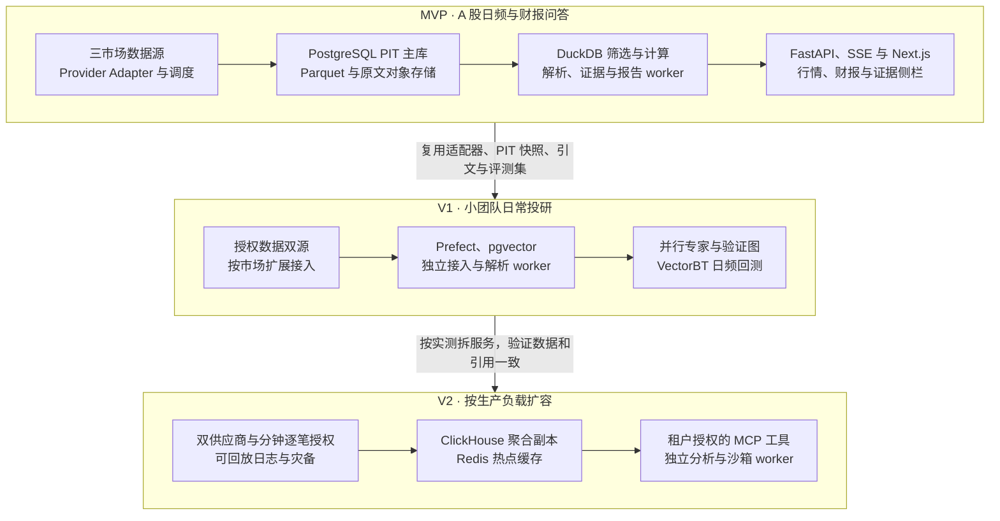

# AI-Native 股票投研系统技术架构调研

调研截点 **2026-11-25（Asia/Shanghai）**。官方价以该日可见页面为准，价格为税前，年付折算仅用于比较。文中的架构、预算和验收阈值属于本项目的工程建议。[待核实] 标记用于官方材料未公开或未明确的事实。采购和发布前按合同及样本复核。版本为当日查得的官方发布标签或包注册表版本，GitHub stars 只反映关注度。

**立项建议**。A 股先做日线、PIT 三表、公告原文和可核查报告。用 FastAPI、PostgreSQL、Parquet/DuckDB、本地文档解析与确定性计算启动。美股先接 SEC EDGAR，港股先接披露易，行情按各市场授权增购。数据产品的升级依据是字段覆盖、可用历史、修订版本、许可和实际负载。报告编排的升级依据是评测收益与运行负载。

## 1. 多市场数据源矩阵与采购路线

### 1.1 覆盖矩阵与数据权威

| 数据 | A 股 | 港股 | 美股 | 数据工程与授权重点 |
|---|---|---|---|---|
| 实时与历史行情、复权 | 日频 Tushare／BaoStock。盘中授权后接 Tushare 专项或持牌供应商 | 港交所 EOD 对账、RQData/Tushare 历史日频候选，实时经授权供应商 | Massive、Tiingo 等。未复权 OHLCV + 公司行动。实时区分 SIP/单场所/多场所参考价 | 对每个数据集记录 consolidated/venue、延迟、盘内/盘外、展示与非展示权、是否包含现金分红。日、分钟、逐笔分别定 SLA |
| 三大财务表和重述 | Tushare 单股/全市场及原报校验。RQData PIT 为付费候选 | 披露易 PDF / RQData A/H PIT。季报覆盖取决于发行人 | EDGAR 原始 iXBRL + 归一化供应商。收入、成本与三表关联以各 filing 版本为准 | 同时查询 period、公告实际可得时间及修订。对跨市场口径、币种、规模、少数股东及累计现金流分别映射 |
| 法定公告与年报季报 | 巨潮资讯、各交易所发布页 | HKEXnews 披露易。实时接 IIS | EDGAR submissions、accession 及原始附件 | 保存文号/修正链、官方发布时间的证据和原始内容哈希。区分监管披露、公司 IR、转载 |
| 新闻舆情及券商研报 | 官方公告、获许可财经媒体与 Tushare 授权新闻/研报模块 | 获许可的本地媒体与券商，双语公告去重 | Finnhub 新闻及分析师数据、Massive/Benzinga 单购，依法定披露核事实 | 新闻发布时间和获取时间分存。没有转授权时只保留许可允许的元数据/原链，限制全文、embedding、模型外传及再分发。券商目标价、研报正文和一致预期是不同许可品类 |
| 特色数据 | 资金流、龙虎榜、两融、北向、板块概念 | 南向活跃与持仓，披露权益及卖空等另采购 | EDGAR 13F/Form 4、按时点一致预期、OPRA/专门期权流 | 记录披露时点、因子定义版本、延迟及历史覆盖，缺失与 0 分开。估计值或推断方向用独立字段 |

A 股日历区分沪深北和交易制度，港股保留港币/人民币柜台、半日市、上市规则和公告语言版本，美股保留多交易场所、东部时区及夏令时、ADR 及 class 维度。港股 GEM 从 2024 年起取消强制季度报告，与主板对齐，不能把普遍缺少的 Q1/Q3 解释成零值。[CSRC 上市公司信息披露办法](https://www.csrc.gov.cn/csrc/c101953/c7547359/content.shtml) · [HKEX GEM 规则改革](https://www.hkex.com.hk/News/Regulatory-Announcements/2023/2312152news?sc_lang=en)

### 1.2 A 股与港股接入选型

| 来源（核验版本/接口） | 主要能力和市场 | 公开费用、接入及优势 | 短板与推荐阶段 |
|---|---|---|---|
| [AKShare 1.20.65](https://pypi.org/project/akshare/) / [项目](https://github.com/akfamily/akshare) | A 股为主，兼有港美与宏观。行情、财务、资金流、板块、新闻 | Python 无 SDK 费用，MIT 代码，快捷接入多网页源 | 项目数据用途声明及各上游限制需分别核对，无稳定合同、跨版本字段会变。个人 MVP 试样或同源交叉排错 |
| [Tushare Pro](https://tushare.pro/document/2?doc_id=290) / [tushare 1.4.29](https://pypi.org/project/tushare/) | A 股行情、复权因子、三表、证券主档、特色因子，港美股与新闻另开权限 | Token + Python/HTTP。个人 120 积分免费日线，2k ¥200/年、5k ¥500/年、10k ¥1,000/年。三表单股 2k、全市场 VIP 5k。A 股实时日 K ¥200/月、历史分钟 ¥2,000/年、实时分钟 ¥1,000/月。港股三表 ¥500/年，美股复权日线 ¥2,000/年，新闻和公告各 ¥1,000/年，研报 ¥500/年。所列机构价原则 10 倍 | [利润表](https://tushare.pro/document/2?doc_id=33)有公告日、实际公告日、报告期、报告类型和更新标志，历史是否完整及发布分钟需与原文对照。专项报价和商用、转授权、IP 白名单按合同，个人支付受[个人用途条款](https://tushare.pro/document/1?doc_id=405)限制。V1 日频首选候选 |
| [BaoStock 0.9.4](https://pypi.org/project/baostock/) | A 股前/后/不复权日线、部分分钟、ST、交易状态与低频财务指标 | 登录式 Python SDK，无公开订阅费。[日线](https://baostock.com/mainContent?file=DailyUpdates.md)与[因子](https://www.baostock.com/mainContent?file=localdatafactorInfo.md)可做对照 | 停牌用前收盘和零量填充，模拟须禁成交。[季频盈利](https://baostock.com/mainContent?file=seasonProfit.md)遇修订只保留最新，发报日字段不足以还原 PIT。MVP EOD/复权对账 |
| [efinance 0.5.9](https://pypi.org/project/efinance/) / [adata 2.9.5](https://pypi.org/project/adata/) / [mootdx 0.11.7](https://pypi.org/project/mootdx/) | efinance 行情/资金流，adata A 股行情/概念/资金流，mootdx 通达信本地文件与行情协议 | SDK 无订阅费，代码许可分别 MIT、Apache-2.0、MIT。研发接入成本低 | 上游变化、封禁和数据权利要单核，多个包装库可能共用东方财富故障域。mootdx PyPI 发行较旧，限研究旁路。[efinance](https://github.com/Micro-sheep/efinance) · [adata](https://github.com/1nchaos/adata) · [mootdx](https://github.com/mootdx/mootdx) |
| [聚宽 JQData](https://pypi.org/project/jqdatasdk/) 1.9.8 | A 股、期货/基金等研究数据。按日可见财务 | 账号 SDK。`get_fundamentals(date=...)` 按该日收盘后可见口径。当前标准公开单价[待核实] | `statDate` 按期查询有未来函数风险，开盘信号取当日收盘数据也会泄漏。服务文档通知 2026-08-01 起不支持非大陆 IP，拟部署地以购买入口和供应商确认为准。V1 备选。[API 说明](https://cdn.joinquant.com/help/img/JoinQuantAPI.pdf) · [购买入口](https://www.joinquant.com/default/index/sdk) · [服务通知](https://test.demo.joinquant.com/help/api/doc?id=10273&name=JQDatadoc) |
| [米筐 RQData](https://pypi.org/project/rqdatac/) 3.8.2 | A/H 股三表 PIT、证券状态、行情、因子 | SDK，`get_pit_financials_ex(date=..., statements='all')` 可查调整版本及披露日期。[官方商城](https://www.ricequant.com/welcome/store/)公开标准额度示例 1GB/日、单机 3 线程 | 逐证券历史可得性和当前订购价[待核实]。标准档额度难覆盖全 A 逐笔。V1/V2 PIT 样本优先候选。[接口](https://www.ricequant.com/doc/rqdata/python/stock-mod.html) |
| [东财掘金 gm 3.0.193](https://pypi.org/project/gm/) | A 股行情、历史财务截面、研究及交易工具 | SDK/终端与权限。旧财务接口已下线，现用 `stk_get_fundamentals_balance_pt` 等新接口。定价以签约为准 | PT 截面字段要用连续重述样本检验可得时间，回测行情与交易权限分开。已有掘金团队或 V1 备选。[迁移与接口](https://emt.18.cn/api/quant-help/faq/index.html) |
| [Wind Server API](https://www.wind.com.cn/mobile/WDS/sapi/zh.html) / [iFinD](https://ftwc.51ifind.com/gwstatic/static/ds_web/quantapi-web/help-center/faq.html) | 多市场行情、财务和特色因子，机构覆盖 | Wind Server API/文件交付。iFinD HTTP/SDK、终端可含少量试用。正式后端询价 | 终端 seat、机器调用、非展示/再分发权各自签约。要求修订覆盖及可提取的源 lineage，V2 主或备源 |
| [巨潮资讯 CNINFO 官方门户](https://www.cninfo.com.cn/) / [数据 API](https://webapi.cninfo.com.cn/) | A 股公告和 PDF、原始财报及修订 | 官方网页检索，授权生产接口按合同。网页查询曾用 `/new/hisAnnouncement/query` | 网页内部请求无公开 SLA，返回日期可能仅到日。有许可才做批量采集。原文为各档验证锚点 |
| [披露易](https://www.hkexnews.hk/) / [IIS](https://www.hkex.com.hk/Services/Market-Data-Services/Infrastructure/Issuer-Information-feed-Service-%28IIS%29?sc_lang=en) / [HKEX 数据商店](https://data.hkex.com.hk/catalog/dataset/0a05f55287014916ab0ea3cff1c26000?lang=en) | HKEX 年/中期/已有季报、公告修订。IIS 实时发布。EOSC 收盘统计 | 披露易可检索，EOSC HK$500/月或 HK$5,100/年，IIS/行情付费。券商 [Futu OpenAPI](https://openapi.futunn.com/futu-api-doc/hk/intro/authority.html) 用账户权限与额度 | EOSC 适合收盘对照，完整历史、复权及行情授权单独采购。券商权限按地区与用户，适合内用试样，正式服务优先持牌源 |

**A 股特色数据的口径**。龙虎榜是满足规则条件的披露，[Tushare 机构明细](https://tushare.pro/document/2?doc_id=107)当前端点写 5k，部分汇总与端点冲突时以端点和实测权限为准。资金流属于来源基于成交单分类估算，无法识别实际资金归属。两融需区分融资余额、流量和 T+1 发布。概念用 `taxonomy_provider` 与纳入/退出版本，Tushare [同花顺成分](https://tushare.pro/document/2?doc_id=261)偏当前快照，[东财成分](https://tushare.pro/document/2?doc_id=363)日历史从 2024-12-20 起。北向 2024-05-13 调整盘中信息，2024-08-19 起公开日/月总成交、笔数、活跃榜等，持仓按季披露。南向披露项目不同。北向净买入和持仓频率变化须标制度断点，缺失值保持缺失。模型估算可独立作为因子。原始研报下载 `research_report` 和盈利预测条目 `report_rc` 分开管理。 [深交所沪深港通通知](https://www.szse.cn/www/szhk/hkbussiness/news/t20240726_608353.html) · [HKEX 第二阶段公函](https://www.hkex.com.hk/-/media/HKEX-Market/Services/Circulars-and-Notices/Participant-and-Members-Circulars/HKSCC/2024/ce_HKSCC_NOM_217_2024.pdf) · [Tushare 研报](https://tushare.pro/document/2?doc_id=415) · [预测数据](https://tushare.pro/document/2?doc_id=292)

### 1.3 美股与全球接入选型

| 来源 | 主要覆盖和接口 | 公开费用与优势 | 短板与推荐阶段 |
|---|---|---|---|
| [Massive（原 Polygon.io）](https://massive.com/blog/polygon-is-now-massive) | 2025-10-30 更名。美国股票、指标、逐笔、期权、公司行动。REST/WS/Flat Files | [个人股票](https://massive.com/pricing) $0/$29/$79/$199 月付（EOD/15 分钟/15 分钟/实时）。Basic 5 次/分钟、2 年历史。[Business](https://massive.com/business) 股票 $2,499/月，全市场延迟 +$499、实时 +$1,999。期权独立 | 个人限 non-professional。行情 bar 默认拆股复权，现金分红另算。三表可能用最新重述值覆盖旧期，且有事后拆股调整。证券主档 date 查询需另验历史版本。V1 行情或 V2 feed。[复权](https://massive.com/knowledge-base/article/is-massives-stock-data-adjusted-for-splits-or-dividends) · [财报 PIT 限制](https://massive.com/knowledge-base/article/does-massive-provide-the-filing-date-for-any-financial-reports) · [主档](https://massive.com/knowledge-base/article/does-massive-have-a-downloadable-security-master) |
| [Financial Modeling Prep](https://site.financialmodelingprep.com/pricing-plans)（FMP） | 美国为核心，部分全球。标准化三表、历史价格、公司行动、筛选、分析师估计，REST | 基础 $0/250 次每日。Starter $29 月付/$19 年付折月，Premium $69/$49，Ultimate $139/$99 | 公开档按个人研究用途评估，显示或再分发需另签。国际 `filingDate` 可能映射报告期，当前 consensus API 不可直接回填历史。个人 V1 报表便利层。[覆盖审计](https://site.financialmodelingprep.com/insights/enterprise/data-infrastructure/how-to-check-financial-data-coverage-against-your-target-equity) · [一致预期示例](https://site.financialmodelingprep.com/education/calendar/build-an-earnings-revision-pressure-signal-estimate-drift-monitor) |
| [Financial Datasets](https://www.financialdatasets.ai/pricing) | 美股三表、行情、SEC filing、内幕持股、新闻等，REST，官方覆盖表另有英法年报 | 2026-11 查得 Credits $20/千次（个人）、Personal $200/月/10 万次、Professional $1,000/月/100 万次，商业项含 webhooks/SLA | A/H 可用性未列。向客户生成答案或摘要也涉及再分发，Professional 的展示权受归属及导出限制。逐字段验证版本。V1 个人低频试用或 V2 规范化美股。[市场覆盖](https://docs.financialdatasets.ai/market-coverage) · [条款](https://www.financialdatasets.ai/terms-of-use) |
| [Finnhub](https://finnhub.io/pricing) | 美股/多市场。REST/WS，三表、Form 4、机构持股、新闻、EPS/营收/EBITDA 一致预期 | 免费 60 次/分钟，个人财务基档 $50/市场/月及估计基档 $75/市场/月（季付）。商业报价单列 | 覆盖及历史修订按市场和数据包。MCP 仍用账号的 entitlement。V1 实验及 V2 可替换供应商。[财务](https://finnhub.io/pricing-fundamental-data) · [估计](https://finnhub.io/pricing-stock-estimates) · [商业](https://api.finnhub.io/pricing-startups-and-enterprise) · [MCP](https://finnhub.io/static/finnhub-how-to-connect-mcp-server.html) |
| [Yahoo Finance / yfinance 1.8.0](https://github.com/ranaroussi/yfinance/releases/tag/1.8.0) | 全球行情、派息/拆股、快照和部分财务，多市场原型方便 | Python 包可免费用，第三方库，Yahoo 数据仅按其用途条款使用 | 无官方 SLA。接口、限流与历史口径变化。缓存与导出权不能由开源许可推断。个人 MVP 对照。[用途声明](https://github.com/ranaroussi/yfinance) |
| [SEC EDGAR + EdgarTools 6.4.0](https://github.com/dgunning/edgartools/releases/tag/v6.4.0) | 美国法定申报，Submissions、CompanyFacts、原始 iXBRL、10-K/Q、8-K、20-F、13F/Form 4 | 官方数据 API 无 key，夜间 bulk 初始化，增量请求带身份 UA 并限 ≤10 次/秒。Python 解析器提升开发速度 | 不提供行情。CompanyFacts 主要覆盖标准标签与实体级事实。重述、扩展和分部从 accession 恢复，锁 parser 版本。全阶段原文锚点。[SEC API](https://www.sec.gov/search-filings/edgar-application-programming-interfaces) · [访问规则](https://www.sec.gov/search-filings/edgar-search-assistance/accessing-edgar-data) |
| [Tiingo](https://www.tiingo.com/products/end-of-day-stock-price-data) | 美股和部分 A 股 EOD、公司行动、主档，另有 IEX 与多场所 24×5 实时参考价 | 个人 Free/$30。Business EOD 内部 $50/月。Base Equities 显示再分发初创 $250 或企业 $500/月，REST/WS | 参考价和 liquidity spread 与 SIP 全量成交/NBBO 口径不同，三表另加购。V1 小团队行情主源候选。[24×5 说明](https://www.tiingo.com/products/consolidated-real-time-stock-api) · [加购](https://app.tiingo.com/pricing/) |
| [Alpha Vantage](https://www.alphavantage.co/premium/) | 股票/外汇/宏观、公司财务、新闻情绪、衍生品，REST | 免费 25 次/日。$49.99 75 次/分钟和 15 分钟延迟美国行情，$99.99 150 次/分钟和实时股票，$199.99 600 次/分钟和实时期权 | 美股高级行情需额外开通 entitlement，商业显示及批量历史按许可。单次接口较便于低频工具集成。MVP/V1 对照。[官方限额](https://www.alphavantage.co/support/api-key/) |
| [OpenBB 5.0.0](https://pypi.org/project/openbb/5.0.0/) | 数据接入 SDK/扩展层，市场由扩展与持有授权决定 | 自带的 V5 供应商按 `obb.sec`、`obb.cboe` 等命名空间。独立适配器可复用数据契约 | V5 移除 V4 中 FMP/yfinance/Tiingo/Alpha Vantage 等集成与共享 `obb.equity` 路径。接 V4 须隔离锁版，V1 优先自管关键供数 Adapter。[V5 FAQ](https://docs.openbb.co/odp/python/faqs/data_providers) · [V4 目录](https://docs.openbb.co/odp/v4/python/extensions/providers) |

**美股特色数据的时效**。13F 通常适用于达到 $100M 门槛的机构，季末后 45 天内申报，覆盖限定证券和报告范围，空头及某些延迟披露的头寸不可见。Form 4 通常成交后第二个营业日申报。两类都以首次公众可见时刻为 PIT，并保留注册时间、受理时刻、修正、迟报。SEC 受理与发布可存在延迟。卖方一致预期每日固化贡献者与估计币种、预测期、修订和生效时间，历史量化需求可询 [LSEG I/B/E/S PIT](https://www.lseg.com/content/dam/data-analytics/en_us/documents/brochures/lseg-data-for-quant-research-brochure.pdf)。期权流单独签 OPRA 或供应商产品，保存成交、报价、期权主档、交易条件和 open interest 的正确发布时间。买卖方向是基于报价的推断，须标多腿、跨场所、更正与覆盖。新闻与评级包也分别采购。 [SEC 13F](https://www.sec.gov/rules-regulations/staff-guidance/frequently-asked-questions-about-form-13f) · [SEC Form 4](https://www.sec.gov/files/form4.pdf) · [SEC 发布延迟](https://www.sec.gov/about/webmaster-frequently-asked-questions) · [Massive Options](https://massive.com/docs/rest/options/overview) · [OIC](https://www.optionseducation.org/referencelibrary/faq/general-information) · [Benzinga 数据包](https://massive.com/partners/benzinga)

### 1.4 三档可落地组合

以下为**数据月预算**，模型、存储、计算和人力分开计费。跨币种只按内部预算汇率 ¥7/USD、HK$7.8/USD 作量级估算。先确定个人、公司内用、对外展示或对外生成内容，再选择套餐。

| 档位 | 可采购组合及月预算 | 能交付的覆盖 | 风险与升级验证 |
|---|---|---|---|
| 1 · 冷启动 | ¥0–¥50。A 股 Tushare 120 积分与 BaoStock 日线、AKShare 样本 + 巨潮原文。美股 EDGAR + Massive Basic。港股披露易及有权限的少量 Futu 行情。以自有设备运行 | 三市场披露样本，A 股日频主流程和小样本复权，选定发行人的手工 PIT 原报和引用 | 无统一实时和 SLA，历史有限。明确报告可用范围。未获得行情权时，港股仅上线披露样本。先跑改报、退市、除权、证据定位等验收 |
| 2 · 个人专业 / 团队内用 | 个人例 Tushare 5k ¥500/年 + FMP Starter $29 月付，约 **$35/月**。可在预算内加 Massive Starter 或 HKEX EOSC。团队例 Tushare 2k 机构档若书面批准 ¥2,000/年 + Tiingo Business $50，约 **$74/月**，加 HKEX EOSC 约 **$138/月**，其余三表用原始披露作小范围标注 | 个人 A 股批量日频、美股标准三表与日线。团队 A 股日线/单股三表、美国 EOD 和获许可参考价、港股收盘校验及原文。RQData PIT 另询可作为替换 | 2k 的三表为单股，团队版预算用量不足以承诺全市场 PIT 扫描。$20–$150 不承诺三个市场同时商业再分发或全市场实时。采购前验证公司用许可，按字典抽验、停源和双源试跑 |
| 3 · 准机构生产 | A 股 Wind/iFinD 商用合同 + 达到历史 PIT 门槛的第二来源。港股持牌经销商实时和 IIS。示例美股 Massive Stocks Business $2,499 + 实时全市场 $1,999 + Financial Datasets Professional $1,000 = **$5,498/月**，另加 Options Business $1,999 后为 $7,497。A/H 合同费用另计 | 授权的分钟/逐笔、时点化财务、许可内研报/一致预期、可替代供应商和审计重放 | 香港直连公开费目可作量级锚点，实时 SS 重分发 HK$51,000/季度 + 首套线路 HK$45,000/季度 + 条件性最低订户费 HK$6,000/月约 HK$38,000/月，另加 IIS 重分发 HK$45,000/季度约 HK$53,000/月。连接、非展示、额外用户及权利另核。优先询经销，避免直连超前建设 |

[HKEX 市场数据供应商费表](https://www.hkex.com.hk/Services/Rules-and-Forms-and-Fees/Fees/Securities-%28Hong-Kong%29/Market-Data/Market-Data-Vendors?sc_lang=en) · [Tushare 积分权益](https://tushare.pro/document/2?doc_id=290) · [Massive Business](https://massive.com/business) · [Financial Datasets 条款](https://www.financialdatasets.ai/terms-of-use)

入围验收要求交付数据字典及每字段许可矩阵、至少跨两期的原始版与重述样本、行情行动和停复牌对账、delisted 历史覆盖、速率限制、重试与许可终止时删除要求。对可显示、模型推理、缓存、训练、下载、派生再分发和成品引用分别授权。将 provider 权限落到报告与导出。

## 2. 数据底座、存储与 ETL

### 2.1 存储选型

| 组合 | 适配市场和负载 | 优势 | 成本、协议与关键限制 | 阶段与使用方式 |
|---|---|---|---|---|
| PostgreSQL + 可选 TimescaleDB + pgvector | 三市场证券主数据、公告索引、财务事实和修订、权限、任务、引文。分区后承接日/分钟行情 | ACID、外键、SQL 与 RLS。TimescaleDB hypertable/连续聚合。pgvector HNSW/IVFFlat，全文可用 tsvector | PostgreSQL/pgvector 使用 PostgreSQL License。TimescaleDB 按功能区分 Apache-2.0 与 TSL。向量 ANN 加过滤需要测召回，索引、写入、历史扫表共用 I/O。中文分词需插件或应用侧处理 | MVP 主库使用原生分区。V1 先测分钟行情再装 TimescaleDB，按扩展兼容矩阵升级。搜索量小可先精确向量检索 |
| DuckDB + Parquet + 对象存储 | 三市场批量历史行情、因子、PIT 快照、报表导出与本地回测 | DuckDB 支持 Parquet 列投影、谓词下推和嵌入式 SQL。按版本传递可复现快照 | DuckDB MIT，存储/请求/出网另计。Parquet 文件本身没有事务发布，嵌入式读写模式是单写进程。DuckDB 2.0 已有 Quack 与 DuckLake 1.1 路线，多写时再按客户端、目录及恢复需求压测 | MVP 批量扫描与筛选。按市场、频率和月分区，避免每股每天一个小文件。生成不可变快照后，由 PostgreSQL 事务提交 manifest 指针 |
| ClickHouse + Redis | 跨市场分钟/逐笔、高并发交互 OLAP、热点快照 | ClickHouse MergeTree 面向大量追加和聚合。Redis 用于短 TTL 缓存、速率计数或临时分发 | ClickHouse OSS Apache-2.0。Redis 8 可选 AGPLv3/RSALv2/SSPLv1，核部署条款。ReplacingMergeTree 后台合并去重具有延迟，读时用 FINAL 或版本感知聚合。两套系统增加运维成本 | V2 按实测加 ClickHouse 作为服务副本，保留 PostgreSQL 管身份、PIT 版本与 ACL，保留 Parquet 作可回放快照。Redis 缓存可重建 |

版本证据包括 [PostgreSQL 18.7 文档](https://www.postgresql.org/docs/18/index.html)、[TimescaleDB 2.32.1 兼容说明](https://github.com/timescale/timescaledb/releases/tag/2.32.1)、[TimescaleDB 许可证](https://www.tigerdata.com/legal/licenses)、[pgvector v0.8.7 标签](https://github.com/pgvector/pgvector/tree/v0.8.7)与[过滤说明](https://github.com/pgvector/pgvector)、[DuckDB 2.0.1 LTS](https://duckdb.org/2026/11/20/announcing-duckdb-201)、[Parquet 扫描](https://duckdb.org/docs/data/parquet)、[DuckDB 并发](https://duckdb.org/docs/2.0/connect/concurrency)、[ClickHouse Stable 26.10.10.3](https://packages.clickhouse.com/)与 [ReplacingMergeTree](https://clickhouse.com/docs/guides/replacing-merge-tree)、[Redis 许可](https://redis.io/legal/licenses/)。

**数据流**。Raw 层保存许可允许持久化的原始响应、文件与校验值。Canonical 层给统一单位、标识、时间及版本。Serving 层发布读视图、搜索索引与快照。PDF、HTML、渲染图、OCR/layout JSON、表格和证据截片进对象存储。PostgreSQL 保存实体、版本、哈希、ACL 和 locator，全文、向量索引可以重建。向量检索先约束租户、市场、证券、披露时间与使用权，再做关键词/向量混合召回及重排。原文的签名 URL 由权限服务发放，索引和报告继承原始授权。

### 2.2 时间、复权与证券事件

| 实体 | 最小键与语义 | 易错点与处理 |
|---|---|---|
| 证券与上市 | 发行人 `issuer_id`、证券 `instrument_id`、交易所 MIC、`listing_id`。时态 `symbol_alias`、市场日历和 `listing_status_event` | 双重上市、ADR、A/H 股分别建 listing，映射同 issuer。代码复用、并购、转板、退市、ST、停牌、恢复交易独立记生效时间与获知时间。回测用当时可见成分和退市证券。停牌仍可有估值标记，成交须为不可交易。Tushare `stock_basic` 默认仅 L，主动补 D/P。北交所 [`bse_mapping`](https://tushare.pro/document/2?doc_id=375) 的上市日与换码生效日分存 |
| 行情与公司行动 | `bar_raw` 以 listing、频率、bar 时间、venue/source/revision 识别。`corporate_action` 保存分红、拆并股、送转、配股、除权和版本 | 原始 OHLCV 可核对，复权价由已生效且当时已知的事件派生。不同厂商的调整范围、基准日、舍入与成交量含义分别记录 |
| 披露与财务事实 | `filing` 存发布、获知、采集时刻、文号/SEC accession、替换关系与哈希。`financial_fact` 存 issuer、概念/维度、期初期末、币种、单位、合并口径、原值、来源定位和修订版本 | A 股季报现金流常为年初至今，需按相容版本差分，资产负债表为期末存量。美股 fiscal calendar 可能跨年或为 52/53 周。IFRS、US GAAP、CAS 的标签和口径分别映射。初报、重述、撤回和解禁时间追加记录 |
| 供数与快照 | `data_release` 持有供应商、授权范围、许可版本、schema、checksum、snapshot/watermark。`entitlement` 记录 display/non-display、缓存、衍生和导出限制 | 数据快照、样本及报告运行绑定同一版本，过期或失联展示状态，授权撤销时同步限制查询、引用及导出 |

当累乘因子 `F` 定义为「在每个除权点按可比价格比的倒数向前累计」时，以锚点 `a` 定标的价格为 `raw_price(t) × F(t) / F(a)`。前复权把**最新有效锚点**价保持为原价，后复权把**初始锚点**价保持为原价。因子方向须用除权日前后样本验证。拆股样例中，若原价由 100 变为 50 且无市场波动，因子由 1 变为 2。前复权序列为 50、50，后复权为 100、100。股息是否再投资、税费、配股申购和可交易价格分别建模。滚动回测每个窗口固定 `as_of` 与因子锚点，回报和滑点基于未复权成交价与实际份额变化。图表切换前/后复权时使用同一版本因子。

**PIT 查询**。同时保存 `period_start/end`、`published_at`、`first_seen_at` 和 `recorded_at`。回测模式显式区分「公开可得」和「当时本系统确实已收录」。前者要求经过验证的公开时间，后者同时要求历史接入记录。缺少可靠历史版本的区间降低覆盖标记或剔除。只有公告日期时保守使用下个可交易时段，盘中发布还需考虑数据路由和策略执行时间。先按 `available_at <= decision_at` 重放报告期/口径内的发布、替代与撤回事件，再选有效版本。撤回后若无有效版本则留缺，重述生效前仍能读到有效原报。禁止把今天回填的最新版套入昨天的信号。示例中，3 月 31 日期末数据 4 月 30 日盘后公布，5 月 20 日纠错，则 4 月 30 日收盘的筛选不可用，5 月 20 日更正可用前使用初报。SEC companyfacts 的 frames 面向跨公司历期对齐，PIT 重放以 accession 和具体 filing 为准。 [SEC XBRL API](https://www.sec.gov/search-filings/edgar-application-programming-interfaces)

### 2.3 增量调度、降级与发布

| 调度方案 | 能力与依赖 | 主要限制 | 建议 |
|---|---|---|---|
| Cron / APScheduler 3.11.3 | 主机级计划任务。Python 内置触发器、misfire 与限并发 | Cron 补跑/锁/重试需应用实现，APScheduler 3.x 用专用调度进程，多个 API worker 同时启调度器会重复执行 | MVP 单调度者，数据库租约+唯一作业键，人工触发同一 CLI 补数 |
| Prefect 3.9.5 | Python task/flow、部署、工作池、调度与重试 | 需运行调度服务和 workers，资产语义由团队设计 | V1 首选，适合日频接入、解析队列和重放 |
| Dagster 1.13.31 | Software-defined Assets、分区、传感器、依赖与 backfill | 改用资产模型与独立控制面有迁移成本 | 数据资产与依赖成为管理核心时选。2026-07 Dagster 宣布加入 Prefect，两套产品能力与部署仍需分别评估 |

[APScheduler 稳定版](https://pypi.org/project/APScheduler/)、[Prefect 稳定版](https://pypi.org/project/prefect/)与[调度文档](https://docs.prefect.io/v3/concepts/schedules)、[Dagster 分区回填](https://docs.dagster.io/guides/build/partitions-and-backfills)与[官方公告](https://dagster.io/prefect)。

1. **增量与回补**。按 market/session 触发交易日历任务，分别给 bar、公告、修订设 watermark，按端点设校正重叠窗口及日终对账。任务键含 `provider/dataset/session/shard`，原始响应按哈希去重。游标只在 schema、覆盖、单位、重复及持久化检查通过后推进。并行补数与实时写入各自生成 staging 版本，校验后原子发布 manifest，旧快照仍可复现。区分 holidays、trading_halt、late、missing、unsupported。失败分片进入重试或人工对账队列。
2. **Data Provider Adapter**。定义 `list_instruments`、`get_bars`、`get_actions`、`list_filings`、`get_facts` 与 `capabilities`。返回数据、source、延迟类型、coverage、许可证和版本，集中管理每账号/端点的配额、并发和失败预算。对 429 遵循 Retry-After，退避加抖动。认证/契约失败隔离，熔断后低频探测。披露类优先交易所或监管原文，行情按同市场/频率/复权/时区/授权降级，有口径差异则明确标记，来源不明时保持缺口。主、备抓取库若共用同一上游，仍视为同一故障域。
3. **观测及恢复**。记录 `provider_status`、`latest_session`、`absent_count`、价格差、异步积压及许可状态。失败超过校正窗口时返回最后一次可用快照与时刻。按金丝雀证券对账分红、改名、港股半日、美股夏令时和 ADR 比率。版本管理覆盖解析器、映射表和计算工具，定期恢复备份并验证同一快照的报告可重放。

## 3. AI-Native 投研引擎

### 3.1 确定性金融工具、受控 SQL 与代码沙箱

| 层 | 输入与输出 | 控制措施 |
|---|---|---|
| Deterministic Financial Tools | Pydantic/JSON Schema 约束化工具如 `get_financial_facts(asset, period, as_of)`、`calculate_metric(metric_id, fact_ids)`、`run_dcf(model_version, fact_ids, assumptions)`。返回精度、单位、币种、公式、工具版本、证据 ID、快照和校验状态 | `Decimal` 处理现金值及明确舍入，指标目录定义净利润口径、分母、TTM 和异常值。产出用 golden fixtures 和会计恒等式抽查。事实、推导及用户假设分别标类型 |
| 自然语言 → 指标/筛选 DSL → SQL | 先映射语义白名单字段和指标。无法用 DSL 描述的内部分析才允许受控 Text-to-SQL。查询结果包含实际参数、归一化查询和统计 | 服务端注入 `as_of`、tenant、snapshot 和 RLS。用 SQLGlot 白名单检查单语句、所有嵌套 AST 节点、表、函数和连接上限。参数化常量。专用只读最小权限账号、精确授权视图、行数/耗时/内存与扫描配额。关闭 DuckDB 非必要外部访问和扩展，拒绝任意路径、远程 URL、系统目录与越权跨市场 |
| Python Code Interpreter | 处理临时敏感性图表、研究员自定义因子体检及获批统计分析。输入只读 Arrow/Parquet 快照，输出结构化摘要及隔离制品 | 独立 worker，通过 gVisor 或 microVM 隔离。禁默认联网和服务凭据，预装固定包，设 CPU/内存/磁盘/执行与输出上限，临时环境可回收。记录输入哈希、代码、镜像、seed 和产物。正式发布所用数字经已验证的公式或独立校验工具重算 |

LLM 解释口径、提出假设、请求工具并解读结果。计算路径负责处理计算周期、单位、财务重述与可复现性。DCF 以明确的自由现金流、WACC 和终值增长假设为输入。永续增长模式要求 `WACC > g`，输出逐年现金流折现、终值、EV、净债务桥与按日期的稀释股数，并给出 WACC × g 敏感性表。FCFF 与 WACC 配对、FCFE 与股权成本配对，境外币转换注明汇率时点。负分母、多币种缺 FX、财务项缺维度时按定义返回不可计算或带条件的结果。模型生成的数字保留前必须与结构化工具产物比对。 [SQLGlot](https://github.com/tobymao/sqlglot) · [PostgreSQL RLS](https://www.postgresql.org/docs/18/ddl-rowsecurity.html) · [gVisor 隔离模型](https://gvisor.dev/docs/architecture_guide/intro/)

**可复算的 DCF 样例**。以百万元计，未来两年 FCFF 为 100、110，年末折现，WACC 10%，永续增长 2%。终值为 `110 × 1.02 / 0.08 = 1,402.5`，折现后 EV 为 1,340.909091。净债务 200、无其他桥接项，稀释股数 100 百万股，每股价值 11.409091。固化输入、未舍入中间值和最终币种与精度为 golden fixture。

### 3.2 财报解析与 Citation Grounding

| 管线及版本 | 主要能力与适用文档 | 成本/许可证 | 优势、关键限制和阶段 |
|---|---|---|---|
| [Docling v2.152.0](https://github.com/docling-project/docling/releases/tag/v2.152.0)（约 71k stars） | `DoclingDocument` 语义树，页码、bbox、字符范围及表格行列跨度，支持 OCR | MIT，自托管，标准文档 CPU 起步 | 文档结构保真，与财报证据映射直接。难页要测识别、旋转、单元格 bbox 与跨页。MVP 默认。[数据模型](https://docling-project.github.io/docling/reference/docling_document/) |
| [MinerU 4.2.3](https://github.com/opendatalab/MinerU/releases/tag/mineru-4.2.3-released)（约 84k stars） | 中文复杂布局、扫描件、OCR/VLM，源页及块级坐标、表格抽取 | 自托管 CPU/GPU，亦有 API。自定义 MinerU License，对在线标注及部分规模商用有条件 | 中文难页优先对照，冻结中间 JSON schema，表格行列和真实 cell bbox 可用性需测试。MVP/V1 定向兜底。[产物](https://opendatalab.github.io/MinerU/reference/output_files/) · [许可](https://github.com/opendatalab/MinerU/blob/mineru-4.2.3-released/LICENSE.md) |
| [LlamaParse v2](https://developers.llamaindex.ai/llamaparse/parse/features/layout-and-bounding-boxes/) / [llama-cloud SDK v2.20.0](https://github.com/run-llama/llama-parse-py/releases/tag/v2.20.0) | 解析复杂页面，`granular_bboxes` 提供词、行、cell 的 JSONL sidecar | SaaS PAYG 有 10k credits，额外 $1.50/1k credits。Fast 1、Cost-effective 3、Agentic 10、Plus 25 credits/页 | 有细粒度坐标，按解析版本、tier、成本和地区留存合同验收。V1 高价值难页或对照，未获授权的文档留本地。[计费](https://developers.llamaindex.ai/llamaparse/general/pricing/) |
| [Unstructured 0.27.38](https://github.com/Unstructured-IO/unstructured/releases/tag/0.27.38)（约 16k stars） | `partition_pdf` 多策略、通用附件和连接器。元素页、坐标与 `text_as_html` | Apache-2.0 OSS，可自托管，云服务另计 | 多格式导入便利。元素 bbox 或 HTML 表格本身不足以证明每个 cell 的几何位置。V1 通用摄取。[partitioning](https://docs.unstructured.io/open-source/core-functionality/partitioning) |
| [原生视觉 PDF（OpenAI）](https://developers.openai.com/api/docs/guides/file-inputs) / [Claude](https://platform.claude.com/docs/en/build-with-claude/pdf-support) | 文本层和页图输入，适合疑难图注、多栏。Claude 可返回页级引用 | 按模型/API 的图像文本 token，云处理 | 图像理解生成候选，逐字段对齐原文。整本频繁提交增加延迟与价格。仅对高价值页或裁片升级。[Claude 引文](https://platform.claude.com/docs/en/build-with-claude/citations) |
| [XBRL/iXBRL + Arelle](https://arelle.readthedocs.io/en/latest/) | US EDGAR 标准及自定义标签、币种、单位、维度、比较期和分部 | SEC 数据无 API 费用，自托管解析消耗计算 | 原始 accession 解析优先于 CompanyFacts 聚合，保留原始 fact/DOM ID。适用于已有 XBRL 的发行人，A/H 缺少结构化资料时回落原文表格。[SEC Inline XBRL](https://www.sec.gov/data-research/structured-data/inline-xbrl) |

**从页到数字的证据链**。

1. **固定原件**。下载时锁定 `source_uri, doc_sha256, disclosed_at, revision_id, entitlement`，记录 OCR、解析引擎、模型、配置和中间产物。按页分类和分流（文本层、扫描件、表格、图像），不重新扫描明确可从 XBRL 获得且能定位的事实。
2. **保留几何与语义**。PDF `page_index` 和印刷页码分别保存，记录坐标原点、裁剪框、宽高和旋转。规范单元格记录 `table_id,row,col,rowspan,colspan,header_path,raw_text,footnote_ids,bbox_list`，跨页并表仍保留每个单元格的源页。iXBRL 解析 QName、`contextRef/unitRef`、duration/instant、维度、`decimals/scale/sign` 与 DOM anchor。隐藏事实提供 filing 链接和标签，注明定位粒度。
3. **按证据单元检索**。关键词/中文分词全文和向量先在同一租户、截止时间、证券和合法文档集合上召回，混合排名后展开标题、表头、年份列与注脚。事实 schema 保存原值、标准化数值、币种、倍率、单位、口径、期间、locator 与来源版本。先验证再写入，处理表格和币种异常，低置信度保留待复核状态。
4. **生成有证据的 claim**。报告结构中 `claim_id` 引用 `fact_id/evidence_id`。推导值还引用 `calculation_id`，后者列公式、版本和依赖事实。核验单位、负号、列对应、证券、期间和数字，逐 claim 检查引用支持程度。观点附所依据事实与反例，估值假设独立展示。例中“营业收入 123.4 亿元，同比增长 8.2%”须分别定位本期与上期单元格，8.2% 链接到两笔收入和计算路径。原表以百万元呈现时同时保留源值与换算。
5. **点击与降级**。锚点链接包含文档哈希、物理页、单元格和版本，用 PDF.js `PageViewport.convertToViewportPoint` 转换四角坐标，缩放、旋转和跨页后按对应多框高亮。HTML 原报用 DOM/XBRL 元素跳转。无真 bbox 时显示可用的表级、页级或文档级粒度，关键数值缺乏可靠定位时触发复核或挡住发布。引文 ID 随文档版本固定，更新报表不破坏旧报告。 [PDF.js 坐标实现](https://github.com/mozilla/pdf.js/blob/master/src/display/page_viewport.js)

### 3.3 Agent 编排与 MCP

| 框架与官方版本快照 | 主要能力 | 成本/许可证和关键限制 | 适用阶段 |
|---|---|---|---|
| [LangGraph 1.2.24](https://github.com/langchain-ai/langgraph/releases/tag/1.2.24)（约 45k stars） | 图状态、条件边、Send fan-out、checkpointer、interrupt、streaming | 核心 MIT，LangSmith 托管/观测单列。外部副作用与产物仍用幂等和版本 | V1 主编排，确有跨步恢复需要时启用。[持久化](https://docs.langchain.com/oss/python/langgraph/persistence) |
| [OpenAI Agents SDK Python v0.26.0](https://github.com/openai/openai-agents-python/releases/tag/v0.26.0)（约 31k） | tools、agents-as-tools、handoffs、guardrails、session、MCP 与 tracing | MIT SDK，模型和工具另计。handoff 和会话不持有研究任务的业务状态，ZDR 条件下 SDK 内建 tracing 受限 | MVP/V1 单 Agent 或专家节点。[文档](https://openai.github.io/openai-agents-python/) |
| [Claude Agent SDK Python v0.2.188](https://github.com/anthropics/claude-agent-sdk-python/releases/tag/v0.2.188)（约 8.6k） / [Agent Skills](https://agentskills.io/specification) | agent loop、subagent、hooks、MCP 和按需加载的 `SKILL.md` | MIT SDK，Claude 服务条款独立。shell、文件权限最小化，技能用于研究方法，工具权利和 PIT 由服务端执行 | V1 文档专家节点。[SDK](https://code.claude.com/docs/en/agent-sdk/overview) |
| [CrewAI 1.15.45](https://github.com/crewAIInc/crewAI/releases/tag/1.15.45)（约 61k） | 角色与委派、event-driven Flows、分支和持久化 | MIT 核心，可选企业版。不受限委派增加预算和血缘难度 | MVP 对照或 V1 固定 Flows。[Flows](https://docs.crewai.com/en/concepts/flows) |
| [Agno v3.2.1](https://github.com/agno-agi/agno/releases/tag/v3.2.1)（约 43k） | Agent / Team / Workflow，AgentOS 提供 FastAPI API、运行持久化和部署能力 | Apache-2.0 框架，控制面单独考虑。与自建应用重叠时统一会话、权限和任务所有权 | V1 runtime 备选。[AgentOS](https://docs.agno.com/agent-os/introduction) |
| [PydanticAI v2.74.0](https://github.com/pydantic/pydantic-ai/releases/tag/v2.74.0)（约 21k） | typed dependencies、输出和工具验证、可替换模型、持久执行集成 | MIT。字段类型正确后仍须核原文及计算，复杂恢复采用 Temporal、DBOS、Prefect 等 | MVP/V1 抽取、工具节点。[输出](https://pydantic.dev/docs/ai/core-concepts/output/) · [Durable execution](https://pydantic.dev/docs/ai/capabilities/durable_execution/overview/) |
| 自研轻量状态机 | FastAPI/Pydantic + `asyncio.TaskGroup` + PostgreSQL run/step/event，固定 DAG | 控制边界直接、依赖少，领取租约、重启续跑、超时和重放测试由团队负责 | MVP 首选。边界和证据契约稳定后可增 LangGraph |

**交付拓扑**。Planner 固定主题、市场、证券、披露 cutoff、数据快照、截止时间和预算。基本面、技术面、舆情和估值专家各自调用已授权工具并提交独立结构化产物。简单问题只启用相关节点。Critic 检查反证、指标口径和多空逻辑，只有必要分支重跑一次。Verifier 读取原文、数据库和计算工件，按事实与推导分别验证，分歧用证据与来源权威解决。Composer 用通过校验的 claim 和证据生成章节，最终门禁拦截新值、PIT 泄漏和不可追溯计算。节点幂等键用 `run_id,node_id,input_hash`，保存 checkpoint、产物哈希、节点租约和错误类型，以独立事件流发布显式可解释进度。用同模型、同预算、同快照比较单 Agent 与并行专家的错误率、证据覆盖和延迟，再决定哪些报告启用并行。 [Anthropic workflow 实践](https://claude.com/resources/articles/common-workflow-patterns-for-ai-agents-and-when-to-use-them)

**MCP 工具契约**。用 MCP 给桌面研究助手、Web Agent、批处理和可替换模型宿主提供统一的工具发现、参数 schema 与结构化结果。工具按领域拆成 `get_statement`、`get_bars`、`search_filings`、`compute_dcf`、`run_screen`，可将指标目录和数据字典提供为只读 resources。`tenant, as_of, snapshot_id` 来自可信运行上下文，`structuredContent` 带 `fact_ids, evidence_ids, freshness, coverage, source_version`。按无权限、数据过期、无数据区分业务错误，授权服务强制市场、端点、存储、导出和每请求预算。MVP 同进程复用契约，需跨宿主时先本机 stdio，远程用 Streamable HTTP。已核实 **MCP 正式版 2026-07-28** 和 [Python SDK v2.3.0](https://github.com/modelcontextprotocol/python-sdk/releases/tag/v2.3.0)。新版核心无协议会话，按请求携带协议/能力，HTTP 可通过 `Mcp-Method`、`Mcp-Name` 路由，HTTP POST 可返回 JSON 或请求级 SSE。旧版按客户端实际能力协商和验收。应用报告 SSE 由自身事件日志和游标恢复。MCP HTTP 边界校验 OAuth token audience、scope 与租户，禁 token passthrough，记录审计 ID。流程状态、数值正确性和供应商许可都由业务系统执行。 [正式发布](https://blog.modelcontextprotocol.io/posts/2026-07-28/) · [协议与传输](https://modelcontextprotocol.io/specification/2026-07-28/basic/transports) · [Tools](https://modelcontextprotocol.io/specification/2026-07-28/server/tools) · [授权](https://modelcontextprotocol.io/specification/2026-07-28/basic/authorization)

### 3.4 模型路由、成本与延迟

| 类别与例子 | 建议工作 | 按百万 token 的示例价格（输入／缓存读／输出） | 验证条件与限制 |
|---|---|---|---|
| 快速文本模型 GPT-6 Luna | 公告分类、结构化候选抽取、候选证据相关性、报告模板路由 | USD 0.10／0.01／0.50 | 主要用短且清洗后的证据片段。低置信度、脚注冲突进入规则或人工复核 |
| 通用 GPT-6.2 Sol | 有限工具调用的日常研究、草稿规划及解释 | USD 2.00／0.10／10.00 | Pydantic schema、模板、批处理与缓存先实测。需要多文档或跨语种映射时用同一评测集对比 |
| 强推理 GPT-6.2 Astra | 对重要矛盾、复杂资本结构和高风险综合报告升级 | USD 8.00／0.40／40.00 | 以验证后证据包作为输入，给长度和推理预算，衡量相对 Sol 的新增正确结论 |
| 国内 API 对照 DeepSeek Flash / V4 Pro | 快速中文抽取和强推理综合。Flash 可作为疑难页视觉候选 | 人民币高峰价分别 ¥2／¥0.04／¥8 和 ¥9／¥0.30／¥27 | 按当前模型 ID `deepseek-flash` 与 `deepseek-v4-pro` 计费，非高峰价另列。与国际 API 用同一中文报告集验证输出 schema、失败率和成本 |

[OpenAI 模型对照](https://developers.openai.com/api/docs/models/compare) · [API 价格](https://developers.openai.com/api/docs/pricing) · [Prompt caching](https://developers.openai.com/api/docs/guides/prompt-caching) · [DeepSeek 价格与模型](https://api-docs.deepseek.com/zh-cn/quick_start/pricing/)

OpenAI 价格按 Standard 短上下文。预算示例使用无缓存短上下文，同一完整报告总计 Luna 30k 输入+3k 输出，Sol 12k+2k，及 Astra 升级时 8k+1.5k，估算分别为 **$0.0045、$0.044、$0.124**。若 20% 报告升级，平均约 **$0.0733/份**，500 份约 **$36.65**。额外计 OCR、embedding、检索、工具、重试、推理输出、解析缓存写价与数据订阅。预算按实际计费 input/cache-read/cache-write/output 逐调用记录，按租户、report profile、模型版本聚合。缓存命中以计费字段观测，稳定前缀用于模板与 schema，应用缓存键加入 snapshot、权限、模型及 parser 版本，修订后选择性失效。可排队的离线抽取用较低价异步批处理。

初始服务目标可设为缓存快照下进度首事件 p95 ≤2 秒，短问答 p95 ≤20 秒，**预解析**完整报告 p95 ≤90 秒。冷文档解析另设异步排队 SLO。并行专家用同一证据快照，完成时间接近最慢分支加汇总/校验，将三到四路并发、截止时间、每路调用上限和整体预算放入 Planner。按行业模板及缺失字段定向检索，去除重复上下文。昂贵 OCR/视觉按页升级，证据包携带定位而非整本 PDF。取消时停止派发新工作并保留已验证产物。超时后按预算恢复或交付部分报告，显示缺失分支。上述为自研预算和 SLO，需在真实文档与并发负载下调校。

## 4. Screener、因子与轻量回测

| 方案与官方版本证据 | 覆盖能力及适用市场 | 成本、优势与限制 | 推荐用途 |
|---|---|---|---|
| [DuckDB](https://duckdb.org/2026/11/20/announcing-duckdb-201) 2.0.1 | 三市场自有 PIT 快照的 SQL 筛选、窗口函数、交叉截面排序 | MIT。与 Parquet 融合，成交模型和组合分解需另做 | MVP 主筛选引擎，支持 NL→DSL 和条件构造器共用 AST |
| [VectorBT](https://pypi.org/project/vectorbt/) 1.2.1 | pandas/NumPy/Numba 向量化，批量信号、参数扫描及组合指标 | 社区版为 Apache-2.0 + Commons Clause，主要依赖其功能的收费服务须核许可。VectorBT PRO 单列。大参数阵列吃内存，多资产约束/市场微观结构需显式模拟 | V1 日频因子初筛、买入持有和调仓基线 |
| [Microsoft Qlib](https://github.com/microsoft/qlib) / [pyqlib 0.9.7](https://pypi.org/project/pyqlib/) | 面向量化研究的特征、模型、组合与回测。有中美数据范式 | MIT。自有证券标识、PIT 数据需要适配。上游 main 能力与稳定包分开验证 | 有 ML 因子管线再引入，训练/测试和元数据与主库共享时间规则 |
| [Backtrader](https://pypi.org/project/backtrader/) 1.9.78.123 | 事件驱动、经纪商/数据订阅抽象，适合日频/分钟级策略行为对照 | GPL-3.0，原 PyPI 版发布于 2023。依赖兼容、冻结和 fork 审核成本高 | 已有策略迁移或小型交叉验证 |
| [NautilusTrader](https://nautilustrader.io/open-source/) | Rust 核心、事件回放、逐笔/订单簿、fill model 以及实盘 adapter | LGPL-3.0 项目，当前官网含 2.0 RC，[GitHub 1.231.0](https://github.com/nautechsystems/nautilus_trader/releases/tag/v1.231.0)也标记 Beta。市场协议与成交数据成本随深度增加 | 确需事件级回测时单独评估，校准实际成交样本，版本升级跑撮合回归 |

自然语言「近四季经营现金流为正、ROE 前 20%、排除 ST」需在提交前展示市场、时点、流动性样本量、ROE 口径与缺失处理，显式区分「四季分别为正」和「TTM 为正」。结果附用到的 fact IDs、SQL/DSL、参数与 snapshot ID，支持解释未入选原因。因子产物含 coverage、Rank IC/ICIR、分组收益、换手、成本敏感度及行业/市值暴露。用滚动样本外和时间切分防止重叠标签或参数选择泄漏。复现实验保留证券池、rebalance 日、缺失处理、策略版本和随机 seed。

轻回测至少包含下一可成交价约定、交易日历、手续费和滑点、成交量上限、涨跌停/停牌无法成交、退市与分红、币种和基准收益。按交易市场、品种、日期配置回转、整手、涨跌幅和可卖仓（例如 A 股普通股票 T+1 卖出约束）。美国盘前盘后、港股半日/整手、部分品种例外独立建规则。信号为当日收盘时，默认下一交易机会执行。日线无法识别触及限价的真实排队成交，输出成交假设及交易覆盖。系统对外交付研究信号、日频/轻量回测、情景分析和可重现报告。实时下单、FIX、清算、订单风控、交易级 SLA 与微秒延迟归独立交易域。

## 5. 全栈应用、专业金融 UI 与 Evals

### 5.1 全栈与交互

| 路线或组件 | 优势与适用阶段 | 成本与边界 |
|---|---|---|
| Next.js 16.4.6（16 Active LTS）+ React/TypeScript，FastAPI 0.165.0 模块化应用 + 分离 worker | MVP/V1。Python 统一数据客户端、量化、解析和 Agent，OpenAPI 生成 TypeScript 契约。前端负责交互与路由 | HTTP 进程负责鉴权和低延迟读。OCR、ETL、长报告交给任务进程，统一到 Postgres 持久化作业状态，照顾滚动部署与断线续接 |
| Node BFF + Python AI/Data Service | V2。既有 Node 团队、复杂 SSR、企业 SSO/多终端编排时拆 BFF。对外请求可保持同源 session | 增加一次跳转、权限契约、超时、Tracing、部署及集成复杂度。只拆有独立负载与所有权的层 |
| TradingView Lightweight Charts 5.3.0 / Apache ECharts 6.1.0 | Lightweight Charts 做 K 线、成交量、十字游标和公司行动。ECharts 做估值瀑布、因子分组与热力图 | Apache-2.0。Lightweight Charts 需 TradingView NOTICE 归属与链接，需要自带行情 |
| TanStack Table / AG Grid | TanStack 做自定义虚拟化表格、财报同屏比较，AG Grid 适合大量列、编辑与高级分组 | TanStack headless 需自行实现键盘及可访问性。AG Grid Community MIT，企业 Server-side Row Model 等须购买许可，Community 可用 Infinite Row Model |
| SSE / WebSocket | SSE 适配报告、引文和作业状态单向更新。WebSocket 用于有订阅控制的持续行情 | SSE 以事件 ID 恢复、代理禁缓冲、独立 keepalive、授权后重连。WebSocket 要补心跳、反压和断线重订阅。首版只实现 SSE |

[Next.js 支持策略](https://nextjs.org/support-policy) · [FastAPI 发行记录](https://pypi.org/project/fastapi/) · [Lightweight Charts 5.3.0](https://github.com/tradingview/lightweight-charts/releases/tag/v5.3.0)与[归属要求](https://tradingview.github.io/lightweight-charts/docs/5.0) · [Apache ECharts 6.1.0](https://github.com/apache/echarts/releases/tag/6.1.0) · [TanStack Table](https://tanstack.com/table/latest/docs/overview) · [AG Grid 行模型](https://www.ag-grid.com/javascript-data-grid/row-models/)与[许可](https://www.ag-grid.com/license-pricing/) · [SSE 标准](https://html.spec.whatwg.org/multipage/server-sent-events.html)

股票页同步提供市场、交易时区、时效、复权方式和来源标识。公告与财务时间线切换「当时已知／最新重述」。报告正文和证据侧栏联动，底部展示估值假设、数据缺口与生成版本。报告作业走 `POST /research-runs` → `GET /research-runs/{id}/events`，终止用独立鉴权请求。SSE 事件用 `plan_ready`、`tool_summary`、`evidence_verified`、`section_ready`、`completed`、`failed`。摘要来自可审计步骤与证据，客户端同样按事件 ID 去重。单用户取消与服务重启后排队恢复保持一致。前端按字段授权导出与展示，报告共享不放大原始数据许可。

### 5.2 验收数据集与生产观测

| 维度 | 金标准与测法 | 初版发布门槛（建议值） |
|---|---|---|
| 财务数据准确度 | 用官方财报原文人工标注 value、单位、符号、币种、会计口径与期间。覆盖合并/母公司、年初累计、同页同比、注脚、跨页与美国 XBRL/原文交叉 | 核心指标样本中正确率 ≥99%，样本中的币种、数量级、日期和符号严重错误为 0。逐类公布覆盖率和拒答率 |
| 确定性计算 | Golden 审核资产负债平衡、已知拆股、ROE、TTM、DCF，规模/币种/负分母等边界。金额按最小货币单位或会计披露精度比较 | 核心公式固定样本全通过。输出数字的证据或计算链覆盖 100%。关键结果重算差异为 0（按规定容差） |
| Citation Grounding | 抽样逐 claim 验证引用语义、页码/表格单元格、期间和来源。统计 citation precision/recall、locator 成功率和 OCR 表格准确率 | 核心数字点击通过 100%，论断 citation precision ≥95%，明确列示缺证据部分、记录误引和无回答率 |
| PIT 与幸存者偏差 | 初报/重述成对快照，对盘后披露、同日多公告、退市和代码切换重放。对未来版本加哨兵值，报告查询、筛选信号和回测均测试 | 未来数据与越权泄漏用例 0。循环重启、重复 ETL 与同快照重放核查一致 |
| 报告完整性与系统质量 | 固定要求基本面、交易及风险、估值假设、核心证据、缺失项。并行验证报告状态、取消、重试、部分故障、响应及实际计费 | 核心结构完整率 100%，置信缺口可见。分别列 p50/p95 耗时、每报告模型成本、升级率、兜底率和引用错误 |

首版可以用约 60 份带修订配对的原文与 150 条金标准任务，覆盖三市场、多个行业和无法回答样例。按证券/披露事件和时间隔离调参与盲测，分层报告每类样本数，评测同时包括当期首报及滞后修正。公开 FinQA、TAT-QA、FinanceBench 作为数字推理、表文对齐和原文证据回归种子，中文财务口径、PIT 和单元格金标由项目补齐。LLM judge 校验语义忠实度并用人工一致性抽样校准。公式、授权、PIT、定位用确定性断言。每次更换供应商、parser、工具版本、模型或提示词时相同快照对照，CI 执行快速硬门禁，夜间运行盲测样本与成本回放。 [FinQA](https://github.com/czyssrs/FinQA) · [TAT-QA](https://github.com/NExTplusplus/TAT-QA) · [FinanceBench](https://github.com/patronus-ai/financebench)

| 工具 | 职责与适用阶段 | 使用限制 |
|---|---|---|
| OpenTelemetry + Collector | 贯穿 ingest → parser → retrieval → Agent → SQL/tool → report，跨进程 trace/span 和指标 | 固定 GenAI semconv 版本。租户 ID 使用脱敏映射，去除凭据和未授权文本，避免高基数标签 |
| Langfuse | 模型、提示词、Token/成本、trace、测试数据集与评分，可接 OpenTelemetry | 评估云或自托管成本、日志保留和访问权限，trace 存结构化证据引用 ID |
| Arize Phoenix + OpenInference | RAG 和 Agent 调用轨迹、实验、检索与评估，可自托管 | 有独立 instrumentation/schema。与 Langfuse 首版二选一，避免双写敏感输入 |
| Ragas | 检索召回、Context Precision 与 Faithfulness 的辅助评分 | 需要校准 judge 在财务单位、期间、语种上的偏差。费用计入离线评测 |

在 span 中记录 `run_id, snapshot_id, tool_version, provider, as_of, cache_status, evidence_ids, input_tokens, output_tokens, provider_latency_ms`。保存模型、parser、价格快照与 error/status，低采样记录普通成功报告，全量记录关键失败、PIT/授权拒绝与回归样本元数据。按许可和数据分类过滤日志，设保留期。 [OpenTelemetry GenAI](https://opentelemetry.io/docs/specs/semconv/gen-ai/) · [Langfuse tracing](https://langfuse.com/docs/observability/overview) · [Phoenix](https://arize.com/docs/phoenix/) · [Ragas Faithfulness](https://docs.ragas.io/en/stable/concepts/metrics/available_metrics/faithfulness/)

## 6. MVP → V1 → V2 渐进式架构

- **MVP → V1**。以 A 股日频为主，通过选定样本验证三市场证券标识、披露页和 PIT。先过第五节硬门槛。ETL 回补、报告长任务和多 worker 使单机调度失效时切 Prefect。是否上线选股以完整历史分母、退市与停牌覆盖验收为准。
- **V1 → V2**。以峰值可用性、并发、授权和运行成本触发升级。例如产品要求的分钟/逐笔扫描 p95 连续两周超目标，PostgreSQL/Parquet 读副本和聚合视图已压测，才增加 ClickHouse。多写湖仓目录、Kafka/Redpanda、Redis、独立 BFF 和跨地域灾备分别有实际需求才立项。迁移期双读校验版本、金额和引用，达到阈值再切读端。数据授权到达审批门且备用源经过断流演练后，才承诺机构 SLA。

### 参考来源索引

- **交易所及监管**。原文和规则以 [巨潮资讯](https://www.cninfo.com.cn/)、[上交所披露](https://www.sse.com.cn/disclosure/listedinfo/announcement/)、[港交所披露易](https://www.hkexnews.hk/)、[港交所北向披露公告](https://www.hkex.com.hk/News/Market-Communications/2024/2404122news?sc_lang=en)、[SEC EDGAR APIs](https://www.sec.gov/search-filings/edgar-application-programming-interfaces) 与 [SEC 13F FAQ](https://www.sec.gov/rules-regulations/staff-guidance/frequently-asked-questions-about-form-13f) 为基线。
- **数据供应商**。接入和采购以各表的官方端点、权限与价表为准，优先复核 [Tushare 积分权益](https://tushare.pro/document/2?doc_id=290)、[Massive 价表](https://massive.com/pricing)、[Tiingo EOD 价表](https://www.tiingo.com/products/end-of-day-stock-price-data)、[Financial Datasets 价表](https://www.financialdatasets.ai/pricing) 与 [OpenBB V5 provider FAQ](https://docs.openbb.co/odp/python/faqs/data_providers)。
- **存储、调度与量化**。版本与能力见 [PostgreSQL](https://www.postgresql.org/docs/18/index.html)、[DuckDB](https://duckdb.org/2026/11/20/announcing-duckdb-201)、[ClickHouse 文档](https://clickhouse.com/docs)、[Prefect](https://docs.prefect.io/)、[Dagster](https://dagster.io/docs) 和 [Qlib](https://github.com/microsoft/qlib)。
- **解析、Agent 与观测**。关键机制见 [Docling Document](https://docling-project.github.io/docling/reference/docling_document/)、[LlamaParse 坐标](https://developers.llamaindex.ai/llamaparse/parse/features/layout-and-bounding-boxes/)、[MCP 正式版发布](https://blog.modelcontextprotocol.io/posts/2026-07-28/)、[LangGraph 持久化](https://docs.langchain.com/oss/python/langgraph/persistence) 和 [OpenTelemetry GenAI](https://opentelemetry.io/docs/specs/semconv/gen-ai/)。

### 对我们自研系统的核心启示

- **Must-Have**。证券身份和交易日历。原始行情与时态公司行动。三表和原文的发布时间、修订、时态授权及历史可用性。确定性计算、指标版本、数据快照、证据到原文坐标。可取消/恢复的报告作业。数据采购、日志和报告发布共享同一授权策略。PIT、防越权和核心计算进 CI 硬门禁。
- **Should-Have**。日终对账与独立备源。跨页表格、中文全文与向量混合召回。语义 DSL 与组合回测。离线重放、抽样审计、可追踪费用。按报告收益阶梯启用强模型、并行专家、MCP 和分钟行情。先把可解释的错误与缺失呈现给研究员。
- **Anti-Patterns**。在回测中用今天的财报和成分股。把北向公开项目变动前后拼成同一个指标。把前复权价拿来模拟现金成交。悄悄混合不同源的延迟或复权。用爬虫代码许可证代替数据使用权。让 LLM 口算、生成 SQL 直连生产、提供无坐标的伪引用或公开模型内部推理。把多 Agent 数量、长上下文或高吞吐数据库当作准确率。在研究产品中直接引入交易级撮合和下单系统。
