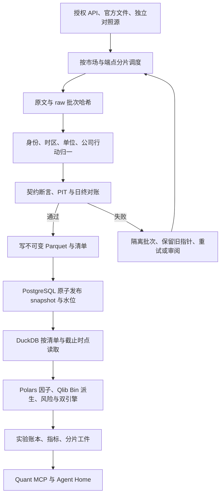

# 专业机构级量化投研平台：8 大 Gap 与数据工具链

核验截点 **2026-11-25，Asia/Shanghai**。产品域沿用 [V2 升级契约](../plan/V2-QUANT-CONTRACT.md) 的 Q1–Q7，继承 [技术与架构调研](02-tech-and-architecture.md) 的证券身份、PIT 时间线、授权和任务恢复约定。本篇把阶段验收落到**同一快照重放、样本外净收益、可解释的订单与持仓账本**。下文门槛为首轮工程配置，须在实验前注册；价格为公开个人研究权益或预算，标注 **[待核实]** 的字段、报价、历史或生产权利需用试用账号和合同实测。本轮实地读取原型源码并核验公开资料，未购数、未使用授权账号验证端点、未运行原型交易服务。

## 1. 从原型到机构量化的 8 大 Gap

### 1.0 原型实地审计

只读检查本机 `<legacy-quant-repo>`。README 声明支持股票/ETF/LOF、技术指标、调度与 Qlib；源码有 FastAPI、SQLAlchemy、Celery、APScheduler、Parquet、Qlib provider 和报告任务。原型可作为调度、研究界面和 provider 导出参考。以下结论限定于本次检查的源码路径。

| 原型证据 | 对机构研究的影响 |
| --- | --- |
| `backend/app/services/data_service.py:18–25,85–118,217–250` 使用种子证券和示例行业；股票/ETF/LOF 共用股票日线接口，分钟频率统一传 `period="1"`，请求 `qfq` 后把 `adj_factor` 写为 1；异常落入合成行情，由相同写入链路落库。 | 真实与合成源、资产类别、分钟频率及复权口径无法从正常结果可靠区分。合成日期用通用 `date_range`，可含非交易时段。 |
| `data_service.py:121–214` 按区间删除重写行情，按最小/最大时间判覆盖；`models/entities.py:22–46` 行情键为 symbol/freq/dt，行业只有开始日期。 | 中间空洞、历史修订和当时行业无法恢复。证券退出、代码复用和历史快照需要独立时态实体。 |
| `qlib_service.py:89–91,232–294,394–489` 导出 Bin、有本地 fallback，源签名主要依赖路径/字节数/mtime；`backtest_service.py:196–239,243–326,330–366` 通过 Qlib TopkDropout，以 close 和统一费用/涨跌阈值运行；缺基准可用样本证券替换，交易表为 `PORTFOLIO` 汇总。 | 可演示计算链，难以证明哪笔订单可成交、基准身份和重跑数据一致性。另有权重延后换仓 helper（80–140 行），实际主回测调用路径为 Qlib。 |
| `strategy_service.py:9–75` 把固定滚动动量模板存为 `source="rd-agent"`，AST 检查类和方法形状；`backtest_service.py:66–77,330–366` 在回测中用内置因子生成信号。 | 从审计代码可证实的能力是策略草稿和固定信号回测。模板正文未接入主路径，形状检查也无法提供运行隔离或研究门禁。 |

AkShare 是数据访问库，Qlib 提供数据、模型和回测组件，Backtrader 提供订单与经纪商抽象。典型入门项目的限制来自接入实现和缺失的控制面。只有实际接入时态证券池、公司行动、实盘约束与实验账本，收益曲线才足以进入投资决策。 [AkShare 接口文档](https://akshare.akfamily.xyz/) · [Qlib 回测](https://qlib.readthedocs.io/en/stable/component/strategy.html) · [Backtrader 订单执行](https://www.backtrader.com/docu/order-creation-execution/order-creation-execution/)

### 1.1 Gap 1 · 数据真实性与反偏差（Q1）

**失真机制。** 当前股票池抹去退市样本，今天行业标签会把过去的行业暴露挪位。以报告期直接连接三表会提前使用公告，以最新更正覆盖初报则泄漏重述。前复权价随锚点和后续行动变化，可产生无法成交的报价和错误的手数、费用、跌停价。就算区间收益比率未变，现金和股数模拟仍会失真。

**实现标准。** 对每笔财务事实保存报告期间、合并/母公司口径、版本、公告证据、`published_at`、`first_seen_at`、`recorded_at` 与来源水位。历史研究模式用经证实的公开可得时间；运行重放再要求 feed 当时已经接收。只有日期时，以该市场**下一交易时段**为保守可用点并标注精度。截止时点前先按版本重放发布、替代和撤回，再为每个报告期与口径选有效事实。撤回无可用版本置缺，三表原始累计值留存，单季流量由兼容期间及版本差分。连续两条时间线是 `decision_at` 与冻结快照 `snapshot_id`，晚到原件只能出现在新快照，且其历史公开时间须有证据。

**证券池与复权。** 证券/上市身份与 ticker 分离，日历、改名、ST、暂停上市、退市、退市整理和终止后的清偿都保留。用来源公告与 `index_weight` 的月度权重快照重建沪深300/中证500/中证1000/国证2000，对普通及临时调样分开记录 `announced_at, effective_from, effective_to`；盘前按生效与可知时间取交集。成分及权重分表，历史月权重与日内成分的可得性分开验证。申万与中信各自保存 taxonomy/version/L1–L3 及有效区间，资金权重未知则标缺或输出明确的估算权重。交易/估值读取 raw OHLC、实时报价 tick、原始股数，分红登记日权益进应收、派息日入现金，拆并股/送转处理到账与可卖日，配股记录认购与结算。因子用 `P_raw(t)·F(t)/F(a)`，选窗口固定起点 `a` 得后复权尺度，或直接用相邻归一因子比计算可比收益。只应用截至决策时已知且已生效的行动，按策略声明价格收益或总回报；公司行动账本负责实际现金、份额与税。 [Tushare 复权说明](https://tushare.pro/document/2?doc_id=109) · [指数月权重](https://tushare.pro/document/2?doc_id=96) · [申万成分](https://tushare.pro/document/1?doc_id=335) · [国证2000](https://www.cnindex.com.cn/module/index-detail.html?act_menu=1&indexCode=399303)

**实现与金标。** DuckDB 用带时间条件的连接与窗口选有效版本，Polars 流式处理、PyArrow 固定 schema，事件账本用 Decimal 或定点整数。构造除息前价 10、每股股息 1、除息后价 9、100 股的无波动税前样本。除息后市值 900 + 应收 100，派息后应收转入现金，净值始终 1000。拆股样本 100 股 × 100 元 → 200 股 × 50 元。以带未来哨兵值的修订、公告跨盘中/盘后、换码、退市和调样重放验收。

### 1.2 Gap 2 · 截面因子统计、换手与容量（Q2）

**失真机制。** 全样本 Winsorize 或按未来入选股票统一填补会引入泄漏；缺失集中在微盘时，补值可把缺失伪装成收益信号。只看相关系数、累计多空曲线或未计成本分组，看不见行业/市值代理、重叠标签的虚高显著性和容量衰减。

**处理顺序。** 逐决策截面，以有资格的当时股票池为分母，分别记录可用、缺失、异常、停牌/剔除。先做单位与符号检查，按注册配置以中位数 ± `k·1.4826·MAD`（初值 `k=3`）截尾；对近似对称分布可比较均值 ± 3σ。MAD 为零走预先声明的尺度回退，常数列记不可排序。要求填前覆盖 ≥80%，每个行业组计算中位数至少 10 个有效值；小组只允许使用注册过的大类/全市场回退并记录填补来源，核心财务缺口可声明禁止填补。按同一截面做 rank 或 z-score。回归 `x=1α+D_indβ+log(float_cap)γ+B_styleδ+ε`，用 QR/SVD 解 OLS；有市值或流动性权重时显式改用 WLS。保留截距时丢一行业哑列或加约束，残差做因子值并报告标准化暴露。对多个因子，可用 `X(XᵀWX)^{-1/2}` 对称正交化（近零特征值截断并报告有效秩），解释性优先时固定优先级用改良 Gram–Schmidt/QR，记录顺序与符号。任何跨日期估计量只在训练折 fit，并在测试折冻结；逐日可用截面统计遵从当时可得性。

**诊断。** 对因子信号和下一可执行时点起的 `h∈{1,5,10,20}` 交易日总回报算每日 Spearman RankIC，用均秩处理 ties，常数或截面样本少于 50 返回缺值。日频 `ICIR=mean(IC)/sd(IC)`，另报观测数和缺失日；HAC 用 `t=mean(IC)/sqrt(LRV(IC)/n)`，Bartlett 权重 `LRV=γ₀+2Σ(1−l/(L+1))γ_l`，带宽至少覆盖重叠期 `h−1` 并报告带宽敏感性。按稳定 ID 处理分层临界 ties 并报告分层集中度。做十分组，展示 Q10−Q1、十组净收益、层号与收益的 Spearman、单调违例、按交易日块 bootstrap 置信区间。比较等权、基准约束纯多和长短组合；A 股空腿若缺券源/借券历史，仅报告纸面截面诊断，禁止当可实现收益。多空使用注册的毛敞口分母，纯多换手 `0.5·Σ|w_target−w_pretrade|`，另列买卖绝对名义额、现金项与实现换手。容量按 1×/2×/5×资金、参与率、等待未成交、借券及冲击计算净 Alpha 曲线，定义可报告容量为净超额大于零且约束全过的资金规模区间。工具用 Polars、SciPy `rankdata/spearmanr`、statsmodels HAC、NumPy/SciPy 线代与自研 Tearsheet。 [Newey–West 原文](https://www.nber.org/papers/t0055) · [statsmodels HAC](https://www.statsmodels.org/stable/generated/statsmodels.stats.sandwich_covariance.cov_hac.html)

标签先登记最迟成交期限、持有期和退出规则。订单未成交或无法估价时保留原始截面分母与拒单/删失原因，同时报告已成交子集 IC 和覆盖。策略净收益按所有发出意图、实际持仓与剩余现金重放，防止只按事后有成交的证券挑选样本。

### 1.3 Gap 3 · 多重假设与过拟合硬防线（Q3）

**失真机制。** Prompt、样本窗、超参、数据版本、成本参数和筛选条件都是试验次数。按普通随机 K-Fold 切重叠的 20D 标签，训练折可读到测试折收益。报告赢家的 Sharpe 会同时隐去试错规模和偏态厚尾。

**时间与样本。** 注册 universe/label/成本模型/样本起止/数据快照/探索预算/主指标及对照。样本锚点 `decision_at`、标签可成交起点和终点、`label_available_at` 明示；一日所有证券同折。使用 Purged K-Fold 移除与任一测试标签区间相交的训练样本，embargo 隔离每段测试期后的训练锚点（初始跨度不短于最大标签期，结合特征回看与时间依赖注册）。使用交易所事件序号半开区间 `[entry, exit_next)`，即包含退出报价；训练退出和测试进入若引用同一报价也清除重叠。滚动特征只读过去。每条路径的 preprocess、模型训练、早停、超参选择只用许可训练集，超参用内层验证。CPCV 初始 `N=6` 个连续块、每次测试 `k=2`，15 种组合和 `k·C(N,k)/N=5` 条每块各出现一次的 OOS 路径；留存组合、剔除和路径映射，发布路径分布与下尾。重叠路径不拼成更大的独立样本。CPCV 对研发验证可用测试块之后的许可训练样本；上线候选另走严格历史向前的 Walk-Forward，例如 36 月训练 + 6 月验证 + 6 月 OOS，滚动 6 月，前段标签在训练截止时已成熟，结尾保留登记后才开启的锁定样本。标签重叠的候选以撮合后的日收益序列聚合，禁止把逐笔前瞻收益当独立样本。

**试验惩罚。** Registry 先记所有尝试，包括淘汰、失败与重启去重，按研究族归集。DSR 令 `SR0` 为多次试验在无真优势假设下的预期最大 Sharpe，以族内 Sharpe 方差和试验数量估计；报告原始试验数、相关候选的有效试验数及敏感性。零优势假设下用 `SR0=sd(trial_SR)·[(1−γ)Φ⁻¹(1−1/N)+γΦ⁻¹(1−1/(N·e))]`（`γ≈0.5772`，`N>1`），单一已注册试验用声明的 null Sharpe。试验族使用同口径研究期与互不重复的日收益，锁定盲窗由验收服务保管。保守门禁使用 raw-N 结果；证据不足无法估计选择惩罚时状态为 `insufficient_evidence`。日频 Sharpe 与基线同尺度，标准 DSR 为 `Φ((SR−SR0)√(T−1)/√(1−skew·SR+(kurtosis−1)·SR²/4))`，kurtosis 用普通峰度。报告标准公式假设，对序列依赖再以块 bootstrap/HAC 稳健检验，禁止用年化 SR 代入日频公式。PBO 在相同冻结窗口、同日期交集的净收益候选矩阵运行 **CSCV**，连续划分偶数块，按半数块训练选择赢家、在补集算赢家由差到好秩的相对分位 `ω=rank/(M+1)`，记录 `logit(ω)≤0` 的比例、候选数和 ties 规则。对候选收益本身做时间隔离，候选不足、跨试验样本不同或一组候选全同则不给有效 PBO。使用 NumPy/SciPy stats、自研 split/path manifest 与实验注册表；增加按研究族的预注册 FDR（具备依赖条件时 BH，保守依赖用 BY）作辅助。 [López de Prado 原著第 7/12 章](https://toc.library.ethz.ch/objects/pdf03/e01_978-1-119-48208-6_01.pdf) · [DSR 原文](https://davidhbailey.com/dhbpapers/deflated-sharpe.pdf) · [PBO 原文](https://www.davidhbailey.com/dhbpapers/backtest-prob.pdf) · [多重检验研究](https://academic.oup.com/rfs/article-abstract/29/1/5/1843824)

### 1.4 Gap 4 · Barra 风格风险与凸优化（Q4）

**失真机制。** TopK 等权在一条小盘/流动性因子上可集中持仓。只估个股样本协方差通常低秩且不稳；用预计成交前的权重计算风险会忽略停牌、涨跌停和 T+1 暴露。

**风格模型。** Phase 0 固定契约十维，`Size=log(float_cap)`、`Beta` 为对基准历史 β、`Momentum` 为跳过最近窗口的历史相对收益、`Volatility` 为历史波动/残差波动、`NonlinearSize` 用标准化 Size 的三次项对 Size 残差化、`Book-to-Price` 用 PIT 权益/市值、`Liquidity` 用多窗口换手、`EarningsYield` 用可用历史盈利/价格、`Growth` 用 PIT 收入/盈利增长、`Leverage` 用债务/权益等定义。每个特征保存公式、窗口、权重、披露日、缺失回退；多描述子先截尾和标准化，再按固定权重合成。行业 dummy 按 PIT 分类与市场截距一起用识别约束，例如以基准行业权重约束行业收益和为零。以 `X_t`（期初暴露）解释下一期收益 `r_{t+1}=X_t f_{t+1}+u_{t+1}`，WLS 权重初始使用市值平方根并限制集中度，记录残差、杠杆点和有效样本数。风险模型 `Σ=X F Xᵀ+diag(σ²_specific)`，对同频因子收益用 EWMA 或样本协方差并做 Ledoit–Wolf 型收缩；多期风险用明确的 Newey–West/HAC 滞后修正，分别报告估计器与持有期。对最终协方差对称化、特征值下限与修复幅度设门槛。特质方差按历史残差以行业/市值先验收缩，历史不足提高不确定度并对风险预算降级。CNE5 公开资料列十个风格和 32 个 GICS 行业。CNE6 公开案例还覆盖质量、分析师情绪、短期反转等细分因子。本系统用申万/中信行业和十个自建代理暴露交付兼容风险视图，再按授权数据对比商业暴露、协方差和风险预测。 [MSCI CNE5 说明](https://www.msci.com/documents/10199/242721/Barra_China_Equity_Model_CNE5.pdf/2935796a-0a80-4050-934a-12966d1e2518) · [MSCI CNE6 研究](https://www.msci.com/research-and-insights/blog-post/vive-la-difference-active-factor-strategies-in-china-a-shares) · [Ledoit–Wolf 论文](https://www.ledoit.net/Well-conditioned2004.pdf) · [scikit-learn LedoitWolf](https://scikit-learn.org/stable/modules/generated/sklearn.covariance.LedoitWolf.html)

**组合求解。** 设基准 `b`、可交易前权重 `w0`、主动权重 `a=w−b`，预期 alpha `μ` 与持有期风险同频，目标中的 `κ` 单列换手成本。默认以 `maximize μᵀw − λ aᵀΣa − κ||w−w0||₁` 解凸 QP，风险可实现为低秩因子项 + 对角特质项，避免稠密 NxN。加约束 `1ᵀw=1`（现金单列）、`0≤w_i≤min(w_max_i,b_i+δ_i)`、`w_i≥max(0,b_i−δ_i)`、`|Dᵀa|≤ε_ind`、`l_style≤Bᵀa≤u_style`、`||w−w0||₁≤2T_max`、`|Δw_i|·NAV≤p·forecast_ADV_i`；停牌钉住持仓、T+1/跌停加可卖下界、涨停加可买上界，非成分按事先定义的额度。跟踪误差、凸成本锥约束用 CLARABEL，纯 QP 用 OSQP 对照；ECOS 安装并兼容目标锥时可回归，不能假定默认捆绑。最小方差直接设目标，Max-Sharpe 在满足相应条件时通过 SOCP/二分可行性，风险平价用适配长仓条件的独立求解（无通用约束下的凸性保证）。先解析诊断约束可行域，只有显式批准的软约束可按优先级放松；返回 active constraints、slacks、solver residuals。转整数股/手后重算现金、暴露、约束与成交可行性，若现金、冻结或风险硬约束失败则阻止发布目标单并保留原因。对于采用 HAC 的多期估计，先构造该持有期的协方差，再按声明强度与对角目标做 PSD 收缩。Ledoit–Wolf 接收收益观测矩阵。 [CVXPY Solver Features](https://www.cvxpy.org/tutorial/solvers/index.html)

### 1.5 Gap 5 · A 股微结构与双引擎（Q5）

**失真机制。** 固定涨跌幅、以收盘产生信号又在收盘成交、停牌前收盘价成交、当日买入卖出和在一字涨停按有成交量就买入都会虚增收益。对冲用连续合约净值替代真实合约，漏掉基差、换月和保证金造成的现金占用。

**共同输入与两条执行路径。** 两引擎读同一 PIT 信号、成本/交易规则版本、基准、初始现金、日历和未复权条形数据。Polars/Numba 或 VectorBT 快筛执行滞后、日级可交易掩码、简化成本与资金遍历，产物标 `screening`，可用于淘汰。高保真路径以自研事件账本为基准，通过 Qlib 扩展对照日/分钟回放，逐笔/盘口增购后用 NautilusTrader 的撮合、事件、fill model 适配。记录 `order_id, parent_id, decision_at, submitted_at, ack_at, fill_at, side, qty, px, fees, reject_reason`，状态覆盖创建→接受/拒绝→部分成交→成交/撤单/到期。同时间的交易所序号优先，其次按注册优先级与稳定序号，行情、策略决策和单据不能倒因果。分钟历史可模拟区间成交与容量，逐笔历史可校准队列。缺少盘口时引擎返回执行假设及不确定区间。

| 机制 | 落地规则 |
| --- | --- |
| T+1、停牌、整手 | 以 `listing_id×acquired_session` 记录可用量与锁定量。股票按下一可交易日解锁，ETF/LOF 回转按市场品种与日期白名单，现金可用和交收另记。全日停牌冻结成交，日内停牌用事件屏蔽区段，复牌由对应竞价规则决定。按板块、品种、方向和日期加载最小申报量、递增单位、零股卖出与价格 tick。 |
| 涨跌停、一字板、价格笼子 | 从 `price_limit` 取原始基准和上下限，精度按 tick；`LIMITLESS` 与 `UNKNOWN` 分开。以未复权 O=H=L=限价且只有 bar 时，保守拒绝涨停主动买/跌停主动卖，即使市场有量；反向仅在有可用对手量时执行。触板与开板由分钟/盘口证据判断，只有逐笔才能按可识别对手量和队列假设尝试成交。盘中价格笼子与全天涨跌停分别验证。样例规则涵盖 IPO、主板风险警示、创业板/科创板、北交所，以及规则变动日。 |
| 集合竞价、VWAP/TWAP、POV | 开收盘竞价、连续与适用的盘后固定价设独立订单与撤单窗口。收盘后信号默认下日第一个许可时段。TWAP 预先定子单数量，VWAP 用过去估出的分时成交曲线，全天事后 VWAP 仅为评价基准；实时执行用已发生分笔/区间成交，允许部分成交，未成交顺延或撤销依时效设定。统一上限分析例 `q_fill≤floor_to_lot(min(remaining,0.05·observed_eligible_volume−prior_strategy_fills))`，同证券同方向多个子单共享预算，低量触发拒绝，时段未来总量禁止提前参与。 |
| 费用、冲击与滑点 | 原始价格计双边佣金、股票卖出印花税和适用过户费，最低佣金按券商合同的单据聚合口径；监管费及经手费与全佣协议去重，ETF/LOF/期货用独立费表。平方根冲击例 `Δp/p=Y·σ_d·sqrt(abs(Q_parent)/ADV_d)`，分离点差、延迟和冲击，按成交样本校准 `Y`、参与率区间与 1×/2× 冲击情景。以预测 ADV 辅助排单，以实现量验 POV，禁止把全天成交量或后续报价作为下单时输入。价格超合法边界则作为受限成交或拒绝；跨内部子单累计压力，避免分单重复或稀释冲击。 |
| ETF/LOF、期货和期权 | 基金跟踪误差、份额、NAV/IOPV 时间戳和二级市场溢价独立记录，申赎另建现金替代与到账模型。股指期货基差 `F−S`，简单年化 `(F/S−1)·365/剩余自然日` 仅在到期前定义；IF/IH 300 元/点，IC/IM 200 元/点。按真实持仓合约算市值、日盯市、保证金、费率、展期成交与双腿冲击。空头对冲目标张数由 `−β·NAV/(multiplier·F)` 按整数和风险限额调整，贴水/升水影响按对冲方向和持有段逐一归因，交易用实际到期月，连续合约仅供研究。期权每个交易日定标乘数、行权价、调整、到期和结算；用当时标的/远期、利率、股息与有效 bid/ask 求 IV，异常价差、无有效报价和无套利约束失败标缺。 |

费率及规则以生效版本为准。公开规则显示，沪深主板风险警示股涨跌幅自 **2026-07-06** 从 5% 调为 10%；历史回放仍用当日规则。沪市基金尾盘竞价规则和沪深盘后固定价适用范围也在该日变更，北交所部分条款另有 2026-08-31、2026-10-26 的分期生效安排。股票证券交易印花税自 **2023-08-28** 减半，现行样例按卖出 0.5‰；A 股过户费 2022-04-29 起双边 0.01‰，实际佣金按合同。不同市场的无涨跌幅期间、申报笼子和竞价例外读规则表。 [沪深规则变更公告说明](https://www.csrc.gov.cn/shanghai/c105566/c7643909/content.shtml) · [上交所交易规则](https://www.sse.com.cn/lawandrules/sselawsrules2025/stocks/exchange/c/c_20260424_10816482.shtml) · [深交所交易规则](https://www.szse.cn/lawrules/rule/trade/current/t20260424_620190.html) · [北交所交易规则](https://www.bse.cn/jygl_list/200028217.html) · [北交所分期生效公告](https://www.bse.cn/jygl_list/200029608.html) · [上交所股票交易指南](https://one.sse.com.cn/onething/gptz/) · [印花税公告](https://fgk.chinatax.gov.cn/zcfgk/c100012/c5193225/content.html) · [过户费调整](https://jrj.sh.gov.cn/SCDT197/20220429/f715759a877b4158812eb6df70ccb49e.html)

规则与算法参考。[IF](http://www.cffex.com.cn/cn/hs300.html) · [IH](http://www.cffex.com.cn/cn/sz50gzqh.html) · [IC](http://www.cffex.com.cn/cn/zz500.html) · [IM](http://www.cffex.com.cn/cn/zz1000.html) · [中金所 IO 合约](http://www.cffex.com.cn/cn/hs300gzqq.html) · [上交所 ETF 期权规则](https://www.sse.com.cn/lawandrules/sselawsrules2025/option/c/c_20250611_10781552.shtml) · [平方根冲击研究](https://journals.aps.org/prx/abstract/10.1103/PhysRevX.1.021006) · [NautilusTrader 撮合](https://nautilustrader.io/docs/latest/concepts/backtesting/fill-prices-and-matching/)

### 1.6 Gap 6 · 可闭合的 Brinson 与 Barra 归因（Q5/Q4）

**失真机制。** 微盘、动量、红利或行业暴露本身可以战胜基准；只有组合净值时无法判断收益可否留住。把 Brinson 行业项与 Barra 行业项直接相加会重复归因。

**实现。** 每期用期初真实持仓、基准 PIT 权重、含公司行动和一致 FX 的证券收益。先从逐单账本重建费前/费后组合收益与现金桥。对行业 `g`，Brinson–Fachler 配置 `A_g=(w_pg−w_bg)(r_bg−r_b)`、选择 `S_g=w_bg(r_pg−r_bg)`、交互 `I_g=(w_pg−w_bg)(r_pg−r_bg)`。现金/未匹配类别有显式分桶；空行业采用预注册约定。期中成交按会计切段或显示独立交易时点桥，期后用几何或 Carino 等同一归因连接器重标化到复合主动净收益。期末结果保留聚合前明细。

Barra 以开期主动权重 `a=w_p−w_b` 分解费前主动收益，风格 `aᵀB_style f_style`，行业 `aᵀD_ind f_ind`，特质 `aᵀu`，市场/现金/对冲/FX 作为实际适用的独立项。成本按费用/冲击/滑点拆分并对应到账本。从同一费前收益分别核对两张视图，术语用「特质选股贡献」，需加独立 OOS 显著性和基准稳健性才可描述为持续 Alpha。对红利用注册的外部 Yield/Dividend 因子或对冲组合做额外暴露诊断。缺官方可授权风险模型时在产物列明风格代理与解释残差。Python 使用 Polars、NumPy/statsmodels、自研记账和归因公式；输出净超额复合、水下回撤、峰值压力期及归因。 [Brinson–Fachler 原文](https://doi.org/10.3905/jpm.1985.409005) · [CFA 归因综述](https://www.cfainstitute.org/sites/default/files/-/media/documents/book/rf-lit-review/2019/rflr-performance-attribution.pdf)

### 1.7 Gap 7 · Shadow Trading、漂移测量与 Authority Gate（Q6）

**失真机制。** 批量离线的目标权重隐含数据及时、正常成交和充足深度。开盘跳空、错过竞价、下单规格不符、拥挤退出、持仓与研究估计不同步，会使有效策略在实际执行中退化。

**盘后到盘后。** 收盘后验数据批次和授权水位，冻结 `decision_at/snapshot/positions/rules/model_revision`，产出次日目标权重、股数、分时计划、指标/成本和审批状态。次日在状态、规则和持仓核对后生成 paper orders，模拟接受、成交和拒绝；获授权时只读导入实际成交进行同订单、同方向、同规模/市场窗口对照。重启恢复沿订单序号和幂等键重放。Research/Quant Bot 仅读 market/portfolio 副本、写研究工件和审批候选，Shadow 服务凭据只能写影子账本；实际执行网段、部署身份、broker 密钥和审阅归交易域，研究服务无路由/凭据/交易工具。仅在审阅通过、时点和数据生效且风控通过时向审阅域交付带有效期、版本和签名的意图文件；授权、失效和撤销每次在出边验证，重复消费去重。 [V2 Authority Gate](../plan/V2-QUANT-CONTRACT.md)

**Implementation Shortfall。** 令 `s=+1` 买、`−1` 卖，目标 `Q`，总成交 `q`，从决策价 `P_d`、可成交报单基准 `P_a`、各成交 `P_j` 和期末标价 `P_e` 拆为 `s·Q(P_a−P_d)+s·Σq_j(P_j−P_a)+s·(Q−q)(P_e−P_a)+fees`。分别记延迟、执行滑点（可另建 spread/impact 反事实）、未成交机会成本、显性费用；原价乘股数，用决策名义额统一换算 bps。回测理论、影子成交和实际成交分别报告，时钟不齐/无法匹配的单据单独计覆盖。 [Perold 原文](https://doi.org/10.3905/jpm.1988.409150)

**哨兵。** 用已成熟标签计算滚动 60D RankIC/ICIR、信号分布 PSI（训练分箱冻结）、风格/行业暴露变化、Top-K 持仓重叠、持仓/可流通股与 ADV 拥挤，以及对同类因子相关、借券/融资紧张指标。首版规则示例，`rankic_60d≤0` 且低于注册训练期第 10 百分位连续 5 个日评估允许预警，样本不足报缺证据。单日授权或核心数据过期、规则版本不符、出现非法成交或持仓/现金对账失败，立即冻结增仓及意图导出，保留告警、定位和人工复核。影子偏差例为同口径 20D IS 中位数比回测恶化 >20 bps 进入审阅；历史阈值按策略、流动性和规模单独校准。恢复需通过最新完整快照、重放及显式授权，禁止重启自动恢复。

### 1.8 Gap 8 · 受控 AI 量化研发（Q7/Q3）

**失真机制。** LLM 快速生成同义因子或编造经济学解释，会扩大隐形试验次数。直接运行生成 Python 并给真实库或 broker 权限，也使数据许可、内存预算与执行权限失控。

**流水线。** Quant Bot/RD-Agent 只负责提出候选和解释结果。每个假设先记经济机制、预期方向、适用条件、允许字段和发布时间、摩擦/失效机制、市场与标签、近似已有因子以及能推翻假设的预注册指标。登记 `hypothesis_id`、父试验、表达式规范哈希和研究族预算。默认经类型化 DSL 编译到只读 Polars/Qlib 操作，允许截面分组、回看和滞后；AST 做白名单、窗口/复杂度/算子/时态检查，禁未授权字段与任何向前索引。确需 Python 的研究任务经审批后由独立 worker 在只读快照、固定镜像、无主库/执行凭据、禁外网的进程隔离容器或 microVM 执行，限制 CPU、内存、输出、磁盘和时长。进出分别校验 schema，资产读权和产物外发授权逐工具校验。 [RD-Agent 量化场景](https://github.com/microsoft/RD-Agent/blob/main/docs/scens/quant_agent_fin.rst) · [RD-Agent 研究论文](https://arxiv.org/abs/2505.15155) · [Python AST](https://docs.python.org/3/library/ast.html) · [gVisor 沙箱](https://gvisor.dev/docs/architecture_guide/intro/)

**相似度与晋级。** 表达式哈希去重后，在共同有效训练折的同日标准化截面计算相关，按预注册定义聚合为候选对每个现役因子的相关（默认按日 Spearman 算 `mean(abs(ρ_t))`，覆盖≥80%，同时报有符号均值和尾部）。要求每个比较值严格 <0.7，符号反向也去重，证据不足状态显式返回；高相关候选可研究其边际贡献，晋级须作为新残差化表达式重走门禁。再经 Gap 2 截面统计、Gap 3 CPCV/DSR/PBO 与滚动 OOS、Gap 4 组合约束、Gap 5 成交及成本容量，最后注册影子观察。失败写 Agent Home 长期记忆 `hypothesis_hash, family, data_scope, snapshot, gate_version, reason_code, counterexample, revisit_condition, artifact_ref`，PG Registry 保存原始证据。按哈希/语义搜索记忆并拿同族已结果防重复，只有数据/机制/门槛变化且满足重试条件才重新注册；受数据许可约束的原文和高颗粒度行情留工件区。Quant Bot 不能改同一尝试的验收规则，也不能跨过研究与执行边界。

### 1.9 8 项上线与 CI 门禁

| Gap | 原型失真 → 平台补齐 | 凡提交必跑的确定性 CI | 夜间/晋级的数据和统计门禁（首轮建议） |
| --- | --- | --- | --- |
| 1 Q1 | 今天的成分、修订和复权价 → 时态实体及原始成交/现金流账本 | 未来版本泄漏、合成行情进入生产、时态身份重复、跨快照混读各 0；分红/拆股/退市黄金账本与 PIT 重放 100%。 | 在已声明的市场、年代和活跃期内，以独立证券主档和日历为分母，应覆盖的证券/交易日分类 100%；原始日线实有覆盖 ≥99.5%，状态及回报有解释的退市样本全通过，无证明的区间不授予「零幸存者偏差」标记。 |
| 2 Q2 | 看单一收益图 → 截面诊断、HAC 和可做规模 | 样例 MAD/填补/常数/ties 100%，残差同设计矩阵的归一化投影误差 ≤1e−8；贴未来哨兵后截止点因子不变；HAC 与参考一致。 | 填前覆盖 ≥80%，有效截面 ≥50 且 ≥120 个成熟日。指定主预测期方向稳定、HAC t≥2（预注册单向正号），十分组层号与净收益秩相关 ≥0.5，Top–Bottom 符合预设方向；压力下资金、换手和借券口径完整。 |
| 3 Q3 | 展示单个最优回测 → 折履历、试验惩罚与锁定盲窗 | CPCV 组合/完整路径 15/5，purge 或 embargo 冲突 0，折内拟合泄漏 0，合成候选 PBO/DSR 金标和重放全过。 | DSR ≥0.95，PBO ≤0.20，CPCV 中位 OOS 净主动 Sharpe >0、Walk-Forward 聚合净超额 >0，1.5× 成本下净超额保持 >0。首轮至少 20 个已登记且可比的不同候选、至少 24 月成熟 OOS；缺证据拒绝晋级。 |
| 4 Q4 | TopK 或等权 → 风格风险、可成交约束与取整验证 | 缺失暴露策略、奇异协方差和不可行约束用例全过；固定种子 `λ_min(Σ)≥−1e−10`（同一日频尺度），输入规范化后连续解的归一化约束违反 ≤1e−6；取整后现金、锁仓和硬约束违规为 0。 | 期后预测风险对照实现风险，输出稳定性与滚窗回测；活跃名单数据与可冻结持仓 100% 对账，硬约束不可行阻断发布。 |
| 5 Q5 | 理想成交 → 双引擎和逐单状态账本 | 违规卖出/停牌成交/反向越价/POV 超额/重复成交 0；竞价禁撤、板块变更、退市、整手、公司行动及期货换月用例全过，账本货币子单位对账差 0。 | 双引擎在无约束对照的确定性场景净值相差 ≤1 bp；有约束场景按订单解释差额。没有分钟或盘口的数据档标示仿真级别，禁止宣称排队精度。 |
| 6 Q4/Q5 | 只看超额 → 双归因、费用和现金重算 | Brinson 费前桥与 Barra 费前桥各自闭合，加入费用/其他项后与净主动日收益差 ≤0.01 bp；多期连接金标全过。 | 超额中无法由预注册归因项和逐单成本解释的对账误差 ≤0.1 bp/日，另列经济解释残差和缺失暴露，由风险审阅判断。 |
| 7 Q6 | 离线曲线 → 影子盘、漂移告警和权限隔离 | stale/kill/无权限/超时/重放场景皆不出意图，订单和记账重复 0；已允许工件可回读，量化服务无法触达 broker。 | 至少 20 个交易日同策略影子观察，预期订单对比覆盖 ≥95%，成交和费率对账 100%；IS、数据陈旧、拥挤与风险状态每次报告并触发回归。 |
| 8 Q3/Q7 | 反复生成模板 → 假设账本、沙箱、硬门禁与记忆 | DSL/AST 非法算子和超资源任务拒绝 100%，正常例全过；相同假设重放只记一个逻辑任务，失败索引可检索，跳过 gate 的发布路径 0。 | 相关 <0.7、按策略预注册的单边调仓换手（例：日均 ≤15%）与容量全过后再跑 Gap 3/5 的冻结验证。候选通过只允许进入影子候审。 |

## 2. 数据获取与落盘

### 2.1 A 股优先的 12 类数据获取矩阵

每个 canonical 表都有 `source_id, source_record_id, provider_revision_id, available_at, ingested_at, raw_batch_id, schema_version, entitlement_id, quality_state`。业务键附带版本写入，时间戳 UTC 存储、市场本地日历派生 `session_date`。对没有明确有效时点的历史数据逐批标 `observed/reconstructed/unknown`，按特征和回测用途限制准入。先建立市场标识和时间语义再补数据。表中 P0 是首个完整日频回放的依赖；其它数据先留契约与黄金样例，授权到位后打开。

| 类别及优先级 | Canonical 表与关键字段/业务键 | 拉取粒度与来源 | 质量断言、口径及缺口处置 |
| --- | --- | --- | --- |
| 01 未复权日/分钟 OHLCV · 日线 P0 | `bar_raw_1d`、`bar_raw_1m`，键 listing/场所/区间终点，含 `open/high/low/close, pre_close_ref, vol_shares, turnover_ccy, session_phase`。 | Tushare `daily(trade_date)` 按市场日拉；`stk_mins(ts_code,freq,start_date,end_date)` 独立授权按标的×窗，BaoStock 对照日线，RQData/JQData 作分钟候选。抓取后按资产记录正确接口；5/15/30/60min 用统一会话聚合做对照。 | 分钟必须声明时间戳是 bar 起点或终点、是否含竞价/盘后。日线量「手」、额「千元」等按端点转股与货币，股指期货用「张」。价格关系、正数/tick、重复、午休/跨日及分钟聚合差检查；停牌无成交有理由；行情缺失继续留缺。 [日线](https://tushare.pro/document/2?doc_id=27) · [分钟](https://tushare.pro/document/2?doc_id=370) |
| 02 复权与公司行动 · P0 | `adjustment_factor` 键 listing/session/source；`corporate_action` 键 listing/action id/revision，保留分红股息、拆并股、送转、配股、登记/除权/支付/到账日及现金/份额。 | `adj_factor` 按日拉、`dividend` 与巨潮/交易所按公告日增量，BaoStock `query_adjust_factor` 从上市日起按股对账。 | 验证因子方向、连续收益、登记前后所有权及到账。只拿到复权因子且缺现金与股数事件时禁止在对应动作窗口通过高保真账本。 [Tushare 复权](https://tushare.pro/document/2?doc_id=28) · [Tushare 端点目录](https://tushare.pro/document/1?doc_id=108) · [BaoStock 因子](https://baostock.com/mainContent?file=factorInfo.md) |
| 03 证券主档与状态 · P0 | `issuer`、`instrument`、`listing_master`、`symbol_alias`、`listing_status_event`、`market_calendar`；发行人/证券/挂牌 ID、MIC、上市/退市、改名/ST、有效区间、状态证据。 | `stock_basic(list_status=L/D/P)` 按状态与交易所完整扫描，`namechange,trade_cal` 与官方证券/终止上市公告对照，跨市场另装 master。 | 新股、ST 变更、曾退市和代码重用可回放；同上市身份同一别名区间无重叠。披露差异不等于无证券，收盘前已上市但无 bar 保留状态。 [Tushare 端点目录](https://tushare.pro/document/1?doc_id=108) · [北交所代码映射](https://tushare.pro/document/2?doc_id=375) |
| 04 历史动态指数成分/权重 · P0 | `index_member_event`，键 index/listing/effective_from/action；`index_weight_snapshot` 键 index/reference_ts/listing；基准日行情 `index_level` 同时记价格/全收益口径。 | `index_weight` 按 `index_code×月` 拉 000300/000905/000852，国证2000 用 399303，代码后缀通过供应商字典验证；用中证/国证官方定期与临时调样公告修复生效区间。 | 取日级成员须回放构成变动。月权重仅用于该参考时点或明示近似；逐日权重未知就留缺，按价格漂移的估值标 `estimated`。每次公告逐项校验，已确认完整快照权重归一误差 ≤0.1 个百分点。 [Tushare 月数据](https://tushare.pro/document/2?doc_id=96) · [中证指数调样](https://www.csindex.com.cn/) · [国证2000](https://www.cnindex.com.cn/module/index-detail.html?act_menu=1&indexCode=399303) |
| 05 历史申万/中信行业 · P0 | `industry_taxonomy`、`industry_membership`，键 taxonomy/version/level/listing/effective_from，含行业层级、进入/退出、公告/获知时间。 | `index_classify` 取 SW 版本字典，`index_member_all` 按 L3 分片拉 `is_new` 历史及当前记录并保存 `in_date/out_date`。中信历史用 RQData、行业官方文件或授权源。 | 同体系版本/层级同日最多一个有效行业，变更前后设验证样本。当前 `stock_basic.industry` 禁止回填历史；有区间无准确发布日期时标记质量。 [Tushare 申万](https://tushare.pro/document/1?doc_id=335) · [RQData 行业](https://www.ricequant.com/doc/rqdata/python/stock-mod.html) |
| 06 PIT 三表、快报预告与原文 · P0 | `filing`、`financial_fact`（issuer/concept/period/口径/版本）、`earnings_event`（issuer/period/type/文号），含首报及修订链、货币单位、发布时间、披露定位、预测上下界。 | Tushare `income_vip/balancesheet_vip/cashflow_vip` 按报告期全市场补数，日常按披露窗回扫；`forecast/express` 独立事件。巨潮原文交叉证实，RQData `get_pit_financials_ex` 对照；美股以 EDGAR accession 加 iXBRL/XBRL。 | `ann_date/f_ann_date` 不保证到分钟或覆盖初报全历史；跨来源发现重述版本缺口阻断严格 PIT。核资产＝负债＋权益、相同现金口径期初→期末桥、累计转单季、合并/母公司、预告区间有效性、初报/撤回/更正两截止点差异。 [利润表](https://tushare.pro/document/2?doc_id=33) · [资产负债表](https://tushare.pro/document/2?doc_id=36) · [端点目录](https://tushare.pro/document/1?doc_id=108) · [巨潮](https://www.cninfo.com.cn/) · [EDGAR](https://www.sec.gov/search-filings/edgar-application-programming-interfaces) |
| 07 每日估值、股本及自由流通 · P0 | `valuation_daily` 键 listing/session/method，含 PE/PE_TTM、PB、普通/自由流通换手、总/流通/自由流通市值；`share_structure` 键 listing/effective_from/share_class。 | `daily_basic(trade_date)`，股本用授权的股本变动、公司行动和披露核验，自由流通按版本自算 `close_raw×free_share`。 | 准确区分 `float_share`（流通股）、`free_share`（自由流通股）、市值单位和负分母。用原始收盘与同日时态股本对账，缺 free_share 禁止把流通市值改名。 [Tushare 日指标](https://tushare.pro/document/2?doc_id=32) |
| 08 涨跌停、停复牌和交易规则 · P0 | `price_limit` 键 listing/session/phase，`trading_status_interval` 键 listing/start_ts，`trading_rule` 键 market/board/asset/date range/rule version。 | `stk_limit` 盘前、`suspend_d` 日内并盘后补，接官方交易规则和证券级公告。另装盘中阶段、费率及日历。 | 价格对齐 tick，节前后、IPO 无涨跌幅、ST、北交所、停牌转复牌逐日核；缺限价规则记 `UNKNOWN`。 [涨跌停价格](https://tushare.pro/document/2?doc_id=183) · [停复牌](https://tushare.pro/document/2?doc_id=214) |
| 09 两融、龙虎榜、大宗交易 | `margin_daily`、`toplist_event`、`block_trade_event`，证券、交易日、披露/可得时间、营业部/触发原因、融券量/余额/大宗金额。 | Tushare `margin/margin_detail/top_list/top_inst/block_trade` 按日或证券窗口，交易所披露作为断点核验。 | 未披露、无资格和零活动分开，研究信号取披露之后。龙虎榜同证券多原因/榜单生成复合键；抽查端点权限和披露滞后。 [两融权限目录](https://tushare.pro/document/1?doc_id=108) · [龙虎榜](https://tushare.pro/document/2?doc_id=106) · [大宗](https://tushare.pro/document/2?doc_id=161) |
| 10 公募/ETF/LOF/期货/期权 | `fund_master/fund_nav/fund_holdings/fund_price`、`derivative_contract/derivative_bar/derivative_settlement`、`futures_basis`、`option_iv_surface`；产品、份额、NAV 时点、乘数、行权/到期、OI、权利金、保证金、标的/合约配对。 | 基金 `fund_basic/fund_nav/fund_daily/fund_portfolio`；期货 `fut_basic/fut_daily/fut_settle/fut_mapping`；期权 `opt_basic/opt_daily`。中金所期权/股指期货行情与结算做官方锚点。基差由时点相同的原始期现价算，RQData `futures.get_basis` 做对照。独立购买分钟/报价/逐笔权。 | NAV 发布滞后和披露持仓期分别入库；收盘和结算分开。逐月 IF/IC/IM/IH 与对应指数核乘数到期和换仓账本。期权按同一快照报价、期限、估值输入求 IV，记录 solver、报价质量、无套利、价差及缺失。 [Tushare 端点目录](https://tushare.pro/document/1?doc_id=108) · [中金所日统计](http://www.cffex.com.cn/cn/rtj.html) · [RQData 期货](https://www.ricequant.com/doc/rqdata/python/futures-mod.html) |
| 11 卖方预测、修正及一致预期 | `analyst_estimate_event` 键 issuer/broker/metric/target fiscal period/report id/版本，`consensus_snapshot` 键 issuer/period/metric/as_of/method，含个数、离散度、修正/撤回与证据。 | Tushare `report_rc` 按研报日期窗口抓个体预测；朝阳永续/通联用于可验的历史一致预期。供应商 `create_time` 按其更新时间字段解释，留本地首次观测。 | 同机构同期间取当时最新一条有效版本，窗口、最小机构数、均值/中位数、货币/拆股校正注册。无确切版本时，旧日期的重建值标 `reconstructed`。缺历史修订/发布时间的快照不进入严格事件研究。 [预测接口](https://tushare.pro/document/2?doc_id=292) · [朝阳永续](https://www.go-goal.com/product/forecast) |
| 12 宏观及政策事件日历 | `macro_release` 键 series/reference_period/vintage，`policy_event` 键 authority/doc no/revision，含预告日、实际发布日、生效、预期、原始及修订值、公告链接及地域。 | 国家统计局 2026 发布日程与实际发布、央行/证监会政策原文、Tushare `cn_cpi/cn_ppi/shibor` 校对，美股加入 FRED/ALFRED 和联储日历，香港取政府统计发布。 | 发布日不等于统计期间，修订不得覆盖历史，事件取消/移期有状态。未覆盖历史 vintage 的区间不能回测政策 surprise。 [国家统计局日程](https://www.stats.gov.cn/xw/tjxw/tzgg/202512/t20251224_1962137.html) · [中国人民银行](https://www.pbc.gov.cn/) · [ALFRED](https://alfred.stlouisfed.org/) · [香港政府统计处](https://www.censtatd.gov.hk/) |

**A 股分钟拉取实操。** 复用账号级 token bucket，先获取证券有效期、市场交易日及配额，按 code/频率分片。Tushare 1min 最大 8,000 行，正常 240 根/日，初始每窗用 20 个交易日并含明确时分秒，遇满页或上界语义不明按窗口二分后按键去重。先跑主板/创业板/北交所/ETF 许可样本和摘牌样本核可用期，源时间用 `Asia/Shanghai`，按场次归一，分钟上游更新时间未到时记为预期等待。月权重、行业和 `daily_basic` 的行数上限单独检测，遇上限而无分页参数则按始末日/代码/分类拆，禁止以请求 200 或 DataFrame 非空替代覆盖核验。股票和期货/期权分钟权限独立。5,000 证券×250 市场日×240 bar 约 3 亿行/年；以每行 20–80 压缩字节做初始情景为 6–24 GB/年（仅 canonical，另外计 raw、版本、快照和期货），先以一个真实月测实存、扫描和回补时长再调存储。 [Tushare 分钟操作](https://tushare.pro/document/2?doc_id=234) · [权限和频率](https://tushare.pro/document/1?doc_id=290)

**公开样本与采购验收。** 本次技术核验只读请求 [中金所 2026-11-24 日统计 XML](http://www.cffex.com.cn/sj/hqsj/rtj/202611/24/index.xml) 得到 752 条记录，含 IF/IH/IC/IM 各 4 个合约、IO/HO/MO 以及国债期货。样本含 close、settlement、OI、delta、expiry，未见 IV 字段，期现同步价和 IV 标记须另算。授权端点采购先跑**同一份验收包**：2016 或更早起点及最新日、沪深北 IPO/退市/停复牌、2018/2021 行业改版周、四指数含临时调样、初报→更正 10 对、2015 早期分钟或产品承诺起点、股指移仓月及两日内 IV 链。每家交原始样本、字段字典、修订/补数 SLA、限制与回退。拒收缺少版本的数据冒充严格 PIT，或历史仅覆盖当前上市样本的「全市场」结果。

### 2.2 三档采购和接入包

#### 方案 1 · ¥0–¥500/年，启动验证

- **¥0 起步**。Tushare 120 积分可拉未复权日线，CNEquity 是真实的本地 Python/Parquet 项目 `rootSunc/CNEquity`（本机 PyPI 元数据核得 `cnequity 0.25.0`，Python ≥3.11）。先用 `cne init --profile demo` 核字段和行级证据，确定数据许可后再按需要回填。`full` 档指南的日线名义起点为 2016 年，分钟和衍生品默认关闭。读 PIT 用 `load_with_receipt` 加 `pit_mode="strict"` 及覆盖清单；直读 Parquet 须由本平台重建可用时点约束。其 schema 说明东财历史回填可能将修订值与初报日期配对，标 `reconstructed`；巨潮原始报表修复命令可用于重点年份样本，批量获取需对应权利。独立来源断言要核到底层供应商，AkShare 与 CNEquity 同取同一站点时合并为同一故障域。 [Tushare 价目表](https://tushare.pro/document/1?doc_id=290) · [CNEquity PyPI](https://pypi.org/project/cnequity/) · [CNEquity 指南](https://github.com/rootSunc/CNEquity/blob/main/README.pypi.md) · [数据契约](https://github.com/rootSunc/CNEquity/blob/main/docs/zh/datasets/schema.md) · [原报修复](https://github.com/rootSunc/CNEquity/blob/main/docs/zh/datasets/catalog.md)
- **¥500/年个人档**。5k 积分作日频主接入，按报告期取全市场三表、拉数核样本。BaoStock 登录取不复权收盘与后复权比例核除权，停牌行的沿用价仅用于复核估值状态；BaoStock 历史财务修订行为需单独验证。AkShare 固定旁路只用于补充/样本发现，禁止直连 canonical ingest 或触发自动切主。由巨潮、交易所原文确认 A 股报表和时间，EDGAR 为美股原文/XBRL 样本锚点。能交付日频横截面候选、订单日级模拟和原报抽查，覆盖声明须通过第 2.1 节验收。全市场长历史分钟、盘口、完整逐次申万变更、全量 PIT 初报/重述、可重放机构一致预期均无该档承诺。 [Tushare 个人许可](https://tushare.pro/document/1?doc_id=405) · [BaoStock 日线](https://baostock.com/mainContent?file=DailyUpdates.md) · [BaoStock 财务接口](https://baostock.com/mainContent?file=seasonProfit.md) · [SEC EDGAR APIs](https://www.sec.gov/search-filings/edgar-application-programming-interfaces)

#### 方案 2 · ¥3,000–¥15,000/年，独立研究员预算

**推荐起点 ¥3,000/年。** 公开个人权益可算出 Tushare 10k（¥1,000/年，含 `report_rc` 盈利预测）＋ A 股**历史**分钟（¥2,000/年）。分钟独立开通，实时分钟另列 ¥1,000/月。期货、期权历史分钟按公开表各有独立项目，均为 ¥2,000/年；具体档可用合约实测。官方 `report_rc` 页列 2k 试用、8k 正式的不同日限，10k 与官方价格表直接可配，按账号和端点核额限。逐条研究员预测可形成有证据的内部一致预期；完整历史修订和机构覆盖须另验。补证资金优先用于实际卡住的字段。严格 PIT、历史中信、IF/IC/IM/IH 基差需要时先验 RQData；申万历史则优先核 Tushare/JQData；一致预期的修订链决定选朝阳或通联追加。入门包可使用同一官方原文和 BaoStock 对照，避免为重叠行情套餐重复支出。¥15,000 是研究预算上沿，覆盖和落入预算须按报价确认。 [Tushare 公开价目表](https://tushare.pro/document/1?doc_id=290) · [分钟接口](https://tushare.pro/document/2?doc_id=370) · [盈利预测接口](https://tushare.pro/document/2?doc_id=292)

| 供应商 | 公开资料证实的量化字段和接入 | 样本必须确认的差别与个人报价 |
| --- | --- | --- |
| 米筐 RQData | Python `get_pit_financials_ex(date,statements='all')` 支持多披露/调整版本；`index_components/index_weights`；`index_weights_ex` 部分指数有**自算**日权重；历史中信/聚源及行业变更；`get_price(adjust_type='none',frequency='1m')`；`futures.get_basis` 按支持频率读取基差。 | 抽查逐报表修订、分钟最早日与批量额度、国证2000和精确申万覆盖；自算日权重和指数公司权重各存口径。公开商城有试用/档位，目标模块签约价 **[待核实]**。 [财务/行业](https://www.ricequant.com/doc/rqdata/python/stock-mod.html) · [指数](https://www.ricequant.com/doc/rqdata/python/indices-mod.html) · [行情](https://www.ricequant.com/doc/rqdata/python/generic-api.html) · [期货](https://www.ricequant.com/doc/rqdata/python/futures-mod.html) · [商城](https://www.ricequant.com/welcome/store/) |
| 聚宽 JQData | SDK 支持 `get_history_fundamentals(watch_date=…)`、`get_fundamentals(date=…)`、`get_index_stocks/get_index_weights(date)`、`get_industry(date)`（含申万类别）、`get_bars(unit='1m',fq_ref_date=None)` 及期货合约/行情。 | `statDate` 按报告期取数的时间口径需区分，`date` 的收盘后可见性不能挪作同日盘前。逐版本重述、行业旧版、四指数历史和原生基差 **[待核实]**。此次访问官方文档返回非大陆 IP 服务限制提示，取用按实际合约与合法部署区域核验；报价 **[待核实]**。 [SDK](https://github.com/JoinQuant/jqdatasdk/blob/master/jqdatasdk/api.py) · [服务及文档](https://www.joinquant.com/help/api/doc?id=10273&name=JQDatadoc) · [采购入口](https://www.joinquant.com/default/index/sdk) |
| 东财掘金 GM | Python SDK `history` 支持日/分钟/Tick；`stk_get_index_constituents` 或历史成分接口；`stk_get_fundamentals_{balance,cashflow,income}_pt` 日期截面。行业接口为相应增值权限。 | 各券商/终端版本权益不同，验证三表截面与逐版本回放、历史申万/中信及四指数；基差可用实际合约与指数自行同步计算，供应商原生字段及报价 **[待核实]**。 [Python 接口](https://emt.18.cn/api/quant-help/python/book.pdf) · [接口迁移与 FAQ](https://emt.18.cn/api/quant-help/faq/index.html) |
| Tushare 专项 | 5k 三表 VIP、月指数快照、申万变更字段；10k 提升盈利预测权益；日/历史分钟口径分供；期现日行情和期货结算可自算合约基差。 | 数值与权限按本节公开组合。分钟授权区分资产/实时，个人协议限制商用。首报逐版、日级正式基准权重和一致预期历史从样本验证。 [积分与专项](https://tushare.pro/document/1?doc_id=290) · [端点目录](https://tushare.pro/document/1?doc_id=108) |
| 通联 Datayes | 提供 API 试用，Hermes 文档支持按授权表增量同步；字典覆盖股票、分析师预测、指数、期货/期权、港股。 | 以采购样本核三表逐版本 PIT、历史指数/申万、分钟最早日、股指基差、分析师发布时间及回填链，逐模块价格 **[待核实]**。 [通联试用](https://m.datayes.com/) · [Hermes 使用说明](https://datadic-static.datayes.com/%E9%80%9A%E8%81%94%E6%95%B0%E6%8D%AE-Hermes%E4%BD%BF%E7%94%A8%E8%AF%B4%E6%98%8E%E6%96%87%E6%A1%A3V0.8.1.pdf) |
| 同花顺 Financial API | 公开的 API/MCP/CLI/Python 项目列 A 股日线/公司行动批量文件、财务、指数成分和期货基差。README 范围排除分钟 K、Tick、Level-2 和港美行情。 | 当前成分接口与历史状态/权重须区别验证，逐修订 PIT、权益和报价 **[待核实]**。机构 iFinD 数据接口是独立产品，另有高频与专题服务。 [Financial API](https://github.com/sqwu/financial-api) · [iFinD API](https://ftwc.51ifind.com/gwstatic/static/ds_web/quantapi-web/help-center/manual.html) |

一分钟行情先验竞价与盘后标签。仅有日 K 时，可以做日级容量情景。若研究目标依赖开盘排队、冲击系数或分钟内期现误差，用第 2.1 节验收包核盘口、竞价与时钟覆盖后再购对应数据。

#### 方案 3 · 私募/机构生产配置，按合同询价

- **国内行情/风险**。在 Wind WDS、iFinD、RQData 机构版中以同一验收包选一主一备。Wind WDS 官方列 API/FTP/文件交付、分钟、Tick、逐笔成交/委托/队列。生产 L2 按沪深北交易所分别核深度、逐笔语义、序号、回补、连接、非展示和终端/派生权；可以专项向上证所信息网络采购授权历史包。机构合约数据、日级指数权重、公司行动和 PIT 指标另报价 **[待核实]**。朝阳永续作为卖方预测/一致预期候选，要求供应商交可重放的预测修订/撤销与样本授权，历史起点和成本 **[待核实]**。若使用 MSCI CNE5/CNE6 风险暴露、因子收益或专有方法，采购对应数据及再使用权。 [Wind 市场数据](https://www.wind.com.cn/portal/zh/WDS/marketdata.html) · [上证所 Level-2](https://www.sseinfo.com/services/assortment/level2/) · [上证所历史数据](https://www.sseinfo.com/services/assortment/historical/) · [朝阳永续](https://www.go-goal.com/product/forecast)
- **美国**。Massive 面向美股股票，成交、报价、实时与期权 OPRA 按档/授权单列；股票 bar 调整口径与现金分红端点应读明，大量原始成交优先 Flat Files 并验 buy/sell/交易条件及拆并股。FMP 用标准三表、估计或部分全球覆盖增强便利性，给定 exchange/ticker/endpoint 抽测范围，EDGAR accession/iXBRL 固定首报和修订。Tiingo 日线/拆股分红备选，IEX/衍生实时的市场定义须单列，对符号列表查历史起点和退市。机构授权价 **[待核实]**，个人/Business 公示档不同。美股延长交易、夏令时、交易场所、ticker 重用和 delist return 单独入库。 [Massive 市场范围](https://massive.com/knowledge-base/article/does-massive-offer-international-data) · [Massive Business 期权](https://www.massive.com/business-options) · [FMP 交易所接口](https://site.financialmodelingprep.com/developer/docs/stable/available-exchanges) · [Tiingo EOD](https://www.tiingo.com/documentation/end-of-day) · [EDGAR](https://www.sec.gov/search-filings/edgar-application-programming-interfaces)
- **香港**。商业主链采购 HKEX 持牌来源并拿实际全量历史，如 RQData 港股模块或其他获授权供应商。官方披露易原报＋HKEX 数据市场对账，任何 FMP/Tiingo 全球字段逐交易所抽查，不能假定 Massive 的 ADR 等同港股本地。港股半日市、按股票整手、币种柜台、IPO 和暂停/退市、企业行动及结算制度自建市场规则。签授权时把研究、影子执行、缓存期限、跨境、AI 处理/转发、展示、导出、再分发及派生用途分开列，未有明确授权的工具返回代码/摘要而非原始记录。 [披露易](https://www.hkexnews.hk/) · [HKEX 数据市场](https://www.hkex.com.hk/Services/Market-Data-Services/Historical-Data-Services/HKEX-Data-Marketplace?sc_lang=en) · [HKEX 授权数据商](https://www.hkex.com.hk/services/market-data-services/real-time-data-services/data-licensing/hkex-is/market-data-vendor-licence/information-vendors-list?sc_lang=en)

### 2.3 Canonical Lake 与日终对账

**数据所有权。** Parquet 是研究数据事实和修订行，DuckDB 按 manifest 查询以及进行 PIT 连接，PostgreSQL 原子维护元数据、发布指针、可见权限、租约与实验账本。复用 [02 的实体、调度与证据约定](02-tech-and-architecture.md#23-增量调度降级与发布)，本篇明确 Q1 横截面/行情的 canonical 行落 Parquet。DuckDB catalog 可本地重建，Phase 0 用单写多只读用途；只有量测出多写需求后再另选湖仓目录层。Qlib Bin 由合法、冻结的 snapshot 派生，可随时重建。

```text
quant-lake/
  raw/provider=tushare/dataset=daily/received_date=2026-11-25/<batch_id>.json.zst
  raw/provider=cffex/dataset=daily_stats/received_date=2026-11-25/<batch_id>.xml.zst
  raw/provider=cninfo/dataset=filing/received_date=2026-11-25/<sha256>.pdf
  canonical/bar_raw_1d/market=CN_EQ/year=2026/month=11/<sha256>.parquet
  canonical/bar_raw_1m/market=CN_EQ/session_date=2026-11-25/bucket=00/<sha256>.parquet
  canonical/financial_fact/market=CN_EQ/available_year=2026/<sha256>.parquet
  canonical/index_member_event/market=CN_EQ/year=2026/<sha256>.parquet
  canonical/industry_membership/market=CN_EQ/taxonomy=SW/<sha256>.parquet
  manifests/datasets/<dataset_release_id>.json
  manifests/snapshots/<snapshot_id>.json
  qlib/<snapshot_id>/<export_version>/<market>/<freq>/{calendars,instruments,features}/
  quarantine/<dataset>/<batch_id>/{reason.json,rejected.parquet}
  artifacts/<tenant_id>/<run_id>/{metrics.json,ledger.parquet,manifest.json}
```

按市场和常用范围（分钟 session、日线月、财务可见年份）作 Hive 分区，按固定哈希将高频行情均衡分桶，避免逐证券小文件；压实目标 128–512 MiB/文件是大分区的调参起点，小分区允许小文件。行组排序优先 `listing_id, event_ts, revision`，使用 PyArrow/Parquet + Zstd，金额 Decimal、价格定点或 decimal、数量整数、字段字典保存原单位/时区。金融计算输出以共享容差比对，原始账簿保持货币最小单位。落 raw 附请求参数、来源、许可、ETag/校验和、服务器/首次本地时间、状态码及重试记录，凭据单独存储。账本、特征、模型及运行工件按授权策略分享。



1. **启动/更新**。先同步日历、证券身份、规则与授权。开始日和结束日显式登记，回补分片键为 `provider/dataset/slice/request_schema_version`。每日收盘价到货后 ETL 日线、估值、状态与公司行动；分钟在供应商约定窗口后（Tushare 文档 17–21 时）独立跑；盘前刷新当日停复牌、规则和限价；公告按发布/修订时间常驻或定时，留业务日加晚到重叠窗。试行回扫行情 3 个交易日、公告 30 个日历日，调整依据为真实水位滞后及修订，长历史专项回补单独记录。T+1 前尚有依赖未齐，停止该能力的发布，已批准的旧快照标年龄。
2. **发布与一致性**。每分片写 staging、留 raw 和规范化版本，校验后用内容哈希定位永久对象，逐个验证存在性和 hash。PostgreSQL 事务提交 `dataset_release`、依赖清单、`snapshot` 与水位；事务比较父版本防并发覆盖。对象先写、指针后切，失败的不可达对象可按留存政策回收，重复同输入返回同逻辑批次。已发布的版本永远按该清单读，DuckDB 禁用用户传入文件路径和任意 SQL，读单提供服务生成的前缀与范围。Schema 变更生成新表/版本及重放报告。来源更换保留源变点及授权，不能暗中混数据。
3. **验收与降级**。Pandera 做 schema/null/unit/范围和唯一键合同，Great Expectations 风格的检查点存批次统计、失败样本和趋势。规则样例 `high≥max(open,close)≥min(open,close)≥low>0`、`volume≥0`、`available_at≤decision_at`、`daily_volume−eligible_minute_volume` 仅允许有解释的竞价/盘后等口径差。两源归一同会话后，原始收盘用 tick 精确对照，超过 1 tick 先隔离并对官方。公司行动前后因子和账本、三表勾稽、指数权重完整快照、市场分钟计数、受影响持仓、数据权利和合成样本隔离是发布门禁。按预期 universe×session 计算覆盖且列缺失原因，不能单用 min/max。过期降级用最后已验快照或显式失败；缺少有效基准、规则、修订时间时阻止相应研究等级。
4. **Qlib 导出**。按 `(snapshot_id,exporter_version,market,freq,fields,feature_config)` 派生，生成交易日历、时态 instruments、连续特征 Bin，从 Parquet 提取带命名的 raw/因子价/量和缺值。适配 Qlib 自身的归一股价、`factor`、交易单位约定，撮合账本继续读 Canonical raw 价与股数。财务采用湖上 PIT panel 或 Qlib 独立 PIT 数据格式，行情 Bin 不合并最新报告列。通过 Qlib reader 回读边界日、闰日、退市、多次复权、缺值及固定截面，原价格/数量按声明精度比对。导出目录和 manifest 不可变，记录 Qlib 版本、映射、源快照及内容哈希。
5. **实验恢复与审计**。PostgreSQL 最小实体 `provider_contract, ingest_batch, dataset_release, snapshot, snapshot_member, quality_check, entitlement, experiment, trial, job, artifact`。trial 登记 snapshot、code/env hash、label、split manifest、seed、成本及规则；jobs 用租约/heartbeat/事务 outbox 更新，进程死后允许同逻辑 job 恢复，附 input/output hash。证据最少保存 `schema_version, availability_mode, coverage, entitlement, run_id`，用户可回查拒绝或降级原因。 [DuckDB Parquet](https://duckdb.org/docs/stable/data/parquet/overview) · [DuckDB 并发](https://duckdb.org/docs/stable/connect/concurrency) · [Pandera](https://pandera.readthedocs.io/en/stable/) · [Great Expectations Checkpoint](https://docs.greatexpectations.io/docs/core/trigger_actions_based_on_results/create_a_checkpoint_with_actions/) · [Qlib 数据](https://qlib.readthedocs.io/en/stable/component/data.html) · [Qlib PIT](https://qlib.readthedocs.io/en/stable/advanced/PIT.html)

### 2.4 Agent Home Quant Bot · 12 个核心 MCP 契约

[V2 契约 §2](../plan/V2-QUANT-CONTRACT.md#2-quant-mcp-server-统一工具契约前后端--agent-home-共用) 实际列出 **13 个 wire name**。以下 12 项作为核心契约，Q6 的 `quant_shadow_drift_check` 保留独立兼容入口并明确 schema。所有工具外部名称与 V2 一致，Phase 0 按能力开关公布 `tools/list`。Quant Server 为同一业务服务的 MCP 与 REST 入口，Agent Home 承担认证上下文、审阅和持久等待。运行版本以实测 MCP handshake 为准。 [MCP Tools](https://modelcontextprotocol.io/specification/2026-07-28/server/tools) · [Agent Home 接入设计](../plan/03-agent-home-integration.md)

**共用 schema。** 表内字段默认为 required，有 `?` 时可省略。对象用 `type:object`、`additionalProperties:false`，枚举和数组最大值固化。ID 与 cursor 为服务端校验的受权引用，`as_of`/区间为带时区 RFC3339，`snapshot_id` 绑定市场、许可及输入可见时界。以下是可直接编译的 JSON Schema 2020-12 数据查询工具骨架及共享工件定义。其它工具按表将属性填入相同模型，输出按状态选用共享 envelope。

```json
{
  "$schema": "https://json-schema.org/draft/2020-12/schema",
  "$id": "urn:quant:v2:quant_query_pit_panel:input",
  "type": "object",
  "additionalProperties": false,
  "properties": {
    "snapshot_id": {"$ref": "#/$defs/Id"},
    "universe_id": {"$ref": "#/$defs/Id"},
    "start": {"$ref": "#/$defs/Ts"},
    "end": {"$ref": "#/$defs/Ts"},
    "as_of": {"$ref": "#/$defs/Ts"},
    "fields": {
      "type": "array", "minItems": 1, "maxItems": 32, "uniqueItems": true,
      "items": {"$ref": "#/$defs/Id"}
    },
    "availability_mode": {"enum": ["strict_public", "recorded_replay"]},
    "preview_limit": {"type": "integer", "minimum": 0, "maximum": 20, "default": 0},
    "preview_cursor": {"type": "string", "minLength": 1, "maxLength": 512}
  },
  "required": ["snapshot_id", "universe_id", "start", "end", "as_of", "fields", "availability_mode"],
  "$defs": {
    "Id": {"type": "string", "minLength": 1, "maxLength": 128, "pattern": "^[A-Za-z0-9][A-Za-z0-9_.:-]*$"},
    "Ts": {"type": "string", "format": "date-time"},
    "Artifact": {
      "type": "object", "additionalProperties": false,
      "required": ["uri", "format", "rows", "sha256"],
      "properties": {
        "uri": {"type": "string", "pattern": "^quant-artifact://[A-Za-z0-9][A-Za-z0-9_-]{0,127}$"},
        "format": {"enum": ["parquet", "arrow", "json", "html"]},
        "rows": {"type": "integer", "minimum": 0},
        "sha256": {"type": "string", "pattern": "^[a-f0-9]{64}$"}
      }
    }
  }
}
```

输入跨字段规则 `start≤end≤as_of` 在 Pydantic/业务层校验。历史 panel 每行使用各自的历史决策时点作为 as-of 上界，外层 `as_of` 限定整次请求，禁止历史行读取当次查询时已出现但当日未公开的值。`fields` 由 entitlement 过滤后枚举，客户端不得指定原始 SQL 或任意 URI。

**统一输出骨架。** 必带 `schema_version, request_id, status`，在 `ok/degraded` 分支返回 `snapshot_id?, as_of?, summary, artifact?, preview?, next_cursor?, provenance`。其中 `artifact` 使用上面的 Artifact，`summary` 按表生成类型、单位和样本数，`provenance` 含可见截止、来源版本/证据引用、覆盖和警告。接受作业分支返回 `job_id, state, snapshot_id, deadline_at, deduplicated`，`state∈{queued,running}`。失败分支返回 `error:{code,retryable,message}`，错误码枚举初值 `INVALID_ARGUMENT, INSUFFICIENT_EVIDENCE, DATA_STALE, FORBIDDEN, APPROVAL_REQUIRED, BUDGET_EXCEEDED, INFEASIBLE, NOT_FOUND, TIMEOUT`。一致性通过 JSON Schema `oneOf` 加各分支 `const` 构造 outputSchema。统计晋级失败是成功计算的 `verdict=reject/inconclusive`，执行失败才走错误分支。新建写入及异步提交带 `idempotency_key`；任务状态与最终摘要通过受权 job 查询或宿主等待恢复获取。

以下是后台回执的 outputSchema 分支，注册为通用 `$defs/Accepted`。其它分支也按表生成固定键和字段约束。

```json
{
  "$schema": "https://json-schema.org/draft/2020-12/schema",
  "$id": "urn:quant:v2:accepted",
  "type": "object",
  "additionalProperties": false,
  "required": ["schema_version", "request_id", "status", "job_id", "state", "snapshot_id", "deadline_at", "deduplicated"],
  "properties": {
    "schema_version": {"const": "2.0"},
    "request_id": {"$ref": "urn:quant:v2:quant_query_pit_panel:input#/$defs/Id"},
    "status": {"const": "accepted"},
    "job_id": {"$ref": "urn:quant:v2:quant_query_pit_panel:input#/$defs/Id"},
    "state": {"enum": ["queued", "running"]},
    "snapshot_id": {"$ref": "urn:quant:v2:quant_query_pit_panel:input#/$defs/Id"},
    "deadline_at": {"type": "string", "format": "date-time"},
    "deduplicated": {"type": "boolean"}
  }
}
```

服务内部用注册表解析上述 `$ref`。MCP 的 `tools/list` 对外发送已内联共享定义的 schema，客户端只需解析本地引用。只读工具若支持在预算外排队，由服务以请求哈希生成受权任务键。

| # / 工具（域） | 输入字段 `name:type` | 结果 summary / artifact | 初始 p95 目标 |
| --- | --- | --- | --- |
| 01 `quant_data_health` Q1 | `market:id, datasets?:id[≤12], snapshot_id?:id, as_of?:ts` | `freshness_sec:int, coverage_pct:num, stale_datasets:id[], failed_checks:id[]`，明细 QA 工件 | 缓存 ≤0.5 s |
| 02 `quant_query_pit_panel` Q1 | 上述 JSON Schema，`preview_limit≤20` | `row_count:int, null_rates:num-map, quality_counts:int-map, min_available_at:ts?, max_available_at:ts?`，Parquet | ≤3 s，超过预算排队 |
| 03 `quant_universe_constituents` Q1 | `universe_id:id, as_of:ts, snapshot_id:id, include_weights?:bool, weight_mode?:enum(official,allow_estimated)` | `count:int, weight_sum:num?, unweighted:int, weight_quality:enum(official,estimated,partial,missing), sample:id[]`，成分工件 | ≤2 s |
| 04 `quant_eval_factor` Q2 | `factor_id:id, label_id:id, universe_id:id, snapshot_id:id, evaluation_spec_id:id, horizons:int[≤4], idempotency_key:id` | `rank_ic:num-map, icir:num-map, hac_t:num-map, coverage_pct:num, turnover:num, gate:enum`，分层/容量 Tearsheet | 作业回执 ≤1 s，日频计算 2–10 min |
| 05 `quant_factor_correlation` Q2 | `factor_ids:id[2–32], universe_id:id, snapshot_id:id, evaluation_spec_id:id, method:enum(pearson,spearman), idempotency_key?:id` | `pairs:int, max_abs_corr:num?, sample_count:int, coverage_pct:num`，相关性矩阵工件 | 小窗 ≤3 s，其余排队 |
| 06 `quant_submit_factor_hypothesis` Q2/Q7 | `hypothesis:text[≤1500], dsl:text[≤4096], field_ids:id[≤32], universe_id:id, snapshot_id:id, evaluation_spec_id:id, idempotency_key:id` | `hypothesis_id:id, expr_hash:string, trial_id:id, duplicate:bool`，审阅回执或终态拒绝原因 | 受控提交 ≤1 s |
| 07 `quant_run_cpcv_gate` Q3 | `experiment_id:id, snapshot_id:id, split_policy_id:id, cost_policy_id:id, idempotency_key:id` | `n_splits:int, n_paths:int, dsr:num?, pbo:num?, oos_median_sharpe:num?, verdict:enum(pass,reject,inconclusive)`，split/净收益工件 | 回执 ≤1 s，10–60 min |
| 08 `quant_list_experiments` Q3 | `family_id?:id, snapshot_id?:id, status?:enum(queued,running,completed,failed,cancelled), cursor?:string, limit?:int[1–20]` | `items:ExperimentBrief[], total:int?, next_cursor:string?`，每项有 ID、版本、状态、主指标与审计引用 | ≤1 s |
| 09 `quant_barra_exposure` Q4 | `subject_id:id, subject_type:enum(portfolio,universe), benchmark_id:id, as_of:ts, snapshot_id:id, risk_model_version:id, idempotency_key?:id` | `style_active:num-map, industry_active:num-map, specific_risk:num?, coverage_pct:num`，暴露/协方差工件 | 缓存 ≤3 s，需训练排队 |
| 10 `quant_optimize_portfolio` Q4 | `alpha_artifact_id:id, positions_id:id, benchmark_id:id, risk_model_version:id, constraints_id:id, objective:enum(mean_variance,min_var,max_sharpe,risk_parity), snapshot_id:id, as_of:ts, idempotency_key:id` | `solve_status:enum, objective_value:num?, tracking_error:num?, turnover:num?, max_violation:num?`，目标权重、约束与取整诊断工件 | 回执 ≤1 s，10 s–5 min |
| 11 `quant_run_backtest` Q5 | `strategy_version:id, engine:enum(screening,event), universe_id:id, benchmark_id:id, snapshot_id:id, start:ts, end:ts, cost_policy_id:id, rules_version:id, idempotency_key:id` | `net_return:num, active_return:num, max_drawdown:num, fills:int, rejection_counts:int-map`，成交/持仓/NAV 工件 | 回执 ≤1 s，1–60 min |
| 12 `quant_attribution_tearsheet` Q5 | `run_id:id, model:enum(brinson,barra,both), risk_model_version?:id, link_method:enum(carino,geometric), idempotency_key?:id` | `industry:num, style:num?, selection_or_specific:num, transaction_cost:num, closure_error_bp:num`，逐日归因工件 | 缓存 ≤3 s，需计算排队 |

**Q6 wire 兼容入口** `quant_shadow_drift_check` 输入 `{shadow_portfolio_id:id, as_of:ts, snapshot_id:id, window:int[20–120]?, compare_run_id:id?}`。输出 `{risk_state:enum(ok,alert,kill,unknown), rankic_60d:num?, is_delta_bps:num?, crowding:num?, coverage_pct:num, alert_ids:id[]}` 加告警/对账工件。本入口只读已生成的哨兵状态，触发时延和风控操作由 Q6 worker 与 Authority Gate 管理，缓存目标 ≤2 s。所有表中时间是工程目标或估算，非实测 SLA，使用一台预先登记 CPU/内存/数据量的本机 runner 做端到端 p95 基线，分别报告暖查询、冷读、排队与执行。

**防爆上下文与异步。** 普通查询每工具 `structuredContent` ≤8 KiB、展示预览 ≤20 行×8 列，工具轮次摘要 ≤12 KiB。大表只交 `artifact.uri`（即文档所述 `artifact_uri`）与统计摘要、覆盖、少量异常。预览默认关闭，服务端白名单切片和 cursor 绑定权限/快照/查询哈希；下载前重新校验权利，token 与原始路径禁止进入模型。更多指标放 JSON 或 Parquet 工件，模型上下文不传 5,000 行 DataFrame。未缓存的小读设置 5 秒服务端预算，明确截断或在授权范围内转异步。长作业快速排队，工作租约与终态落 PG。等到实际数据可用时才标 success。避免将长作业阻塞在 Agent Home MCP HTTP 的默认 20 秒请求时限内。

**审批、等待和回收。** 只读按已授予的工具 scope 执行。提交假设/高成本回测按 Domain Bundle 的 `approvalMode`、额度和审批凭证检查，由宿主与量化服务共同验证。Job 查询与取消基于 owner、租户和版本。进入 Goal/Routine 的长作业可用已批准的固定 `bg_run` 适配器，取其真实 `waitFor`（宿主已自动 park 时沿用）或宿主注册的业务状态源，按 `wait_for` 等待具体 `ref` 与终态。禁止以任意命令或 MCP 自报状态伪造宿主身份。进程退出只结束等待，恢复后要回读真实 job、快照与工件哈希才标完成；取消等待与取消 worker 为不同状态，重启、重试与重新调用保留同逻辑 job。对不支持 durable wait 的普通会话返回受权 job 引用，由 UI/host 观察更新。源码对照为 Agent Home 本机 `packages/core/src/mcp/mcp-http.ts`、`tools/builtin-tools.ts`、`waits/{tool,background-source}.ts`。 [Agent Home 接入设计](../plan/03-agent-home-integration.md)

## 3. 2026 技术选型及 Phase 0 实施

### 3.1 分层工具矩阵

| 层 | 首选与适用边界 | 对照或升级路径 |
| --- | --- | --- |
| 截面计算/湖查询 | **Polars（Rust 核心）+ DuckDB**。Polars Lazy/Arrow 做滚动表达式、逐日中性化前处理和分组特征；DuckDB 做 Parquet 投影裁剪、关系连接、PIT 查询和 DuckDB SQL 审计；PyArrow 固化互换 schema。 | 用统一快照和字段规范，避免两个权威计算版本。目录元数据用 PostgreSQL 管权限和并发发布，批处理 load 契约由 Pandera 校验。 [Polars Lazy](https://docs.pola.rs/user-guide/concepts/lazy-api/) · [DuckDB Parquet](https://duckdb.org/docs/stable/data/parquet/overview) · [PostgreSQL 事务](https://www.postgresql.org/docs/current/tutorial-transactions.html) |
| 因子研究与 Bin | **Qlib** 做 provider、Alpha158 对照、模型 Dataset 及机构测试 baseline。先验证动态成分、PIT 和输入输出回读，再接 Qlib recorder。 | 数据真相和撮合账本由 canonical 建模。默认 dataset/flattened 日线 Bin 的财务可见性须由导出契约提供，Qlib 独立 PIT 数据格式可另外适配。 [Qlib 项目](https://github.com/microsoft/qlib) · [Qlib PIT](https://qlib.readthedocs.io/en/stable/advanced/PIT.html) |
| 快筛与事件回测 | **Polars/Numba** 做参数扫描与简化 T+1/封板掩码；**自研 Python 事件账本**做 A 股确定性规范；逐笔数据就绪后评估 Rust 核心 **NautilusTrader**。 | VectorBT 适合研究快筛及小样例对照，已发布 v1.2.1 为 Apache 2.0 附 Commons Clause，商业服务在选版本时核对对应制品许可，PRO 单列。Qlib exchange/executor 可以扩展做日/分钟对照。Backtrader reference 可用于既有基线，核 GPL 与版本维护。NautilusTrader 用来复用吞吐和 L2 撮合框架，交易所特例、公司行动、回转与费率由本地适配。 [Numba](https://numba.readthedocs.io/en/stable/) · [VectorBT](https://vectorbt.dev/getting-started/features/) · [VectorBT 许可](https://github.com/polakowo/vectorbt/blob/v1.2.1/LICENSE.md) · [Qlib 撮合参数](https://qlib.readthedocs.io/en/latest/component/rl/quickstart.html) · [NautilusTrader](https://nautilustrader.io/docs/latest/concepts/backtesting/) |
| 因子统计、归因 | **NumPy/SciPy/statsmodels + 自研 Tearsheet** 固化严格 PIT、Newey–West、可交易标签、双归因闭合与数据可见性。 | Alphalens-reloaded 当 IC/分组/换手的外部对照，Pandas 输入和默认远期收益定义按撮合策略适配；图表与重要数据落工件。 [Alphalens-reloaded](https://github.com/stefan-jansen/alphalens-reloaded) · [statsmodels HAC](https://www.statsmodels.org/stable/generated/statsmodels.stats.sandwich_covariance.cov_hac.html) |
| 组合与风险 | **CVXPY + CLARABEL** 是首选锥优化，简单 QP 用 **OSQP** 对照；NumPy/SciPy、sklearn shrinkage 支撑风险估计。 | ECOS 按安装与锥兼容性设单独回归。跟踪约束、归一与取整后的回测结果才是发布证据，solver 给出 success 仍需独立约束校验。 [CVXPY Solver Features](https://www.cvxpy.org/tutorial/solvers/index.html) · [Clarabel](https://clarabel.org/stable/) · [OSQP](https://osqp.org/docs/) |
| 监督学习与搜索 | **线性/Ridge 或 ICIR 加权**作洁净基线，**LightGBM** 用数值截面树模型，CatBoost 为类别与缺值路径候选。 | 同一成本/切分/研究预算下比较。固种子、训练库版本和线程，早停、标准化和类别编码在每训练折内完成，本平台控制时序和基准。 [LightGBM](https://lightgbm.readthedocs.io/en/latest/) · [CatBoost](https://catboost.ai/docs/en/) |
| 实验注册与统计 | **PG 实验 Registry + DuckDB 工件查询**。PG 保存不可变 trial、元数据事务和审计，DuckDB 在固定 Parquet 快照上做实验指标聚合。 | 个人探索可用临时 DuckDB 而发布实例沿用 PG 唯一账本。MLflow Tracking 用于确有模型版本/报表界面需求时，关联现有 trial_id，严禁双写改变试验次数。 [MLflow Tracking](https://mlflow.org/docs/latest/ml/tracking/) |
| ETL 和质量 | **单调度进程 + PG 租约**起步，**Pandera** 做严格类型和字段断言，Python/SQL 做跨表金标及行情差异。 | 回补并发和分片增长后接 Prefect 或 Dagster。Great Expectations 风格的 checkpoint/审阅由同一 QA manifest 支撑。 [Prefect](https://docs.prefect.io/v3/concepts/schedules) · [Dagster](https://docs.dagster.io/) |
| 工具服务与 Bot | **FastAPI/Pydantic + FastMCP** 复用实体接口和约束，Quant Bot 挂到 Agent Home。官方 MCP Python SDK v2 的 `MCPServer` 可作为更薄实现，单独校验 Agent Home 客户端协议协商。 | 以 MCP `inputSchema/outputSchema` 与结构化 JSON 验收接口。长任务沿用 PG job 和 Agent Home 的持久等待约定，本机 stdio 与受权 Streamable HTTP 做同能力测试。独立 `fastmcp` 包和官方 SDK 分别锁定。 [FastMCP Tools](https://gofastmcp.com/docs/servers/tools) · [MCP Python SDK v2 迁移](https://py.sdk.modelcontextprotocol.io/migration/) · [MCP 传输规范](https://modelcontextprotocol.io/specification/2026-07-28/basic/transports) |

### 3.2 Phase 0 可开始编码的依赖顺序

| 顺序 | 首个可运行切片 | 发布验收 |
| --- | --- | --- |
| 1 · Q1 schema 与采集 | 注册表和原始数据写入，先同步 CN 沪深北日历、证券身份、规则、公司行动、raw bar、指数/行业变更，再补财务 vintage。构造 10 对初报/修订、含 ST 变更/退市/停牌的 20 证券小池和 2026-07-06 跨规则日样本。 | 缺片重试幂等、旧快照哈希稳定、未来哨兵泄漏 0；用收盘价与日历独立对账，记录哪段能声明覆盖。 |
| 2 · Q2/Q5 端到端 | 同一动态小池运行 20D 动量与 PIT 盈利质量各一条因子，输出单日截面、冻结标签、分组和净回报诊断。跑 Numba 快筛与日级事件账本、费用/公司行动和强制不可成交。Qlib Bin 读回做交叉对照。 | 同 snapshot 的信号可定位到可得记录。同向执行样例分别与账本、基准和保守撮合结果闭合；Q5 返回逐单结果与失败原因。 |
| 3 · Q3/Q4 计算门禁 | 写折清单与 trial 上限，锁定候选和 OOS；实测样本不足时用合成 gate fixtures 验实现。用 10 维风险暴露、行业与现金建最小 QP，复核取整及拒绝行为。 | Gate 输出有 split 排除证据和不足原因，金标的过拟合/泄漏被拒绝。不可行优化不给可执行候选权重。 |
| 4 · Q6/Q7 工具接通 | 最先接 `quant_data_health`、`quant_query_pit_panel`、`quant_universe_constituents`，再接回测异步和因子评估。用一个影子盘日批和一个重复假设检验 authority、超时、取消、重启和记忆索引。 | 固定 host 验证取数、快速回执、持久等待、最终工件回读。5000 行样本只返回摘要和 URI。意图隔离和风控用例全过，受权真数据不足时标可用性级别。 |

Phase 0 出口交付一份冻结的输入、实验注册记录、CPCV split manifest、订单/持仓/现金账本、归因和 MCP 回执，全部带可复算哈希。分钟或盘口、授权一致预期、其他市场和生产对接按已测字段与合同分批放行，采购验收优先复现已知缺口。
