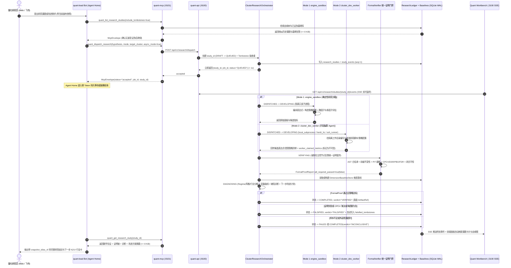
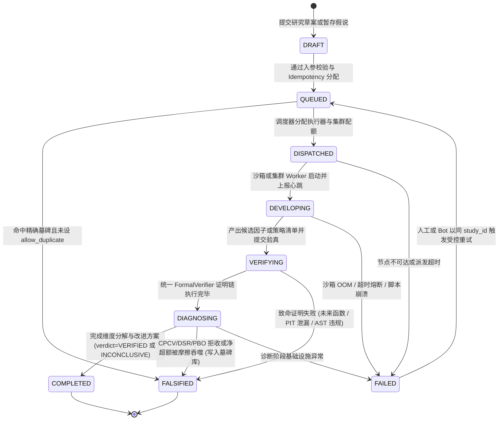

# QuantLab Pro V3.0 架构方案：Bot 集群调度、持续研究知识库与后端 / MCP 契约

> **文档角色**：QuantLab Pro V3.0 Stage 1 分布式研究编排、Agent Home 集成与量化知识库工程落地契约  
> **审计基线**：基于仓库实地代码审计（`packages/quant-core/src/quant_core/schemas.py`、`lake/registry.py`、`lake/store.py`、`factors/`、`validation/`、`risk/`、`backtest/`、`shadow/`、`services/quant-api/src/quant_api/`、`services/quant-mcp/src/quant_mcp/`、`services/quant-mcp/skills/quant-lead/SKILL.md`、`scripts/register_agent_home.mjs`）  
> **兼容承诺**：100% 向后兼容 Pro-Quant V2.0 的全部 17 个契约 REST 端点（含 `/backtest/{run_id}` 与 `/jobs/{job_id}/events` 共 19 条路由）及全部 13 个 `quant_*` MCP 工具，严守物理零下单红线。

---

## 0. 集群拓扑与运行环境基线

V3.0 架构面向混合异构研发集群与单机开发双模运行，所有节点与地址在配置与契约中均采用环境变量与逻辑主机名解耦：

| 逻辑节点占位符 | 角色定位 | 核心运行组件与工具链 | 通信协议与安全边界 |
| :--- | :--- | :--- | :--- |
| `<mac-host>` | 认知控制面 & 交互端 | Agent Home（`ppeng-agent-core` Daemon `<agent-home-url>`）、永久主研 Bot `quant-lead`、浏览器访问 Quant Workbench | 通过 Streamable HTTP + Bearer Token 调用 `<quant-mcp-url>`；通过 Next.js 同源代理连接本地 Daemon |
| `<ubuntu1-host>` | 量化确定性主控与主计算节点 | `quantlab-api`（`:8100`）、`quantlab-mcp`（`:8101`）、`quantlab-web`（`:3100`）、`python3.12` / `uv`、`herdr-core (hc)`、`claude`、`cursor-agent`、PIT Data Lake（只读向研究沙箱挂载） | 唯一允许写 `data/state/quant_registry.db` 与 `data/quant-lake/artifacts/` 的主节点；物理隔离券商网络 |
| `<ubuntu2-host>` | 辅助 CPU 研究与沙箱节点 | Tailscale SSH 可达的 Linux CPU 节点（`python3.12` / `uv` / 隔离工作区） | 仅接受白名单 `ssh_runner` 参数化命令与只读数据快照同步，不持主库写权限 |
| `<win4090-host>` | 单卡 GPU 实验节点 | Tailscale SSH 可达的 GPU 工作站（LightGBM / CatBoost / PyTorch 时序截面因子实验） | 仅接受显式配置启用的 `ssh_runner` 离线研究任务，产出候选脚本与产物回传 `<ubuntu1-host>` 验真 |
| `<h20-host>` | 高显存 GPU 集群计算节点 | Tailscale SSH 可达的大显存训练节点（大规模多因子/深度学习模型与参数扫描） | 同上：所有外部产出必须经 `<ubuntu1-host>` 统一形式化验证门禁复算后方可进入 `ResearchLedger` |

---

## 1. 现状能力与顶级投行研究协作平台 Gap 分析

### 1.1 现有 V2.0 代码库实地能力审计

逐文件核验当前仓库实现后，V2.0 已具备扎实的**单点确定性计算底座**：
- **数据与契约层**：`packages/quant-core/src/quant_core/schemas.py` 以 `ConfigDict(extra="forbid")` 定义了 Q1–Q7 完整 Pydantic v2 模型；`lake/store.py` (`QuantLake`) 与 `lake/registry.py` (`QuantRegistry`) 基于 Zstd Parquet + DuckDB 时态 SQL + SQLite WAL 实现了 PIT 财报重放、7 项 QA Sentinel 审计与 `quant-artifact://` 产物持久化。
- **确定性引擎层**：`factors/ast_guard.py` 提供白名单 AST 编译到 Polars（禁 `shift(-k)` / `lead` / `center=True` / 系统调用）；`factors/engine.py` 实现 MAD 去极值、行业市值与 Barra 正交中性化、RankIC / ICIR / Newey-West HAC $t$ / 10 分层纸面净值；`validation/cpcv.py` 实现 Purged/Embargo CPCV + CSCV PBO + Bailey–López de Prado DSR；`risk/barra_opt.py` 实现 CNE6 代理风格模型 + Ledoit-Wolf 收缩协方差 + `cvxpy` (CLARABEL/OSQP) 优化；`backtest/engine.py` 实现 A 股微结构（T+1、2026-07-06 主板 ST 10% 切换、停牌、PoV、平方根冲击、Brinson/Barra 闭合归因）；`shadow/monitor.py` 实现 Perold IS 拆解与 `READ_ONLY_SIGNAL_EXPORT_ONLY` 只读签核单。
- **API / MCP / Agent Home 层**：`services/quant-api/src/quant_api/` 暴露 17 个契约端点（外加 `GET /api/v1/backtest/{run_id}` 与 `GET /api/v1/jobs/{job_id}/events`）；`services/quant-mcp/src/quant_mcp/` 暴露 13 个 `quant_*` 工具，强制 `McpEnvelope`（`schema_version="2.0"`，严格 `<= 8,192` 字节）与 `BearerAuthMiddleware`；`scripts/register_agent_home.mjs` 实现了零侵入注册 `quant-lead` Bot。

### 1.2 对标顶级投行研究平台的 4 大架构级缺口

对标 **Two Sigma Research Platform**（可复现建模工作流与共享特征账本）、**Goldman Sachs QIS Studio / SecDB**（统一对象图谱、风险归因与研究治理）及 **D. E. Shaw Research Ledger**（严格假说血缘、证伪留痕与证明门禁），当前 V2.0 存在 4 个结构性缺口与 5 项必须同步收敛的代码级技术债：

| 对比维度 | 当前 QuantLab V2.0 现状（代码实证） | 顶级投行研究协作平台标准（Two Sigma / GS QIS / D. E. Shaw） | QuantLab Pro V3.0 升级目标 |
| :--- | :--- | :--- | :--- |
| **1. 研究生命周期管理** | 仅支持单次原子调用（`POST /factors/evaluate`、`POST /validation/cpcv`、`POST /backtest/run`）；`jobs.py` 仅支持扁平 3 类短任务（`backtest`/`cpcv`/`hypothesis`） | **端到端研究课题（Research Study）全生命周期**：假说立项 → 数学推演 → 代码研发 → 形式化验证 → 跨维度归因 → 自动诊断与迭代建议 → 终审归档 | 建立 `ResearchStudy` 一等实体与 9 态状态机（`DRAFT` 至 `COMPLETED/FAILED/FALSIFIED`），串联全流程并自动持久化至 `ResearchLedger` |
| **2. Bot 调度研发闭环** | `quant-lead` 只能调用 13 个工具查指标或提交单行表达式，无法自主调度集群编写/测试多因子与策略脚本，也无法将外部研究结论验真后结构化写回面板 | **研究 Agent + 受控计算/研发集群自动闭环**：AI 提出假说与推演 → 派发沙箱或研发 Worker 写代码/跑实验 → 独立确定性核验门禁复算 → 结论回写研究总账与前端画布 | 构建 `ClusterResearchOrchestrator` 双模执行器（Mode 1 `engine_sandbox` + Mode 2 `cluster_dev_worker`），强制统一形式化验证门禁与结构化写回 |
| **3. 持续研究知识积累** | 无假说血缘树；无维度基线缓存（每次评估脱离市场 Regime 孤立看均值）；已证伪因子仅靠 `SKILL.md` 约定人工写进 Agent Home `project.memory` 纯文本，后端无结构化墓碑库与提交前查重拦截 | **机构级不可变研究知识库**：假说父子血缘 DAG、按快照冻结的维度基线库（Regime/波动/市值/行业/风格）、全库结构化证伪墓碑与同质假说自动预警、全链路复盘事件流 | 在 `quant_registry.db` 落地 `research_studies`、`dimension_baselines`、`falsified_tombstones`、`study_events` / `research_notes` 四大核心表 |
| **4. 术语百科与上下文问答** | 前端无统一量化术语元数据；Bot 解释指标依赖大模型自由发挥，无权威公式、机构门槛与常见陷阱映射，也未绑定当前页面实时数值 | **单一数据源（SSOT）术语知识图谱 + 上下文感知助手**：UI hover 卡片、LaTeX 公式、机构红线、常见误区与 Bot 带实时快照数值的深度诊断共享同一套定义 | 构建 `GlossaryRegistry`（50+ 机构量化术语，7 大分类），前后端与 MCP 共享；支持 `bot_prompt_template` 自动拼装实时指标且不击穿 Agent Home KV Cache |

### 1.3 审计发现的 5 项代码级技术债（V3.0 必须同步修正）

1. **双 SQLite 状态分裂**：`packages/quant-core/src/quant_core/lake/registry.py` 写入 `data/state/quant_registry.db`（6 表：`snapshots` / `experiments` / `jobs` / `artifacts` / `qa_runs` / `ingest_batches`），而 `services/quant-api/src/quant_api/jobs.py` (`StateStore`) 另建 `data/state/quant_api_state.db`（`jobs` / `results` / `tool_calls`），因子假设仅作为 JSON blob 存在 `results` 中。**V3.0 决策**：全部研究知识库表（`research_studies`、`dimension_baselines`、`falsified_tombstones`、`study_events`、`research_notes`）统一落入 `data/state/quant_registry.db`（保持 SQLite WAL 与 PostgreSQL 18 双兼容 DDL），`quant_api_state.db` 仅保留进程内短期任务调度锁与 MCP 调用计数统计。
2. **实验到因子的脆性字符串匹配**：`services/quant-api/src/quant_api/service.py:397` 的 `_experiment_factors()` 通过 `f in f"{rec.family_id} {rec.feature_summary} {rec.name}"` 猜因子列表。**V3.0 决策**：`research_studies` 显式持久化结构化 `hypothesis_json.factor_specs`（`factor_id`、`expression`、`expr_hash`、`weights`），彻底消除子串误匹配。
3. **相关性引擎仅支持内置因子**：`packages/quant-core/src/quant_core/factors/engine.py:713` 的 `compute_factor_correlation()` 遇到不在 `BUILTIN_FACTORS` 中的已登记因子直接抛出 `ValueError`。**V3.0 决策**：支持传入 `factor_expressions: dict[str, str]` 或自动从 `ResearchLedger` / `hypothesis` 注册表解析表达式。
4. **准入门槛双源漂移**：`services/quant-mcp/skills/quant-lead/SKILL.md:26` 写着 `|RankIC|>=0.02, ICIR>=1.0, |NW t|>=2.0, corr<0.5, mono>=0.7`，而真实引擎 `factors/engine.py:765-824` 的 `_admission_checks()` 校验的是 `RankIC>=0.03, ICIR>=1.5, NW t>=3.0, turnover<=0.15, corr<0.70, mono>=0.90`。**V3.0 决策**：在 `quant_core` 中定义统一的 `INSTITUTIONAL_GATES` 常量，供 `factors/engine.py`、`validation/formal.py`、`GlossaryRegistry` 与 `SKILL.md` 共同对齐（区分“初筛观察线”与“正式入库门禁线”）。
5. **现有安全路由契约约束**：`services/quant-api/tests/test_api.py:83-92` 的 `test_no_broker_or_order_routes` 严格校验：① 所有 OpenAPI 路径必须以 `/api/v1/` 开头；② HTTP 方法集合必须为 `{"get", "post"}` 子集；③ 路由路径严禁匹配正则 `order|broker|execut|trade|position|account|buy|sell|ctp|qmt`；`services/quant-mcp/tests/test_mcp.py:89` 校验工具名不含 `order|broker|trade|buy|sell|place`。**V3.0 全部新增 REST 路由与 MCP 工具名已逐一通过该安全正则审计**（例如用 `/dispatch` 替代 `/execute`，全部保持 `GET`/`POST`）。

---

## 2. Bot 调度开发集群研究闭环架构（`ClusterResearchOrchestrator`）

### 2.1 端到端协作时序图



### 2.2 研究课题状态机（State Machine）



#### 状态迁移与 Verdict 正交约束表

为避免“执行成功（流程跑完）”与“结论可信（数学证真）”混淆，`status`（流程状态）与 `verdict`（学术结论）严格分离：

| `status` | 含义 | 允许的 `verdict` | 触发持久化副作用 |
| :--- | :--- | :--- | :--- |
| `DRAFT` | 草案已建档，尚未进入执行队列 | `PENDING` | 写入 `research_studies` + `study_events` |
| `QUEUED` | 已通过快照锁定与前置墓碑查重，等待执行槽位 | `PENDING` | 关联 `jobs.job_id`；若命中精确墓碑且 `allow_duplicate=false` 则直接短路转 `FALSIFIED` |
| `DISPATCHED` | 已选定 `engine_sandbox` 或具体 `ClusterWorkerSpec` | `PENDING` | 记录 `target_cluster`、`worker_session_id`、启动时间与截止超时时间 |
| `DEVELOPING` | 因子编译/多因子训练/集群开发 Agent 正在编码与自测 | `PENDING` | 周期性追加 `study_events` 心跳与进度（`15% -> 55%`） |
| `VERIFYING` | 在 `<ubuntu1-host>` 确定性内核上运行强制形式化验证门禁 | `PENDING` | 执行 P1–P5 五大硬证明；发现未来函数泄漏直接短路判 `FALSIFIED` |
| `DIAGNOSING` | 叠加 `DimensionBaselineStore` 做跨维度 Regime/容量分析，生成诊断与迭代建议 | `PENDING` | 填充 `dimension_analysis_json`、`diagnosis_json`、`improvement_plan_json` |
| `COMPLETED` | 全链路无基础设施错误地完成 | `VERIFIED` 或 `INCONCLUSIVE` | 仅当 `formal_proof.passed == true` **且** `cpcv_verdict == "pass"` **且** `admission_passed == true` 时方可标为 `VERIFIED`；否则最高标为 `INCONCLUSIVE` |
| `FALSIFIED` | 研究假说被证伪（前视泄漏、过拟合、高共线性或净收益为负） | `FALSIFIED` | **强制原子写入 `falsified_tombstones`** 并生成标准 `[FALSIFIED]` 记忆行供 Bot 写入 `project.memory` |
| `FAILED` | 基础设施/超时/依赖缺失导致未完成验证（非假说证伪） | `ERROR` | 记录错误堆栈与 `retryable` 标记；**不写入证伪墓碑库**，允许重试 |

---

### 2.3 双模执行器设计（单机可单测、集群真可跑）

新增核心模块建议位于 `services/quant-api/src/quant_api/orchestrator/`，与 `packages/quant-core/src/quant_core/validation/formal.py`、`factors/regime.py`、`risk/capacity.py` 协同工作：

```text
packages/quant-core/src/quant_core/
├── glossary/                 # Module 4: GlossaryRegistry + terms.json (50+ 术语 SSOT)
├── validation/
│   ├── cpcv.py               # V2.0 已有
│   └── formal.py             # V3.0 新增: FormalVerifier (AST + Prefix-Invariance + PIT + FDR + Closure)
├── factors/
│   └── regime.py             # V3.0 新增: DimensionBaselineBuilder + Cross-Regime 稳定性分解
├── risk/
│   └── capacity.py           # V3.0 新增: CapacityFrontierAnalyzer (AUM 冲击与容量衰减曲线)
└── lake/
    └── registry.py           # V3.0 扩展: ResearchLedger + DimensionBaselineStore + TombstoneStore DDL

services/quant-api/src/quant_api/
├── orchestrator/
│   ├── engine.py             # ClusterResearchOrchestrator 状态机与编排主循环
│   ├── sandbox.py            # Mode 1: DeterministicEngineSandbox (零外部依赖确定性研究沙箱)
│   ├── adapters.py           # Mode 2: ClusterAdapter Protocol + local_subprocess / herdr_hc / ssh_runner
│   ├── diagnosis.py          # 规则化 + 结构化诊断引擎 & 迭代改进建议生成器
│   └── cluster_config.py     # QUANT_CLUSTER_WORKERS 解析与健康检查
```

#### Mode 1：`engine_sandbox`（确定性量化研究沙箱，零外部依赖立即可用）

专为单机、CI 与 `<ubuntu1-host>` 无外部 Agent 依赖场景设计，接收结构化研究契约（假说描述、LaTeX 数学推演、单因子/多因子 Polars 表达式或权重组合、Barra 优化约束、微结构回测配置），在受控独立子进程（或测试期受控线程）内完成全自动 7 步确定性闭环：

1. **前置墓碑检查**：计算规范化 `expr_hash` 与 AST 结构指纹 `ast_fingerprint`，检索 `falsified_tombstones`；命中同质证伪时按 `allow_duplicate` 策略拦截或附告警继续。
2. **形式化验证证明链（`FormalVerifier`）**：
   - **P1 · AST 因果与安全证明**：调用 `validate_factor_ast` 校验全部算子白名单、复杂度 `<= 160`、无未来偏移/居中滚动/系统调用。
   - **P2 · Prefix-Invariance（前缀不变性证明）**：随机/固定抽取 3 个历史截断点 $t_k \in \{0.4T, 0.65T, 0.85T\}$，分别在截断面板 $\mathcal{D}_{[t_0, t_k]}$ 与完整面板 $\mathcal{D}_{[t_0, T]}$ 上计算因子值与信号权重，校验：
     $$\max_{i,\; t \le t_k} \left| f(\mathcal{D}_{[t_0, t_k]})_{i,t} - f(\mathcal{D}_{[t_0, T]})_{i,t} \right| \le 10^{-12}$$
     任何超阈差异立即判定存在前视泄漏（例如误用全样本标准化、全样本行业均值或未来退市筛选），直接短路转 `FALSIFIED` (`LOOKAHEAD_PREFIX_VIOLATION`)。
   - **P3 · PIT 财务时态与生存偏差证明**：若因子依赖财务字段，验证所有记录严格满足 `published_at <= decision_at` 且样本包含历史退市/ST 生命周期记录（与 `qa_sentinel` 对账）。
   - **P4 · 统计与多重检验门禁证明**：基于真实 `factors/engine.py` 与 `validation/cpcv.py` 校验 `purge_conflicts == 0`、`DSR >= 0.95`、`PBO <= 0.25`、`OOS/IS >= 0.50`，并补充跨同族试验的 **Benjamini-Hochberg FDR**（$q \le 0.05$）校正。
   - **P5 · 优化与归因数值守恒证明**：验证 Barra 协方差最小特征值 `psd_min_eigenvalue > 0`、`cvxpy` 约束最大违背 `max_constraint_violation <= 1e-6`、Brinson 与 Barra 归因闭合误差均 `< 1.0 bp`、全周期权重与现金守恒 `|sum(w) + cash - 1| <= 1e-6`。
3. **因子 / 多因子评估**：调用 `quant_core.factors.engine.evaluate_factor`（并扩展支持多因子线性/ICIR 合成与已注册因子相关性矩阵）。
4. **CPCV / DSR / FDR 过拟合检验**：调用 `quant_core.validation.cpcv.run_cpcv_gate`，如实累计 `trial_count_m`（含该课题家族及墓碑库内已淘汰试验数！）。
5. **Barra CNE6 + `cvxpy` 优化与 AUM 容量前沿**：调用 `quant_core.risk.barra_opt.optimize_portfolio` 与 V3.0 `quant_core.risk.capacity.analyze_capacity_frontier`，在 AUM 网格（如 `10M, 50M, 100M, 300M, 500M, 1B, 3B` CNY）上结合 `square_root_impact` 与 `max_pov` 测算冲击滑点侵蚀与**半衰容量（Half-Alpha AUM，净超额衰减至基准 50% 时的资金规模）**及**盈亏平衡容量（Breakeven AUM）**。
6. **A 股事件驱动微结构回测**：调用 `quant_core.backtest.engine.run_backtest(engine="event")`，获取完整摩擦拆解（佣金/印花税/过户费/冲击/涨跌停停牌机会成本）与 Brinson/Barra 闭合归因。
7. **跨维度 Regime 分解、诊断与改进计划生成**：
   - 从 `DimensionBaselineStore` 读取当前 `(snapshot_id, universe_id)` 的 5 维基线（市场 Regime / 波动率分位 / 市值分组 / 申万一级行业 / Barra CNE6 风格）；
   - 计算该策略/因子在各分桶下的条件 RankIC、超额年化、胜率与基准对照差值；
   - 由确定性诊断引擎（`orchestrator/diagnosis.py`）产出结构化 `diagnosis_json`（如 `HIGH_TURNOVER_FRICTION`、`SMALL_CAP_BET_CONCENTRATION`、`BEAR_REGIME_BREAKDOWN`、`HIGH_LIBRARY_COLLINEARITY`、`LOW_CAPACITY_LIQUIDITY_BOTTLENECK`）和可执行 `improvement_plan_json`（每个建议带预计影响、具体表达式/约束补丁及一键派发子课题 `child_dispatch_payload`，自动继承 `parent_study_id`）。

#### Mode 2：`cluster_dev_worker`（开发集群 Agent 调度器）

当研究任务需要探索新型非线性结构、编写定制 Python 研究脚本、特征工程对比或 LightGBM/CatBoost 多因子模型实验时，启用 Mode 2。所有集群节点通过统一配置模型 `ClusterWorkerSpec` 注册：

```python
class ClusterAdapterType(str, Enum):
    LOCAL_SUBPROCESS = "local_subprocess"
    HERDR_HC = "herdr_hc"
    SSH_RUNNER = "ssh_runner"

class ClusterWorkerSpec(BaseModel):
    model_config = ConfigDict(extra="forbid")

    cluster_id: str                       # 例如: "ubuntu1-hc", "ubuntu2-cpu", "win4090-gpu", "h20-gpu", "local-dev"
    display_name: str
    adapter: ClusterAdapterType
    host: str                             # 逻辑主机名/SSH alias 占位符, 例如 "<ubuntu1-host>", "localhost"
    agent_cli: Literal["python", "claude", "cursor-agent", "codex"] = "python"
    capabilities: list[str]               # ["polars", "cvxpy", "herdr_hc", "gpu_4090", "gpu_h20", "lightgbm"]
    max_concurrency: int = 2
    default_timeout_sec: int = 600
    max_timeout_sec: int = 1800
    workspace_root: str                   # 隔离沙箱目录, 如 "data/sandboxes"
    lake_mount_mode: Literal["read_only"] = "read_only"
    allowed_command_templates: list[str]  # 严格命令模板 ID 白名单, 如 ["run_study_script", "agent_factor_dev"]
    enabled: bool = True
```

配置加载顺序：`QUANT_CLUSTER_WORKERS` 环境变量（JSON 数组） → 仓库/部署目录 `config/cluster_workers.json` → 默认内置安全回退列表（仅启用 `local-sandbox` `local_subprocess`，确保零配置下服务和单测即刻可用）。

##### 三种安全可控适配器（均实现统一 `ClusterAdapter` Protocol）

```python
class ClusterAdapter(Protocol):
    def health_check(self, spec: ClusterWorkerSpec) -> dict[str, Any]: ...
    def launch(self, spec: ClusterWorkerSpec, task: WorkerTaskEnvelope, on_event: Callable[[dict[str, Any]], None]) -> WorkerOutputBundle: ...
    def cancel(self, spec: ClusterWorkerSpec, worker_run_id: str) -> bool: ...
```

| 适配器 | 适用环境与目标节点 | 调度与执行机制 | 隔离与安全控制 |
| :--- | :--- | :--- | :--- |
| **`local_subprocess`** | 单机开发 / CI 单测 / `<ubuntu1-host>` 无代理脚本任务 | `subprocess.Popen(argv, shell=False, cwd=sandbox_dir, env=sanitized_env)` 运行受限 Python 研究入口 `python -m quant_core.sandbox.runner --manifest task.json` | 无 shell 拼接；`resource.setrlimit` 限制内存与 CPU；独立目录 `data/sandboxes/<study_id>/`；仅传递只读 `QUANT_DATA_ROOT` 与受限环境变量（剥离所有密钥/Token）；超时后 `os.killpg` 清理进程树 |
| **`herdr_hc`** | `<ubuntu1-host>` 上调度 `claude` / `cursor-agent` / `codex` | 通过 `herdr-core (hc)` 命令行在 `<ubuntu1-host>` 上为该 `study_id` 创建独立会话/隔离目录（`data/sandboxes/<study_id>/`），写入只读任务契约 `STUDY_BRIEF.json`（含 `snapshot_id`、字段白名单、输出 Schema 要求），引导 Agent 产出标准 `candidate_output.json`（表达式/策略规格/推演/单测报告），轮询哨兵文件或会话退出码后自动回收 `hc` 终端 | 严格限定在隔离沙箱目录启动，绝不触碰主仓库 Git 索引；不继承任何券商/Tushare 生产密钥；强制 `--max-turns` / 超时强杀并回收会话；产出仅读取结构化 `candidate_output.json` |
| **`ssh_runner`** | 跨 Tailscale 节点（`<ubuntu2-host>`、`<win4090-host>`、`<h20-host>`） | 通过 `ssh -o BatchMode=yes -o ConnectTimeout=10 -o StrictHostKeyChecking=yes <host> -- <allowlisted_entrypoint> --study-id <id>` 触发远端预置 Runner；通过 `scp`/JSON stdin-stdout 传输不可变任务清单并回收 `candidate_output.json` + 产物哈希 | **绝对禁止将自由文本 Prompt 拼进远端 Shell**；仅允许执行 `allowed_command_templates` 中预注册的固定入口脚本；远端目录按 `study_id` 隔离并在超时后远端 `kill`；不共享主控数据库写权限 |

##### 强制 Post-Dev 统一证明门禁（零信任外部 Worker）

无论是 `herdr_hc` 上的 `claude`/`cursor-agent` 还是 `<h20-host>` 上 GPU 训练产出的模型与因子，其返回的 `WorkerOutputBundle` 中的指标仅存入 `metrics_summary_json.worker_claimed_metrics`（**不可信声明**）：
1. 若产出为**因子表达式 / 多因子线性或树模型预测信号面板**（`signal_panel.parquet` + `factor_spec.json`）：
   - 主控节点 `<ubuntu1-host>` 必须对表达式/脚本重新执行 `FormalVerifier`（AST 白名单 + Prefix-Invariance 前缀不变性重跑 + PIT 财务截断核验）；
   - 对于外部脚本产出的预测面板，必须用**受控确定性复跑函数**在截断数据集 $[t_0, t_k]$ 上重新生成前缀信号并与全量信号比对，无法重现或前缀不一致直接判 `FALSIFIED` (`UNREPRODUCIBLE_OR_LEAKY_WORKER_OUTPUT`)！
2. 只有通过主控节点 `FormalVerifier` + `CPCV/DSR/PBO` + `Event Backtest` 复算后的结果，才会写入正式 `metrics_summary_json`、`formal_proof_json` 与 `verdict`。

### 2.4 不可协商的 5 道安全边界

| 安全边界 | 强制工程实现 | 违背时的系统行为 |
| :--- | :--- | :--- |
| **1. 只读数据湖隔离** | 沙箱进程设置 `QUANT_LAKE_READ_ONLY=1`；`QuantLake` 在只读模式下拒绝 `publish_snapshot` / `quarantine_batch` / `save_experiment`；远端/子进程仅对 `data/quant-lake/canonical` 具读权限 | 抛出 `PermissionError`，任务立即标记 `FAILED` 并记录安全审计事件 |
| **2. 绝不接触实盘券商** | 物理无券商 SDK/路由/凭证；保留 `test_no_broker_or_order_routes` 正则门禁与 `AuthorityGateManifest.broker_connected=False`；所有研究输出仅为统计论证与只读权重方案 | CI 编译期与单测期直接失败阻断合入 |
| **3. 命令白名单与零 Shell 注入** | 所有适配器一律 `shell=False` 参数数组调用；仅接受预注册 `allowed_command_templates`；禁止从 MCP 参数透传任意 shell 命令或路径穿越（`..`） | 返回 `422 INVALID_ARGUMENT` / `McpErrorCode.FORBIDDEN` |
| **4. 超时熔断与并发配额** | 单节点 `max_concurrency` 信号量；硬超时（默认 600s，上限 1800s）；进程组级联终止与沙箱目录自动清理/归档；服务重启时 `fail_orphans` 同步回收悬空 `DISPATCHED/DEVELOPING` 课题 | 自动切换至 `FAILED` (`TIMEOUT`) 并推送终态 SSE 事件 |
| **5. 形式化验证门禁不可绕过** | 代码层在 `ResearchLedger.finalize_study()` 设置硬断言：若 `verdict == "VERIFIED"` 但 `not formal_proof.all_required_passed` 或 `cpcv.verdict != "pass"`，直接抛出 `ProofGateViolationError` 拒绝落库 | 强制降级为 `FALSIFIED` 或 `INCONCLUSIVE` 并记录 `proof_gate_reasons` |

---

## 3. 持续研究知识积累体系（`ResearchLedger` + `DimensionBaselineStore`）

所有持续研究知识表统一写入 `data/state/quant_registry.db`（由 `packages/quant-core/src/quant_core/lake/registry.py` 的 `REGISTRY_SCHEMA_SQL` 管理，严格遵守 SQLite WAL 与 PostgreSQL 18 双兼容语法：仅用 `TEXT` / `INTEGER` / `DOUBLE PRECISION` + `ON CONFLICT ... DO UPDATE` + 标准递归 CTE）。

### 3.1 数据库 Schema 设计（SQLite WAL / PostgreSQL 18 兼容 DDL）

```sql
-- =========================================================================
-- QuantLab Pro V3.0 Persistent Research Knowledge Schema (quant_registry.db)
-- =========================================================================

-- 1. 端到端研究课题主表 (含假说血缘树 parent_study_id)
CREATE TABLE IF NOT EXISTS research_studies (
    study_id                TEXT PRIMARY KEY,
    parent_study_id         TEXT REFERENCES research_studies(study_id),
    title                   TEXT NOT NULL,
    topic_tags              TEXT NOT NULL DEFAULT '[]',       -- JSON array[str], 如 ["volume_price", "reversal", "csi500"]
    status                  TEXT NOT NULL,                    -- DRAFT|QUEUED|DISPATCHED|DEVELOPING|VERIFYING|DIAGNOSING|COMPLETED|FAILED|FALSIFIED
    dispatch_mode           TEXT NOT NULL,                    -- engine_sandbox | cluster_dev_worker | external_publish
    target_cluster          TEXT NOT NULL DEFAULT 'local-sandbox',
    snapshot_id             TEXT NOT NULL,
    universe_id             TEXT NOT NULL DEFAULT 'CSI500',
    job_id                  TEXT,
    idempotency_key         TEXT,
    hypothesis_json         TEXT NOT NULL,                    -- 研究假说、因子/策略规格、前置参数
    math_derivation_json    TEXT NOT NULL DEFAULT '{}',       -- 经济学机制、LaTeX 推导、预期暴露与理论半衰期
    formal_proof_json       TEXT NOT NULL DEFAULT '{}',       -- FormalProofReport (P1-P5 证明链明细与哈希)
    metrics_summary_json    TEXT NOT NULL DEFAULT '{}',       -- 确定性复算核心指标 (IC/ICIR/CPCV/Barra/Backtest/Capacity)
    dimension_analysis_json TEXT NOT NULL DEFAULT '{}',       -- 叠加维度基线后的 5 维拆解结果
    diagnosis_json          TEXT NOT NULL DEFAULT '{}',       -- 自动化缺陷诊断清单 (severity/code/evidence)
    improvement_plan_json   TEXT NOT NULL DEFAULT '{}',       -- 可执行的下一步迭代计划与子课题模板
    verdict                 TEXT NOT NULL DEFAULT 'PENDING',  -- PENDING | VERIFIED | FALSIFIED | INCONCLUSIVE | ERROR
    created_by              TEXT NOT NULL DEFAULT 'quant-lead',
    created_at              TEXT NOT NULL,
    updated_at              TEXT NOT NULL,
    completed_at            TEXT,
    artifact_uri            TEXT                              -- quant-artifact://... 完整研究数据包
);

CREATE UNIQUE INDEX IF NOT EXISTS ux_research_studies_idem
    ON research_studies(idempotency_key) WHERE idempotency_key IS NOT NULL;
CREATE INDEX IF NOT EXISTS idx_research_studies_parent
    ON research_studies(parent_study_id);
CREATE INDEX IF NOT EXISTS idx_research_studies_snapshot_status
    ON research_studies(snapshot_id, status, created_at DESC);
CREATE INDEX IF NOT EXISTS idx_research_studies_verdict
    ON research_studies(verdict, created_at DESC);

-- 2. 维度基线持久化存储 (按 snapshot_id + universe_id 一次计算、所有研究复用)
CREATE TABLE IF NOT EXISTS dimension_baselines (
    baseline_id             TEXT PRIMARY KEY,                 -- 格式: bl_<snapshot_id>_<universe_id>_<dimension_type>
    snapshot_id             TEXT NOT NULL,
    universe_id             TEXT NOT NULL,
    dimension_type          TEXT NOT NULL,                    -- market_regime | volatility_regime | market_cap_tier | sw_industry | barra_style
    period_granularity      TEXT NOT NULL DEFAULT 'daily',    -- daily | weekly | monthly
    date_range_start        TEXT NOT NULL,
    date_range_end          TEXT NOT NULL,
    bucket_definitions_json TEXT NOT NULL,                    -- 分桶边界定义 (如 Bull/Bear/Sideways 阈值、波动率三分位)
    bucket_stats_json       TEXT NOT NULL,                    -- 各分桶基准年化收益、波动、换手、占比天数、风格基准收益
    date_bucket_map_uri     TEXT,                             -- 大型逐日分桶映射落盘 quant-artifact://... (Parquet)
    baseline_sha256         TEXT NOT NULL,
    created_at              TEXT NOT NULL,
    UNIQUE(snapshot_id, universe_id, dimension_type, period_granularity)
);

CREATE INDEX IF NOT EXISTS idx_dimension_baselines_lookup
    ON dimension_baselines(snapshot_id, universe_id, dimension_type);

-- 3. 结构化已证伪墓碑库 (防重复踩坑与提交前相似度预警)
CREATE TABLE IF NOT EXISTS falsified_tombstones (
    tombstone_id            TEXT PRIMARY KEY,                 -- TOMB-<hash10>
    study_id                TEXT REFERENCES research_studies(study_id),
    factor_id               TEXT NOT NULL,
    expression              TEXT NOT NULL,
    expr_hash               TEXT NOT NULL,                    -- 去空白 SHA-256 前 16 位 (兼容 V2.0 expr_hash)
    ast_fingerprint         TEXT NOT NULL,                    -- 归一化变量/常量窗口后的 AST 结构指纹
    universe_id             TEXT NOT NULL,
    snapshot_id             TEXT NOT NULL,
    failure_code            TEXT NOT NULL,                    -- LOOKAHEAD_PREFIX_VIOLATION|AST_UNSAFE|LOW_DSR|HIGH_PBO|OOS_DECAY|HIGH_TURNOVER|COLLINEAR|NEG_NET|LOW_CAPACITY|REGIME_FRAGILE
    failure_metrics_json    TEXT NOT NULL,                    -- {dsr, pbo, oos_is, rank_ic, icir, max_corr, max_corr_peer, net_excess_ann}
    lesson_summary          TEXT NOT NULL,                    -- 人话+统计学证伪教训摘要
    keywords_json           TEXT NOT NULL DEFAULT '[]',       -- 归一化词元集合, 用于提交前 Jaccard 相似度检索
    memory_line             TEXT NOT NULL,                    -- 预格式化标准 [FALSIFIED] 文本行, 供 Bot 一键同步 project.memory
    created_by              TEXT NOT NULL DEFAULT 'orchestrator',
    created_at              TEXT NOT NULL
);

CREATE INDEX IF NOT EXISTS idx_tombstones_expr_hash
    ON falsified_tombstones(expr_hash);
CREATE INDEX IF NOT EXISTS idx_tombstones_ast_fp
    ON falsified_tombstones(ast_fingerprint);
CREATE INDEX IF NOT EXISTS idx_tombstones_study
    ON falsified_tombstones(study_id);
CREATE INDEX IF NOT EXISTS idx_tombstones_created
    ON falsified_tombstones(created_at DESC);

-- 4. 研究全链路事件流 (供前端实时 SSE 与事后逐帧复盘)
CREATE TABLE IF NOT EXISTS study_events (
    event_id                TEXT PRIMARY KEY,
    study_id                TEXT NOT NULL REFERENCES research_studies(study_id),
    seq                     INTEGER NOT NULL,                 -- 课题内单调递增序号 (支持 Last-Event-ID 断点续传)
    stage                   TEXT NOT NULL,                    -- 对应状态机节点
    event_type              TEXT NOT NULL,                    -- state_change | progress | proof_check | metric_snapshot | warning | heartbeat | note | terminal
    progress_pct            INTEGER NOT NULL DEFAULT 0,
    message                 TEXT NOT NULL,
    payload_json            TEXT NOT NULL DEFAULT '{}',
    actor                   TEXT NOT NULL DEFAULT 'orchestrator',
    created_at              TEXT NOT NULL,
    UNIQUE(study_id, seq)
);

CREATE INDEX IF NOT EXISTS idx_study_events_stream
    ON study_events(study_id, seq ASC);

-- 5. 结构化研究批注与复盘笔记 (支持研究员与 Bot 在课题/血缘节点沉淀定性洞察)
CREATE TABLE IF NOT EXISTS research_notes (
    note_id                 TEXT PRIMARY KEY,
    study_id                TEXT NOT NULL REFERENCES research_studies(study_id),
    author                  TEXT NOT NULL,                    -- researcher | quant-lead | risk-pm | alpha-miner
    note_type               TEXT NOT NULL DEFAULT 'review',   -- review | rationale | override_reason | postmortem
    content_md              TEXT NOT NULL,
    linked_terms_json       TEXT NOT NULL DEFAULT '[]',       -- 关联 Glossary term_id
    created_at              TEXT NOT NULL
);

CREATE INDEX IF NOT EXISTS idx_research_notes_study
    ON research_notes(study_id, created_at DESC);
```

### 3.2 四大核心知识机制详解

#### 机制 A：假说血缘树（Hypothesis Lineage Tree）与跨课题对比
- 通过 `parent_study_id` 构成有向无环血缘树（根课题为初始经济直觉，子课题为“中性化修正”“换手降频”“去小市值暴露”“更换窗口或特征”等迭代版本）。
- 使用 SQLite / PostgreSQL 通用递归 CTE（`WITH RECURSIVE lineage AS (...)`）一键拉取整个研究家族的演进路径，并生成 **Cross-Study Comparison Delta**（逐列对比 `rank_ic_mean`、`icir_ann`、`dsr`、`pbo`、`net_excess_ann_pct`、`ann_turnover_pct`、`half_alpha_aum_cny`、`verdict`），让研究员一目了然每次改进是否真正换来净超额提升而非过拟合。

#### 机制 B：`DimensionBaselineStore`（5 维市场背景基线缓存）
每次对某个 `(snapshot_id, universe_id)` 首次触发维度分析或显式调用 `POST /api/v1/research/baselines` 时，自动基于冻结快照计算并持久化以下 5 类基准维度切片（不可变快照决定基线天然可缓存复用）：

| `dimension_type` | 客观划分规则（无未来信息泄漏） | 持久化基准统计（用于所有新研究一键叠加对照） |
| :--- | :--- | :--- |
| `market_regime` | 基于基准 60D 滚动趋势与相对 120D 高点回撤划分：`BULL`（60D 收益 > +5% 且回撤 > -8%）、`BEAR`（60D 收益 < -5% 或回撤 <= -15%）、`SIDEWAYS`（其余） | 各 Regime 占比天数、基准年化收益/波动、全市场平均换手与截面离散度 |
| `volatility_regime` | 基于基准过去 20D 实现年化波动率的历史扩展分位数（Strictly Causal Expanding Quantile）划分：`LOW_VOL`（< P33）、`MID_VOL`（P33–P67）、`HIGH_VOL`（> P67） | 各波动率区间基准表现、涨跌停密度、流动性冲击基线 |
| `market_cap_tier` | 按每交易日截面 `float_market_cap` 划分 5 分组（`MEGA` / `LARGE` / `MID` / `SMALL` / `MICRO`） | 各市值分组等权/市值加权基准收益、日均成交额中位数、换手基线 |
| `sw_industry` | 按 PIT 申万一级行业 `industry_l1`（`SW2021`）聚合 | 各行业平均权重、区间年化收益、行业波动率与截面股票数 |
| `barra_style` | 复用 `risk/barra_opt.py:fit_barra_factor_returns` 估算 CNE6 10 大风格因子的日频纯因子收益序列 | 10 大风格的区间累计收益、年化波动、近 60D 风格动量与拥挤度基线 |

**研究叠加价值**：任何新课题在 `DIAGNOSING` 阶段直接关联这 5 份基线，UI 可在同一坐标轴叠加“该策略在熊市/高波/微盘/各行业的超额 vs 当期维度基线走势”，立刻识破“看似高 IC、实则只在微盘牛市赚钱”的伪 Alpha。

#### 机制 C：三层已证伪墓碑库（`falsified_tombstones`）查重与预警
新研究派发前，调度器自动运行三层相似度扫描：
1. **Tier 1 · 精确表达式匹配（`expr_hash`）**：与 V2.0 `service.py:expr_hash()` 算法 100% 兼容（去空白 SHA-256 前 16 位）。命中则默认阻断（返回已有墓碑与历史证明结果），除非调用方显式传 `allow_duplicate=true` 并填写 `override_rationale`。
2. **Tier 2 · 归一化 AST 结构指纹（`ast_fingerprint`）**：将表达式解析为 AST 后，把数字窗口字面量归一化为类型占位符（如 `rolling_corr(close.pct_change(), volume_shares.log1p().diff(), window_size=W)`）并计算规范 SHA-256。捕捉“仅把 20 天改成 21 天试图绕过过拟合检验”的参数微调重复试错！命中后发出高危警告并强制累加原家族 `trial_count_m`（防止 p-hacking 漏计试验次数）。
3. **Tier 3 · 假说关键词 Jaccard 相似度**：基于 `keywords_json` 计算与历史墓碑假说文本的 Jaccard 相似度（阈值 `>= 0.45`），以软预警形式注入 `study_events` 与 Bot 返回摘要，提示研究员参考前人教训。
4. **双写同步**：每条落库墓碑自动生成标准 `memory_line`：
   ```text
   [FALSIFIED] <factor_id> | <expr_hash> | <failure_code> | DSR=<x> PBO=<y> OOS/IS=<z> | snap=<snapshot_id> | <YYYY-MM-DD> | study=<study_id>
   ```
   既在数据库结构化永久留存，又让 Agent Home 的 `quant-lead` Bot 无缝同步至 `project.memory`。

---

## 4. 专业术语知识图谱与上下文感知 API（`GlossaryRegistry`）

### 4.1 单一数据源（SSOT）设计与 Schema 契约

在 `packages/quant-core/src/quant_core/glossary/` 建立单一真相源（`terms.json` + `registry.py`），由 `quant-api`（REST `/api/v1/glossary`）、`quant-mcp`（`quant_glossary_lookup`）与 `apps/web`（Tooltip / 抽屉 / 一键问 Bot）共同消费，杜绝前后端解释口径和机构阈值不一致。

```python
class GlossaryCategory(str, Enum):
    FACTOR = "factor"
    VALIDATION = "validation"
    RISK = "risk"
    BACKTEST = "backtest"
    DATA = "data"
    SHADOW = "shadow"
    MATH = "math"

class GlossaryTerm(BaseModel):
    model_config = ConfigDict(extra="forbid")

    term_id: str                        # 唯一稳定标识符, 如 "rank_ic", "deflated_sharpe_ratio"
    term: str                           # 中文标准简称, 如 "秩信息系数 (RankIC)"
    en_name: str                        # 英文全称, 如 "Spearman Rank Information Coefficient"
    category: GlossaryCategory
    short_tip: str                      # 一句话人话解释 (<= 80 字, 供 UI Hover Tooltip)
    formula_latex: str                  # KaTeX 兼容 LaTeX 公式
    institutional_threshold: str        # 与引擎常量对齐的机构标准门槛
    common_pitfalls: list[str]          # 2-4 条实战易踩坑误区
    related_terms: list[str]            # 关联 term_id 列表 (构成术语图谱跳转)
    bot_prompt_template: str            # 带占位符的提问模板, 如 "{term} 当前在 {universe_id}({snapshot_id}) 上为 {value}..."
```

#### 完整词条 JSON 示例（`deflated_sharpe_ratio`）

```json
{
  "term_id": "deflated_sharpe_ratio",
  "term": "折减夏普比率 (DSR)",
  "en_name": "Deflated Sharpe Ratio",
  "category": "validation",
  "short_tip": "扣除你反复试错 M 次的运气成分以及收益偏度/峰度后，策略真实夏普大于零的统计置信概率。",
  "formula_latex": "\\text{DSR} = \\Phi\\!\\left(\\frac{(\\widehat{SR} - SR_0(M))\\sqrt{T-1}}{\\sqrt{1 - \\hat{\\gamma}_3 \\widehat{SR} + \\frac{\\hat{\\gamma}_4 - 1}{4}\\widehat{SR}^2}}\\right)",
  "institutional_threshold": "正式入库 >= 0.95；< 0.80 直接拒绝；0.80–0.95 判 INCONCLUSIVE 需继续观察（M 必须如实含已淘汰试验）",
  "common_pitfalls": [
    "隐瞒历史失败试验次数（人为调小 trial_count_m）会导致 DSR 虚高，属于典型 p-hacking",
    "忽略收益厚尾峰度（kurtosis）与负偏度会严重低估夏普估计方差",
    "在非独立重叠多日收益上直接代入日频 T 会夸大有效样本量"
  ],
  "related_terms": ["cpcv_pbo", "oos_is_ratio", "bh_fdr", "newey_west_t"],
  "bot_prompt_template": "请结合当前快照 {snapshot_id}（{universe_id}，研究对象 {entity_id}）的真实数据，深度解读「{term}」：当前值为 {value}（试验数 M={trial_count_m}，对比基准门槛：{institutional_threshold}）。请解释该数值背后的统计含义、是否存在多重检验虚高风险，并给出下一步验证或改进建议。"
}
```

#### 上下文感知 Bot 提问联动与 KV Cache 零击穿规范
- 前端用户点击任意指标旁的 `?` 图标弹出 Glossary 卡片，点击「让 Quant-Lead 结合当前数据深度解读」时：
  1. 前端调用 `GET /api/v1/glossary/{term_id}`（或复用启动缓存）获取 `bot_prompt_template`；
  2. 将当前页面的真实数值（`snapshot_id`、`universe_id`、`entity_id`、`value` 及相邻关联指标）填入模板；
  3. 按照 `docs/plan/03-agent-home-integration.md §4.3` 的工程不变量，将其连同紧凑 `<quant_canvas_context>` 注入到最新一条 `user` 消息正文，**绝不修改 Bot 系统提示词**，保证 Agent Home `STABLE_SYSTEM_VERSION` 的 Prompt KV Cache 零击穿！
  4. `quant-lead` Bot 收到后可按需调用 `quant_glossary_lookup(term_id, context_values=...)` 拉取精准公式与门槛并交叉验证工具数据，严禁凭记忆编造指标。

### 4.2 56 个机构量化术语完整注册表蓝图（覆盖 7 大领域）

> 数量：共计 **56** 条（超过 50+ 要求），按 7 大 `category` 均衡覆盖，所有 `institutional_threshold` 与 `quant_core` 引擎代码严格同源。

| 分类 (`category`) | 数量 | 完整 `term_id` 清单与核心覆盖内容 |
| :--- | :-: | :--- |
| **`factor`**（因子工程与截面检验） | **9** | `rank_ic`（秩信息系数）、`icir_ann`（年化信息比率）、`ic_win_rate`（IC 胜率）、`ic_decay_half_life`（IC 半衰期）、`decile_monotonicity`（十分层单调性 Spearman $\rho$）、`mad_winsorization`（MAD 中位数绝对偏差去极值）、`cross_sectional_neutralization`（行业/市值/Barra 正交中性化）、`factor_turnover_oneway`（因子单边换手率）、`factor_crowding_collinearity`（因子拥挤度与库内共线性） |
| **`validation`**（过拟合防御与形式化证明） | **9** | `cpcv`（组合清除交叉验证 Combinatorial Purged CV）、`purge_embargo`（标签清除与隔离缓冲窗）、`cpcv_pbo`（CSCV 过拟合概率 PBO）、`deflated_sharpe_ratio`（折减夏普比率 DSR）、`oos_is_ratio`（样本外/样本内夏普衰减比）、`bh_fdr`（Benjamini-Hochberg 错误发现率 FDR）、`walk_forward_validation`（滚动样本外验证）、`prefix_invariance_proof`（因果前缀不变性证明）、`ast_causal_guard`（静态 AST 因果安全守卫） |
| **`risk`**（Barra 风险模型与凸优化） | **9** | `barra_cne6`（Barra CNE6 中国股票多因子风险模型）、`active_style_exposure`（风格主动暴露 $z$-score）、`industry_active_deviation`（申万行业主动偏离）、`predicted_tracking_error`（预测年化跟踪误差 TE）、`euler_risk_decomposition`（欧拉边际风险分解：风格/行业/特质占比）、`ledoit_wolf_shrinkage`（Ledoit-Wolf 协方差收缩与 PSD 修正）、`convex_portfolio_optimization`（`cvxpy` 凸组合优化与软松弛诊断）、`turnover_penalty_lambda`（换手惩罚系数 $\lambda$ 与 L1 交易成本项）、`effective_n_stocks`（有效持股数 $1/\sum w_i^2$） |
| **`backtest`**（A 股微结构与业绩归因） | **8** | `event_vs_screening_engine`（事件驱动高保真 vs 向量化快筛引擎）、`t_plus_1_lock`（A 股 T+1 交收锁定）、`price_limit_queue`（涨跌停一字板与 2026-07-06 ST 10% 规则）、`pov_participation_cap`（成交量参与率上限 PoV）、`square_root_market_impact`（平方根市场冲击模型 / Almgren-Chriss）、`aum_capacity_frontier`（策略容量前沿与半衰容量 Half-Alpha AUM）、`brinson_fachler_attribution`（Brinson-Fachler 业绩归因与闭合误差）、`barra_return_attribution`（Barra 因子收益分解：纯 Alpha vs 风格/行业/成本） |
| **`data`**（PIT 数据湖与质量哨兵） | **7** | `point_in_time_bitemporal`（双时态 PIT：`published_at` 与 `first_seen_at`）、`survivorship_bias`（幸存者偏差与退市股覆盖）、`restatement_withdrawal`（财报重述与撤回处理）、`adj_factor_continuity`（复权因子连续性与除权除息现金流）、`immutable_dataset_snapshot`（不可变数据集快照与 Manifest SHA-256）、`qa_sentinel_7_checks`（数据质量哨兵 7 项硬核审计）、`dynamic_universe_constituents`（动态历史指数成分与权重质量分级） |
| **`shadow`**（影子盘漂移与风控闸门） | **7** | `implementation_shortfall`（Perold 执行缺口 IS 拆解：延迟/流动性/未成交/费用）、`shadow_is_delta`（影子盘 vs 理论回测滑点漂移差）、`fill_rate_gap`（成交率缺口与涨跌停排队损耗）、`rolling_ic_decay_killswitch`（滚动 60D IC 衰减与 Kill-Switch 熔断）、`authority_gate_manifest`（只读调仓签核单 `READ_ONLY_SIGNAL_EXPORT_ONLY`）、`fact_fingerprint_silence`（事实指纹与 `[NO_UPDATE]` 静默协议）、`regime_shift_monitoring`（市场状态切换与跨维度基线偏离监控） |
| **`math`**（核心计量与统计基础） | **7** | `newey_west_t`（Newey-West HAC 自相关异方差稳健 $t$ 统计量）、`spearman_vs_pearson`（斯皮尔曼秩相关 vs 皮尔逊线性相关）、`information_ratio`（信息比率 IR 与年化换算）、`calmar_max_drawdown`（卡玛比率与超额最大水下回撤）、`sharpe_sampling_variance`（非正态偏度/峰度下的夏普抽样方差）、`wls_factor_regression`（市值平方根加权最小二乘 WLS 横截面回归）、`multi_period_carino_linking`（多期相对收益平滑链接权重） |

---

## 5. V3.0 REST API（FastAPI）与 MCP 工具增量契约

### 5.1 严格兼容 V2.0 基线声明
- **REST 层**：保留全部 17 个 V2.0 契约端点（及 `GET /api/v1/backtest/{run_id}`、`GET /api/v1/jobs/{job_id}/events`），路径、入参、出参 Schema 零破坏性变更；`app.version` 升级为 `"0.3.0"`，CORS 继续限定白名单源与 `GET/POST/OPTIONS`。
- **MCP 层**：保留全部 13 个 V2.0 `quant_*` 工具；`McpEnvelope.schema_version` 保持 `"2.0"`（向后兼容全部 V2.0 客户端及 `test_mcp.py:112` 断言）；继续强制单次响应 `<= 8,192` 字节、`ArtifactRef` 外溢与 `BearerAuthMiddleware`。

### 5.2 新增 V3.0 FastAPI REST 端点契约（`services/quant-api/src/quant_api/routes.py`）

> 所有新增路由均以 `/api/v1/` 为前缀，仅使用 `GET` / `POST`，且全量通过 `test_no_broker_or_order_routes` 安全正则检查（零 `order|broker|execut|trade|position|account|buy|sell|ctp|qmt` 字样）。

| # | Method & Path | 所属域 | 核心请求参数 / Body | 响应 Schema / 形态 | 关键行为与错误码 |
| :-: | :--- | :---: | :--- | :--- | :--- |
| 1 | `GET /api/v1/glossary` | **Q8 百科** | Query: `category?`, `q?`, `term_id?` | `GlossaryListResponse` (`count`, `categories`, `terms: list[GlossaryTerm]`) | 零快照依赖（无数据湖也可正常返回术语百科）；支持按中英文/关键词模糊搜索 |
| 2 | `GET /api/v1/glossary/{term_id}` | **Q8 百科** | Path: `term_id`; Query 可选上下文参数 | `GlossaryTerm` | 未知 `term_id` 返回 `404 NOT_FOUND` |
| 3 | `POST /api/v1/validation/formal-verify` | **Q3 证明** | `FormalVerifyRequest`: `factor_id?`, `expression?`, `experiment_id?`, `universe_id`, `snapshot_id?`, `prefix_cutoffs=[0.4, 0.65, 0.85]`, `run_cpcv=true`, `trial_count_m` | `FormalProofResult`（`passed`, `proof_sha256`, `checks: list[ProofCheckItem]`, `max_prefix_drift`, `fdr_q_value`, `blocking_failures`）或 `?async_mode=true` 返回 `AsyncJobRecord` | 确定性运行 P1–P5 证明链；AST 违规返回 `passed=false` 并在 `blocking_failures` 标明行/算子 |
| 4 | `POST /api/v1/factors/regime-analysis` | **Q2 维度** | `RegimeAnalysisRequest`: `factor_id`, `expression?`, `universe_id="CSI500"`, `snapshot_id?`, `dimensions=["market_regime","volatility_regime","market_cap_tier","sw_industry","barra_style"]` | `RegimeAnalysisResult`（各维度分桶 `rank_ic`, `icir`, `ls_ann`, `win_rate`, `baseline_bench_ann`, `alpha_vs_baseline`, `stability_score`, `fragile_buckets`, `artifact_uri`） | 自动复用或惰性构建 `DimensionBaselineStore`；一键输出策略收益与维度基线对照 |
| 5 | `POST /api/v1/portfolio/capacity` | **Q4 容量** | `CapacityAnalysisRequest`: `experiment_id`, `universe_id="CSI500"`, `snapshot_id?`, `aum_grid_cny=[1e7, 5e7, 1e8, 3e8, 5e8, 1e9, 3e9]`, `microstructure?` | `CapacityAnalysisResult`（`points: list[CapacityPoint]`, `half_alpha_aum_cny`, `breakeven_aum_cny`, `binding_bottleneck`, `illiquid_names_top10`, `artifact_uri`） | 基于真实历史 ADV、波动率与 `square_root_impact` + `max_pov` 模拟 AUM 滑点衰减前沿 |
| 6 | `GET /api/v1/research/studies` | **Q7 知识库** | Query: `status?`, `verdict?`, `snapshot_id?`, `parent_study_id?`, `tag?`, `q?`, `include_lineage=false`, `limit=20` | `StudyListResponse`（`total`, `studies: list[ResearchStudySummary]`, `lineage_edges?`） | 支持按状态/结论/标签/血缘树检索持续研究总账 |
| 7 | `POST /api/v1/research/dispatch` | **Q7 编排** | `ResearchDispatchRequest`: `title`, `parent_study_id?`, `topic_tags`, `dispatch_mode ("engine_sandbox"|"cluster_dev_worker")`, `target_cluster?`, `universe_id`, `snapshot_id?`, `hypothesis`, `math_derivation?`, `factor_spec?`, `strategy_config?`, `allow_duplicate=false`, `override_rationale?`; Query `async_mode=true`; Header `Idempotency-Key` | `ResearchStudyRecord`（同步）或 `ResearchDispatchAccepted`（含 `study_id`, `job_id`, `status="QUEUED"`, `tombstone_warnings`） | 先做三层墓碑查重；精确命中且未授权覆写时返回 `FALSIFIED` 警告；异步模式 `< 1s` 返回 |
| 8 | `GET /api/v1/research/studies/{study_id}` | **Q7 知识库** | Path: `study_id`; Query: `include_lineage=true`, `include_notes=true` | `ResearchStudyDetail`（完整假说、数学推演、证明链、指标、5 维分析、诊断、改进计划、父子血缘与批注） | 不存在返回 `404 NOT_FOUND` |
| 9 | `GET /api/v1/research/studies/{study_id}/events` | **Q7 实时流** | Path: `study_id`; Query: `after_seq=0`, `replay_only=false`; Header: `Last-Event-ID?` | `text/event-stream` SSE 流（事件类型：`state_change` / `progress` / `proof_check` / `warning` / `terminal`） | 支持断线重连从 `Last-Event-ID` 续传与已完成课题的历史事件全量回放 |
| 10 | `POST /api/v1/research/studies/{study_id}/publish` | **Q7 回写** | `PublishFindingRequest`: `worker_cluster_id`, `candidate_expression?`, `candidate_signals_uri?`, `math_derivation`, `worker_claimed_metrics?`, `notes?` | `ResearchStudyDetail` | 供外部集群 Worker / Bot 结构化提交外部研究成果；**服务端强制运行 `FormalVerifier` 复算后落库** |
| 11 | `GET /api/v1/research/baselines` | **Q7 基线** | Query: `snapshot_id?`, `universe_id="CSI500"`, `dimension_type?` | `BaselineListResponse`（各维度分桶定义、基准统计与 `baseline_sha256`） | 同时提供 `POST /api/v1/research/baselines`（Body `BuildBaselinesRequest`）显式预构建/刷新缓存 |
| 12 | `GET /api/v1/research/tombstones` | **Q7 墓碑库** | Query: `expr_hash?`, `expression?`, `q?`, `failure_code?`, `limit=50` | `TombstoneListResponse`（`items`, `similarity_matches?`） | 同时提供 `POST /api/v1/research/tombstones` 允许显式登记人工/外部证伪教训 |
| 13 | `GET /api/v1/research/clusters` | **Q7 集群** | Query: `probe_health=false` | `ClusterInventoryResponse`（各节点 `ClusterWorkerSpec` 脱敏视图、能力标签、当前活跃课题数、`health_status`） | 绝不返回 SSH 私钥或真实内网 IP，仅暴露逻辑 `cluster_id`、适配器类型与状态 |

### 5.3 新增 V3.0 Quant MCP 工具契约（总计 13 → 21 个 `quant_*` 工具）

`services/quant-api/src/quant_api/catalog.py`（`MCP_TOOLS`）与 `services/quant-mcp/src/quant_mcp/server.py`（`_REGISTRY`）同步注册以下 **8 个新工具**，继续受 `assert registered == MCP_TOOL_NAMES` 零漂移校验与 `envelope.to_text()` 硬 `<= 8 KiB` 守卫保护：

| # | MCP 工具名 | 对应 REST 路由 | 模式 & 审批策略 | 核心输入参数（精简） | `McpEnvelope.summary` 紧凑返回策略（严格 `<= 8 KiB`） |
| :-: | :--- | :--- | :--- | :--- | :--- |
| 14 | **`quant_glossary_lookup`** | `GET /api/v1/glossary` | `sync` · `never` | `query_or_term_id: str`, `category?: str`, `context_values?: dict`（当前页面真实指标，可选） | 精确匹配返回完整词条（`short_tip`, `formula_latex`, `institutional_threshold`, `common_pitfalls`, `related_terms`, 若传 `context_values` 则返回已渲染的 `contextual_prompt`）；模糊匹配返回 Top-8 候选词条摘要 |
| 15 | **`quant_formal_verify`** | `POST /api/v1/validation/formal-verify` | `sync\|async` · `auto` | `factor_id?: str`, `expression?: str`, `experiment_id?: str`, `universe_id="CSI500"`, `trial_count_m=20`, `snapshot_id?`, `async_mode=false`, `job_id?` | 返回 `passed`, `verdict_hint`, `max_prefix_drift`, `fdr_q_value`, `blocking_failures`, P1–P5 逐项布尔与关键值；完整分折/截断对比矩阵落盘 `artifact.uri` |
| 16 | **`quant_regime_analysis`** | `POST /api/v1/factors/regime-analysis` | `sync` · `never` | `factor_id: str`, `expression?: str`, `universe_id="CSI500"`, `dimensions?: list[str]`, `snapshot_id?` | 返回 5 维稳定性总分、各维度最弱/最强 Top-3 分桶（附基准收益对照）、`fragile_buckets`；完整 31 行业与逐日映射落盘 `artifact.uri` |
| 17 | **`quant_capacity_analysis`** | `POST /api/v1/portfolio/capacity` | `sync` · `never` | `experiment_id="EXP-0427"`, `universe_id="CSI500"`, `aum_grid_cny?: list[float]`, `snapshot_id?` | 返回 `half_alpha_aum_cny`, `breakeven_aum_cny`, `binding_bottleneck`, 精简 AUM 曲线点（`<= 10` 点）与流动性瓶颈 Top-5 标的；明细落盘 `artifact.uri` |
| 18 | **`quant_dispatch_research`** | `POST /api/v1/research/dispatch` | `sync\|async` · **`always`**（涉及集群算力与写总账） | `title`, `hypothesis`, `dispatch_mode="engine_sandbox"`, `target_cluster?`, `parent_study_id?`, `factor_spec?`, `strategy_config?`, `math_derivation?`, `universe_id="CSI500"`, `snapshot_id?`, `allow_duplicate=false`, `async_mode=true`, `job_id?` | 默认 `async_mode=true` 在 `< 1s` 内返回 `status="accepted"`, `study_id`, `job_id`, `tombstone_warnings`；若前置命中精确墓碑直接返回 `status="ok"` 附 `duplicate_tombstone` 阻止浪费算力；轮询同工具带 `job_id` 取终态摘要 |
| 19 | **`quant_get_research_study`** | `GET /api/v1/research/studies/{study_id}` | `sync` · `never` | `study_id: str`, `include_lineage=true`, `include_events_tail=10` | 返回 `status`, `verdict`, `formal_proof` 核心摘要、`metrics_summary` 头牌指标、Top-5 `diagnosis` 问题、`improvement_plan` 行动项、父子血缘链与最新事件尾；完整 dossier 落盘 `artifact.uri` |
| 20 | **`quant_list_research_studies`** | `GET /api/v1/research/studies` + `/tombstones` | `sync` · `never` | `view="studies"|"tombstones"|"lineage"`, `query?: str`, `verdict?: str`, `parent_study_id?: str`, `limit=20` | 返回紧凑 `preview` 表（`<= 20` 行：`study_id/tombstone_id`, `parent`, `title/factor_id`, `verdict/failure_code`, `dsr`, `pbo`, `net_excess`, `snap`）及统计计数 |
| 21 | **`quant_publish_research_finding`** | `POST /api/v1/research/studies/{study_id}/publish` | `sync\|async` · **`always`** | `study_id?: str`, `title`, `worker_cluster_id`, `candidate_expression?`, `candidate_signals_uri?`, `math_derivation`, `worker_claimed_metrics?`, `notes?`, `async_mode=true`, `job_id?` | 接收外部集群/Bot 研究产出，**强制执行主控 `FormalVerifier` 复算**，返回核验后 `verdict`、`claimed_vs_verified_diff`、是否入墓碑库与 `artifact.uri` |

#### `McpErrorCode` 增量建议（保持向后兼容）
在 `packages/quant-core/src/quant_core/schemas.py` 现有 9 个 `McpErrorCode` 基础上，向后兼容增补 3 个精确语义错误码：
- `PROOF_FAILED`（形式化验证门禁阻断，不可标为 `VERIFIED`）
- `DUPLICATE_TOMBSTONE`（命中已证伪墓碑库，未传 `allow_duplicate=true`）
- `CLUSTER_UNAVAILABLE`（目标 `ClusterWorkerSpec` 未启用或健康探针不可达，`retryable=true`）

### 5.4 `services/quant-mcp/skills/quant-lead/SKILL.md` 与 `scripts/register_agent_home.mjs` 同步更新规范

1. **`services/quant-mcp/skills/quant-lead/SKILL.md` 新增 3 节行为铁律**：
   - **第 7 节 · 端到端研究课题与集群调度（`quant_dispatch_research` / `quant_get_research_study`）**：
     - 提出任何新研究前，必须先调用 `quant_list_research_studies(view="tombstones", query=...)` 检索结构化墓碑库 + `project.memory`；同质证伪假说禁止重复消耗集群算力。
     - 简单表达式与标准多因子优先 `dispatch_mode="engine_sandbox"`；仅在需要新代码/模型研发时选择 `cluster_dev_worker`，且必须默认 `async_mode=true` 配合 `wait_for` / 轮询，严禁同步阻塞超过 20s。
     - 收到课题终态后，必须如实汇报 `formal_proof` 结果、5 维 Regime 薄弱点、AUM 容量上限与 `improvement_plan`；凡 `verdict="FALSIFIED"` 的课题，立即将工具返回的 `memory_line` 同步写入 `project.memory`。
     - 发起下一轮迭代时必须传入 `parent_study_id`，保持研究血缘树连续可追溯。
   - **第 8 节 · 外部研究成果验真写回（`quant_publish_research_finding`）**：
     - 严禁直接采信集群 Agent 自报的回测指标作为最终结论；必须调用 `quant_publish_research_finding` 经过主控形式化验证复算后，仅引用复算确认的指标，并在回答中显式标注 `claimed_vs_verified_diff`。
   - **第 9 节 · 术语百科与上下文解读（`quant_glossary_lookup`）**：
     - 当用户询问量化术语或点击 UI Tooltip 发起解读时，先调用 `quant_glossary_lookup` 对齐机构定义、LaTeX 公式、统一门槛与常见误区，再结合当前快照真实工具返回值做定量解读。
   - **同步校准第 1 节准入门槛文案**：与 `quant_core` 的 `INSTITUTIONAL_GATES` 单一数据源对齐，明确区分「初筛参考线」与「正式入库硬门禁（RankIC ≥ 0.03、ICIR ≥ 1.5、NW t ≥ 3.0、日均单边换手 ≤ 15%、库内相关 < 0.70、单调性 ≥ 0.90）」。
2. **`scripts/register_agent_home.mjs` 约束检查**：
   - 更新 `BOT_DESCRIPTION` 简述新增的 V3.0 研究课题集群调度、形式化验证门禁与术语百科能力，同时严格控制总长度 **`<= 2000` 字符**（满足 Agent Home `BOT_DESCRIPTION_MAX` 与 `test_mcp.py:342` 断言）。

---

## 6. 测试与验收矩阵

所有测试必须遵循仓库既有工程纪律：**单测全自包含（hermetic，零外部网络与真集群依赖，不捏造生产行情）+ 实库端到端验收 + 零下单安全回归**。

### 6.1 分层单元测试与契约测试矩阵

| 测试层级与目标文件 | 覆盖范围与核心断言 | 验收门禁（Pass Criteria） |
| :--- | :--- | :--- |
| **L1 · `quant-core` 知识库与存储**<br/>`packages/quant-core/tests/test_research_ledger.py` | - `QuantRegistry` 创建全部 5 张 V3.0 新表（`research_studies`, `dimension_baselines`, `falsified_tombstones`, `study_events`, `research_notes`），校验 PG18/SQLite 兼容 DDL 与幂等重复建表<br/>- 假说血缘树（3 层父子课题）递归查询与跨课题指标 Diff<br/>- `DimensionBaselineStore` 5 维基线构建、缓存命中与 SHA-256 稳定性<br/>- 三层墓碑查重：精确 `expr_hash` 拦截、参数微调 `ast_fingerprint` 告警、关键词 Jaccard 预警<br/>- `finalize_study()` 硬门禁：伪造 `verdict="VERIFIED"` 搭配 `formal_proof.passed=False` 必须抛出异常 | 100% 通过；SQLite WAL 并发读写无 `database is locked` |
| **L2 · `quant-core` 形式化验证、维度、容量与术语**<br/>`packages/quant-core/tests/test_v3_engines.py` | - **Prefix-Invariance 金丝雀测试**：构造正常因果因子（最大漂移 `<= 1e-12` 通过）vs 注入隐蔽全局标准化/未来均值泄漏因子（必须检出漂移并判 `LOOKAHEAD_PREFIX_VIOLATION`）<br/>- **PIT 截断测试**：注入发布日晚于交易日的财报记录，验证 P3 阻断<br/>- **FDR 校正测试**：校验 Benjamini-Hochberg $q$ 值随 `trial_count_m` 单调收紧<br/>- **Regime 分解测试**：验证 5 维分桶与基线对照闭合、无样本外数据渗入<br/>- **Capacity 前沿测试**：验证净超额随 AUM 单调递减、`half_alpha_aum_cny <= breakeven_aum_cny`<br/>- **GlossaryRegistry 测试**：词条数 `>= 50`、7 个分类全覆盖、`related_terms` 无悬空引用、`bot_prompt_template` 渲染无缺键、门槛与 `INSTITUTIONAL_GATES` 一致 | 100% 通过；前缀泄漏检出率 100% |
| **L3 · `quant-api` 编排器与安全适配器**<br/>`services/quant-api/tests/test_v3_orchestrator.py` | - 状态机全路径测试：`DRAFT -> QUEUED -> DISPATCHED -> DEVELOPING -> VERIFYING -> DIAGNOSING -> COMPLETED | FALSIFIED | FAILED`<br/>- **Mode 1 `engine_sandbox` 端到端**：提交合法因子 → 自动跑完 7 步并落库 `ResearchLedger` + `study_events`；提交前视/高相关因子 → 自动转 `FALSIFIED` 并写入 `falsified_tombstones`<br/>- **Mode 2 适配器测试**：① `local_subprocess` 真实子进程隔离跑通 + 超时强杀回收测试；② `herdr_hc` 与 `ssh_runner` 通过 fake CLI/mock runner 测试命令构造、禁止 shell 注入、非白名单模板拒绝 (`422/403`)、只读数据湖环境变量断言<br/>- **零信任复算测试**：模拟外部 Worker 上报虚假高收益 `worker_claimed_metrics`，验证主控 `FormalVerifier` 复算推翻虚假声明并记录 `claimed_vs_verified_diff` | 100% 通过；所有注入攻击与超时熔断均干净收敛 |
| **L4 · `quant-api` REST 增量契约与 V2.0 回归**<br/>`services/quant-api/tests/test_api.py`（扩展） | - 原 17 个 V2.0 契约路由零回归<br/>- 新增 11+ 个 V3.0 路由 OpenAPI 存在性与响应 Pydantic 严格校验<br/>- `GET /api/v1/research/studies/{id}/events` SSE 实时推流与 `Last-Event-ID` 断点续传/历史回放<br/>- **零下单安全正则回归**：`test_no_broker_or_order_routes` 全量覆盖 V2.0 + V3.0 所有路由（仅 `GET`/`POST`，零禁词）<br/>- 空数据湖降级测试：`/api/v1/glossary` 与 `/api/v1/research/clusters` 正常返回 `200`，依赖快照的研究端点返回 `503 DATA_STALE` 且永不伪造行情 | 原测试 + 新测试 100% 通过 |
| **L5 · `quant-mcp` 21 工具契约与 8 KiB 防爆**<br/>`services/quant-mcp/tests/test_mcp.py`（扩展） | - 校验严格注册 21 个 `quant_*` 工具且与 `MCP_TOOL_NAMES` 100% 一致，工具名不含任何交易禁词<br/>- 对全部 21 个工具执行实调，断言每次响应 JSON `<= 8,192` 字节、合法 `McpEnvelope` (`schema_version="2.0"`)、超大 `ResearchStudyDetail` 自动外溢至 `quant-artifact://`<br/>- `quant_dispatch_research` / `quant_formal_verify` / `quant_publish_research_finding` 的 `async_mode=true` 在 `< 1s` 内返回 `status="accepted"` + `job_id`<br/>- `stdio` 与 `streamable-http`（含 Bearer 401/200）双传输全覆盖<br/>- `node scripts/register_agent_home.mjs --dry-run --json` 退出码 0 且 `description.length <= 2000` | 21/21 工具全部 `<= 8,192` 字节；异步受理延迟 `< 1s` |

### 6.2 跨节点集成与线上验收清单（Stage 2/3 交付前必检）

1. **单机全栈实数闭环（`make seed` 真实黄金数据集）**：
   - 预构建 `(latest_snapshot, CSI500)` 5 维基线 → 通过 `POST /api/v1/research/dispatch`（Mode 1）端到端执行 1 个有效因子与 1 个故意构造的前视泄漏因子 → 验证前者生成完整 `VERIFIED`/`INCONCLUSIVE` 报告与 5 维对照、后者自动进入 `falsified_tombstones` 且再次提交同质表达式被秒级拦截。
2. **`<ubuntu1-host>` 生产服务与 `herdr_hc` 集群联调**：
   - 验证 `quantlab-api :8100`、`quantlab-mcp :8101`、`quantlab-web :3100` 与 `herdr-core (hc)` 沙箱联动，确认 `cluster_dev_worker` 产出经主控 `FormalVerifier` 复算后通过 SSE 实时刷新 Web 面板且隔离工作区与 `hc` 会话无泄漏。
3. **`<mac-host>` Agent Home `quant-lead` Bot 闭环与缓存零击穿验证**：
   - 通过 `quant-lead` 依次触发 `quant_glossary_lookup`（带实时页面数值）→ `quant_list_research_studies(view="tombstones")` → `quant_dispatch_research(async_mode=true)` → `quant_get_research_study`；
   - 核验 Agent Home `/api/traces` 中跨多轮交互的 `turn_start.payload.stablePrefixHash` 保持 100% 一致，确保 Prompt KV Cache 零击穿。
4. **隐私与安全终验**：
   - 全库扫描新代码与文档，确保零硬编码本机路径、零内网真实 IP、零凭据明文；`AuthorityGateManifest.broker_connected` 恒为 `false`。
